# Step 11 (`mobgrid/budget`): EMP 2019 re-estimation (section 9.9)

Generated by `python -m mobgrid.budget.emp`. Rebuilds section 9.9's re-estimation steps 1-3 and 5 on the EMP 2019 public tables, plus the F8 robustness check; terminal legs reuse sections 9.4-9.7's formulas and `config/energy.yaml`'s already-calibrated car/stairs/waiting/PT-ride defaults, plus provisional PT headway/station-height/access-walk defaults (TODO(confirm), `config.pt_ride`). EMC² (step 4) and Ē_c (step 6) are out of scope.

**Variables used** (K_DEPLOC unless noted): mode `mtp`; duration `DUREE`; distance `MDISTTOT_fin`; purpose `MMOTIFDES`/`MOTPREC` (read, not used by this step's formulas); companions `MACCOMPM`/`MACCOMPHM` (household vs carpool passenger split); day `TYPEJOUR`, `mobloc` (F8's local-trips variant); weights `POND_JOUR` (day) and `pond_indC` (K_INDIVIDU, individual); age band `AGE6` (TCM_IND_KISH); population category (section 6.1) from `SITUA` (TCM_IND_KISH) combined with `AGE` for the 6-17 children group; density of residence `DENSITECOM_ORI` of the home-departure trip (`MORIDOM`); non-traveller cross-check `MIMMOSEM` (K_INDIVIDU).

**Sample:** 13,136 respondent-days with at least one classified trip (455 of 13591 respondents report no trip that day, 2.7% by individual weight, reported apart per point 2).

## Main-mode-of-the-day groups (point 3)

walking only, bike, car driver, car passenger with a household driver, car passenger with a non-household driver (carpool), urban PT, train short (< 80 km), train long (>= 80 km), multimodal (two or more distinct non-walk modes in the day; driving and riding as a passenger count as two), other. **'other' contains:** powered two-wheelers under 50cm3 or unspecified (mtp 2.3-2.7), unspecified 3/4-wheeler (mtp 3.4), taxi/specialised/school transport (mtp 4.x), plane (mtp 7.x), boat (mtp 8.1), other/unspecified (mtp 9.1, missing, or the 9999 refusal code).

**Children as car drivers** (56 children_6_17 car_driver days): the raw `mtp` code is 3.1 (n=167, ages 6-17), 3.3 (n=5, ages 10-17). Both codes are `mtp` category 3 "Automobile" (3.1 "Conducteur", 3.3 "Tantot conducteur tantot passager"), not a two-wheeler code (2.x): no two-wheeler reclassification applies. `mtp` 3.1 includes "voiturette" (a license-free microcar, legal from age 14 in France), plausible for the 14-17 share, but not for the many 6-13 year olds here; most likely EMP's own household/accompanying-trip coding records the car's use rather than confirming the child personally drove.

## Density classes

INSEE's own 4-level grid names and order: dense (1, densely populated communes), intermediate (2), sparse (3, peu denses), very_sparse (4, tres peu denses); `emp2019._DENSITY_LABEL_BY_CODE` maps `DENSITECOM_ORI`/`_DES` directly, and `emp2019._DENSITY_KEY_TRANSLATION` re-keys `config.car`/`config.pt_ride`'s existing density defaults (chosen for step 7 as `dense`/`urban`/`suburban`/`rural`) to these same INSEE names and order, checked against `data/raw/emp2019/emp2019-categories.pdf`'s "Degre de densite" table.

## Mean daily energy and time by main-mode group (point 3)

| Group | n | weighted n | mean time (min) | median time (min) | mean energy kh (kJ) | median energy kh (kJ) | 95% CI | mean energy compendium (kJ) | median energy compendium (kJ) | 95% CI |
|---|---|---|---|---|---|---|---|---|---|---|
| car_driver | 6852 | 165,532,364 | 79.8 | 60.0 | 676.8 | 566.3 | [663.2, 692.7] | 643.2 | 536.6 | [628.9, 658.9] |
| walking_only | 1937 | 52,790,026 | 49.0 | 33.0 | 589.8 | 444.0 | [559.6, 623.5] | 450.2 | 338.9 | [427.2, 475.9] |
| car_passenger_household | 1305 | 39,572,007 | 68.8 | 50.0 | 468.6 | 361.5 | [442.4, 498.9] | 380.0 | 296.0 | [360.3, 404.5] |
| multimodal | 1071 | 32,571,483 | 120.1 | 98.0 | 803.9 | 731.3 | [770.3, 838.4] | 702.3 | 619.2 | [671.9, 732.6] |
| urban_pt | 885 | 26,473,853 | 101.5 | 90.0 | 651.5 | 542.0 | [623.2, 681.7] | 537.8 | 451.5 | [516.5, 563.1] |
| car_passenger_carpool | 589 | 10,771,228 | 71.0 | 50.0 | 547.1 | 421.8 | [505.5, 605.8] | 441.2 | 346.5 | [409.2, 487.1] |
| cycle | 231 | 6,812,124 | 69.6 | 50.0 | 976.7 | 675.0 | [838.7, 1123.9] | 944.6 | 612.8 | [804.8, 1088.1] |
| train_short | 183 | 6,163,587 | 146.7 | 133.0 | 670.7 | 612.3 | [629.7, 714.2] | 589.2 | 532.7 | [549.7, 631.9] |
| other | 40 | 1,452,718 | 107.7 | 85.0 | 446.1 | 330.4 | [326.2, 564.8] | 340.6 | 252.2 | [249.0, 431.1] |
| train_long | 43 | 1,184,927 | 295.4 | 265.0 | 747.9 | 703.5 | [643.2, 852.5] | 680.0 | 638.0 | [578.5, 772.3] |

## Leisure loops (point 1): trips without a destination

Identified by EMP's own purpose code `MMOTIFDES` = 7.7 ("se promener sans destination precise", stroll/ride/drive without a specific destination; code 7.8, "go to a place for walking", has a destination and does not count). EMP's public release has no commune-level origin field (destination only, disclosure control), so an exact origin=destination geometry check is not available; this purpose code is EMP's own operationalisation of the same concept.

| Group | loop trip share | n loop / n total | loop share of day energy (kh) | loop share of day energy (cp) |
|---|---|---|---|---|
| car_driver | 1.4% | 367 / 24,120 | 2.9% | 2.5% |
| car_passenger_carpool | 2.2% | 38 / 1,642 | 4.8% | 4.6% |
| car_passenger_household | 2.1% | 86 / 3,932 | 6.0% | 5.8% |
| cycle | 7.2% | 58 / 808 | 15.8% | 15.7% |
| multimodal | 2.0% | 101 / 5,034 | 4.7% | 4.5% |
| other | 2.4% | 9 / 185 | 4.1% | 4.1% |
| train_long | 0.0% | 0 / 71 | 0.0% | 0.0% |
| train_short | 0.8% | 4 / 446 | 0.9% | 0.8% |
| urban_pt | 2.2% | 56 / 2,682 | 4.0% | 3.9% |
| walking_only | 8.4% | 471 / 5,724 | 15.0% | 15.0% |

### Main-mode group table, loop trips excluded

| Group | n | weighted n | mean time (min) | median time (min) | mean energy kh (kJ) | median energy kh (kJ) | 95% CI | mean energy compendium (kJ) | median energy compendium (kJ) | 95% CI |
|---|---|---|---|---|---|---|---|---|---|---|
| car_driver | 6851 | 165,481,065 | 78.0 | 60.0 | 657.3 | 556.3 | [645.2, 671.5] | 627.6 | 529.8 | [614.1, 645.0] |
| walking_only | 1934 | 52,839,446 | 41.2 | 30.0 | 502.7 | 399.6 | [474.7, 529.6] | 383.8 | 305.0 | [362.4, 404.3] |
| car_passenger_household | 1308 | 39,762,587 | 65.6 | 45.0 | 439.4 | 355.1 | [421.4, 462.1] | 357.3 | 289.3 | [342.2, 377.4] |
| multimodal | 1065 | 32,120,974 | 116.9 | 95.0 | 772.0 | 720.5 | [743.4, 804.4] | 675.2 | 612.1 | [647.7, 707.2] |
| urban_pt | 884 | 26,454,086 | 98.0 | 85.0 | 625.2 | 536.5 | [597.7, 656.6] | 517.1 | 446.7 | [495.3, 542.5] |
| car_passenger_carpool | 589 | 10,973,015 | 67.4 | 45.0 | 516.7 | 406.8 | [473.2, 556.6] | 417.3 | 337.7 | [384.4, 447.9] |
| cycle | 229 | 6,716,772 | 58.5 | 45.0 | 827.0 | 607.2 | [741.7, 943.9] | 802.0 | 596.6 | [722.8, 917.5] |
| train_short | 183 | 6,163,587 | 145.6 | 130.0 | 664.7 | 605.4 | [621.7, 716.8] | 584.4 | 524.7 | [545.1, 631.4] |
| other | 39 | 1,441,518 | 94.9 | 85.0 | 431.2 | 330.4 | [307.7, 583.4] | 329.1 | 252.2 | [234.9, 445.3] |
| train_long | 43 | 1,184,927 | 295.4 | 265.0 | 747.9 | 703.5 | [665.4, 861.5] | 680.0 | 638.0 | [603.6, 782.8] |

## Data-quality correction: implausible door-to-door speeds

Trips are corrected, not dropped (section 9.9, step 11 round 5): flagged above an upper speed bound only -- walk > 7 km/h, bike > 35 km/h, car (driver or passenger) > 130 km/h -- their declared distance is replaced by declared duration x the mode's own median speed (from its not-flagged trips). Cycling energy is time-based (round 4), so only walk's and car's corrected distances feed the energy formulas; bike is flagged (reported) but not corrected.

- car_driver: 0 of 23,859 trips corrected
- car_passenger_carpool: 0 of 1,993 trips corrected
- car_passenger_household: 0 of 4,138 trips corrected
- cycle: 0 of 1,023 trips corrected
- other: 0 of 937 trips corrected
- train_long: 0 of 91 trips corrected
- train_short: 0 of 540 trips corrected
- urban_pt: 0 of 2,408 trips corrected
- walk: 1,569 of 10,180 trips corrected

## Mean daily energy and time by main-mode group, overall and by population category (F4)

### overall

| Group | n | weighted n | mean time (min) | median time (min) | mean energy kh (kJ) | median energy kh (kJ) | 95% CI | mean energy compendium (kJ) | median energy compendium (kJ) | 95% CI |
|---|---|---|---|---|---|---|---|---|---|---|
| car_driver | 6852 | 165,532,364 | 79.8 | 60.0 | 676.8 | 566.3 | [663.2, 692.7] | 643.2 | 536.6 | [628.9, 658.9] |
| walking_only | 1937 | 52,790,026 | 49.0 | 33.0 | 589.8 | 444.0 | [559.6, 623.5] | 450.2 | 338.9 | [427.2, 475.9] |
| car_passenger_household | 1305 | 39,572,007 | 68.8 | 50.0 | 468.6 | 361.5 | [442.4, 498.9] | 380.0 | 296.0 | [360.3, 404.5] |
| multimodal | 1071 | 32,571,483 | 120.1 | 98.0 | 823.5 | 739.2 | [790.4, 860.1] | 721.9 | 630.5 | [692.2, 756.4] |
| urban_pt | 885 | 26,473,853 | 101.5 | 90.0 | 651.5 | 542.0 | [623.2, 681.7] | 537.8 | 451.5 | [516.5, 563.1] |
| car_passenger_carpool | 589 | 10,771,228 | 71.0 | 50.0 | 547.1 | 421.8 | [505.5, 605.8] | 441.2 | 346.5 | [409.2, 487.1] |
| cycle | 231 | 6,812,124 | 69.6 | 50.0 | 1192.1 | 798.2 | [1020.2, 1378.9] | 1160.0 | 765.8 | [987.7, 1342.4] |
| train_short | 183 | 6,163,587 | 146.7 | 133.0 | 670.7 | 612.3 | [629.7, 714.2] | 589.2 | 532.7 | [549.7, 631.9] |
| other | 40 | 1,452,718 | 107.7 | 85.0 | 446.1 | 330.4 | [326.2, 564.8] | 340.6 | 252.2 | [249.0, 431.1] |
| train_long | 43 | 1,184,927 | 295.4 | 265.0 | 747.9 | 703.5 | [643.2, 852.5] | 680.0 | 638.0 | [578.5, 772.3] |

### children_6_17

| Group | n | weighted n | mean time (min) | median time (min) | mean energy kh (kJ) | median energy kh (kJ) | 95% CI | mean energy compendium (kJ) | median energy compendium (kJ) | 95% CI |
|---|---|---|---|---|---|---|---|---|---|---|
| car_passenger_household | 467 | 21,029,856 | 56.6 | 40.0 | 444.5 | 350.2 | [408.9, 484.9] | 356.4 | 279.8 | [326.5, 388.6] |
| walking_only | 256 | 13,856,034 | 34.4 | 25.0 | 406.8 | 333.0 | [359.8, 453.3] | 310.5 | 254.2 | [274.7, 346.0] |
| multimodal | 186 | 7,735,888 | 79.3 | 60.0 | 597.4 | 527.9 | [529.6, 670.9] | 494.7 | 431.3 | [436.2, 558.9] |
| urban_pt | 134 | 6,284,304 | 90.0 | 75.0 | 584.4 | 509.3 | [525.9, 654.5] | 481.6 | 421.8 | [433.7, 539.9] |
| car_driver | 56 | 2,619,751 | 76.9 | 60.0 | 591.1 | 462.2 | [489.7, 742.1] | 576.8 | 451.2 | [466.2, 758.4] |
| car_passenger_carpool | 34 | 2,346,634 | 51.5 | 40.0 | 426.4 | 297.1 | [332.3, 639.3] | 341.5 | 240.2 | [269.5, 504.8] |
| cycle | 31 | 1,534,957 | 69.7 | 40.0 | 1180.5 | 646.1 | [616.5, 1921.9] | 1161.5 | 643.5 | [597.7, 1903.4] |
| train_short | 14 | 814,310 | 98.9 | 92.0 | 526.9 | 496.4 | [485.2, 585.3] | 451.2 | 417.4 | [410.8, 507.0] |
| other | 7 | 232,754 | 74.7 | 75.0 | 295.4 | 444.0 | [116.9, 444.0] | 225.5 | 338.9 | [89.2, 338.9] |
| train_long | 1 | 77,755 | 330.0 | 330.0 | 703.5 | 703.5 | [703.5, 703.5] | 656.6 | 656.6 | [656.6, 656.6] |

### employed

| Group | n | weighted n | mean time (min) | median time (min) | mean energy kh (kJ) | median energy kh (kJ) | 95% CI | mean energy compendium (kJ) | median energy compendium (kJ) | 95% CI |
|---|---|---|---|---|---|---|---|---|---|---|
| car_driver | 3742 | 104,900,456 | 84.1 | 65.0 | 702.3 | 606.9 | [685.1, 719.9] | 673.2 | 573.0 | [653.1, 693.4] |
| multimodal | 519 | 15,390,074 | 133.9 | 115.0 | 906.3 | 830.0 | [849.6, 952.1] | 808.7 | 724.8 | [756.8, 854.2] |
| walking_only | 420 | 12,121,218 | 52.1 | 40.0 | 669.9 | 444.0 | [601.3, 745.0] | 511.4 | 338.9 | [459.0, 568.7] |
| urban_pt | 332 | 9,936,510 | 103.8 | 91.0 | 707.2 | 552.3 | [655.8, 754.8] | 581.5 | 476.5 | [539.9, 618.8] |
| car_passenger_household | 215 | 6,283,240 | 92.4 | 65.0 | 517.6 | 383.8 | [446.9, 594.9] | 427.7 | 333.9 | [372.6, 493.5] |
| train_short | 119 | 3,439,925 | 151.3 | 140.0 | 688.5 | 625.7 | [637.3, 735.3] | 605.9 | 558.5 | [561.6, 643.0] |
| cycle | 100 | 2,997,590 | 62.5 | 55.0 | 1108.9 | 851.1 | [905.9, 1345.6] | 1082.6 | 778.0 | [883.3, 1305.1] |
| car_passenger_carpool | 113 | 2,449,453 | 95.1 | 60.0 | 588.9 | 463.0 | [507.3, 655.4] | 484.9 | 404.3 | [419.3, 536.4] |
| other | 20 | 884,897 | 111.8 | 88.0 | 373.6 | 330.4 | [251.2, 501.6] | 285.2 | 252.2 | [191.8, 382.9] |
| train_long | 30 | 836,736 | 294.5 | 265.0 | 747.9 | 715.9 | [655.2, 830.1] | 682.5 | 634.1 | [588.0, 766.3] |

### other_inactive

| Group | n | weighted n | mean time (min) | median time (min) | mean energy kh (kJ) | median energy kh (kJ) | 95% CI | mean energy compendium (kJ) | median energy compendium (kJ) | 95% CI |
|---|---|---|---|---|---|---|---|---|---|---|
| car_driver | 356 | 8,942,153 | 75.9 | 60.0 | 702.0 | 562.6 | [643.2, 771.5] | 642.1 | 537.8 | [584.3, 702.8] |
| walking_only | 246 | 6,297,155 | 51.9 | 36.0 | 634.2 | 444.0 | [553.4, 746.8] | 484.1 | 338.9 | [422.4, 570.0] |
| urban_pt | 150 | 4,963,685 | 107.9 | 90.0 | 601.2 | 529.7 | [541.9, 667.7] | 506.8 | 449.1 | [451.9, 575.2] |
| multimodal | 89 | 3,769,676 | 153.1 | 128.0 | 862.7 | 815.4 | [764.4, 968.5] | 754.2 | 717.5 | [659.1, 855.8] |
| car_passenger_household | 126 | 3,165,392 | 79.1 | 60.0 | 545.9 | 404.3 | [467.2, 641.8] | 440.7 | 332.9 | [377.3, 517.0] |
| car_passenger_carpool | 76 | 1,597,722 | 68.6 | 45.0 | 596.5 | 480.4 | [512.0, 712.5] | 478.0 | 379.8 | [409.2, 572.6] |
| train_short | 26 | 1,390,167 | 143.2 | 145.0 | 619.9 | 659.4 | [515.2, 692.9] | 548.7 | 565.7 | [445.3, 620.4] |
| cycle | 19 | 503,598 | 50.9 | 40.0 | 850.8 | 593.8 | [520.1, 1316.9] | 822.3 | 594.6 | [499.9, 1284.6] |
| train_long | 5 | 147,925 | 207.2 | 240.0 | 470.2 | 507.5 | [304.1, 840.1] | 436.0 | 476.4 | [267.7, 803.8] |
| other | 5 | 146,207 | 93.6 | 60.0 | 538.9 | 222.0 | [198.9, 878.9] | 411.4 | 169.5 | [151.8, 670.9] |

### retired

| Group | n | weighted n | mean time (min) | median time (min) | mean energy kh (kJ) | median energy kh (kJ) | 95% CI | mean energy compendium (kJ) | median energy compendium (kJ) | 95% CI |
|---|---|---|---|---|---|---|---|---|---|---|
| car_driver | 2383 | 41,213,179 | 68.6 | 50.0 | 606.8 | 475.1 | [586.0, 629.4] | 564.8 | 430.8 | [543.2, 585.5] |
| walking_only | 867 | 17,352,662 | 56.2 | 40.0 | 646.9 | 444.0 | [590.2, 698.7] | 493.8 | 338.9 | [450.5, 533.4] |
| car_passenger_household | 448 | 7,878,156 | 75.7 | 60.0 | 456.4 | 350.7 | [419.0, 503.8] | 374.4 | 292.2 | [345.3, 409.8] |
| multimodal | 221 | 3,939,495 | 117.8 | 95.0 | 872.7 | 712.5 | [793.8, 949.4] | 769.2 | 625.5 | [697.0, 840.3] |
| urban_pt | 186 | 3,215,929 | 110.1 | 90.0 | 678.0 | 593.3 | [616.2, 729.3] | 555.8 | 491.6 | [507.5, 593.9] |
| car_passenger_carpool | 313 | 3,182,405 | 67.7 | 55.0 | 540.6 | 421.8 | [490.2, 588.1] | 434.0 | 342.6 | [395.9, 472.4] |
| cycle | 64 | 1,345,476 | 82.5 | 50.0 | 1395.9 | 776.3 | [1003.5, 1765.4] | 1345.7 | 773.5 | [955.9, 1694.1] |
| train_short | 17 | 312,298 | 159.3 | 145.0 | 801.4 | 674.5 | [611.9, 1000.6] | 691.0 | 592.0 | [536.1, 862.6] |
| train_long | 7 | 122,512 | 386.2 | 405.0 | 1110.8 | 1133.1 | [690.6, 1553.2] | 972.3 | 1091.5 | [654.3, 1281.6] |
| other | 6 | 94,579 | 202.3 | 50.0 | 790.9 | 310.8 | [130.9, 1500.1] | 603.7 | 237.2 | [99.9, 1145.1] |

### unemployed

| Group | n | weighted n | mean time (min) | median time (min) | mean energy kh (kJ) | median energy kh (kJ) | 95% CI | mean energy compendium (kJ) | median energy compendium (kJ) | 95% CI |
|---|---|---|---|---|---|---|---|---|---|---|
| car_driver | 311 | 7,809,003 | 85.8 | 60.0 | 704.7 | 607.2 | [621.5, 789.6] | 678.4 | 567.8 | [584.6, 778.5] |
| walking_only | 147 | 3,153,836 | 56.4 | 35.0 | 684.7 | 421.8 | [559.2, 820.9] | 522.6 | 322.0 | [426.9, 626.6] |
| urban_pt | 81 | 2,034,355 | 96.3 | 85.0 | 666.8 | 552.3 | [564.5, 800.7] | 545.3 | 487.9 | [466.2, 648.4] |
| multimodal | 56 | 1,736,349 | 113.6 | 110.0 | 899.8 | 792.7 | [779.2, 1049.3] | 787.6 | 663.7 | [672.7, 918.7] |
| car_passenger_household | 49 | 1,215,363 | 86.9 | 46.0 | 510.3 | 394.2 | [391.5, 639.1] | 419.0 | 330.4 | [320.0, 528.2] |
| car_passenger_carpool | 49 | 1,023,923 | 74.8 | 73.0 | 642.0 | 561.2 | [523.6, 769.0] | 512.0 | 455.5 | [423.2, 609.2] |
| cycle | 17 | 430,502 | 100.7 | 85.0 | 1575.2 | 1460.7 | [1001.0, 2049.3] | 1508.2 | 1461.6 | [974.9, 1967.4] |
| train_short | 6 | 185,878 | 279.4 | 195.0 | 1148.9 | 705.8 | [521.3, 1774.3] | 1033.5 | 644.3 | [480.6, 1584.7] |
| other | 2 | 94,281 | 78.3 | 70.0 | 1010.0 | 1110.0 | [566.1, 1110.0] | 771.0 | 847.3 | [432.1, 847.3] |

## By population category (section 6.1)

| Group | n | weighted n | mean time (min) | median time (min) | mean energy kh (kJ) | median energy kh (kJ) | 95% CI | mean energy compendium (kJ) | median energy compendium (kJ) | 95% CI |
|---|---|---|---|---|---|---|---|---|---|---|
| employed | 5610 | 159,240,099 | 90.5 | 70.0 | 710.9 | 612.7 | [697.5, 729.2] | 654.1 | 558.3 | [641.2, 671.1] |
| retired | 4512 | 78,656,691 | 71.9 | 50.0 | 623.9 | 469.0 | [602.2, 640.6] | 543.6 | 411.8 | [525.4, 558.5] |
| children_6_17 | 1186 | 56,532,242 | 60.1 | 42.0 | 489.7 | 399.6 | [467.4, 518.4] | 401.7 | 326.1 | [381.2, 427.5] |
| other_inactive | 1098 | 30,923,679 | 88.8 | 70.0 | 663.8 | 540.0 | [634.9, 695.9] | 566.2 | 464.6 | [538.6, 596.4] |
| unemployed | 718 | 17,683,490 | 86.3 | 70.0 | 717.6 | 570.6 | [668.4, 778.2] | 634.2 | 490.6 | [583.2, 699.2] |
| unknown | 12 | 288,116 | 64.6 | 47.0 | 666.4 | 756.3 | [512.3, 744.1] | 544.6 | 591.0 | [441.7, 609.2] |

## By home density class

| Group | n | weighted n | mean time (min) | median time (min) | mean energy kh (kJ) | median energy kh (kJ) | 95% CI | mean energy compendium (kJ) | median energy compendium (kJ) | 95% CI |
|---|---|---|---|---|---|---|---|---|---|---|
| dense | 4782 | 134,163,114 | 84.9 | 65.0 | 725.2 | 605.7 | [707.5, 743.1] | 621.8 | 509.4 | [606.5, 639.1] |
| sparse | 4100 | 101,063,694 | 78.3 | 60.0 | 564.6 | 447.9 | [546.4, 582.3] | 528.4 | 410.5 | [509.7, 546.2] |
| intermediate | 3762 | 96,924,974 | 78.0 | 60.0 | 650.7 | 520.6 | [630.7, 670.3] | 576.4 | 451.2 | [557.5, 595.2] |
| very_sparse | 492 | 11,172,535 | 80.6 | 60.0 | 532.2 | 373.0 | [471.0, 616.4] | 521.4 | 373.8 | [459.4, 605.6] |

## Car passengers (F7)

- Carpool trips: 43,845,864 of 174,585,172 weighted passenger trips (25.1% share).
- Daily totals of both passenger groups: see `car_passenger_household`/`car_passenger_carpool` rows of the main-mode-group table above.
- Mean walking trips per day: driver 0.29, household passenger 0.47, carpool passenger 0.56.
- **Carpool premium** (the extra origin-side walk/wait before the car, section 9.6): `config.car.carpool_passenger.walk_to_meeting_point_min` = 5 min, `.wait_standing_min` = 3 min -- TODO(confirm), no survey or observed pickup pattern.

## F8 robustness (max/min ratio and CV of the group means, walk/bike/driver/both passenger groups/urban PT/train short)

| Variant | Scope | Statistic | energy ratio (kh) | CV (kh) | min/max group (kh) | energy ratio (cp) | CV (cp) | min/max group (cp) | time ratio | time CV | min/max group (time) |
|---|---|---|---|---|---|---|---|---|---|---|---|
| terminal legs x0.5 | full | mean | 2.87 | 0.34 | car_passenger_household / cycle | 3.30 | 0.40 | car_passenger_household / cycle | 2.99 | 0.35 | walking_only / train_short |
| terminal legs x0.5 | full | median | 2.84 | 0.32 | car_passenger_household / cycle | 3.13 | 0.36 | car_passenger_household / cycle | 4.03 | 0.47 | walking_only / train_short |
| terminal legs x0.5 | core | mean | 1.16 | 0.06 | urban_pt / walking_only | 1.25 | 0.09 | urban_pt / car_driver | 2.99 | 0.38 | walking_only / train_short |
| terminal legs x0.5 | core | median | 1.17 | 0.06 | urban_pt / train_short | 1.27 | 0.11 | walking_only / train_short | 4.03 | 0.47 | walking_only / train_short |
| terminal legs x1 (base case) | full | mean | 2.08 | 0.23 | car_passenger_household / cycle | 2.49 | 0.31 | car_passenger_household / cycle | 2.99 | 0.35 | walking_only / train_short |
| terminal legs x1 (base case) | full | median | 1.87 | 0.20 | car_passenger_household / cycle | 2.07 | 0.25 | car_passenger_household / cycle | 4.03 | 0.47 | walking_only / train_short |
| terminal legs x1 (base case) | core | mean | 1.15 | 0.05 | walking_only / car_driver | 1.43 | 0.13 | walking_only / car_driver | 2.99 | 0.38 | walking_only / train_short |
| terminal legs x1 (base case) | core | median | 1.38 | 0.11 | walking_only / train_short | 1.58 | 0.17 | walking_only / car_driver | 4.03 | 0.47 | walking_only / train_short |
| weekdays only | full | mean | 2.03 | 0.22 | car_passenger_household / cycle | 2.42 | 0.30 | car_passenger_household / cycle | 3.02 | 0.34 | walking_only / train_short |
| weekdays only | full | median | 1.81 | 0.19 | car_passenger_household / cycle | 2.16 | 0.26 | car_passenger_household / cycle | 3.79 | 0.43 | walking_only / train_short |
| weekdays only | core | mean | 1.22 | 0.07 | walking_only / car_driver | 1.51 | 0.15 | walking_only / car_driver | 3.02 | 0.37 | walking_only / train_short |
| weekdays only | core | median | 1.34 | 0.11 | walking_only / train_short | 1.65 | 0.18 | walking_only / car_driver | 3.79 | 0.45 | walking_only / train_short |
| local trips only (MOBLOC=1) | full | mean | 2.10 | 0.23 | car_passenger_household / cycle | 2.52 | 0.31 | car_passenger_household / cycle | 3.02 | 0.39 | walking_only / train_short |
| local trips only (MOBLOC=1) | full | median | 1.87 | 0.20 | car_passenger_household / cycle | 2.10 | 0.25 | car_passenger_household / cycle | 4.29 | 0.50 | walking_only / train_short |
| local trips only (MOBLOC=1) | core | mean | 1.14 | 0.05 | walking_only / train_short | 1.33 | 0.11 | walking_only / car_driver | 3.02 | 0.40 | walking_only / train_short |
| local trips only (MOBLOC=1) | core | median | 1.38 | 0.11 | walking_only / train_short | 1.57 | 0.16 | walking_only / train_short | 4.29 | 0.48 | walking_only / train_short |
| terminal legs x1.5 | full | mean | 1.74 | 0.18 | walking_only / cycle | 2.20 | 0.26 | walking_only / cycle | 2.99 | 0.35 | walking_only / train_short |
| terminal legs x1.5 | full | median | 1.66 | 0.17 | walking_only / train_short | 1.89 | 0.22 | walking_only / car_driver | 4.03 | 0.47 | walking_only / train_short |
| terminal legs x1.5 | core | mean | 1.43 | 0.13 | walking_only / car_driver | 1.69 | 0.18 | walking_only / car_driver | 2.99 | 0.38 | walking_only / train_short |
| terminal legs x1.5 | core | median | 1.66 | 0.18 | walking_only / train_short | 1.89 | 0.23 | walking_only / car_driver | 4.03 | 0.47 | walking_only / train_short |
| P0 = 52.5 W (section 9.7 reference) | full | mean | 2.54 | 0.32 | car_passenger_household / cycle | 3.05 | 0.41 | car_passenger_household / cycle | 2.99 | 0.35 | walking_only / train_short |
| P0 = 52.5 W (section 9.7 reference) | full | median | 2.21 | 0.25 | car_passenger_household / cycle | 2.59 | 0.32 | car_passenger_household / cycle | 4.03 | 0.47 | walking_only / train_short |
| P0 = 52.5 W (section 9.7 reference) | core | mean | 1.15 | 0.05 | walking_only / car_driver | 1.43 | 0.13 | walking_only / car_driver | 2.99 | 0.38 | walking_only / train_short |
| P0 = 52.5 W (section 9.7 reference) | core | median | 1.38 | 0.11 | walking_only / train_short | 1.58 | 0.17 | walking_only / car_driver | 4.03 | 0.47 | walking_only / train_short |

## Constancy test (point 3, 5)

- Overall weighted mean daily energy: 650.6 kJ (kh), 578.2 kJ (compendium); Koelbl & Helbing's (2003) hypothesis is 615 kJ.
- Max/min ratio of the day-mode-group means (walking_only, cycle, car_driver, car_passenger_household, car_passenger_carpool, urban_pt, train_short, train_long): 2.08 (kh), 2.49 (compendium).
- Method-of-moments gamma fit (point 5): shape=1.85, scale=350.8 kJ (kh); shape=1.66, scale=348.6 kJ (compendium).
- Mean trips per person and day: 3.50 (95% CI [3.46, 3.55]).

## Calibrated v0 and P0 (step 1)

- **v0 estimator:** the ratio of weighted sums of distance and duration, sum(POND_JOUR*distance)/sum(POND_JOUR*duration), not an average of per-trip speeds (avoids the bias of averaging a ratio).
- Overall v0: 3.33 km/h, n=10178 (configured: 4.8 km/h).
- **P0 estimator:** get/park bike (2 min total) and the expected stop delays (section 9.7, Webster 1958) are subtracted from the declared duration at the naive speed before computing the ride speed; P0 is `bike.required_power_w` at the single ratio-estimated implied flat speed (not an average of per-trip, nonlinear P0 values). EMP 2019's own mode codes do not separate e-bikes from bicycles (`mtp` 2.1 includes "assistance electrique"), so they cannot be excluded or reported apart.
- Overall P0: 34.8 W at an implied flat speed of 13.55 km/h, n=1023 (section 9.7's reference: 52.5 W at 16 km/h).

| Age band (AGE6) | n walk | v0 (km/h) | n cycle | implied flat speed (km/h) | P0 (W) |
|---|---|---|---|---|---|
| 00 | 986 | 3.27 | 84 | 8.38 | 14.7 |
| 15 | 1315 | 3.42 | 148 | 11.40 | 24.9 |
| 30 | 1181 | 3.60 | 148 | 15.31 | 45.0 |
| 40 | 1032 | 3.58 | 162 | 14.92 | 42.6 |
| 50 | 1480 | 3.37 | 167 | 14.14 | 38.0 |
| 60 | 4184 | 3.13 | 314 | 15.32 | 45.0 |

## Cycle group, after the fix (point 3)

Cycling energy's work term is now time-based at the single calibrated P0 (34.8 W, declared ride minutes x riding rate), not at each trip's own implied, per-trip power (section 9.9, step 11 third round: see `build_trip_legs`'s docstring for why the per-trip approach inflated energy).

| Variant | n | mean energy kh (kJ) | median energy kh (kJ) | mean energy cp (kJ) | median energy cp (kJ) |
|---|---|---|---|---|---|
| all days | 231 | 976.7 | 675.0 | 944.6 | 612.8 |
| weekdays only | 179 | 964.1 | 681.5 | 928.2 | 654.6 |

### Post-fix cycle-day decomposition (point 3)

Ride work, unloaded pedalling and stops are the same formula in both rate sets (section 9.7's mechanical/physiological terms); only get/park (a standing activity rate) and the day's walking legs (c0) differ by rate set.

- Mean ride time: 48.7 min; ride work: 423.5 kJ; unloaded pedalling: 263.7 kJ.
- Stops: 136.6 kJ/day, 21.36 stops/day at `config.bike.stops.stops_per_km` = 2/km; 6.39 kJ/stop.
- Get/park: 2 min/day fixed, 5.2 kJ (kh), 5.4 kJ (cp).
- Walking trips of the same day: 11.0 min/day, 138.2 kJ (kh), 105.5 kJ (cp).

### Cycling energy by motive (point 1 follow-up)

`MOT_SEQ_COMPL`, EMP's own chain-level, corrected trip purpose (unlike the raw, trip-level `MMOTIFDES` used by the leisure-loop flag above); excludes "return home"/"return to residence" codes 1.1-1.3 (a return leg is recoded to the purpose of the outward leg it closes).

| Motive | n | weighted n | trip share | energy share (kh) | energy share (cp) | mean distance (km) | mean duration (min) |
|---|---|---|---|---|---|---|---|
| 7.7 stroll, no specific destination | 121 | 3,396,125 | 11.1% | 26.5% | 26.5% | 9.22 | 46.2 |
| 9.1 work, fixed usual workplace | 211 | 6,106,768 | 20.0% | 16.4% | 16.4% | 3.03 | 15.7 |
| 7.6 sport | 139 | 4,384,429 | 14.3% | 12.6% | 12.6% | 4.75 | 17.0 |
| 2.2 shopping, local store | 141 | 3,662,771 | 12.0% | 8.6% | 8.6% | 2.13 | 12.7 |
| 7.8 go to a place for walking | 30 | 1,121,614 | 3.7% | 7.9% | 7.9% | 6.40 | 33.0 |
| 5.2 visit friends | 63 | 2,502,591 | 8.2% | 5.9% | 5.9% | 3.12 | 15.2 |
| 1.4 study (school/university) | 57 | 1,936,470 | 6.3% | 3.6% | 3.6% | 1.67 | 13.5 |
| 5.1 visit family | 50 | 994,458 | 3.2% | 2.4% | 2.4% | 3.14 | 17.9 |
| 6.2 accompany elsewhere | 23 | 985,546 | 3.2% | 2.4% | 2.4% | 3.02 | 14.7 |
| 2.1 shopping, mall/large store | 32 | 1,041,468 | 3.4% | 1.9% | 1.9% | 2.32 | 12.5 |
| 9.4 professional rounds/patient visits | 15 | 385,636 | 1.3% | 1.8% | 1.8% | 5.91 | 30.9 |
| 6.4 pick up elsewhere | 14 | 646,002 | 2.1% | 1.5% | 1.5% | 1.75 | 11.4 |
| 7.3 eat/drink out | 19 | 485,911 | 1.6% | 1.3% | 1.3% | 4.00 | 15.5 |
| 3.1 medical/personal care | 17 | 785,526 | 2.6% | 1.2% | 1.2% | 1.84 | 10.3 |
| 4.1 administrative errand | 19 | 449,830 | 1.5% | 1.1% | 1.1% | 2.54 | 17.4 |
| 9.5 other professional reason | 4 | 111,958 | 0.4% | 0.9% | 0.9% | 8.75 | 47.5 |
| 9.2 work, outside fixed workplace | 13 | 345,727 | 1.1% | 0.8% | 0.8% | 3.25 | 12.0 |
| 8.1 holiday, away from second home | 1 | 12,024 | 0.0% | 0.8% | 0.8% | 50.00 | 390.0 |
| 7.1 association/religious/meeting | 21 | 491,127 | 1.6% | 0.7% | 0.7% | 1.33 | 9.3 |
| 9.3 training/conference/exhibition | 8 | 170,420 | 0.6% | 0.4% | 0.4% | 3.05 | 16.6 |
| 7.5 cultural/sports show, conference | 8 | 204,308 | 0.7% | 0.4% | 0.4% | 2.65 | 13.1 |
| 7.4 visit monument/historic site | 2 | 59,899 | 0.2% | 0.3% | 0.3% | 7.00 | 30.0 |
| 8.4 other personal reason | 3 | 67,461 | 0.2% | 0.1% | 0.1% | 2.67 | 13.3 |
| 6.3 pick up from station/airport | 2 | 92,209 | 0.3% | 0.1% | 0.1% | 2.00 | 7.5 |
| 8.2 go to second home | 2 | 16,808 | 0.1% | 0.1% | 0.1% | 5.00 | 43.3 |
| 7.2 leisure centre/amusement park/fair | 6 | 99,845 | 0.3% | 0.1% | 0.1% | 1.86 | 6.3 |
| 4.12 waste disposal site | 2 | 45,291 | 0.1% | 0.1% | 0.1% | 0.70 | 10.0 |

**Leisure cycling** (motives 7.6, 7.7, 7.8: sport, stroll, no specific destination, go to a place for walking): 29.1% of weighted trips, 46.9% of weighted energy (kh), 46.9% (cp).

## Non-traveller immobility (point 2)

Identified as: a Kish respondent with zero rows in K_DEPLOC for their described day. Cross-check: every one of these respondents has K_INDIVIDU's `MIMMOSEM` (weekday immobility) = 1 (100% match); `MDATE_jour` is blank only for these same respondents, so EMP 2019's public release records no day-of-week for a fully immobile respondent -- a Saturday/Sunday non-traveller cannot be told apart from a weekday one in these tables. The surveyed-day mix among travellers is TYPEJOUR=1: 779173.5%, TYPEJOUR=2: 9822033.1%, TYPEJOUR=3: 18706783.0% (weekday-dominated: 2.7% overall immobility is a weekday-weighted figure, not comparable to all-week averages that include weekends, when immobility is known to be much higher).

## Figures

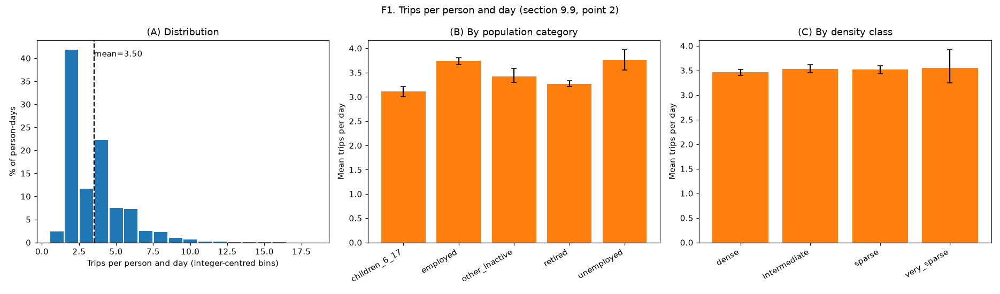

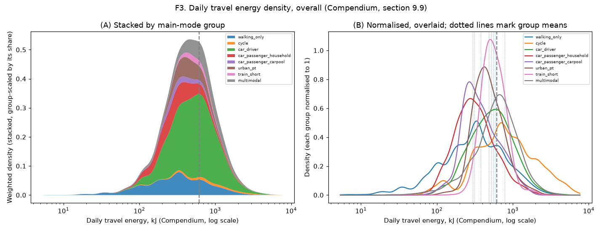

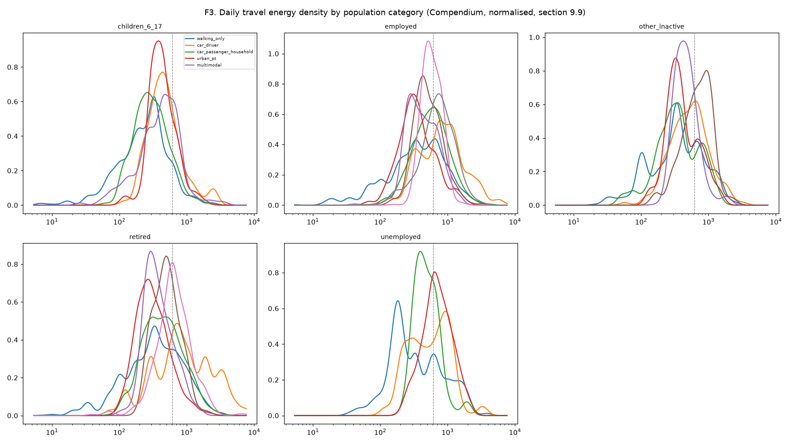

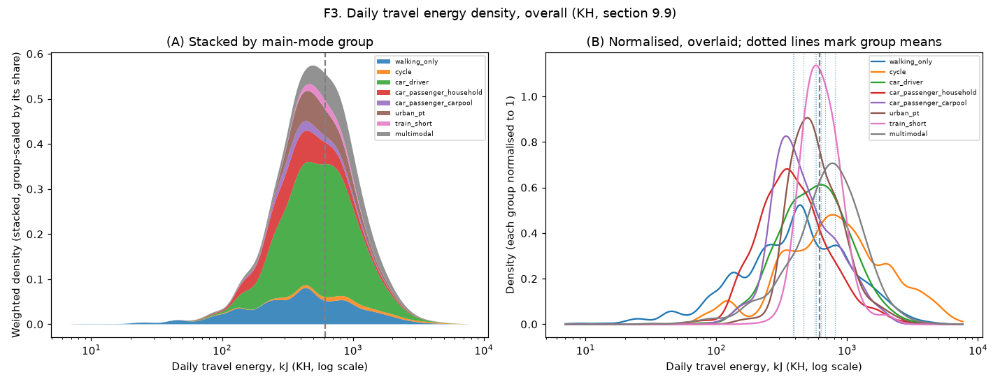

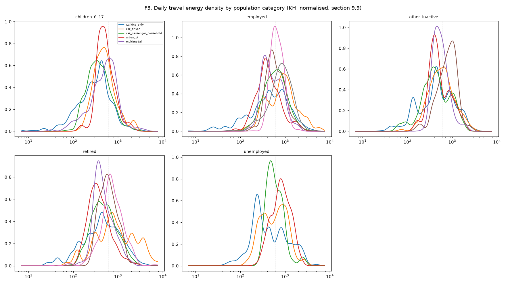

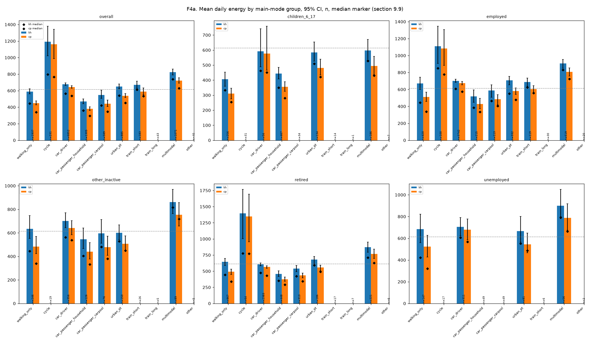

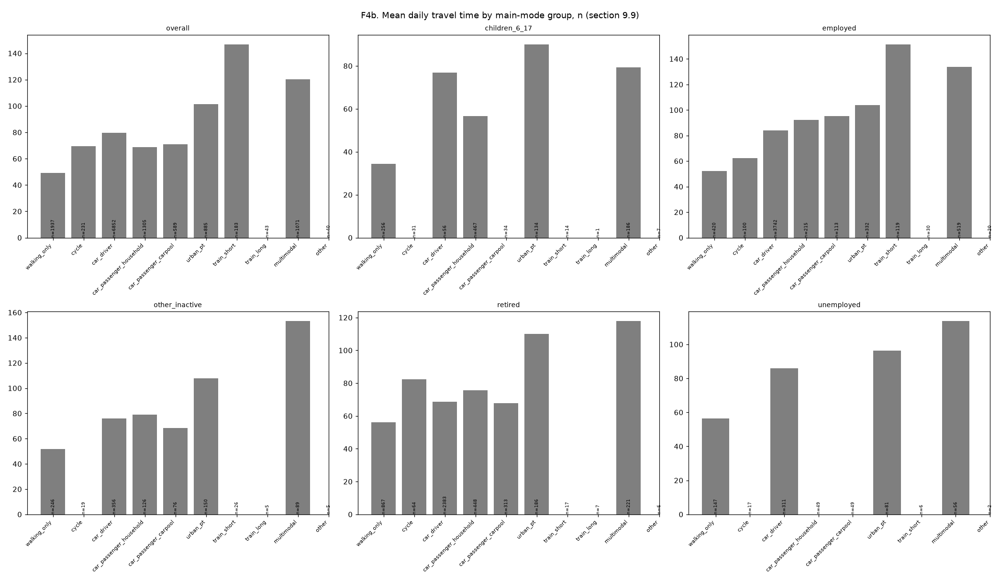

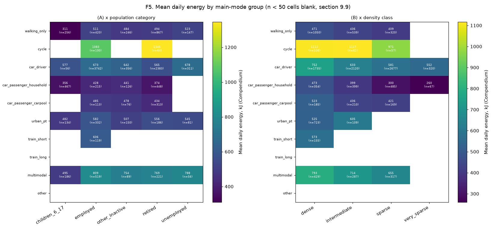

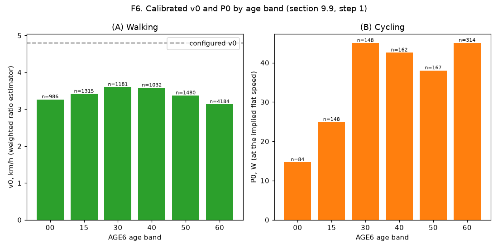

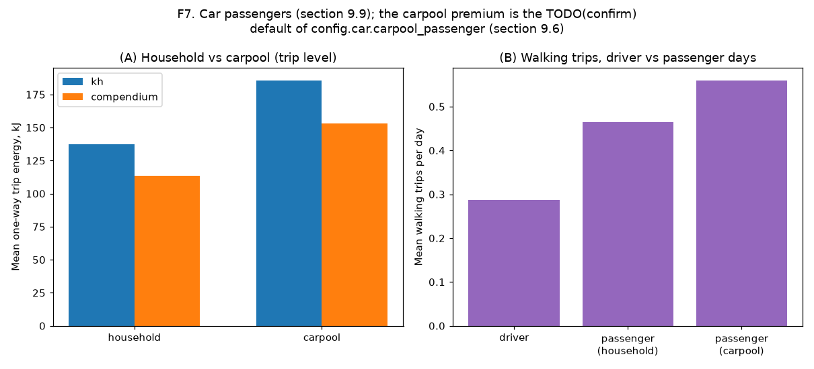

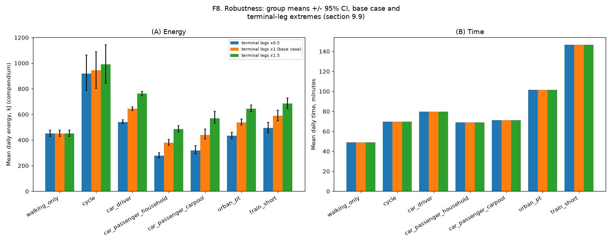

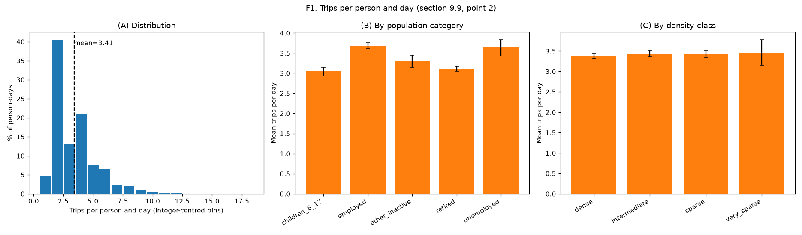

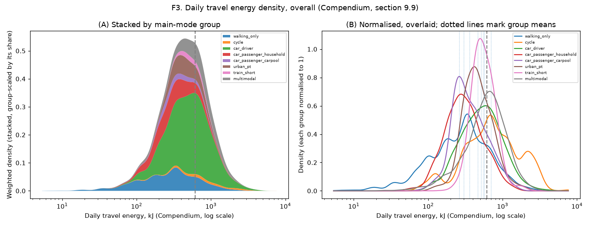

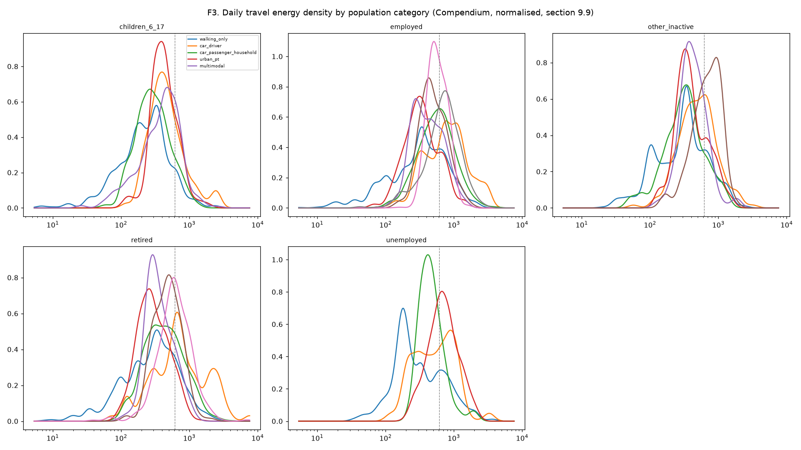

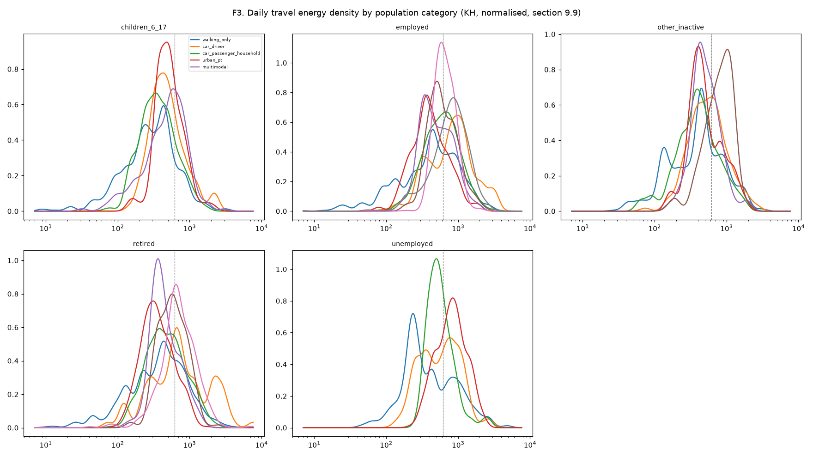

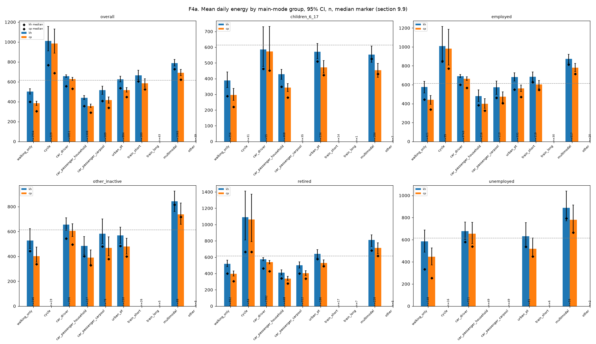

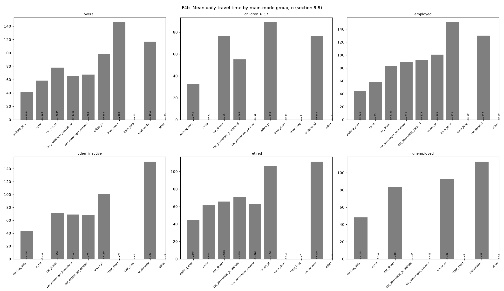

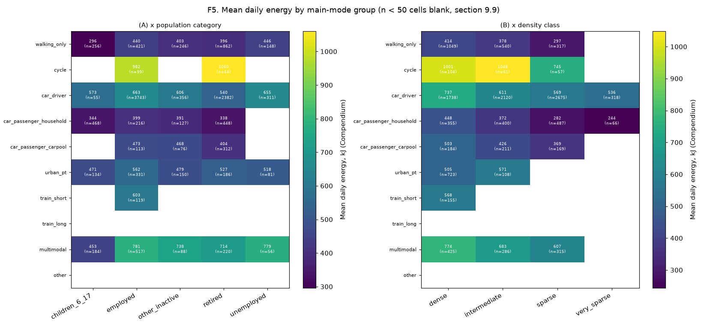

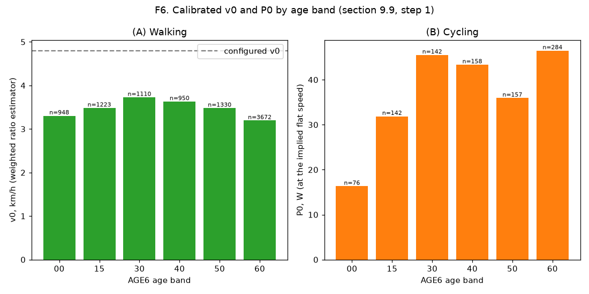

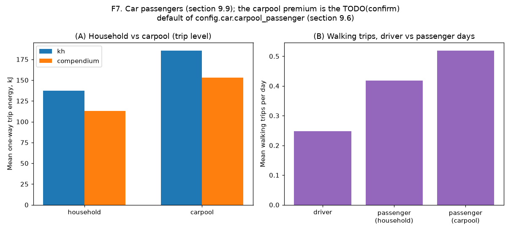

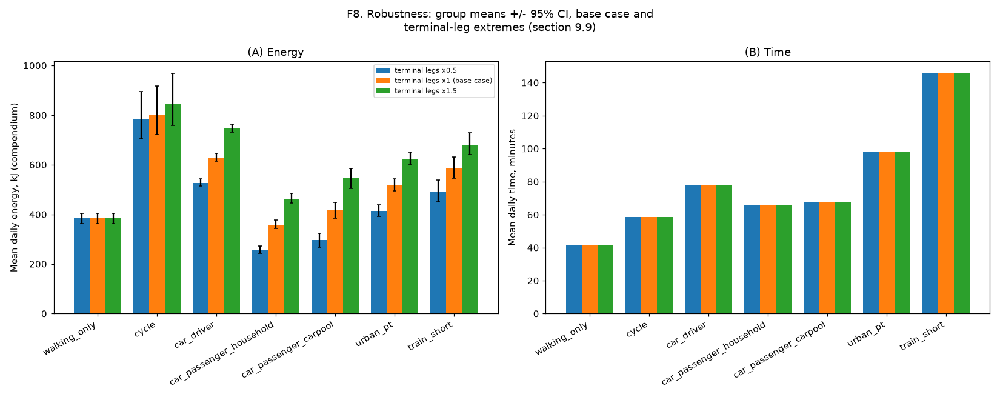

## Modelling notes and simplifications

- EMP 2019 gives no headway, station-depth or PT access-walk-distance data; `config.pt_ride.headway_min_am_peak`/`station_height_m`/`access_walk_m_by_density` are provisional TODO(confirm) defaults, used only by this step.
- Car terminal legs always use the apartment-density default: the public tables give no house/apartment split (section 9.6's `s_house`).
- `mode_group='other'` trips have no energy formula and contribute 0 kJ to a day's total; a day with only such trips is its own 'other' group, separate from 'multimodal'.
- The day's home density is the origin density of its home-departure trip (`MORIDOM=1`), or the first trip by number if no such trip is recorded that day.
- Bike get/park and stop-delay adjustment: unreliable (would consume over half, or all but under a minute, of a very short trip's declared duration) for a small share of cycling trips; these fall back to the naive whole-duration speed for both energy and the P0 estimator's ride-time denominator.
- F3/F4/F5 use the full set of day-mode groups (including multimodal and other); F8's robustness check is restricted to the six groups the task names (walk, bike, driver, both passenger groups, urban PT, train short).
- F8's figure shows bootstrap CIs for the base case and the terminal-legs x0.5/x1.5 extremes only (not every table variant), per the task's "figure ... for the base case and the extremes".
