# Step 11 (`mobgrid/budget`): EMP 2019 re-estimation (section 9.9) — Round-trip days · destination purposes · local (≤ 80 km)

**Scope:** Round-trip days · destination purposes · local (≤ 80 km) (`round-dest-local`).
**Days:** Monday-Friday; EMP 2019's all-days table is a sensitivity only.

Generated by `python -m mobgrid.budget.emp`. Rebuilds section 9.9's re-estimation steps 1-3 and 5 on the EMP 2019 public tables, plus the F8 robustness check; terminal legs reuse sections 9.4-9.7's formulas and `config/energy.yaml`'s already-calibrated car/stairs/waiting/PT-ride defaults, plus provisional PT headway/station-height/access-walk defaults (TODO(confirm), `config.pt_ride`). EMC² (step 4) and Ē_c (step 6) are out of scope. Same model parameters (`config/energy.yaml`) in both surveys: differences reflect behaviour, not the model (section 9.9, "Change between 2008 and 2019"). Density: `grid` (the INSEE grid, or section 9.9's urban-unit-status x residence-size proxy; ENTD 2008 always uses the proxy).

**Variables used** (K_DEPLOC unless noted): mode `mtp`; duration `DUREE`; distance `MDISTTOT_fin`; purpose `MMOTIFDES`/`MOTPREC` (read, not used by this step's formulas); companions `MACCOMPM`/`MACCOMPHM` (household vs carpool passenger split); day `TYPEJOUR`, `mobloc` (F8's local-trips variant); weights `POND_JOUR` (day) and `pond_indC` (K_INDIVIDU, individual); age band `AGE6` (TCM_IND_KISH); population category (section 6.1) from `SITUA` (TCM_IND_KISH) combined with `AGE` for the 6-17 children group; density of residence `TCM_MEN.DENSITECOM_RES`/`STATUTCOM_UU_RES` (27 October 2026 decision: the residence commune's own density, not a trip end's); non-traveller cross-check `MIMMOSEM` (K_INDIVIDU).

## Choices made

- EMP 2019: residents aged 6+ in every scope; 0 respondents removed (0 aged under 6; 0 age missing, including unmatched demographics). 13,825 respondents before, 13,825 after; the difference is fully accounted for by these age exclusions.

**Sample flow** (persons and days kept apart, section 9.9's "Change between 2008 and 2019"; one described day per respondent in EMP 2019, reference weekday in ENTD 2008; Monday-Friday only):

| Step | n |
|---|---|
| Respondents | 13,825 |
| Days with trips | 10,356 |
| Days with energy | 10,148 |
| Days within scope | 9,418 |
| Days within scope with energy | 9,244 |

455 of 13,825 respondents report no trip that day (3.3% unweighted, 2.6% by individual weight; reported apart per point 2).

## Main-mode-of-the-day groups (point 3)

walking only, bike, car driver, car passenger with a household driver, car passenger with a non-household driver (carpool), urban PT, train (short- and long-distance merged, step 11 round 8: train_long had too few observations to be a meaningful separate group), multimodal (two or more distinct non-walk modes in the day; driving and riding as a passenger count as two), other. **'other' contains:** powered two-wheelers under 50cm3 or unspecified (mtp 2.3-2.7), unspecified 3/4-wheeler (mtp 3.4), taxi/specialised/school transport (mtp 4.x), plane (mtp 7.x), boat (mtp 8.1), other/unspecified (mtp 9.1, missing, or the 9999 refusal code).

**Children as car drivers** (34 children_6_17 car_driver days): the raw `mtp` code is 3.1 (n=108, ages 6-17), 3.3 (n=5, ages 10-17). Both codes are `mtp` category 3 "Automobile" (3.1 "Conducteur", 3.3 "Tantot conducteur tantot passager"), not a two-wheeler code (2.x): no two-wheeler reclassification applies. `mtp` 3.1 includes "voiturette" (a license-free microcar, legal from age 14 in France), plausible for the 14-17 share, but not for the many 6-13 year olds here; most likely EMP's own household/accompanying-trip coding records the car's use rather than confirming the child personally drove.

## Density classes

INSEE's own 4-level grid names and order: dense (1, densely populated communes), intermediate (2), sparse (3, peu denses), very_sparse (4, tres peu denses). EMP 2019's `emp2019._DENSITY_LABEL_BY_CODE` maps `DENSITECOM_ORI`/`_DES` directly (grid); both surveys' `trip_legs.density_proxy_case_sql` computes the same four labels from the urban-unit-status x residence-size proxy of section 9.9's "Change between 2008 and 2019" when `density_source='proxy'` (this report: `grid`). `trip_legs._DENSITY_KEY_TRANSLATION` re-keys `config.car`/`config.pt_ride`'s existing density defaults (chosen for step 7 as `dense`/`urban`/`suburban`/`rural`) to these same INSEE names and order, checked against `data/raw/emp2019/emp2019-categories.pdf`'s "Degre de densite" table. `home_density` (every per-day/per-person table below) is the **residence** commune's own density (`trip_legs.residence_density`; 27 October 2026 decision), from `TCM_MEN.DENSITECOM_RES`/`STATUTCOM_UU_RES` (EMP 2019) or `Q_TCM_MENAGE.numcom_UUCat`/`TU99` (ENTD 2008, proxy only) -- not the density of the trip departing from home, which this replaces: that proxy was undefined for a day with no home-departing trip in scope, and was not a property of the person.

## Time budget: constancy across density classes (point 3)

The reference constant (section 9.9, 27 October 2026 decision): is mean daily travel time the same across density classes of residence, within each population category? Day with trips, selected scope. Cells of fewer than 50 persons blank. The 95% CI column (bootstrap over households) gives time the same treatment energy already has (section 9.9's income update).

| Category | Density | n | mean time (min) | 95% CI | p25 time (min) | median time (min) | p75 time (min) |
|---|---|---|---|---|---|---|---|
| children_6_17 | dense | 323 | 57.9 | [52.6, 62.9] | 25.0 | 45.0 | 80.0 |
| children_6_17 | intermediate | 237 | 46.9 | [42.6, 52.2] | 20.0 | 30.0 | 65.0 |
| children_6_17 | sparse | 235 | 50.3 | [46.8, 59.5] | 20.0 | 40.0 | 70.0 |
| children_6_17 | very_sparse | 25 | - | - | - | - | - |
| employed | dense | 1494 | 85.7 | [82.4, 88.5] | 45.0 | 75.0 | 115.0 |
| employed | intermediate | 1023 | 77.6 | [73.4, 82.1] | 40.0 | 61.0 | 95.0 |
| employed | sparse | 1309 | 81.8 | [78.6, 85.6] | 43.0 | 70.0 | 105.0 |
| employed | very_sparse | 152 | 84.5 | [71.4, 93.7] | 45.0 | 70.0 | 115.0 |
| unemployed | dense | 225 | 82.1 | [72.9, 90.8] | 40.0 | 75.0 | 115.0 |
| unemployed | intermediate | 144 | 74.7 | [61.2, 92.6] | 25.0 | 50.0 | 105.0 |
| unemployed | sparse | 118 | 56.4 | [47.2, 65.9] | 28.0 | 40.0 | 75.0 |
| unemployed | very_sparse | 11 | - | - | - | - | - |
| retired | dense | 1004 | 65.0 | [61.4, 69.4] | 30.0 | 50.0 | 90.0 |
| retired | intermediate | 948 | 55.7 | [52.4, 59.9] | 25.0 | 41.0 | 74.0 |
| retired | sparse | 1086 | 54.8 | [52.0, 58.6] | 20.0 | 40.0 | 70.0 |
| retired | very_sparse | 140 | 58.4 | [49.5, 66.6] | 25.0 | 45.0 | 80.0 |
| other_inactive | dense | 376 | 81.4 | [75.6, 87.6] | 40.0 | 70.0 | 115.0 |
| other_inactive | intermediate | 217 | 66.3 | [56.7, 77.4] | 30.0 | 50.0 | 85.0 |
| other_inactive | sparse | 150 | 70.2 | [61.3, 79.5] | 30.0 | 60.0 | 90.0 |
| other_inactive | very_sparse | 17 | - | - | - | - | - |

### Constancy summary

| Category | dense/very_sparse | max/min | CV across classes |
|---|---|---|---|
| children_6_17 | - | 1.24 | 0.09 |
| employed | 1.01 | 1.10 | 0.04 |
| unemployed | - | 1.46 | 0.15 |
| retired | 1.11 | 1.19 | 0.07 |
| other_inactive | - | 1.23 | 0.09 |

### Equivalence to the category mean (TOST)

Ratio of each density-class mean to its population-category mean; 90% household-bootstrap CI. `equivalent` means the full interval lies within the configured margin; `different` means it lies wholly outside; otherwise the result is `inconclusive`. Cells under 50 respondents are suppressed.

| Category | Group | n | Ratio to category mean | 90% CI | ±15% verdict | ±10% verdict |
|---|---|---|---|---|---|---|
| children_6_17 | dense | 325 | 1.083 | [1.024, 1.141] | equivalent | inconclusive |
| children_6_17 | intermediate | 247 | 0.887 | [0.809, 0.956] | inconclusive | inconclusive |
| children_6_17 | sparse | 263 | 0.983 | [0.903, 1.079] | equivalent | equivalent |
| children_6_17 | very_sparse | 26 | - | - | - | - |
| employed | dense | 1526 | 1.040 | [1.015, 1.065] | equivalent | equivalent |
| employed | intermediate | 1033 | 0.942 | [0.908, 0.981] | equivalent | equivalent |
| employed | sparse | 1331 | 0.996 | [0.965, 1.023] | equivalent | equivalent |
| employed | very_sparse | 155 | 1.003 | [0.912, 1.102] | equivalent | inconclusive |
| other_inactive | dense | 382 | 1.096 | [1.044, 1.154] | inconclusive | inconclusive |
| other_inactive | intermediate | 224 | 0.887 | [0.775, 0.993] | inconclusive | inconclusive |
| other_inactive | sparse | 155 | 0.943 | [0.837, 1.059] | inconclusive | inconclusive |
| other_inactive | very_sparse | 17 | - | - | - | - |
| retired | dense | 1023 | 1.106 | [1.063, 1.150] | inconclusive | inconclusive |
| retired | intermediate | 960 | 0.947 | [0.907, 0.987] | equivalent | equivalent |
| retired | sparse | 1096 | 0.941 | [0.905, 0.985] | equivalent | equivalent |
| retired | very_sparse | 143 | 0.979 | [0.864, 1.117] | equivalent | inconclusive |
| unemployed | dense | 227 | 1.111 | [1.015, 1.189] | inconclusive | inconclusive |
| unemployed | intermediate | 146 | 1.015 | [0.880, 1.171] | inconclusive | inconclusive |
| unemployed | sparse | 118 | 0.765 | [0.669, 0.876] | inconclusive | different |
| unemployed | very_sparse | 11 | - | - | - | - |

## Time budget: constancy across income quintiles (section 9.9's income update)

Household income per consumption unit (modified OECD scale), in quintiles computed within this survey with individual weights (`docs/data/entd2008.md`'s "Income variables"): is mean daily travel time the same across income quintiles, within each population category, as income is treated as density is? Day with trips, selected scope. `'unknown'` (missing/refused income) is its own class, excluded from the constancy summary (not an ordered quantile).

| Category | Income quintile | n | mean time (min) | 95% CI | p25 time (min) | median time (min) | p75 time (min) |
|---|---|---|---|---|---|---|---|
| children_6_17 | q1 | 224 | 56.2 | [49.4, 62.5] | 20.0 | 40.0 | 75.0 |
| children_6_17 | q2 | 174 | 48.8 | [45.0, 54.3] | 25.0 | 40.0 | 70.0 |
| children_6_17 | q3 | 151 | 51.3 | [47.0, 62.7] | 20.0 | 40.0 | 65.0 |
| children_6_17 | q4 | 156 | 51.0 | [44.3, 58.6] | 20.0 | 36.0 | 70.0 |
| children_6_17 | q5 | 115 | 56.3 | [48.4, 64.7] | 22.0 | 42.0 | 80.0 |
| employed | q1 | 380 | 74.1 | [67.2, 80.9] | 40.0 | 60.0 | 95.0 |
| employed | q2 | 656 | 78.9 | [72.4, 83.9] | 40.0 | 65.0 | 100.0 |
| employed | q3 | 837 | 81.8 | [77.8, 87.0] | 41.0 | 67.0 | 106.0 |
| employed | q4 | 962 | 82.7 | [78.1, 86.1] | 42.0 | 70.0 | 110.0 |
| employed | q5 | 1143 | 88.1 | [83.9, 91.3] | 50.0 | 80.0 | 115.0 |
| unemployed | q1 | 276 | 75.8 | [65.4, 86.1] | 30.0 | 60.0 | 97.0 |
| unemployed | q2 | 88 | 67.9 | [57.8, 80.5] | 30.0 | 56.8 | 90.0 |
| unemployed | q3 | 64 | 74.9 | [61.2, 88.2] | 33.0 | 60.0 | 120.0 |
| unemployed | q4 | 44 | - | - | - | - | - |
| unemployed | q5 | 26 | - | - | - | - | - |
| retired | q1 | 347 | 50.9 | [46.1, 58.4] | 20.0 | 35.0 | 70.0 |
| retired | q2 | 698 | 54.3 | [50.3, 58.2] | 20.0 | 40.0 | 70.0 |
| retired | q3 | 661 | 56.8 | [52.2, 61.1] | 25.0 | 45.0 | 75.0 |
| retired | q4 | 736 | 60.5 | [57.1, 64.3] | 29.0 | 45.0 | 82.0 |
| retired | q5 | 736 | 66.1 | [62.0, 70.9] | 30.0 | 50.0 | 90.0 |
| other_inactive | q1 | 360 | 69.6 | [63.0, 76.7] | 30.0 | 60.0 | 95.0 |
| other_inactive | q2 | 182 | 74.7 | [67.2, 83.5] | 35.0 | 64.0 | 110.0 |
| other_inactive | q3 | 100 | 78.9 | [66.3, 88.9] | 40.0 | 75.0 | 120.0 |
| other_inactive | q4 | 65 | 80.5 | [67.5, 96.5] | 36.0 | 55.0 | 110.0 |
| other_inactive | q5 | 53 | 80.4 | [60.4, 103.6] | 35.0 | 70.0 | 105.0 |

### Constancy summary

| Category | q5/q1 | max/min | CV across classes |
|---|---|---|---|
| children_6_17 | 1.00 | 1.15 | 0.06 |
| employed | 1.19 | 1.19 | 0.06 |
| unemployed | - | 1.12 | 0.05 |
| retired | 1.30 | 1.30 | 0.09 |
| other_inactive | 1.16 | 1.16 | 0.05 |

### Equivalence to the category mean (TOST)

Ratio of each income-quintile mean to its population-category mean; 90% household-bootstrap CI. `equivalent` means the full interval lies within the configured margin; `different` means it lies wholly outside; otherwise the result is `inconclusive`. Cells under 50 respondents are suppressed.

| Category | Group | n | Ratio to category mean | 90% CI | ±15% verdict | ±10% verdict |
|---|---|---|---|---|---|---|
| children_6_17 | q1 | 233 | 1.053 | [0.973, 1.132] | equivalent | inconclusive |
| children_6_17 | q2 | 184 | 0.926 | [0.843, 1.004] | inconclusive | inconclusive |
| children_6_17 | q3 | 165 | 1.013 | [0.916, 1.125] | equivalent | inconclusive |
| children_6_17 | q4 | 161 | 0.948 | [0.843, 1.061] | inconclusive | inconclusive |
| children_6_17 | q5 | 118 | 1.059 | [0.953, 1.178] | inconclusive | inconclusive |
| employed | q1 | 385 | 0.899 | [0.835, 0.954] | inconclusive | inconclusive |
| employed | q2 | 669 | 0.956 | [0.905, 1.011] | equivalent | equivalent |
| employed | q3 | 852 | 1.000 | [0.954, 1.038] | equivalent | equivalent |
| employed | q4 | 973 | 1.002 | [0.969, 1.040] | equivalent | equivalent |
| employed | q5 | 1166 | 1.067 | [1.031, 1.104] | equivalent | inconclusive |
| other_inactive | q1 | 369 | 0.931 | [0.874, 0.994] | equivalent | inconclusive |
| other_inactive | q2 | 189 | 1.017 | [0.923, 1.106] | equivalent | inconclusive |
| other_inactive | q3 | 101 | 1.053 | [0.924, 1.156] | inconclusive | inconclusive |
| other_inactive | q4 | 65 | 1.086 | [0.951, 1.283] | inconclusive | inconclusive |
| other_inactive | q5 | 54 | 1.078 | [0.844, 1.327] | inconclusive | inconclusive |
| retired | q1 | 358 | 0.887 | [0.814, 0.982] | inconclusive | inconclusive |
| retired | q2 | 711 | 0.926 | [0.870, 0.977] | equivalent | inconclusive |
| retired | q3 | 668 | 0.968 | [0.906, 1.019] | equivalent | equivalent |
| retired | q4 | 742 | 1.026 | [0.976, 1.072] | equivalent | equivalent |
| retired | q5 | 743 | 1.126 | [1.079, 1.186] | inconclusive | inconclusive |
| unemployed | q1 | 279 | 1.029 | [0.958, 1.102] | equivalent | inconclusive |
| unemployed | q2 | 89 | 0.921 | [0.786, 1.050] | inconclusive | inconclusive |
| unemployed | q3 | 64 | 1.016 | [0.863, 1.187] | inconclusive | inconclusive |
| unemployed | q4 | 44 | - | - | - | - |
| unemployed | q5 | 26 | - | - | - | - |

### Quintile shares and cut points

Quintiles are cut to hold equal shares of individual weight (28 October 2026 decision): a tied income value (common -- EMP 2019's `decile_rev_uc` has only 10 distinct values, and ENTD 2008's bracket-midpoint/`NBUC` often repeats) straddling a cut point is split between the two quintiles in proportion, by a seeded random draw (`trip_legs.build_income_quintile_table`). `'unknown'` (missing/refused income) is its own row, excluded from the 20/40/60/80% cut, with its own breakdown below of *why* a value is missing (`emp2019.missing_income_breakdown`): a producer-side gap (no `TCM_MEN` match at all for the respondent's household, or a matched household with a blank `decile_rev_uc`) -- this project's own code does nothing beyond the plain lookup, so there is no code-side failure mode to report here.

| Quintile | n | Share of individual weight | Share of day weight |
|---|---|---|---|
| q1 | 2504 | 20.0% | 18.8% |
| q2 | 2662 | 20.0% | 19.6% |
| q3 | 2742 | 20.0% | 19.6% |
| q4 | 2885 | 20.0% | 20.6% |
| q5 | 3032 | 20.0% | 21.4% |

Cut points (q1/q2, q2/q3, q3/q4, q4/q5): 2.0, 4.0, 6.0, 8.0.

Missing-income breakdown, of 13825 respondents: 0 (0.0%) with no matching household income record at all (a producer-side gap, not this project's code); 0 (0.0%) with a matched household but a blank `decile_rev_uc`.

## Trips per day and minutes per trip, by category, density and income quintile (section 9.9 point 2: daily time = trips/day x minutes/trip)

### Trips per day

#### By population category x density class

| Category | Density | n | mean trips/day | 95% CI | p25 trips/day | median trips/day | p75 trips/day |
|---|---|---|---|---|---|---|---|
| children_6_17 | dense | 325 | 3.12 | [2.94, 3.31] | 2.00 | 2.00 | 4.00 |
| children_6_17 | intermediate | 247 | 3.23 | [3.02, 3.43] | 2.00 | 3.00 | 4.00 |
| children_6_17 | sparse | 263 | 2.92 | [2.75, 3.08] | 2.00 | 2.00 | 4.00 |
| children_6_17 | very_sparse | 26 | - | - | - | - | - |
| employed | dense | 1526 | 3.77 | [3.66, 3.88] | 2.00 | 4.00 | 5.00 |
| employed | intermediate | 1033 | 3.87 | [3.72, 4.01] | 2.00 | 4.00 | 5.00 |
| employed | sparse | 1331 | 4.05 | [3.91, 4.20] | 2.00 | 4.00 | 5.00 |
| employed | very_sparse | 155 | 4.20 | [3.81, 4.68] | 2.00 | 4.00 | 5.00 |
| unemployed | dense | 227 | 3.84 | [3.51, 4.21] | 2.00 | 3.00 | 5.00 |
| unemployed | intermediate | 146 | 4.35 | [3.66, 5.11] | 2.00 | 3.00 | 6.00 |
| unemployed | sparse | 118 | 3.57 | [3.12, 4.09] | 2.00 | 3.00 | 4.00 |
| unemployed | very_sparse | 11 | - | - | - | - | - |
| retired | dense | 1023 | 3.20 | [3.08, 3.31] | 2.00 | 2.00 | 4.00 |
| retired | intermediate | 960 | 3.34 | [3.19, 3.49] | 2.00 | 3.00 | 4.00 |
| retired | sparse | 1096 | 3.17 | [3.05, 3.28] | 2.00 | 2.00 | 4.00 |
| retired | very_sparse | 143 | 3.20 | [2.88, 3.63] | 2.00 | 2.00 | 4.00 |
| other_inactive | dense | 382 | 3.36 | [3.09, 3.58] | 2.00 | 3.00 | 4.00 |
| other_inactive | intermediate | 224 | 3.62 | [3.32, 4.00] | 2.00 | 3.00 | 5.00 |
| other_inactive | sparse | 155 | 3.45 | [3.06, 3.86] | 2.00 | 2.00 | 4.00 |
| other_inactive | very_sparse | 17 | - | - | - | - | - |

#### By population category x income quintile

| Category | Income quintile | n | mean trips/day | 95% CI | p25 trips/day | median trips/day | p75 trips/day |
|---|---|---|---|---|---|---|---|
| children_6_17 | q1 | 233 | 3.29 | [3.04, 3.52] | 2.00 | 3.00 | 4.00 |
| children_6_17 | q2 | 184 | 3.03 | [2.81, 3.21] | 2.00 | 2.00 | 4.00 |
| children_6_17 | q3 | 165 | 2.87 | [2.66, 3.11] | 2.00 | 2.00 | 4.00 |
| children_6_17 | q4 | 161 | 3.12 | [2.86, 3.40] | 2.00 | 2.00 | 4.00 |
| children_6_17 | q5 | 118 | 3.04 | [2.80, 3.31] | 2.00 | 2.00 | 4.00 |
| employed | q1 | 385 | 3.83 | [3.59, 4.07] | 2.00 | 4.00 | 5.00 |
| employed | q2 | 669 | 4.07 | [3.83, 4.33] | 2.00 | 4.00 | 5.00 |
| employed | q3 | 852 | 3.86 | [3.71, 4.02] | 2.00 | 4.00 | 5.00 |
| employed | q4 | 973 | 3.91 | [3.78, 4.07] | 2.00 | 4.00 | 5.00 |
| employed | q5 | 1166 | 3.83 | [3.70, 3.97] | 2.00 | 4.00 | 5.00 |
| unemployed | q1 | 279 | 3.92 | [3.53, 4.29] | 2.00 | 3.00 | 5.00 |
| unemployed | q2 | 89 | 4.05 | [3.30, 4.73] | 2.00 | 4.00 | 6.00 |
| unemployed | q3 | 64 | 4.34 | [3.56, 5.24] | 2.00 | 3.00 | 7.00 |
| unemployed | q4 | 44 | - | - | - | - | - |
| unemployed | q5 | 26 | - | - | - | - | - |
| retired | q1 | 358 | 2.77 | [2.57, 2.98] | 2.00 | 2.00 | 3.00 |
| retired | q2 | 711 | 3.03 | [2.90, 3.17] | 2.00 | 2.00 | 4.00 |
| retired | q3 | 668 | 3.18 | [3.04, 3.34] | 2.00 | 2.00 | 4.00 |
| retired | q4 | 742 | 3.40 | [3.26, 3.55] | 2.00 | 3.00 | 4.00 |
| retired | q5 | 743 | 3.53 | [3.37, 3.71] | 2.00 | 3.00 | 4.00 |
| other_inactive | q1 | 369 | 3.35 | [3.10, 3.66] | 2.00 | 2.00 | 4.00 |
| other_inactive | q2 | 189 | 3.71 | [3.39, 4.11] | 2.00 | 3.00 | 4.00 |
| other_inactive | q3 | 101 | 3.33 | [3.04, 3.64] | 2.00 | 3.00 | 4.00 |
| other_inactive | q4 | 65 | 3.25 | [2.80, 3.78] | 2.00 | 2.00 | 4.00 |
| other_inactive | q5 | 54 | 3.56 | [2.84, 4.13] | 2.00 | 3.00 | 5.00 |

### Minutes per trip

#### By population category x density class

| Category | Density | n | mean min/trip | 95% CI | p25 min/trip | median min/trip | p75 min/trip |
|---|---|---|---|---|---|---|---|
| children_6_17 | dense | 325 | 20.25 | [18.31, 22.12] | 10.00 | 15.00 | 25.00 |
| children_6_17 | intermediate | 247 | 16.08 | [14.07, 17.81] | 7.50 | 12.14 | 20.00 |
| children_6_17 | sparse | 263 | 19.64 | [16.90, 22.39] | 7.50 | 15.00 | 25.00 |
| children_6_17 | very_sparse | 26 | - | - | - | - | - |
| employed | dense | 1526 | 26.09 | [25.00, 27.21] | 13.33 | 20.83 | 31.67 |
| employed | intermediate | 1033 | 22.98 | [21.55, 24.79] | 10.00 | 16.67 | 27.50 |
| employed | sparse | 1331 | 24.00 | [22.68, 25.37] | 11.67 | 18.75 | 30.00 |
| employed | very_sparse | 155 | 23.15 | [19.07, 28.73] | 10.00 | 16.00 | 28.75 |
| unemployed | dense | 227 | 24.30 | [21.15, 27.11] | 12.40 | 19.17 | 30.00 |
| unemployed | intermediate | 146 | 18.56 | [15.61, 22.69] | 10.00 | 14.17 | 21.00 |
| unemployed | sparse | 118 | 17.90 | [14.32, 21.33] | 10.00 | 12.50 | 18.67 |
| unemployed | very_sparse | 11 | - | - | - | - | - |
| retired | dense | 1023 | 21.84 | [20.38, 23.71] | 10.00 | 15.12 | 27.50 |
| retired | intermediate | 960 | 17.67 | [16.69, 18.65] | 10.00 | 14.00 | 21.67 |
| retired | sparse | 1096 | 18.54 | [17.37, 19.78] | 9.00 | 15.00 | 22.50 |
| retired | very_sparse | 143 | 18.99 | [16.94, 21.57] | 10.00 | 15.00 | 26.67 |
| other_inactive | dense | 382 | 27.57 | [25.27, 30.77] | 13.18 | 22.50 | 35.33 |
| other_inactive | intermediate | 224 | 20.33 | [16.90, 23.14] | 9.40 | 15.00 | 28.75 |
| other_inactive | sparse | 155 | 23.12 | [19.16, 26.93] | 10.00 | 16.67 | 30.00 |
| other_inactive | very_sparse | 17 | - | - | - | - | - |

#### By population category x income quintile

| Category | Income quintile | n | mean min/trip | 95% CI | p25 min/trip | median min/trip | p75 min/trip |
|---|---|---|---|---|---|---|---|
| children_6_17 | q1 | 233 | 18.72 | [16.41, 20.71] | 8.75 | 15.00 | 25.00 |
| children_6_17 | q2 | 184 | 17.52 | [15.61, 19.84] | 10.00 | 15.00 | 21.25 |
| children_6_17 | q3 | 165 | 21.50 | [17.96, 26.07] | 7.50 | 13.00 | 30.00 |
| children_6_17 | q4 | 161 | 17.30 | [14.75, 20.65] | 7.50 | 12.78 | 20.00 |
| children_6_17 | q5 | 118 | 20.27 | [16.76, 23.48] | 10.00 | 16.33 | 25.00 |
| employed | q1 | 385 | 21.99 | [20.11, 24.37] | 10.00 | 17.40 | 28.33 |
| employed | q2 | 669 | 23.50 | [21.14, 26.25] | 10.00 | 17.50 | 27.50 |
| employed | q3 | 852 | 24.03 | [22.77, 25.39] | 12.50 | 18.50 | 30.00 |
| employed | q4 | 973 | 24.23 | [22.88, 25.70] | 12.00 | 19.25 | 30.00 |
| employed | q5 | 1166 | 26.93 | [25.44, 28.63] | 13.33 | 21.25 | 35.00 |
| unemployed | q1 | 279 | 21.23 | [18.82, 23.75] | 10.00 | 15.00 | 26.25 |
| unemployed | q2 | 89 | 19.54 | [15.66, 24.46] | 10.00 | 15.00 | 22.50 |
| unemployed | q3 | 64 | 18.91 | [15.70, 22.46] | 11.00 | 15.33 | 22.50 |
| unemployed | q4 | 44 | - | - | - | - | - |
| unemployed | q5 | 26 | - | - | - | - | - |
| retired | q1 | 358 | 19.70 | [17.34, 22.62] | 10.00 | 13.75 | 25.00 |
| retired | q2 | 711 | 18.93 | [17.66, 20.23] | 10.00 | 15.00 | 22.50 |
| retired | q3 | 668 | 19.26 | [17.69, 20.83] | 10.00 | 15.00 | 23.33 |
| retired | q4 | 742 | 19.14 | [17.94, 20.56] | 10.00 | 15.00 | 25.00 |
| retired | q5 | 743 | 20.14 | [18.57, 22.16] | 10.00 | 15.00 | 25.00 |
| other_inactive | q1 | 369 | 22.93 | [20.53, 25.73] | 10.00 | 19.00 | 30.00 |
| other_inactive | q2 | 189 | 24.45 | [20.70, 27.69] | 10.00 | 16.67 | 35.00 |
| other_inactive | q3 | 101 | 26.67 | [21.74, 31.97] | 12.50 | 20.00 | 35.00 |
| other_inactive | q4 | 65 | 27.06 | [21.58, 32.79] | 13.75 | 17.50 | 35.00 |
| other_inactive | q5 | 54 | 25.12 | [18.48, 32.62] | 10.00 | 19.00 | 41.50 |

#### By density class and by income quintile (marginals)

| Group | n | weighted n | mean trips/day | 95% CI | p25 trips/day | median trips/day | p75 trips/day |
|---|---|---|---|---|---|---|---|
| dense | 3490 | 92,220,315 | 3.51 | [3.44, 3.57] | 2.00 | 3.00 | 4.00 |
| sparse | 2965 | 68,141,338 | 3.60 | [3.52, 3.68] | 2.00 | 3.00 | 4.00 |
| intermediate | 2611 | 63,799,208 | 3.63 | [3.52, 3.74] | 2.00 | 3.00 | 4.00 |
| very_sparse | 352 | 7,079,632 | 3.77 | [3.51, 4.09] | 2.00 | 4.00 | 5.00 |

| Group | n | weighted n | mean trips/day | 95% CI | p25 trips/day | median trips/day | p75 trips/day |
|---|---|---|---|---|---|---|---|
| q5 | 2107 | 49,415,493 | 3.66 | [3.57, 3.76] | 2.00 | 3.00 | 4.00 |
| q4 | 1990 | 47,741,502 | 3.63 | [3.55, 3.73] | 2.00 | 3.00 | 4.00 |
| q3 | 1850 | 45,345,913 | 3.52 | [3.43, 3.63] | 2.00 | 3.00 | 4.00 |
| q2 | 1843 | 45,229,151 | 3.57 | [3.46, 3.69] | 2.00 | 3.00 | 4.00 |
| q1 | 1628 | 43,508,435 | 3.48 | [3.37, 3.60] | 2.00 | 3.00 | 4.00 |

| Group | n | weighted n | mean min/trip | 95% CI | p25 min/trip | median min/trip | p75 min/trip |
|---|---|---|---|---|---|---|---|
| employed | 4045 | 108,861,371 | 24.55 | [23.74, 25.32] | 12.00 | 19.00 | 30.00 |
| retired | 3222 | 52,878,394 | 19.41 | [18.64, 20.11] | 10.00 | 15.00 | 24.00 |
| children_6_17 | 861 | 38,156,208 | 18.91 | [17.55, 20.43] | 8.75 | 15.00 | 23.33 |
| other_inactive | 778 | 19,411,691 | 24.49 | [22.61, 26.59] | 11.25 | 18.33 | 31.93 |
| unemployed | 502 | 11,800,111 | 20.91 | [18.80, 23.16] | 10.00 | 15.00 | 25.00 |

| Group | n | weighted n | mean min/trip | 95% CI | p25 min/trip | median min/trip | p75 min/trip |
|---|---|---|---|---|---|---|---|
| dense | 3490 | 92,220,315 | 24.34 | [23.51, 25.23] | 12.00 | 19.00 | 30.00 |
| sparse | 2965 | 68,141,338 | 21.65 | [20.87, 22.56] | 10.00 | 16.00 | 27.50 |
| intermediate | 2611 | 63,799,208 | 19.97 | [19.14, 20.84] | 10.00 | 15.00 | 25.00 |
| very_sparse | 352 | 7,079,632 | 21.37 | [18.96, 24.40] | 10.00 | 16.00 | 27.50 |

| Group | n | weighted n | mean min/trip | 95% CI | p25 min/trip | median min/trip | p75 min/trip |
|---|---|---|---|---|---|---|---|
| q5 | 2107 | 49,415,493 | 24.55 | [23.50, 25.78] | 11.67 | 18.75 | 30.00 |
| q4 | 1990 | 47,741,502 | 21.95 | [21.02, 22.90] | 10.00 | 16.43 | 27.50 |
| q3 | 1850 | 45,345,913 | 22.47 | [21.48, 23.63] | 10.00 | 16.75 | 28.33 |
| q2 | 1843 | 45,229,151 | 21.13 | [20.00, 22.38] | 10.00 | 15.00 | 25.00 |
| q1 | 1628 | 43,508,435 | 20.92 | [19.93, 22.15] | 10.00 | 15.00 | 27.50 |

## Per-person budget, days without trips included (section 9.9 point 2b)

Direct producer-weighted sum of selected-scope day values over the full respondent roster. EMP 2019 weekdays use Σ pond_jour × value ÷ 5 ÷ Σ pond_indC; ENTD 2008 uses the weighted reference-weekday total ÷ Σ POIDS_JOUR for the full Kish roster. The weekday estimates are comparable; EMP 2019 also reports the 7-day average, Σ pond_jour × value over the described week ÷ 7 ÷ Σ pond_indC.

Among described weekdays with trips (all motives), the producer-weighted share with zero local trips is 2.88% (285/10356 days; 7,371,178/255,634,487 weighted days).

### By population category

#### Weekday

| Category | n respondents | min/person/day | 95% CI |
|---|---:|---:|---|
| children_6_17 | 1256 | 42.6 | [39.9, 45.7] |
| employed | 5741 | 70.6 | [68.8, 72.9] |
| unemployed | 740 | 54.2 | [48.2, 60.9] |
| retired | 4907 | 39.2 | [37.6, 40.9] |
| other_inactive | 1168 | 52.9 | [48.6, 58.1] |
| overall | 13825 | 55.2 | [53.9, 56.7] |

#### Sensitivity: all days (Monday-Sunday)

| Category | n respondents | min/person/day | 95% CI |
|---|---:|---:|---|
| children_6_17 | 1256 | 40.6 | [38.0, 43.0] |
| employed | 5741 | 63.8 | [62.1, 65.5] |
| unemployed | 740 | 51.1 | [45.5, 56.3] |
| retired | 4907 | 36.4 | [35.2, 37.9] |
| other_inactive | 1168 | 50.9 | [47.2, 55.7] |
| overall | 13825 | 50.9 | [49.9, 52.0] |

### By population category x density class (weekday budget)

| Category | Density | n respondents | min/person/day | 95% CI |
|---|---|---:|---:|---|
| children_6_17 | dense | 463 | 48.9 | [43.7, 55.2] |
| children_6_17 | intermediate | 352 | 38.1 | [32.7, 43.5] |
| children_6_17 | sparse | 400 | 39.1 | [33.9, 44.4] |
| children_6_17 | very_sparse | 41 | - | - |
| employed | dense | 2182 | 73.3 | [69.8, 77.5] |
| employed | intermediate | 1502 | 64.2 | [59.9, 68.8] |
| employed | sparse | 1834 | 73.1 | [69.2, 77.8] |
| employed | very_sparse | 223 | 66.8 | [54.3, 77.4] |
| unemployed | dense | 325 | 63.0 | [53.3, 72.1] |
| unemployed | intermediate | 218 | 52.0 | [40.9, 68.1] |
| unemployed | sparse | 177 | 41.0 | [31.7, 50.2] |
| unemployed | very_sparse | 20 | - | - |
| retired | dense | 1521 | 46.5 | [43.1, 50.4] |
| retired | intermediate | 1512 | 36.4 | [33.6, 39.3] |
| retired | sparse | 1660 | 35.2 | [32.7, 37.8] |
| retired | very_sparse | 214 | 36.0 | [28.9, 44.2] |
| other_inactive | dense | 579 | 61.1 | [54.4, 68.6] |
| other_inactive | intermediate | 318 | 49.0 | [40.6, 58.5] |
| other_inactive | sparse | 246 | 42.4 | [33.2, 51.2] |
| other_inactive | very_sparse | 25 | - | - |

### By population category x income quintile (weekday budget)

| Category | Income quintile | n respondents | min/person/day | 95% CI |
|---|---|---:|---:|---|
| children_6_17 | q1 | 345 | 44.1 | [37.4, 50.6] |
| children_6_17 | q2 | 282 | 37.9 | [33.0, 43.9] |
| children_6_17 | q3 | 232 | 44.4 | [36.4, 51.9] |
| children_6_17 | q4 | 238 | 40.1 | [32.6, 47.6] |
| children_6_17 | q5 | 159 | 48.6 | [40.6, 57.2] |
| employed | q1 | 545 | 61.6 | [54.7, 68.2] |
| employed | q2 | 899 | 69.2 | [63.9, 75.8] |
| employed | q3 | 1229 | 69.1 | [64.3, 73.8] |
| employed | q4 | 1407 | 69.8 | [65.4, 73.8] |
| employed | q5 | 1661 | 77.5 | [73.7, 81.3] |
| unemployed | q1 | 414 | 54.7 | [45.9, 64.6] |
| unemployed | q2 | 145 | 45.3 | [35.6, 57.4] |
| unemployed | q3 | 86 | 58.8 | [41.7, 77.5] |
| unemployed | q4 | 59 | 65.9 | [44.1, 90.6] |
| unemployed | q5 | 36 | - | - |
| retired | q1 | 646 | 28.1 | [24.6, 32.4] |
| retired | q2 | 1065 | 35.3 | [32.3, 39.3] |
| retired | q3 | 1034 | 36.1 | [32.8, 39.8] |
| retired | q4 | 1078 | 44.3 | [41.1, 48.5] |
| retired | q5 | 1084 | 48.3 | [43.8, 52.7] |
| other_inactive | q1 | 549 | 49.1 | [41.8, 56.8] |
| other_inactive | q2 | 269 | 54.7 | [45.3, 64.2] |
| other_inactive | q3 | 160 | 52.0 | [38.9, 65.4] |
| other_inactive | q4 | 98 | 60.0 | [41.3, 76.8] |
| other_inactive | q5 | 92 | 59.1 | [36.2, 83.5] |

## Mean daily energy and time by main-mode group (point 3)

| Group | n | weighted n | mean time (min) | p25 time (min) | median time (min) | p75 time (min) | mean energy kh (kJ) | p25 energy kh (kJ) | median energy kh (kJ) | p75 energy kh (kJ) | 95% CI | mean energy compendium (kJ) | p25 energy compendium (kJ) | median energy compendium (kJ) | p75 energy compendium (kJ) | 95% CI |
|---|---|---|---|---|---|---|---|---|---|---|---|---|---|---|---|
| car_driver | 5127 | 116,061,625 | 71.5 | 35.0 | 60.0 | 94.0 | 385.8 | 180.6 | 305.9 | 504.0 | [376.3, 396.3] | 438.2 | 216.7 | 357.6 | 568.9 | [428.9, 448.7] |
| walking_only | 1196 | 31,213,973 | 38.8 | 20.0 | 30.0 | 50.0 | 474.9 | 196.3 | 355.2 | 598.9 | [447.6, 504.7] | 362.5 | 149.9 | 271.1 | 457.2 | [341.6, 385.2] |
| multimodal | 750 | 21,927,779 | 100.4 | 58.0 | 90.0 | 130.0 | 495.5 | 185.1 | 397.9 | 719.4 | [465.5, 529.7] | 467.7 | 190.4 | 406.3 | 657.7 | [440.5, 497.0] |
| car_passenger_household | 781 | 21,806,523 | 53.6 | 25.0 | 40.0 | 70.0 | 211.7 | 52.5 | 124.8 | 267.6 | [187.9, 239.2] | 182.6 | 56.9 | 117.0 | 227.7 | [163.4, 203.0] |
| urban_pt | 699 | 19,828,058 | 93.5 | 60.0 | 85.0 | 120.0 | 626.4 | 350.5 | 562.6 | 785.8 | [591.1, 655.1] | 515.5 | 303.5 | 465.5 | 652.8 | [488.9, 537.7] |
| car_passenger_carpool | 364 | 5,529,716 | 59.5 | 30.0 | 45.0 | 75.0 | 244.4 | 66.6 | 141.6 | 299.9 | [203.1, 276.6] | 211.1 | 63.9 | 128.5 | 271.5 | [177.7, 238.3] |
| train | 149 | 4,746,923 | 145.9 | 95.0 | 125.0 | 180.0 | 826.5 | 527.7 | 646.1 | 1001.6 | [726.3, 953.6] | 701.6 | 446.0 | 566.3 | 857.6 | [621.5, 809.7] |
| cycle | 154 | 4,398,930 | 52.4 | 25.0 | 45.0 | 70.0 | 718.3 | 348.5 | 611.9 | 933.6 | [627.2, 827.0] | 697.7 | 344.6 | 590.0 | 907.0 | [607.8, 799.5] |
| other | 24 | 925,830 | 109.0 | 60.0 | 88.0 | 120.0 | 342.7 | 133.2 | 330.4 | 444.0 | [226.6, 486.0] | 261.6 | 101.7 | 252.2 | 338.9 | [173.0, 371.0] |

## Data-quality correction: implausible door-to-door speeds

Trips are corrected, not dropped (section 9.9, step 11 round 5): flagged above an upper speed bound only -- walk > 7 km/h, bike > 35 km/h, car (driver or passenger) > 130 km/h -- their declared distance is replaced by declared duration x the mode's own median speed (from its not-flagged trips). Cycling energy's main work term is time-based (round 4), but its "stops" sub-term still multiplies by distance and by the distance-derived ride speed squared (section 9.7), so a flagged bike trip's distance is corrected too, like walk and car (round 9).

- car_driver: 0 of 18,516 trips corrected
- car_passenger_carpool: 0 of 1,259 trips corrected
- car_passenger_household: 0 of 2,628 trips corrected
- cycle: 0 of 689 trips corrected
- other: 0 of 709 trips corrected
- train: 0 of 455 trips corrected
- urban_pt: 0 of 1,899 trips corrected
- walk: 923 of 6,211 trips corrected

## Mean daily energy and time by main-mode group, overall and by population category (F4)

### overall

| Group | n | weighted n | mean time (min) | p25 time (min) | median time (min) | p75 time (min) | mean energy kh (kJ) | p25 energy kh (kJ) | median energy kh (kJ) | p75 energy kh (kJ) | 95% CI | mean energy compendium (kJ) | p25 energy compendium (kJ) | median energy compendium (kJ) | p75 energy compendium (kJ) | 95% CI |
|---|---|---|---|---|---|---|---|---|---|---|---|---|---|---|---|
| car_driver | 5127 | 116,061,625 | 71.5 | 35.0 | 60.0 | 94.0 | 385.8 | 180.6 | 305.9 | 504.0 | [376.3, 396.3] | 438.2 | 216.7 | 357.6 | 568.9 | [428.9, 448.7] |
| walking_only | 1196 | 31,213,973 | 38.8 | 20.0 | 30.0 | 50.0 | 474.9 | 196.3 | 355.2 | 598.9 | [447.6, 504.7] | 362.5 | 149.9 | 271.1 | 457.2 | [341.6, 385.2] |
| multimodal | 750 | 21,927,779 | 100.4 | 58.0 | 90.0 | 130.0 | 495.5 | 185.1 | 397.9 | 719.4 | [465.5, 529.7] | 467.7 | 190.4 | 406.3 | 657.7 | [440.5, 497.0] |
| car_passenger_household | 781 | 21,806,523 | 53.6 | 25.0 | 40.0 | 70.0 | 211.7 | 52.5 | 124.8 | 267.6 | [187.9, 239.2] | 182.6 | 56.9 | 117.0 | 227.7 | [163.4, 203.0] |
| urban_pt | 699 | 19,828,058 | 93.5 | 60.0 | 85.0 | 120.0 | 626.4 | 350.5 | 562.6 | 785.8 | [591.1, 655.1] | 515.5 | 303.5 | 465.5 | 652.8 | [488.9, 537.7] |
| car_passenger_carpool | 364 | 5,529,716 | 59.5 | 30.0 | 45.0 | 75.0 | 244.4 | 66.6 | 141.6 | 299.9 | [203.1, 276.6] | 211.1 | 63.9 | 128.5 | 271.5 | [177.7, 238.3] |
| train | 149 | 4,746,923 | 145.9 | 95.0 | 125.0 | 180.0 | 826.5 | 527.7 | 646.1 | 1001.6 | [726.3, 953.6] | 701.6 | 446.0 | 566.3 | 857.6 | [621.5, 809.7] |
| cycle | 154 | 4,398,930 | 52.4 | 25.0 | 45.0 | 70.0 | 718.3 | 348.5 | 611.9 | 933.6 | [627.2, 827.0] | 697.7 | 344.6 | 590.0 | 907.0 | [607.8, 799.5] |
| other | 24 | 925,830 | 109.0 | 60.0 | 88.0 | 120.0 | 342.7 | 133.2 | 330.4 | 444.0 | [226.6, 486.0] | 261.6 | 101.7 | 252.2 | 338.9 | [173.0, 371.0] |

### children_6_17

| Group | n | weighted n | mean time (min) | p25 time (min) | median time (min) | p75 time (min) | mean energy kh (kJ) | p25 energy kh (kJ) | median energy kh (kJ) | p75 energy kh (kJ) | 95% CI | mean energy compendium (kJ) | p25 energy compendium (kJ) | median energy compendium (kJ) | p75 energy compendium (kJ) | 95% CI |
|---|---|---|---|---|---|---|---|---|---|---|---|---|---|---|---|
| car_passenger_household | 293 | 12,328,907 | 45.1 | 20.0 | 35.0 | 60.0 | 191.5 | 45.0 | 112.5 | 233.3 | [160.8, 230.6] | 163.3 | 43.9 | 112.7 | 200.6 | [141.0, 193.3] |
| walking_only | 181 | 9,400,387 | 33.3 | 20.0 | 25.0 | 40.0 | 387.6 | 177.6 | 287.4 | 475.7 | [342.3, 436.0] | 295.8 | 135.6 | 219.4 | 363.1 | [261.3, 332.8] |
| multimodal | 139 | 5,518,645 | 68.0 | 35.0 | 60.0 | 88.0 | 263.1 | 60.0 | 144.9 | 330.8 | [213.8, 320.0] | 228.8 | 62.5 | 141.9 | 288.9 | [188.6, 275.2] |
| urban_pt | 118 | 5,163,112 | 85.6 | 55.0 | 75.0 | 110.0 | 496.8 | 260.2 | 439.1 | 669.0 | [431.0, 559.3] | 414.8 | 222.7 | 357.3 | 563.9 | [360.3, 465.2] |
| car_driver | 34 | 1,562,427 | 56.2 | 30.0 | 49.0 | 80.0 | 295.3 | 168.0 | 252.0 | 378.0 | [242.8, 357.9] | 334.0 | 210.0 | 312.4 | 463.2 | [278.5, 392.4] |
| car_passenger_carpool | 19 | 897,560 | 42.8 | 20.0 | 30.0 | 60.0 | 131.3 | 36.6 | 108.9 | 183.3 | [82.4, 202.1] | 119.6 | 39.0 | 95.9 | 180.8 | [76.1, 175.5] |
| train | 13 | 773,832 | 95.4 | 75.0 | 90.0 | 110.0 | 585.3 | 507.6 | 542.5 | 645.0 | [479.4, 701.5] | 493.5 | 434.9 | 446.9 | 539.4 | [417.2, 593.8] |
| cycle | 17 | 679,690 | 39.9 | 26.0 | 30.0 | 50.0 | 527.0 | 355.2 | 433.9 | 565.2 | [368.9, 749.2] | 512.5 | 355.2 | 420.8 | 565.2 | [360.1, 720.8] |
| other | 6 | 205,083 | 77.1 | 60.0 | 88.0 | 100.0 | 322.6 | 155.4 | 444.0 | 444.0 | [124.4, 444.0] | 246.3 | 118.6 | 338.9 | 338.9 | [94.9, 338.9] |

### employed

| Group | n | weighted n | mean time (min) | p25 time (min) | median time (min) | p75 time (min) | mean energy kh (kJ) | p25 energy kh (kJ) | median energy kh (kJ) | p75 energy kh (kJ) | 95% CI | mean energy compendium (kJ) | p25 energy compendium (kJ) | median energy compendium (kJ) | p75 energy compendium (kJ) | 95% CI |
|---|---|---|---|---|---|---|---|---|---|---|---|---|---|---|---|
| car_driver | 2788 | 73,719,865 | 78.0 | 42.4 | 65.0 | 100.0 | 407.3 | 216.1 | 344.4 | 525.0 | [393.9, 421.0] | 470.2 | 260.0 | 403.7 | 598.7 | [454.4, 484.6] |
| multimodal | 360 | 10,509,316 | 115.8 | 70.0 | 105.0 | 150.0 | 607.5 | 296.0 | 510.1 | 861.6 | [552.2, 653.2] | 584.5 | 325.0 | 503.8 | 763.5 | [538.1, 625.5] |
| urban_pt | 249 | 6,989,399 | 97.1 | 64.0 | 90.0 | 120.0 | 710.4 | 448.0 | 645.1 | 894.3 | [652.8, 760.1] | 580.9 | 380.2 | 535.5 | 712.7 | [537.4, 619.3] |
| walking_only | 251 | 6,766,228 | 41.9 | 20.0 | 35.0 | 56.0 | 564.8 | 222.0 | 444.0 | 774.1 | [492.2, 636.3] | 431.1 | 169.5 | 338.9 | 590.9 | [375.7, 485.7] |
| train | 102 | 2,834,199 | 156.3 | 105.0 | 141.0 | 195.0 | 858.8 | 556.6 | 753.5 | 1056.8 | [756.4, 971.3] | 731.5 | 491.4 | 661.6 | 904.9 | [647.2, 823.9] |
| cycle | 74 | 2,336,324 | 56.7 | 30.0 | 50.0 | 72.0 | 773.0 | 420.8 | 677.3 | 1001.0 | [653.4, 900.3] | 746.2 | 420.8 | 635.3 | 997.9 | [636.5, 866.8] |
| car_passenger_household | 82 | 1,949,706 | 70.3 | 34.0 | 50.0 | 85.0 | 240.7 | 110.0 | 207.6 | 317.6 | [193.5, 293.1] | 212.3 | 105.6 | 185.7 | 270.4 | [173.9, 255.5] |
| car_passenger_carpool | 59 | 1,017,320 | 73.3 | 37.0 | 55.0 | 100.0 | 276.1 | 81.6 | 194.2 | 337.6 | [210.0, 353.5] | 241.0 | 87.8 | 192.4 | 301.2 | [188.2, 301.2] |
| other | 13 | 654,900 | 123.1 | 80.0 | 105.0 | 155.0 | 349.2 | 133.2 | 330.4 | 377.4 | [211.0, 486.2] | 266.6 | 101.7 | 252.2 | 288.1 | [161.1, 371.1] |

### unemployed

| Group | n | weighted n | mean time (min) | p25 time (min) | median time (min) | p75 time (min) | mean energy kh (kJ) | p25 energy kh (kJ) | median energy kh (kJ) | p75 energy kh (kJ) | 95% CI | mean energy compendium (kJ) | p25 energy compendium (kJ) | median energy compendium (kJ) | p75 energy compendium (kJ) | 95% CI |
|---|---|---|---|---|---|---|---|---|---|---|---|---|---|---|---|
| car_driver | 240 | 5,593,605 | 68.1 | 30.0 | 57.0 | 100.0 | 426.6 | 138.2 | 312.4 | 546.0 | [348.6, 554.8] | 460.7 | 162.5 | 363.2 | 647.8 | [389.4, 568.8] |
| walking_only | 93 | 1,962,839 | 45.8 | 20.0 | 25.0 | 60.0 | 545.4 | 222.0 | 296.0 | 660.4 | [403.3, 678.9] | 416.3 | 169.5 | 225.9 | 504.1 | [307.8, 518.2] |
| urban_pt | 63 | 1,519,192 | 97.6 | 60.0 | 90.0 | 120.0 | 692.0 | 427.0 | 584.9 | 840.6 | [557.5, 858.8] | 565.6 | 362.9 | 465.5 | 662.4 | [459.9, 697.3] |
| multimodal | 40 | 1,215,002 | 98.6 | 60.0 | 90.0 | 135.0 | 531.4 | 258.8 | 441.9 | 759.8 | [411.8, 671.5] | 508.4 | 259.4 | 428.1 | 658.8 | [393.7, 652.1] |
| car_passenger_household | 22 | 537,600 | 50.8 | 25.0 | 30.0 | 75.0 | 326.0 | 45.0 | 142.6 | 272.6 | [136.7, 606.9] | 262.5 | 48.8 | 116.0 | 215.8 | [119.6, 474.9] |
| car_passenger_carpool | 25 | 504,643 | 59.6 | 22.0 | 45.0 | 80.0 | 361.0 | 81.0 | 240.0 | 540.0 | [209.9, 551.6] | 296.0 | 72.9 | 202.2 | 428.1 | [177.2, 445.0] |
| cycle | 9 | 192,595 | 85.2 | 60.0 | 80.0 | 120.0 | 1224.5 | 835.9 | 1310.1 | 1677.5 | [804.0, 1609.5] | 1184.5 | 835.9 | 1127.4 | 1677.5 | [786.0, 1609.5] |
| train | 5 | 148,246 | 319.9 | 180.0 | 315.0 | 460.0 | 2001.9 | 1233.0 | 1365.3 | 3134.0 | [781.2, 3134.0] | 1683.6 | 1025.9 | 1223.8 | 2610.7 | [698.7, 2610.7] |
| other | 1 | 17,329 | 70.0 | 70.0 | 70.0 | 70.0 | 55.5 | 55.5 | 55.5 | 55.5 | [55.5, 55.5] | 42.4 | 42.4 | 42.4 | 42.4 | [42.4, 42.4] |

### retired

| Group | n | weighted n | mean time (min) | p25 time (min) | median time (min) | p75 time (min) | mean energy kh (kJ) | p25 energy kh (kJ) | median energy kh (kJ) | p75 energy kh (kJ) | 95% CI | mean energy compendium (kJ) | p25 energy compendium (kJ) | median energy compendium (kJ) | p75 energy compendium (kJ) | 95% CI |
|---|---|---|---|---|---|---|---|---|---|---|---|---|---|---|---|
| car_driver | 1798 | 29,230,292 | 57.7 | 25.0 | 45.0 | 75.0 | 332.4 | 126.0 | 237.1 | 435.0 | [317.6, 349.6] | 364.9 | 162.5 | 270.8 | 487.5 | [349.5, 381.5] |
| walking_only | 514 | 9,629,257 | 37.7 | 17.0 | 30.0 | 50.0 | 446.1 | 133.2 | 355.2 | 572.6 | [408.2, 495.1] | 340.5 | 101.7 | 271.1 | 437.1 | [311.6, 377.9] |
| car_passenger_household | 303 | 5,054,776 | 63.1 | 30.0 | 50.0 | 80.0 | 192.7 | 67.5 | 126.6 | 252.6 | [173.4, 218.0] | 174.3 | 72.6 | 121.4 | 233.1 | [159.3, 195.4] |
| multimodal | 153 | 2,629,176 | 100.6 | 60.0 | 90.0 | 129.0 | 564.5 | 261.6 | 431.0 | 740.7 | [490.1, 648.4] | 528.7 | 298.7 | 422.5 | 718.0 | [463.8, 596.7] |
| urban_pt | 147 | 2,510,198 | 92.3 | 60.0 | 85.0 | 120.0 | 661.5 | 389.3 | 572.7 | 907.3 | [586.5, 733.9] | 536.8 | 339.7 | 483.0 | 719.2 | [476.5, 592.0] |
| car_passenger_carpool | 209 | 2,236,944 | 58.0 | 30.0 | 45.0 | 75.0 | 264.6 | 57.1 | 152.1 | 368.3 | [209.1, 326.9] | 225.1 | 55.3 | 152.8 | 337.5 | [183.6, 272.7] |
| cycle | 39 | 798,610 | 47.8 | 15.0 | 40.0 | 75.0 | 672.6 | 216.9 | 521.6 | 1036.9 | [487.4, 960.7] | 666.6 | 217.6 | 521.6 | 1036.9 | [483.1, 950.5] |
| train | 13 | 209,131 | 167.7 | 120.0 | 165.0 | 270.0 | 1221.9 | 632.7 | 1481.2 | 1636.7 | [843.7, 1652.7] | 1004.1 | 544.1 | 1192.9 | 1388.8 | [703.7, 1353.9] |
| other | 2 | 32,791 | 50.6 | 50.0 | 50.0 | 50.0 | 303.7 | 310.8 | 310.8 | 310.8 | [199.8, 310.8] | 231.8 | 237.2 | 237.2 | 237.2 | [152.5, 237.2] |

### other_inactive

| Group | n | weighted n | mean time (min) | p25 time (min) | median time (min) | p75 time (min) | mean energy kh (kJ) | p25 energy kh (kJ) | median energy kh (kJ) | p75 energy kh (kJ) | 95% CI | mean energy compendium (kJ) | p25 energy compendium (kJ) | median energy compendium (kJ) | p75 energy compendium (kJ) | 95% CI |
|---|---|---|---|---|---|---|---|---|---|---|---|---|---|---|---|
| car_driver | 263 | 5,907,614 | 65.1 | 30.0 | 50.0 | 85.0 | 366.0 | 138.2 | 252.0 | 483.8 | [322.2, 412.4] | 409.1 | 162.5 | 301.4 | 568.6 | [363.3, 454.5] |
| urban_pt | 120 | 3,607,085 | 97.1 | 62.0 | 90.0 | 130.0 | 596.3 | 352.3 | 540.8 | 706.2 | [524.6, 677.4] | 496.7 | 315.0 | 436.5 | 580.9 | [439.8, 559.6] |
| walking_only | 156 | 3,446,139 | 46.5 | 20.0 | 35.0 | 63.0 | 577.2 | 266.4 | 444.0 | 740.0 | [483.5, 671.7] | 440.6 | 203.4 | 338.9 | 564.9 | [369.1, 512.7] |
| multimodal | 58 | 2,055,640 | 109.8 | 60.0 | 85.0 | 155.0 | 437.2 | 215.7 | 402.8 | 580.9 | [357.6, 506.0] | 409.9 | 219.2 | 401.1 | 554.7 | [342.4, 476.8] |
| car_passenger_household | 81 | 1,935,534 | 66.5 | 30.0 | 50.0 | 109.0 | 328.8 | 52.5 | 128.8 | 372.6 | [198.7, 539.2] | 274.9 | 56.9 | 132.4 | 346.8 | [172.0, 434.8] |
| car_passenger_carpool | 50 | 857,553 | 63.7 | 30.0 | 45.0 | 75.0 | 205.4 | 66.9 | 116.6 | 276.6 | [143.7, 278.2] | 185.7 | 71.5 | 112.1 | 242.4 | [135.7, 247.4] |
| train | 15 | 760,506 | 119.4 | 106.0 | 120.0 | 150.0 | 612.0 | 439.0 | 594.4 | 708.1 | [456.7, 849.4] | 526.5 | 438.7 | 505.8 | 587.9 | [397.1, 709.1] |
| cycle | 15 | 391,711 | 41.3 | 20.0 | 25.0 | 60.0 | 567.7 | 279.7 | 348.5 | 832.2 | [369.6, 1045.9] | 553.3 | 279.7 | 348.5 | 734.2 | [361.9, 1042.0] |
| other | 2 | 15,727 | 101.2 | 20.0 | 135.0 | 135.0 | 729.6 | 199.8 | 949.7 | 949.7 | [199.8, 949.7] | 556.9 | 152.5 | 725.0 | 725.0 | [152.5, 725.0] |

## By population category (section 6.1)

| Group | n | weighted n | mean time (min) | p25 time (min) | median time (min) | p75 time (min) | mean energy kh (kJ) | p25 energy kh (kJ) | median energy kh (kJ) | p75 energy kh (kJ) | 95% CI | mean energy compendium (kJ) | p25 energy compendium (kJ) | median energy compendium (kJ) | p75 energy compendium (kJ) | 95% CI |
|---|---|---|---|---|---|---|---|---|---|---|---|---|---|---|---|
| employed | 3978 | 106,777,257 | 82.4 | 45.0 | 70.0 | 105.0 | 472.1 | 231.0 | 379.6 | 619.4 | [458.1, 485.4] | 491.0 | 262.4 | 420.0 | 642.3 | [479.3, 504.1] |
| retired | 3178 | 52,331,176 | 58.7 | 25.0 | 45.0 | 75.0 | 373.1 | 126.0 | 252.0 | 483.0 | [359.0, 392.1] | 359.6 | 140.9 | 270.8 | 487.5 | [348.1, 376.6] |
| children_6_17 | 820 | 36,529,643 | 52.8 | 22.0 | 40.0 | 74.0 | 314.2 | 95.0 | 225.0 | 444.0 | [289.0, 338.0] | 263.0 | 84.7 | 197.0 | 363.3 | [243.6, 281.2] |
| other_inactive | 760 | 18,977,509 | 74.4 | 35.0 | 60.0 | 105.0 | 459.1 | 172.6 | 372.6 | 603.6 | [427.0, 494.6] | 415.6 | 169.5 | 338.9 | 557.8 | [389.5, 448.9] |
| unemployed | 498 | 11,691,052 | 73.7 | 30.0 | 60.0 | 105.0 | 517.0 | 177.6 | 378.0 | 677.6 | [460.1, 594.5] | 482.4 | 173.3 | 363.2 | 652.4 | [437.9, 540.2] |

## By home density class

| Group | n | weighted n | mean time (min) | p25 time (min) | median time (min) | p75 time (min) | mean energy kh (kJ) | p25 energy kh (kJ) | median energy kh (kJ) | p75 energy kh (kJ) | 95% CI | mean energy compendium (kJ) | p25 energy compendium (kJ) | median energy compendium (kJ) | p75 energy compendium (kJ) | 95% CI |
|---|---|---|---|---|---|---|---|---|---|---|---|---|---|---|---|
| dense | 3429 | 90,672,821 | 76.3 | 39.0 | 60.0 | 105.0 | 519.8 | 231.2 | 434.2 | 690.5 | [503.8, 538.5] | 473.5 | 221.8 | 399.7 | 637.7 | [460.3, 489.3] |
| sparse | 2900 | 66,299,882 | 68.7 | 30.0 | 55.0 | 90.0 | 345.4 | 130.9 | 264.2 | 450.4 | [331.8, 361.5] | 374.7 | 157.2 | 299.8 | 493.2 | [360.7, 389.2] |
| intermediate | 2570 | 62,624,605 | 65.7 | 30.0 | 51.0 | 85.0 | 382.9 | 145.0 | 285.3 | 504.0 | [365.1, 404.9] | 385.5 | 157.2 | 308.8 | 514.6 | [368.9, 404.6] |
| very_sparse | 345 | 6,842,049 | 72.8 | 32.0 | 60.0 | 100.0 | 327.0 | 126.0 | 252.0 | 449.3 | [289.9, 366.0] | 369.1 | 135.6 | 297.9 | 522.9 | [327.0, 414.5] |

## Car passengers (F7)

- Carpool trips: 24,002,454 of 100,816,775 weighted passenger trips (23.8% share).
- Daily totals of both passenger groups: see `car_passenger_household`/`car_passenger_carpool` rows of the main-mode-group table above.
- Mean walking trips per day: driver 0.21, household passenger 0.46, carpool passenger 0.54.
- **Carpool premium** (the extra origin-side walk/wait before the car, section 9.6): `config.car.carpool_passenger.walk_to_meeting_point_min` = 5 min, `.wait_standing_min` = 3 min -- TODO(confirm), no survey or observed pickup pattern.

## F8 robustness (time and energy; max/min ratio and CV of the group means, walk/bike/driver/both passenger groups/urban PT/train, over the terminal-legs variants: declared (base case), declared + 1 min, and the former section 9.4-9.7 defaults at x0.5/x1/x1.5, plus weekdays-only, local-trips-only and P0)

| Variant | Scope | Statistic | energy ratio (kh) | CV (kh) | min/max group (kh) | energy ratio (cp) | CV (cp) | min/max group (cp) | time ratio | time CV | min/max group (time) |
|---|---|---|---|---|---|---|---|---|---|---|---|
| declared (base case) | full | mean | 3.90 | 0.44 | car_passenger_household / train | 3.84 | 0.44 | car_passenger_household / train | 3.76 | 0.46 | walking_only / train |
| declared (base case) | full | median | 5.18 | 0.51 | car_passenger_household / train | 5.04 | 0.51 | car_passenger_household / cycle | 4.17 | 0.50 | walking_only / train |
| declared (base case) | core | mean | 2.14 | 0.29 | car_driver / train | 1.94 | 0.25 | walking_only / train | 3.76 | 0.45 | walking_only / train |
| declared (base case) | core | median | 2.11 | 0.30 | car_driver / train | 2.09 | 0.27 | walking_only / train | 4.17 | 0.46 | walking_only / train |
| declared + 1 min (car/bike/urban PT) | full | mean | 3.24 | 0.39 | car_passenger_household / train | 3.27 | 0.40 | car_passenger_household / train | 3.76 | 0.46 | walking_only / train |
| declared + 1 min (car/bike/urban PT) | full | median | 3.69 | 0.44 | car_passenger_household / train | 3.64 | 0.45 | car_passenger_household / cycle | 4.17 | 0.50 | walking_only / train |
| declared + 1 min (car/bike/urban PT) | core | mean | 1.90 | 0.26 | car_driver / train | 1.94 | 0.24 | walking_only / train | 3.76 | 0.45 | walking_only / train |
| declared + 1 min (car/bike/urban PT) | core | median | 1.82 | 0.27 | walking_only / train | 2.09 | 0.26 | walking_only / train | 4.17 | 0.46 | walking_only / train |
| former defaults, terminal legs x0.5 | full | mean | 2.41 | 0.26 | car_passenger_household / cycle | 2.82 | 0.33 | car_passenger_household / cycle | 3.76 | 0.46 | walking_only / train |
| former defaults, terminal legs x0.5 | full | median | 2.58 | 0.30 | car_passenger_household / cycle | 3.01 | 0.36 | car_passenger_household / cycle | 4.17 | 0.50 | walking_only / train |
| former defaults, terminal legs x0.5 | core | mean | 1.16 | 0.06 | urban_pt / train | 1.36 | 0.13 | walking_only / car_driver | 3.76 | 0.45 | walking_only / train |
| former defaults, terminal legs x0.5 | core | median | 1.31 | 0.10 | walking_only / train | 1.54 | 0.17 | walking_only / train | 4.17 | 0.46 | walking_only / train |
| former defaults, terminal legs x1 | full | mean | 1.57 | 0.16 | car_passenger_household / cycle | 1.90 | 0.23 | car_passenger_household / cycle | 3.76 | 0.46 | walking_only / train |
| former defaults, terminal legs x1 | full | median | 1.70 | 0.21 | car_passenger_household / train | 2.00 | 0.26 | walking_only / cycle | 4.17 | 0.50 | walking_only / train |
| former defaults, terminal legs x1 | core | mean | 1.42 | 0.13 | walking_only / train | 1.66 | 0.18 | walking_only / car_driver | 3.76 | 0.45 | walking_only / train |
| former defaults, terminal legs x1 | core | median | 1.69 | 0.18 | walking_only / train | 1.97 | 0.24 | walking_only / car_driver | 4.17 | 0.46 | walking_only / train |
| former defaults, terminal legs x1.5 | full | mean | 1.72 | 0.17 | walking_only / car_driver | 2.00 | 0.21 | walking_only / car_driver | 3.76 | 0.46 | walking_only / train |
| former defaults, terminal legs x1.5 | full | median | 2.08 | 0.21 | walking_only / train | 2.34 | 0.25 | walking_only / car_driver | 4.17 | 0.50 | walking_only / train |
| former defaults, terminal legs x1.5 | core | mean | 1.72 | 0.20 | walking_only / car_driver | 2.00 | 0.24 | walking_only / car_driver | 3.76 | 0.45 | walking_only / train |
| former defaults, terminal legs x1.5 | core | median | 2.08 | 0.25 | walking_only / train | 2.34 | 0.29 | walking_only / car_driver | 4.17 | 0.46 | walking_only / train |
| weekdays only | full | mean | 3.90 | 0.44 | car_passenger_household / train | 3.84 | 0.44 | car_passenger_household / train | 3.76 | 0.46 | walking_only / train |
| weekdays only | full | median | 5.18 | 0.51 | car_passenger_household / train | 5.04 | 0.51 | car_passenger_household / cycle | 4.17 | 0.50 | walking_only / train |
| weekdays only | core | mean | 2.14 | 0.29 | car_driver / train | 1.94 | 0.25 | walking_only / train | 3.76 | 0.45 | walking_only / train |
| weekdays only | core | median | 2.11 | 0.30 | car_driver / train | 2.09 | 0.27 | walking_only / train | 4.17 | 0.46 | walking_only / train |
| local trips only (MOBLOC=1) | full | mean | 3.90 | 0.44 | car_passenger_household / train | 3.84 | 0.44 | car_passenger_household / train | 3.76 | 0.46 | walking_only / train |
| local trips only (MOBLOC=1) | full | median | 5.18 | 0.51 | car_passenger_household / train | 5.04 | 0.51 | car_passenger_household / cycle | 4.17 | 0.50 | walking_only / train |
| local trips only (MOBLOC=1) | core | mean | 2.14 | 0.29 | car_driver / train | 1.94 | 0.25 | walking_only / train | 3.76 | 0.45 | walking_only / train |
| local trips only (MOBLOC=1) | core | median | 2.11 | 0.30 | car_driver / train | 2.09 | 0.27 | walking_only / train | 4.17 | 0.46 | walking_only / train |
| P0 = 52.5 W (section 9.7 reference) | full | mean | 4.35 | 0.48 | car_passenger_household / cycle | 4.94 | 0.51 | car_passenger_household / cycle | 3.76 | 0.46 | walking_only / train |
| P0 = 52.5 W (section 9.7 reference) | full | median | 6.20 | 0.56 | car_passenger_household / cycle | 6.36 | 0.56 | car_passenger_household / cycle | 4.17 | 0.50 | walking_only / train |
| P0 = 52.5 W (section 9.7 reference) | core | mean | 2.14 | 0.29 | car_driver / train | 1.94 | 0.25 | walking_only / train | 3.76 | 0.45 | walking_only / train |
| P0 = 52.5 W (section 9.7 reference) | core | median | 2.11 | 0.30 | car_driver / train | 2.09 | 0.27 | walking_only / train | 4.17 | 0.46 | walking_only / train |

## Constancy test (point 3, 5): energy (Kolbl & Helbing's hypothesis)

- Overall weighted mean daily energy: 425.0 kJ (kh), 417.1 kJ (compendium); Koelbl & Helbing's (2003) hypothesis is 615 kJ.
- Max/min ratio of the day-mode-group means (walking_only, cycle, car_driver, car_passenger_household, car_passenger_carpool, urban_pt, train): 3.90 (kh), 3.84 (compendium).
- Method-of-moments gamma fit (point 5): shape=1.17, scale=364.0 kJ (kh); shape=1.41, scale=295.1 kJ (compendium). A zero weighted variance cannot be fit.- Mean trips per person and day: 3.58 (95% CI [3.54, 3.63]).

## Calibrated v0 and P0 (step 1)

- **v0 estimator:** the ratio of weighted sums of distance and duration, sum(POND_JOUR*distance)/sum(POND_JOUR*duration), not an average of per-trip speeds (avoids the bias of averaging a ratio).
- Overall v0: 3.40 km/h, n=6211 (configured: 4.8 km/h).
- **P0 estimator:** the trip's own terminal-leg walk (27 October 2026 decision: `terminal_legs='declared'`, each trip's own `MTEMPSMAP`/`V2_MTEMPSMAP`, falling back to the section 9.4-9.7 defaults where missing) and the expected stop delays (section 9.7, Webster 1958) are subtracted from the declared duration at the naive speed before computing the ride speed; P0 is `bike.required_power_w` at the single ratio-estimated implied flat speed (not an average of per-trip, nonlinear P0 values). EMP 2019's own mode codes do not separate e-bikes from bicycles (`mtp` 2.1 includes "assistance electrique"), so they cannot be excluded or reported apart.
- Overall P0: 31.0 W at an implied flat speed of 12.80 km/h, n=689 (configured `config.bike.power.p0_w` = 34.8 W; section 9.7's reference: 52.5 W at 16 km/h). `config/energy.yaml` is not changed by this calibration.

| Age band (AGE6) | n walk | v0 (km/h) | n cycle | implied flat speed (km/h) | P0 (W) |
|---|---|---|---|---|---|
| 00 | 744 | 3.25 | 43 | 6.96 | 11.1 |
| 15 | 755 | 3.40 | 89 | 13.80 | 36.1 |
| 30 | 837 | 3.86 | 122 | 12.55 | 29.9 |
| 40 | 640 | 3.69 | 135 | 14.65 | 41.0 |
| 50 | 855 | 3.37 | 109 | 12.25 | 28.5 |
| 60 | 2380 | 3.20 | 191 | 12.11 | 27.9 |

## Declared vs modelled walk/wait minutes, by mode group (step 1)

Unweighted trip-level means. Since the 27 October 2026 decision, the declared value *is* the model's terminal-leg walk/wait by default (`terminal_legs='declared'`, falling back to the modelled default where missing): "modelled" below is the section 9.4-9.7 default this report no longer uses by default, kept as the comparison point.

| Mode group | n | declared walk (min) | modelled walk (min) | declared wait (min) | modelled wait (min) |
|---|---|---|---|---|---|
| car_driver | 18516 | 1.3 | 6.3 | 0.0 | - |
| car_passenger_carpool | 1259 | 1.4 | 6.6 | 20.0 | - |
| car_passenger_household | 2628 | 1.5 | 6.3 | 0.0 | - |
| train | 455 | 13.5 | 8.0 | 11.5 | 4.8 |
| urban_pt | 1899 | 8.7 | 8.2 | 6.3 | 4.5 |

## Cycle group, after the fix (point 3)

Cycling energy's work term is now time-based at the single calibrated P0 (34.8 W, declared ride minutes x riding rate), not at each trip's own implied, per-trip power (section 9.9, step 11 third round: see `build_trip_legs`'s docstring for why the per-trip approach inflated energy).

| Variant | n | mean energy kh (kJ) | median energy kh (kJ) | mean energy cp (kJ) | median energy cp (kJ) |
|---|---|---|---|---|---|
| all days | 154 | 718.3 | 611.9 | 697.7 | 590.0 |
| weekdays only | 154 | 718.3 | 611.9 | 697.7 | 590.0 |

### Post-fix cycle-day decomposition (point 3)

Ride work, unloaded pedalling and stops are the same formula in both rate sets (section 9.7's mechanical/physiological terms); only get/park (a standing activity rate) and the day's walking legs (c0) differ by rate set.

- Mean ride time: 41.3 min; ride work: 359.6 kJ; unloaded pedalling: 223.9 kJ.
- Stops: 81.1 kJ/day, 16.74 stops/day at `config.bike.stops.stops_per_km` = 2/km; 4.84 kJ/stop.
- Get/park: 2 min/day fixed, 5.2 kJ (kh), 5.4 kJ (cp).
- Walking trips of the same day: 6.1 min/day, 87.5 kJ (kh), 66.8 kJ (cp).

### Cycling energy by motive (point 1 follow-up)

Trip motive uses `MMOTIFDES`, except returns home or to a residence (codes 1.1-1.3), which take the origin motive from `MOTPREC`, harmonised with ENTD 2008. This is a trip-level table; `MOT_SEQ_COMPL` is only used on unique sequences in the step-12 sequence-level option. This trip-level table uses the selected scope; F9 shows every mode at the top-level motive only.

| Motive | n | weighted n | trip share | energy share (kh) | energy share (cp) | mean distance (km) | mean duration (min) |
|---|---|---|---|---|---|---|---|
| 9.1 work, fixed usual workplace | 180 | 5,149,034 | 25.1% | 26.2% | 26.2% | 2.93 | 15.3 |
| 2.2 shopping, local store | 113 | 2,725,547 | 13.3% | 13.6% | 13.6% | 2.09 | 12.8 |
| 7.6 sport | 90 | 2,762,585 | 13.5% | 12.2% | 12.2% | 4.04 | 16.5 |
| 5.2 visit friends | 39 | 1,651,982 | 8.0% | 9.1% | 9.1% | 2.95 | 15.9 |
| 1.4 study (school/university) | 50 | 1,815,634 | 8.8% | 7.7% | 7.7% | 1.54 | 13.0 |
| 6.4 pick up elsewhere | 24 | 1,052,234 | 5.1% | 4.9% | 4.9% | 2.08 | 12.2 |
| 6.2 accompany elsewhere | 25 | 1,055,070 | 5.1% | 4.4% | 4.4% | 2.77 | 13.0 |
| 5.1 visit family | 39 | 767,777 | 3.7% | 3.4% | 3.4% | 3.07 | 15.9 |
| 9.4 professional rounds/patient visits | 12 | 322,161 | 1.6% | 3.4% | 3.4% | 5.97 | 32.0 |
| 3.1 medical/personal care | 16 | 788,584 | 3.8% | 2.8% | 2.8% | 2.31 | 12.2 |
| 4.1 administrative errand | 16 | 381,288 | 1.9% | 2.2% | 2.2% | 2.71 | 18.8 |
| 2.1 shopping, mall/large store | 24 | 529,407 | 2.6% | 2.1% | 2.1% | 2.28 | 11.8 |
| 9.3 training/conference/exhibition | 9 | 215,102 | 1.0% | 1.7% | 1.7% | 3.82 | 19.8 |
| 9.2 work, outside fixed workplace | 11 | 268,780 | 1.3% | 1.2% | 1.2% | 3.45 | 13.5 |
| 7.1 association/religious/meeting | 15 | 279,188 | 1.4% | 1.1% | 1.1% | 1.76 | 11.7 |
| 7.5 cultural/sports show, conference | 10 | 251,248 | 1.2% | 1.1% | 1.1% | 2.42 | 13.0 |
| 9.5 other professional reason | 2 | 92,660 | 0.5% | 1.0% | 1.0% | 6.32 | 31.0 |
| 7.3 eat/drink out | 7 | 160,614 | 0.8% | 0.7% | 0.7% | 3.83 | 17.9 |
| 7.8 go to a place for walking | 1 | 65,385 | 0.3% | 0.6% | 0.6% | 8.00 | 30.0 |
| 7.4 visit monument/historic site | 2 | 59,899 | 0.3% | 0.5% | 0.5% | 7.00 | 30.0 |
| 6.3 pick up from station/airport | 2 | 92,209 | 0.4% | 0.2% | 0.2% | 2.00 | 7.5 |
| 1.5 young-child childcare drop-off | 1 | 30,900 | 0.2% | 0.1% | 0.1% | 0.40 | 5.0 |
| 7.2 leisure centre/amusement park/fair | 1 | 6,688 | 0.0% | 0.0% | 0.0% | 3.33 | 10.0 |

## Non-traveller immobility (point 2)

Identified as: a Kish respondent with zero rows in K_DEPLOC for their described day. Cross-check: every one of these respondents has K_INDIVIDU's `MIMMOSEM` (weekday immobility) = 1 (100% match); `MDATE_jour` is blank only for these same respondents, so EMP 2019's public release records no day-of-week for a fully immobile respondent -- a Saturday/Sunday non-traveller cannot be told apart from a weekday one in these tables. The surveyed-day mix among travellers is TYPEJOUR=1: 100.0% (weekday-dominated: 2.6% overall immobility is a weekday-weighted figure, not comparable to all-week averages that include weekends, when immobility is known to be much higher).

## Figures

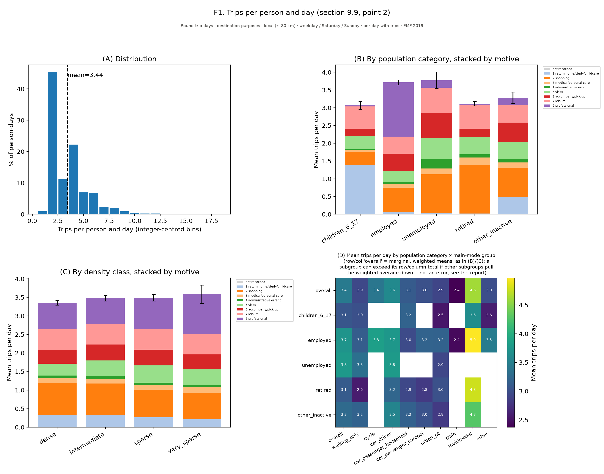

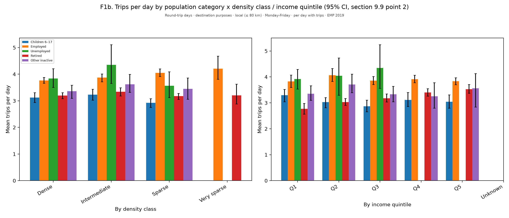

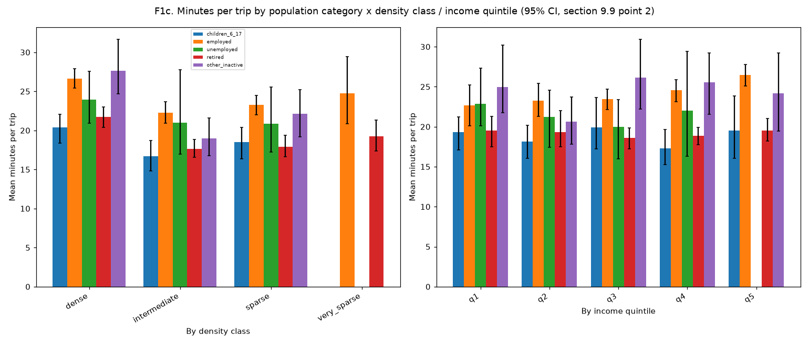

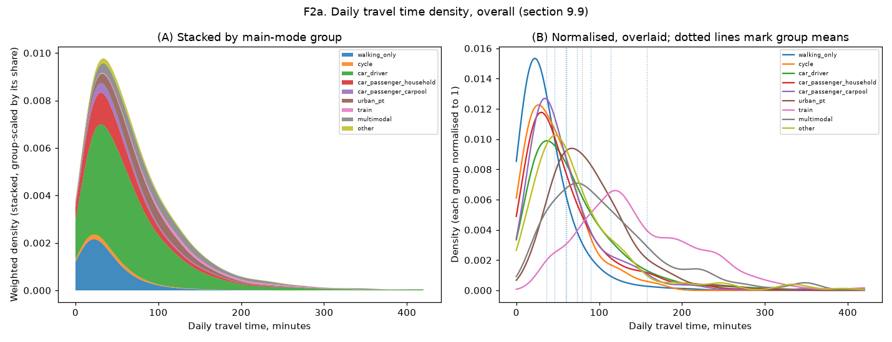

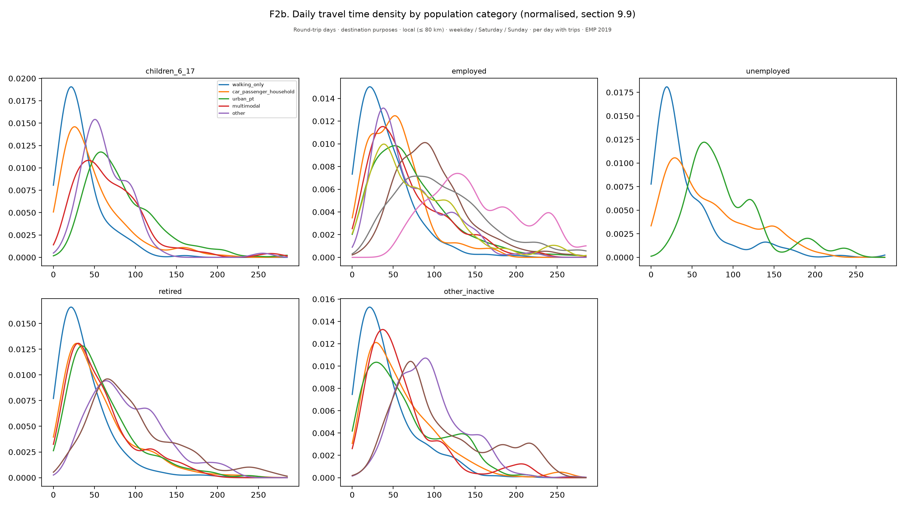

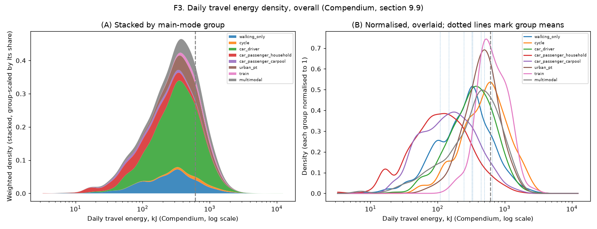

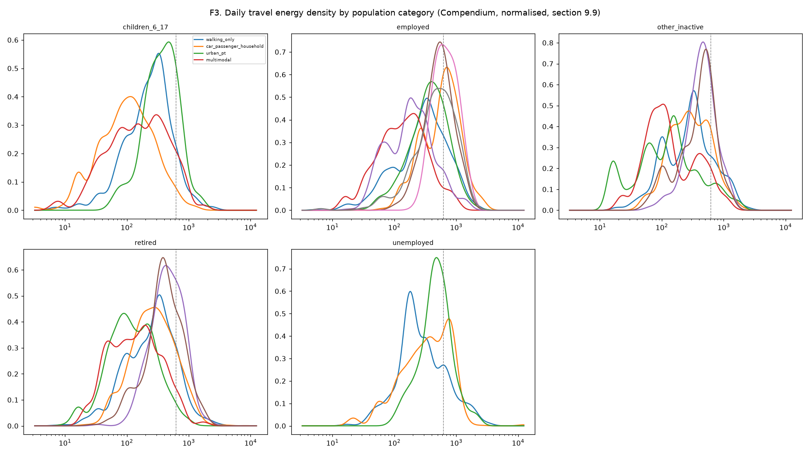

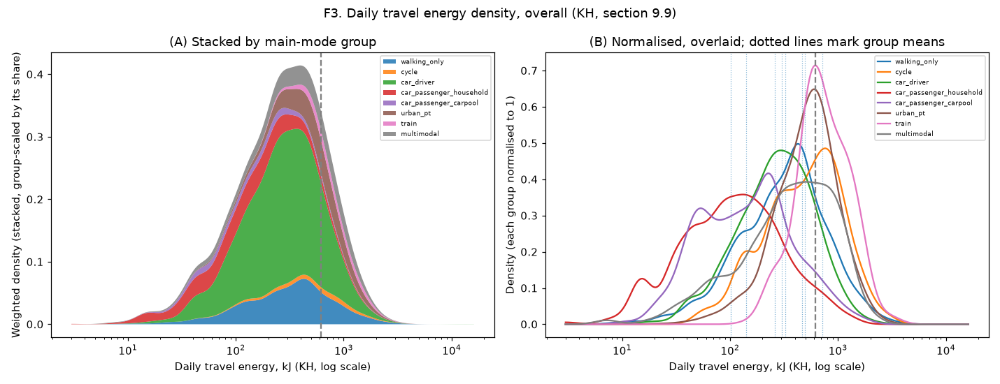

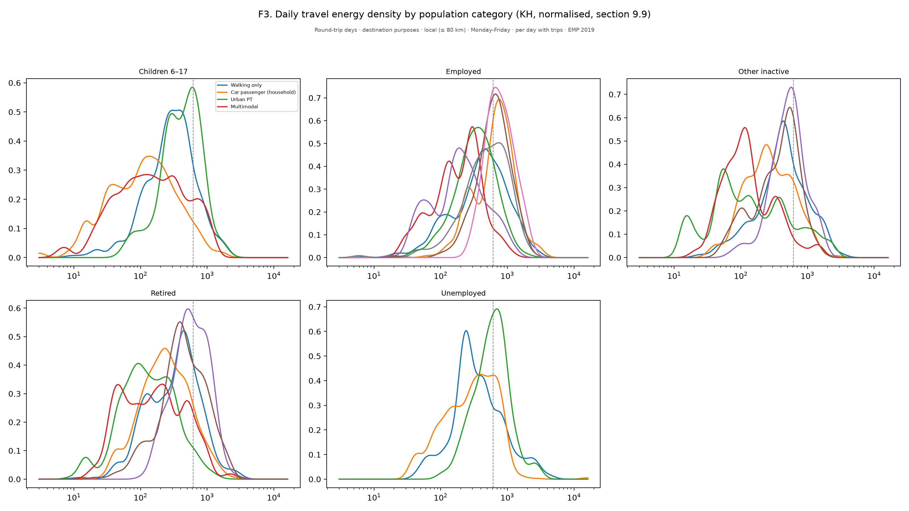

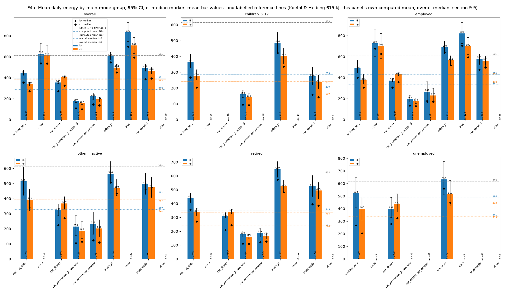

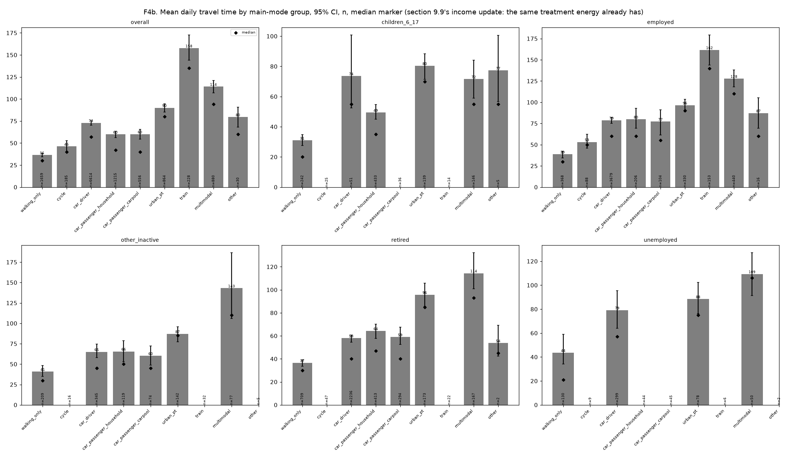

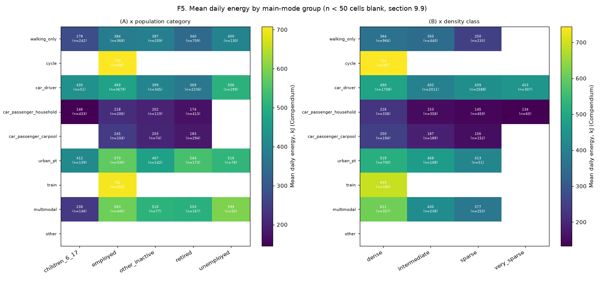

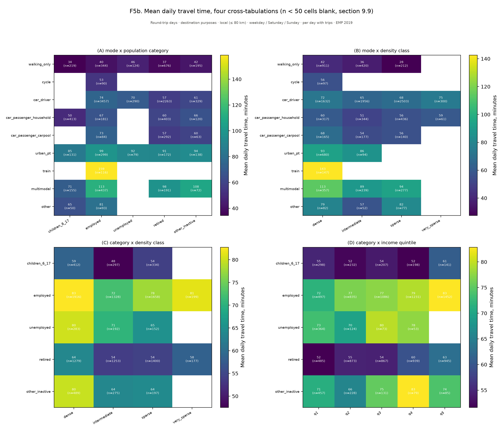

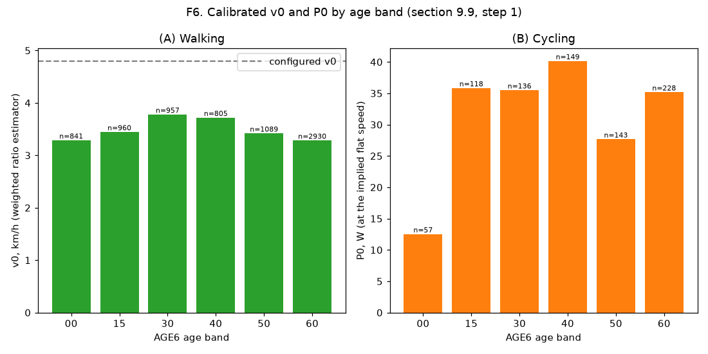

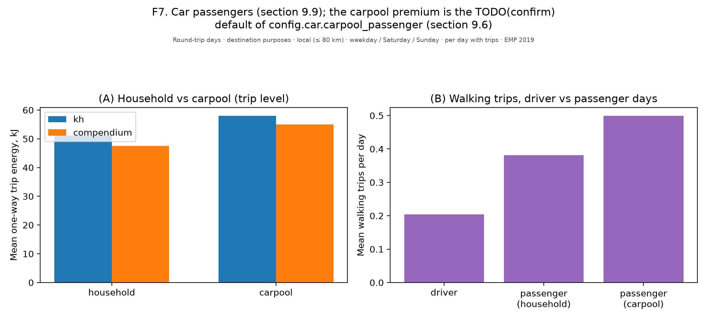

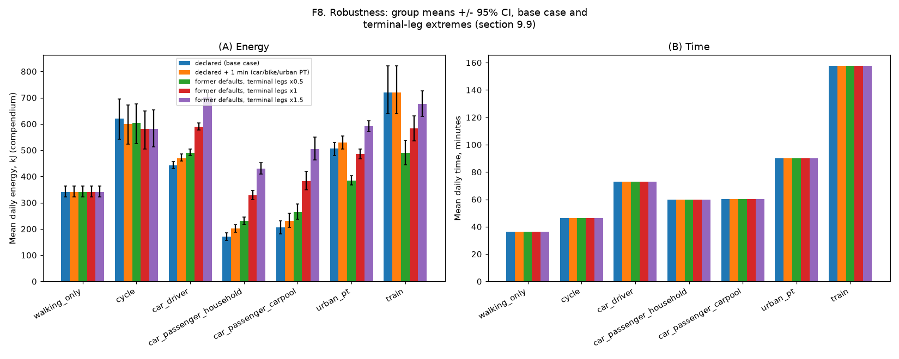

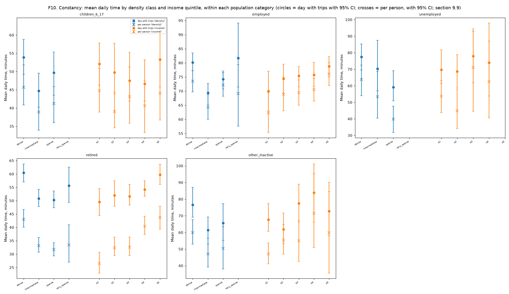

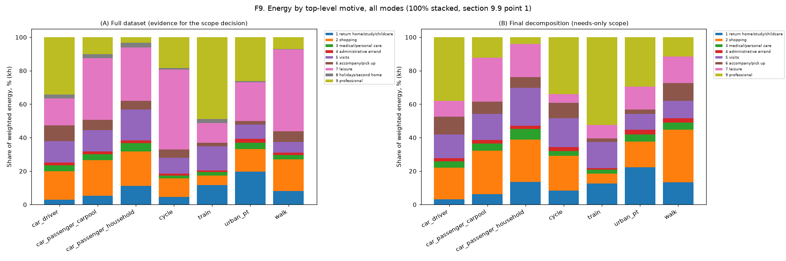

## Modelling notes and simplifications

- EMP 2019 gives no headway, station-depth or PT access-walk-distance data; `config.pt_ride.headway_min_am_peak`/`station_height_m`/`access_walk_m_by_density` are provisional TODO(confirm) defaults, used only by this step.
- Car terminal legs always use the apartment-density default: the public tables give no house/apartment split (section 9.6's `s_house`).
- `mode_group='other'` trips have no energy formula and contribute 0 kJ to a day's total; a day with only such trips is its own 'other' group, separate from 'multimodal'.
- The day's home density is the residence commune's own density (`trip_legs.residence_density`, 27 October 2026 decision), not the origin density of the home-departure trip.
- Bike get/park and stop-delay adjustment: unreliable (would consume over half, or all but under a minute, of a very short trip's declared duration) for a small share of cycling trips; these fall back to the naive whole-duration speed for both energy and the P0 estimator's ride-time denominator.
- F3/F4/F5 use the full set of day-mode groups (including multimodal and other); F8's robustness check is restricted to the seven groups the task names (walk, bike, driver, both passenger groups, urban PT, train).
- F8's figure shows bootstrap CIs for every terminal-legs variant with a CI (declared, declared + 1 min, former defaults x0.5/x1/x1.5), not every table variant (not weekdays-only, local-trips-only or the P0 reference, which have none).
