# Step 11 (`mobgrid/budget`): EMP 2019 re-estimation (section 9.9)

Generated by `python -m mobgrid.budget.emp`. Rebuilds section 9.9's re-estimation steps 1-3 and 5 on the EMP 2019 public tables, plus the F8 robustness check; terminal legs reuse sections 9.4-9.7's formulas and `config/energy.yaml`'s already-calibrated car/stairs/waiting/PT-ride defaults, plus provisional PT headway/station-height/access-walk defaults (TODO(confirm), `config.pt_ride`). EMC² (step 4) and Ē_c (step 6) are out of scope. Same model parameters (`config/energy.yaml`) in both surveys: differences reflect behaviour, not the model (section 9.9, "Change between 2008 and 2019"). Density: `grid` (the INSEE grid, or section 9.9's urban-unit-status x residence-size proxy; ENTD 2008 always uses the proxy).

**Variables used** (K_DEPLOC unless noted): mode `mtp`; duration `DUREE`; distance `MDISTTOT_fin`; purpose `MMOTIFDES`/`MOTPREC` (read, not used by this step's formulas); companions `MACCOMPM`/`MACCOMPHM` (household vs carpool passenger split); day `TYPEJOUR`, `mobloc` (F8's local-trips variant); weights `POND_JOUR` (day) and `pond_indC` (K_INDIVIDU, individual); age band `AGE6` (TCM_IND_KISH); population category (section 6.1) from `SITUA` (TCM_IND_KISH) combined with `AGE` for the 6-17 children group; density of residence `TCM_MEN.DENSITECOM_RES`/`STATUTCOM_UU_RES` (27 October 2026 decision: the residence commune's own density, not a trip end's); non-traveller cross-check `MIMMOSEM` (K_INDIVIDU).

**Sample flow** (persons and days kept apart, section 9.9's "Change between 2008 and 2019"; one described day per respondent in EMP 2019, up to three in ENTD 2008, weekday/Saturday/Sunday):

| Step | n |
|---|---|
| Respondents | 13,825 |
| Days with trips | 13,370 |
| Days with energy | 13,136 |
| Days within scope | 12,195 |
| Days within scope with energy | 11,974 |

455 of 13,825 respondents report no trip that day (3.3% unweighted, 2.6% by individual weight; reported apart per point 2).

## Main-mode-of-the-day groups (point 3)

walking only, bike, car driver, car passenger with a household driver, car passenger with a non-household driver (carpool), urban PT, train (short- and long-distance merged, step 11 round 8: train_long had too few observations to be a meaningful separate group), multimodal (two or more distinct non-walk modes in the day; driving and riding as a passenger count as two), other. **'other' contains:** powered two-wheelers under 50cm3 or unspecified (mtp 2.3-2.7), unspecified 3/4-wheeler (mtp 3.4), taxi/specialised/school transport (mtp 4.x), plane (mtp 7.x), boat (mtp 8.1), other/unspecified (mtp 9.1, missing, or the 9999 refusal code).

**Children as car drivers** (50 children_6_17 car_driver days): the raw `mtp` code is 3.1 (n=148, ages 6-17), 3.3 (n=5, ages 10-17). Both codes are `mtp` category 3 "Automobile" (3.1 "Conducteur", 3.3 "Tantot conducteur tantot passager"), not a two-wheeler code (2.x): no two-wheeler reclassification applies. `mtp` 3.1 includes "voiturette" (a license-free microcar, legal from age 14 in France), plausible for the 14-17 share, but not for the many 6-13 year olds here; most likely EMP's own household/accompanying-trip coding records the car's use rather than confirming the child personally drove.

## Density classes

INSEE's own 4-level grid names and order: dense (1, densely populated communes), intermediate (2), sparse (3, peu denses), very_sparse (4, tres peu denses). EMP 2019's `emp2019._DENSITY_LABEL_BY_CODE` maps `DENSITECOM_ORI`/`_DES` directly (grid); both surveys' `trip_legs.density_proxy_case_sql` computes the same four labels from the urban-unit-status x residence-size proxy of section 9.9's "Change between 2008 and 2019" when `density_source='proxy'` (this report: `grid`). `trip_legs._DENSITY_KEY_TRANSLATION` re-keys `config.car`/`config.pt_ride`'s existing density defaults (chosen for step 7 as `dense`/`urban`/`suburban`/`rural`) to these same INSEE names and order, checked against `data/raw/emp2019/emp2019-categories.pdf`'s "Degre de densite" table. `home_density` (every per-day/per-person table below) is the **residence** commune's own density (`trip_legs.residence_density`; 27 October 2026 decision), from `TCM_MEN.DENSITECOM_RES`/`STATUTCOM_UU_RES` (EMP 2019) or `Q_TCM_MENAGE.numcom_UUCat`/`TU99` (ENTD 2008, proxy only) -- not the density of the trip departing from home, which this replaces: that proxy was undefined for a day with no home-departing trip in scope, and was not a property of the person.

## Time budget: constancy across density classes (point 3)

The reference constant (section 9.9, 27 October 2026 decision): is mean daily travel time the same across density classes of residence, within each population category? Day with trips, needs scope. Cells of fewer than 50 persons blank. The 95% CI column (bootstrap over households) gives time the same treatment energy already has (section 9.9's income update).

| Category | Density | n | mean time (min) | 95% CI | median time (min) |
|---|---|---|---|---|---|
| children_6_17 | dense | 405 | 57.7 | [53.0, 63.5] | 41.0 |
| children_6_17 | intermediate | 304 | 48.2 | [42.9, 56.9] | 35.0 |
| children_6_17 | sparse | 319 | 53.6 | [47.6, 60.6] | 35.0 |
| children_6_17 | very_sparse | 32 | - | - | - |
| employed | dense | 2008 | 88.6 | [84.6, 94.1] | 70.0 |
| employed | intermediate | 1400 | 77.6 | [73.4, 82.5] | 60.0 |
| employed | sparse | 1694 | 83.5 | [78.7, 88.0] | 65.0 |
| employed | very_sparse | 205 | 89.1 | [77.6, 100.5] | 70.0 |
| unemployed | dense | 292 | 91.5 | [78.9, 106.4] | 70.0 |
| unemployed | intermediate | 184 | 72.4 | [59.5, 89.0] | 46.0 |
| unemployed | sparse | 152 | 73.4 | [53.9, 106.7] | 40.0 |
| unemployed | very_sparse | 19 | - | - | - |
| retired | dense | 1242 | 67.7 | [63.7, 71.8] | 50.0 |
| retired | intermediate | 1202 | 55.7 | [51.9, 59.8] | 40.0 |
| retired | sparse | 1342 | 57.4 | [52.9, 63.6] | 40.0 |
| retired | very_sparse | 166 | 59.7 | [51.2, 68.3] | 40.0 |
| other_inactive | dense | 503 | 81.0 | [74.1, 89.1] | 66.0 |
| other_inactive | intermediate | 269 | 75.5 | [57.5, 101.5] | 55.0 |
| other_inactive | sparse | 203 | 69.2 | [56.0, 83.7] | 55.0 |
| other_inactive | very_sparse | 22 | - | - | - |

### Constancy summary

| Category | dense/very_sparse | max/min | CV across classes |
|---|---|---|---|
| children_6_17 | - | 1.20 | 0.07 |
| employed | 1.00 | 1.15 | 0.05 |
| unemployed | - | 1.26 | 0.11 |
| retired | 1.13 | 1.22 | 0.08 |
| other_inactive | - | 1.17 | 0.06 |

## Time budget: constancy across income quintiles (section 9.9's income update)

Household income per consumption unit (modified OECD scale), in quintiles computed within this survey with individual weights (`docs/data/entd2008.md`'s "Income variables"): is mean daily travel time the same across income quintiles, within each population category, as income is treated as density is? Day with trips, needs scope. `'unknown'` (missing/refused income) is its own class, excluded from the constancy summary (not an ordered quantile).

| Category | Income quintile | n | mean time (min) | 95% CI | median time (min) |
|---|---|---|---|---|---|
| children_6_17 | q1 | 180 | 50.1 | [43.2, 57.8] | 40.0 |
| children_6_17 | q2 | 259 | 58.0 | [50.2, 68.7] | 40.0 |
| children_6_17 | q3 | 204 | 49.7 | [45.3, 56.3] | 40.0 |
| children_6_17 | q4 | 219 | 56.2 | [47.2, 68.4] | 37.0 |
| children_6_17 | q5 | 198 | 52.1 | [46.0, 60.0] | 40.0 |
| children_6_17 | unknown | 0 | - | - | - |
| employed | q1 | 211 | 77.3 | [66.3, 92.7] | 50.0 |
| employed | q2 | 683 | 74.5 | [67.8, 79.5] | 60.0 |
| employed | q3 | 1008 | 87.3 | [79.8, 96.4] | 65.0 |
| employed | q4 | 1488 | 82.2 | [78.2, 86.2] | 65.0 |
| employed | q5 | 1917 | 89.1 | [85.3, 93.0] | 70.0 |
| employed | unknown | 0 | - | - | - |
| unemployed | q1 | 259 | 67.9 | [58.7, 78.1] | 50.0 |
| unemployed | q2 | 177 | 79.5 | [66.3, 95.4] | 65.0 |
| unemployed | q3 | 88 | 110.4 | [70.9, 163.9] | 60.0 |
| unemployed | q4 | 72 | 81.4 | [64.8, 101.2] | 75.0 |
| unemployed | q5 | 51 | 84.0 | [54.7, 108.5] | 60.0 |
| unemployed | unknown | 0 | - | - | - |
| retired | q1 | 183 | 50.2 | [43.8, 58.1] | 35.0 |
| retired | q2 | 705 | 54.7 | [49.9, 60.8] | 40.0 |
| retired | q3 | 802 | 58.1 | [53.4, 63.6] | 40.0 |
| retired | q4 | 1080 | 59.0 | [53.9, 66.5] | 40.0 |
| retired | q5 | 1182 | 67.7 | [62.8, 72.2] | 45.0 |
| retired | unknown | 0 | - | - | - |
| other_inactive | q1 | 295 | 70.3 | [62.0, 79.6] | 60.0 |
| other_inactive | q2 | 313 | 81.9 | [65.3, 109.8] | 60.0 |
| other_inactive | q3 | 157 | 70.6 | [58.1, 83.2] | 60.0 |
| other_inactive | q4 | 127 | 87.5 | [72.1, 104.1] | 62.0 |
| other_inactive | q5 | 105 | 73.6 | [60.1, 88.5] | 65.0 |
| other_inactive | unknown | 0 | - | - | - |

### Constancy summary

| Category | q5/q1 | max/min | CV across classes |
|---|---|---|---|
| children_6_17 | 1.04 | 1.17 | 0.06 |
| employed | 1.15 | 1.20 | 0.07 |
| unemployed | 1.24 | 1.63 | 0.17 |
| retired | 1.35 | 1.35 | 0.10 |
| other_inactive | 1.05 | 1.25 | 0.09 |

## Trips per day and minutes per trip, by category, density and income quintile (section 9.9 point 2: daily time = trips/day x minutes/trip)

### Trips per day

#### By population category x density class

| Category | Density | n | mean trips/day | 95% CI | median trips/day |
|---|---|---|---|---|---|
| children_6_17 | dense | 405 | 2.92 | [2.78, 3.12] | 2.00 |
| children_6_17 | intermediate | 304 | 3.06 | [2.83, 3.31] | 2.00 |
| children_6_17 | sparse | 319 | 2.87 | [2.70, 3.08] | 2.00 |
| children_6_17 | very_sparse | 32 | - | - | - |
| employed | dense | 2008 | 3.47 | [3.38, 3.56] | 3.00 |
| employed | intermediate | 1400 | 3.49 | [3.39, 3.61] | 3.00 |
| employed | sparse | 1694 | 3.75 | [3.61, 3.88] | 3.00 |
| employed | very_sparse | 205 | 3.88 | [3.46, 4.27] | 4.00 |
| unemployed | dense | 292 | 3.59 | [3.37, 3.84] | 3.00 |
| unemployed | intermediate | 184 | 3.58 | [3.13, 4.02] | 2.00 |
| unemployed | sparse | 152 | 3.36 | [2.87, 3.80] | 2.00 |
| unemployed | very_sparse | 19 | - | - | - |
| retired | dense | 1242 | 3.04 | [2.95, 3.14] | 2.00 |
| retired | intermediate | 1202 | 3.03 | [2.91, 3.16] | 2.00 |
| retired | sparse | 1342 | 2.95 | [2.85, 3.06] | 2.00 |
| retired | very_sparse | 166 | 3.05 | [2.78, 3.33] | 2.00 |
| other_inactive | dense | 503 | 3.13 | [2.94, 3.33] | 2.00 |
| other_inactive | intermediate | 269 | 3.66 | [3.31, 4.11] | 3.00 |
| other_inactive | sparse | 203 | 3.15 | [2.82, 3.46] | 2.00 |
| other_inactive | very_sparse | 22 | - | - | - |

#### By population category x income quintile

| Category | Income quintile | n | mean trips/day | 95% CI | median trips/day |
|---|---|---|---|---|---|
| children_6_17 | q1 | 180 | 2.96 | [2.73, 3.20] | 2.00 |
| children_6_17 | q2 | 259 | 3.10 | [2.84, 3.45] | 2.00 |
| children_6_17 | q3 | 204 | 2.75 | [2.54, 3.00] | 2.00 |
| children_6_17 | q4 | 219 | 2.86 | [2.70, 3.04] | 2.00 |
| children_6_17 | q5 | 198 | 3.02 | [2.81, 3.22] | 2.00 |
| children_6_17 | unknown | 0 | - | - | - |
| employed | q1 | 211 | 3.55 | [3.27, 3.94] | 3.00 |
| employed | q2 | 683 | 3.65 | [3.44, 3.85] | 3.00 |
| employed | q3 | 1008 | 3.69 | [3.55, 3.84] | 3.00 |
| employed | q4 | 1488 | 3.58 | [3.47, 3.70] | 3.00 |
| employed | q5 | 1917 | 3.48 | [3.37, 3.58] | 3.00 |
| employed | unknown | 0 | - | - | - |
| unemployed | q1 | 259 | 3.50 | [3.15, 3.92] | 2.00 |
| unemployed | q2 | 177 | 3.46 | [3.05, 3.86] | 3.00 |
| unemployed | q3 | 88 | 3.53 | [3.05, 4.16] | 3.00 |
| unemployed | q4 | 72 | 3.97 | [3.45, 4.55] | 4.00 |
| unemployed | q5 | 51 | 3.25 | [2.69, 3.98] | 2.00 |
| unemployed | unknown | 0 | - | - | - |
| retired | q1 | 183 | 2.55 | [2.37, 2.74] | 2.00 |
| retired | q2 | 705 | 2.77 | [2.66, 2.90] | 2.00 |
| retired | q3 | 802 | 2.93 | [2.81, 3.04] | 2.00 |
| retired | q4 | 1080 | 3.03 | [2.91, 3.16] | 2.00 |
| retired | q5 | 1182 | 3.23 | [3.13, 3.34] | 3.00 |
| retired | unknown | 0 | - | - | - |
| other_inactive | q1 | 295 | 3.06 | [2.83, 3.30] | 2.00 |
| other_inactive | q2 | 313 | 3.30 | [3.03, 3.62] | 2.00 |
| other_inactive | q3 | 157 | 3.36 | [2.94, 3.81] | 3.00 |
| other_inactive | q4 | 127 | 3.28 | [2.89, 3.77] | 2.00 |
| other_inactive | q5 | 105 | 3.38 | [3.00, 3.77] | 3.00 |
| other_inactive | unknown | 0 | - | - | - |

### Minutes per trip

#### By population category x density class

| Category | Density | n | mean min/trip | 95% CI | median min/trip |
|---|---|---|---|---|---|
| children_6_17 | dense | 405 | 21.32 | [19.13, 23.60] | 15.00 |
| children_6_17 | intermediate | 304 | 17.48 | [15.64, 19.73] | 12.50 |
| children_6_17 | sparse | 319 | 20.05 | [17.54, 22.63] | 15.00 |
| children_6_17 | very_sparse | 32 | - | - | - |
| employed | dense | 2008 | 29.32 | [27.79, 31.30] | 21.25 |
| employed | intermediate | 1400 | 26.70 | [24.53, 29.21] | 16.71 |
| employed | sparse | 1694 | 26.34 | [24.73, 28.18] | 18.75 |
| employed | very_sparse | 205 | 27.22 | [22.44, 33.02] | 17.60 |
| unemployed | dense | 292 | 32.60 | [24.46, 45.58] | 20.00 |
| unemployed | intermediate | 184 | 22.08 | [17.81, 28.42] | 15.00 |
| unemployed | sparse | 152 | 34.83 | [18.73, 65.75] | 15.00 |
| unemployed | very_sparse | 19 | - | - | - |
| retired | dense | 1242 | 24.95 | [22.70, 27.35] | 16.25 |
| retired | intermediate | 1202 | 19.67 | [18.30, 21.42] | 14.29 |
| retired | sparse | 1342 | 20.99 | [18.78, 23.63] | 15.00 |
| retired | very_sparse | 166 | 20.95 | [18.01, 25.35] | 15.00 |
| other_inactive | dense | 503 | 29.38 | [26.23, 33.30] | 22.50 |
| other_inactive | intermediate | 269 | 23.17 | [18.47, 30.90] | 15.00 |
| other_inactive | sparse | 203 | 23.51 | [19.92, 26.91] | 17.50 |
| other_inactive | very_sparse | 22 | - | - | - |

#### By population category x income quintile

| Category | Income quintile | n | mean min/trip | 95% CI | median min/trip |
|---|---|---|---|---|---|
| children_6_17 | q1 | 180 | 20.07 | [16.58, 24.48] | 12.50 |
| children_6_17 | q2 | 259 | 19.89 | [17.42, 22.50] | 15.00 |
| children_6_17 | q3 | 204 | 19.65 | [17.66, 22.39] | 15.00 |
| children_6_17 | q4 | 219 | 20.58 | [17.69, 24.57] | 15.00 |
| children_6_17 | q5 | 198 | 18.77 | [15.97, 22.19] | 15.00 |
| children_6_17 | unknown | 0 | - | - | - |
| employed | q1 | 211 | 24.61 | [19.94, 30.46] | 15.00 |
| employed | q2 | 683 | 23.61 | [21.37, 25.29] | 17.50 |
| employed | q3 | 1008 | 28.11 | [25.44, 31.57] | 18.00 |
| employed | q4 | 1488 | 26.53 | [25.28, 28.15] | 20.00 |
| employed | q5 | 1917 | 30.41 | [28.80, 32.55] | 20.00 |
| employed | unknown | 0 | - | - | - |
| unemployed | q1 | 259 | 21.78 | [18.65, 25.49] | 15.00 |
| unemployed | q2 | 177 | 26.67 | [21.41, 33.39] | 16.83 |
| unemployed | q3 | 88 | 58.82 | [22.06, 109.93] | 16.00 |
| unemployed | q4 | 72 | 22.36 | [17.31, 27.84] | 16.67 |
| unemployed | q5 | 51 | 30.67 | [19.99, 41.97] | 19.17 |
| unemployed | unknown | 0 | - | - | - |
| retired | q1 | 183 | 21.10 | [17.28, 25.25] | 15.00 |
| retired | q2 | 705 | 20.99 | [19.01, 23.35] | 15.00 |
| retired | q3 | 802 | 21.66 | [19.42, 24.60] | 15.00 |
| retired | q4 | 1080 | 20.51 | [18.55, 22.83] | 15.00 |
| retired | q5 | 1182 | 23.95 | [21.60, 27.10] | 15.00 |
| retired | unknown | 0 | - | - | - |
| other_inactive | q1 | 295 | 26.50 | [22.61, 30.81] | 20.00 |
| other_inactive | q2 | 313 | 28.07 | [22.33, 35.64] | 20.00 |
| other_inactive | q3 | 157 | 24.26 | [20.02, 30.08] | 16.00 |
| other_inactive | q4 | 127 | 28.03 | [23.60, 33.06] | 23.33 |
| other_inactive | q5 | 105 | 23.85 | [18.52, 28.50] | 17.50 |
| other_inactive | unknown | 0 | - | - | - |

#### By density class and by income quintile (marginals)

| Group | n | weighted n | mean trips/day | 95% CI | median trips/day |
|---|---|---|---|---|---|
| dense | 4458 | 124,863,046 | 3.27 | [3.21, 3.33] | 3.00 |
| sparse | 3712 | 90,497,649 | 3.37 | [3.28, 3.44] | 3.00 |
| intermediate | 3360 | 87,493,794 | 3.32 | [3.25, 3.40] | 3.00 |
| very_sparse | 444 | 9,671,561 | 3.47 | [3.18, 3.72] | 3.00 |

| Group | n | weighted n | mean trips/day | 95% CI | median trips/day |
|---|---|---|---|---|---|
| q5 | 3454 | 86,830,242 | 3.36 | [3.29, 3.44] | 3.00 |
| q4 | 2990 | 76,184,515 | 3.34 | [3.26, 3.43] | 3.00 |
| q3 | 2259 | 61,051,836 | 3.33 | [3.23, 3.42] | 2.00 |
| q2 | 2139 | 57,526,924 | 3.30 | [3.19, 3.40] | 2.00 |
| q1 | 1132 | 30,932,533 | 3.17 | [3.05, 3.31] | 2.00 |

| Group | n | weighted n | mean min/trip | 95% CI | median min/trip |
|---|---|---|---|---|---|
| employed | 5307 | 150,389,289 | 27.67 | [26.75, 28.69] | 19.33 |
| retired | 3952 | 67,697,803 | 21.90 | [20.74, 23.31] | 15.00 |
| children_6_17 | 1060 | 50,539,780 | 19.81 | [18.49, 21.14] | 15.00 |
| other_inactive | 997 | 27,787,489 | 26.38 | [23.83, 28.71] | 20.00 |
| unemployed | 647 | 15,840,084 | 29.92 | [22.92, 39.71] | 16.00 |

| Group | n | weighted n | mean min/trip | 95% CI | median min/trip |
|---|---|---|---|---|---|
| dense | 4458 | 124,863,046 | 27.40 | [26.38, 28.66] | 20.00 |
| sparse | 3712 | 90,497,649 | 24.24 | [22.88, 25.81] | 15.67 |
| intermediate | 3360 | 87,493,794 | 22.89 | [21.74, 24.74] | 15.00 |
| very_sparse | 444 | 9,671,561 | 24.77 | [21.05, 28.21] | 17.50 |

| Group | n | weighted n | mean min/trip | 95% CI | median min/trip |
|---|---|---|---|---|---|
| q5 | 3454 | 86,830,242 | 27.40 | [26.12, 29.09] | 18.00 |
| q4 | 2990 | 76,184,515 | 24.18 | [23.17, 25.25] | 16.67 |
| q3 | 2259 | 61,051,836 | 26.18 | [23.80, 28.76] | 16.00 |
| q2 | 2139 | 57,526,924 | 23.16 | [21.85, 24.75] | 15.71 |
| q1 | 1132 | 30,932,533 | 22.82 | [21.05, 25.15] | 15.00 |

## Per-person budget, days without trips included (section 9.9 point 2b)

P(out on the weekday) x T(weekday|out), weekday only (comparable with ENTD 2008's own, unverified-weekend-eligibility budget); EMP 2019 additionally reports the all-week budget, Sigma_d w_d . P(out on day type d) . T(d|out), w_d = 5/7, 1/7, 1/7 (P from `IMMODEP_A`-`G`, T from the described days of each day type; point estimate only, no bootstrap CI).

### By population category

#### Weekday

| Category | n | P(out) | T\|out (min) | budget (min) | 95% CI |
|---|---|---|---|---|---|
| children_6_17 | 860 | 0.912 | 53.4 | 48.7 | [45.7, 51.8] |
| employed | 4199 | 0.946 | 87.6 | 82.9 | [79.9, 85.2] |
| unemployed | 514 | 0.818 | 80.5 | 65.8 | [57.8, 73.7] |
| retired | 3077 | 0.727 | 60.7 | 44.1 | [42.0, 45.9] |
| other_inactive | 788 | 0.815 | 74.9 | 61.0 | [56.5, 66.0] |
| overall | 9448 | 0.863 | 74.7 | 64.5 | [63.2, 66.3] |

#### All-week

| Category | n | P(out) | T\|out (min) | budget (min) | 95% CI |
|---|---|---|---|---|---|
| children_6_17 | 90 | 0.912 | 53.4 | 46.8 | - |
| employed | 483 | 0.946 | 87.6 | 77.5 | - |
| unemployed | 53 | 0.818 | 80.5 | 64.4 | - |
| retired | 374 | 0.727 | 60.7 | 43.3 | - |
| other_inactive | 93 | 0.815 | 74.9 | 60.1 | - |
| overall | 1093 | 0.863 | 74.7 | 61.5 | - |

### By population category x density class (weekday budget)

| Category | Density | n | P(out) | T\|out (min) | budget (min) | 95% CI |
|---|---|---|---|---|---|---|
| children_6_17 | dense | 328 | 0.926 | 57.4 | 53.1 | [48.5, 59.3] |
| children_6_17 | intermediate | 251 | 0.901 | 47.4 | 42.7 | [38.3, 47.4] |
| children_6_17 | sparse | 253 | 0.901 | 53.7 | 48.4 | [41.8, 57.3] |
| children_6_17 | very_sparse | 0 | - | - | - | - |
| employed | dense | 1578 | 0.957 | 89.8 | 86.0 | [81.2, 90.9] |
| employed | intermediate | 1097 | 0.943 | 82.9 | 78.1 | [73.1, 84.3] |
| employed | sparse | 1366 | 0.938 | 88.0 | 82.5 | [78.2, 87.7] |
| employed | very_sparse | 158 | 0.924 | 93.5 | 86.4 | [76.3, 95.9] |
| unemployed | dense | 236 | 0.845 | 96.1 | 81.2 | [68.8, 95.0] |
| unemployed | intermediate | 143 | 0.801 | 74.5 | 59.7 | [44.3, 77.0] |
| unemployed | sparse | 121 | 0.800 | 57.6 | 46.1 | [37.5, 54.9] |
| unemployed | very_sparse | 0 | - | - | - | - |
| retired | dense | 980 | 0.768 | 68.4 | 52.5 | [48.8, 56.5] |
| retired | intermediate | 913 | 0.720 | 57.2 | 41.2 | [38.0, 44.7] |
| retired | sparse | 1051 | 0.703 | 55.9 | 39.3 | [37.1, 42.1] |
| retired | very_sparse | 133 | 0.654 | 60.0 | 39.2 | [33.3, 47.2] |
| other_inactive | dense | 391 | 0.850 | 79.0 | 67.1 | [61.9, 73.8] |
| other_inactive | intermediate | 221 | 0.786 | 65.5 | 51.5 | [43.1, 59.7] |
| other_inactive | sparse | 157 | 0.779 | 79.6 | 61.9 | [50.9, 76.1] |
| other_inactive | very_sparse | 0 | - | - | - | - |

### By population category x income quintile (weekday budget)

| Category | Income quintile | n | P(out) | T\|out (min) | budget (min) | 95% CI |
|---|---|---|---|---|---|---|
| children_6_17 | q1 | 141 | 0.875 | 52.3 | 45.7 | [39.0, 53.6] |
| children_6_17 | q2 | 206 | 0.907 | 53.5 | 48.5 | [43.1, 54.3] |
| children_6_17 | q3 | 163 | 0.925 | 53.4 | 49.4 | [44.5, 56.2] |
| children_6_17 | q4 | 180 | 0.914 | 58.4 | 53.3 | [40.5, 65.5] |
| children_6_17 | q5 | 170 | 0.942 | 49.2 | 46.3 | [40.3, 52.4] |
| employed | q1 | 168 | 0.914 | 76.3 | 69.8 | [58.2, 84.1] |
| employed | q2 | 534 | 0.931 | 77.2 | 71.9 | [66.7, 78.1] |
| employed | q3 | 805 | 0.944 | 92.3 | 87.2 | [78.0, 97.8] |
| employed | q4 | 1176 | 0.950 | 84.5 | 80.3 | [76.3, 84.8] |
| employed | q5 | 1516 | 0.957 | 93.1 | 89.0 | [85.1, 93.3] |
| unemployed | q1 | 200 | 0.782 | 73.2 | 57.3 | [49.5, 66.2] |
| unemployed | q2 | 138 | 0.810 | 79.4 | 64.3 | [50.5, 85.1] |
| unemployed | q3 | 71 | 0.833 | 91.8 | 76.5 | [50.9, 114.0] |
| unemployed | q4 | 63 | 0.891 | 83.1 | 74.1 | [57.4, 89.2] |
| unemployed | q5 | 0 | - | - | - | - |
| retired | q1 | 126 | 0.611 | 51.2 | 31.3 | [25.9, 38.9] |
| retired | q2 | 562 | 0.651 | 55.7 | 36.3 | [32.4, 40.7] |
| retired | q3 | 649 | 0.699 | 58.5 | 40.9 | [37.2, 44.4] |
| retired | q4 | 818 | 0.751 | 58.6 | 44.0 | [40.6, 47.5] |
| retired | q5 | 922 | 0.799 | 68.4 | 54.6 | [49.5, 59.3] |
| other_inactive | q1 | 232 | 0.796 | 64.8 | 51.6 | [45.3, 59.5] |
| other_inactive | q2 | 257 | 0.808 | 72.4 | 58.5 | [52.0, 66.2] |
| other_inactive | q3 | 130 | 0.843 | 76.1 | 64.1 | [54.9, 75.8] |
| other_inactive | q4 | 100 | 0.812 | 88.8 | 72.1 | [55.2, 88.0] |
| other_inactive | q5 | 69 | 0.833 | 81.0 | 67.5 | [52.4, 84.5] |

## Mean daily energy and time by main-mode group (point 3)

| Group | n | weighted n | mean time (min) | median time (min) | mean energy kh (kJ) | median energy kh (kJ) | 95% CI | mean energy compendium (kJ) | median energy compendium (kJ) | 95% CI |
|---|---|---|---|---|---|---|---|---|---|---|
| car_driver | 6491 | 157,222,228 | 73.6 | 60.0 | 391.8 | 292.7 | [380.4, 406.2] | 447.6 | 330.4 | [434.5, 463.8] |
| walking_only | 1628 | 44,762,712 | 37.4 | 30.0 | 461.3 | 355.2 | [433.5, 487.3] | 352.2 | 271.1 | [330.9, 371.9] |
| car_passenger_household | 1167 | 35,288,714 | 60.5 | 42.0 | 198.8 | 117.5 | [181.3, 216.0] | 176.8 | 113.8 | [161.6, 190.3] |
| multimodal | 864 | 26,159,448 | 116.1 | 95.0 | 536.6 | 439.5 | [501.2, 572.5] | 506.4 | 428.1 | [474.2, 541.5] |
| urban_pt | 850 | 25,417,601 | 93.3 | 85.0 | 640.0 | 566.5 | [610.3, 676.9] | 525.2 | 476.0 | [502.3, 553.3] |
| car_passenger_carpool | 540 | 9,942,344 | 61.5 | 45.0 | 246.1 | 160.7 | [213.5, 283.4] | 214.0 | 152.8 | [187.8, 243.8] |
| train | 219 | 7,261,663 | 156.1 | 135.0 | 857.6 | 713.6 | [765.5, 957.6] | 727.8 | 632.7 | [654.4, 813.6] |
| cycle | 184 | 5,372,285 | 46.1 | 40.0 | 634.9 | 540.7 | [548.6, 741.4] | 617.0 | 521.6 | [532.2, 712.7] |
| other | 31 | 1,099,055 | 98.8 | 80.0 | 457.1 | 330.4 | [320.6, 584.8] | 348.9 | 252.2 | [244.7, 446.4] |

## Section 9.9's scope: commuting and travel for needs fulfilment

Every table and figure above and below is restricted to this scope (2026-10-20 project decision, not an optional variant): trips whose corrected motive (`motive`, `MOT_SEQ_COMPL`) is sport (7.6), a destination-less stroll (7.7, "se promener sans destination precise"), going to a place to walk/ride (7.8, a destination exists, but the movement itself is the point), or any top-level motive group 8 purpose (8.1-8.4: holidays, second/occasional residence, other private reasons -- none of them a needs-fulfilment destination) are excluded from every day's energy/time sums and from day classification; a day whose only trips were these becomes a non-traveller for this analysis. A missing/refused motive is kept, not excluded. See F9 and the table below for the evidence behind this decision, computed on the full, pre-exclusion dataset.

| Group | excluded trip share | n excluded / n total | excluded share of day energy (kh) | excluded share of day energy (cp) |
|---|---|---|---|---|
| car_driver | 10.1% | 2,478 / 24,120 | 16.1% | 14.4% |
| car_passenger_carpool | 15.6% | 218 / 1,642 | 23.5% | 23.2% |
| car_passenger_household | 15.5% | 590 / 3,932 | 30.0% | 28.7% |
| cycle | 29.4% | 223 / 808 | 46.6% | 46.5% |
| multimodal | 15.0% | 727 / 5,022 | 17.1% | 17.0% |
| other | 15.3% | 28 / 185 | 18.0% | 18.0% |
| train | 4.9% | 30 / 529 | 7.7% | 8.2% |
| urban_pt | 8.3% | 218 / 2,682 | 13.2% | 13.1% |
| walking_only | 24.7% | 1,366 / 5,724 | 36.5% | 36.5% |

## Data-quality correction: implausible door-to-door speeds

Trips are corrected, not dropped (section 9.9, step 11 round 5): flagged above an upper speed bound only -- walk > 7 km/h, bike > 35 km/h, car (driver or passenger) > 130 km/h -- their declared distance is replaced by declared duration x the mode's own median speed (from its not-flagged trips). Cycling energy's main work term is time-based (round 4), but its "stops" sub-term still multiplies by distance and by the distance-derived ride speed squared (section 9.7), so a flagged bike trip's distance is corrected too, like walk and car (round 9).

- car_driver: 0 of 23,859 trips corrected
- car_passenger_carpool: 0 of 1,993 trips corrected
- car_passenger_household: 0 of 4,138 trips corrected
- cycle: 0 of 1,023 trips corrected
- other: 0 of 937 trips corrected
- train: 0 of 631 trips corrected
- urban_pt: 0 of 2,408 trips corrected
- walk: 1,569 of 10,180 trips corrected

## Mean daily energy and time by main-mode group, overall and by population category (F4)

### overall

| Group | n | weighted n | mean time (min) | median time (min) | mean energy kh (kJ) | median energy kh (kJ) | 95% CI | mean energy compendium (kJ) | median energy compendium (kJ) | 95% CI |
|---|---|---|---|---|---|---|---|---|---|---|
| car_driver | 6491 | 157,222,228 | 73.6 | 60.0 | 391.8 | 292.7 | [380.4, 406.2] | 447.6 | 330.4 | [434.5, 463.8] |
| walking_only | 1628 | 44,762,712 | 37.4 | 30.0 | 461.3 | 355.2 | [433.5, 487.3] | 352.2 | 271.1 | [330.9, 371.9] |
| car_passenger_household | 1167 | 35,288,714 | 60.5 | 42.0 | 198.8 | 117.5 | [181.3, 216.0] | 176.8 | 113.8 | [161.6, 190.3] |
| multimodal | 864 | 26,159,448 | 116.1 | 95.0 | 536.6 | 439.5 | [501.2, 572.5] | 506.4 | 428.1 | [474.2, 541.5] |
| urban_pt | 850 | 25,417,601 | 93.3 | 85.0 | 640.0 | 566.5 | [610.3, 676.9] | 525.2 | 476.0 | [502.3, 553.3] |
| car_passenger_carpool | 540 | 9,942,344 | 61.5 | 45.0 | 246.1 | 160.7 | [213.5, 283.4] | 214.0 | 152.8 | [187.8, 243.8] |
| train | 219 | 7,261,663 | 156.1 | 135.0 | 857.6 | 713.6 | [765.5, 957.6] | 727.8 | 632.7 | [654.4, 813.6] |
| cycle | 184 | 5,372,285 | 46.1 | 40.0 | 634.9 | 540.7 | [548.6, 741.4] | 617.0 | 521.6 | [532.2, 712.7] |
| other | 31 | 1,099,055 | 98.8 | 80.0 | 457.1 | 330.4 | [320.6, 584.8] | 348.9 | 252.2 | [244.7, 446.4] |

### children_6_17

| Group | n | weighted n | mean time (min) | median time (min) | mean energy kh (kJ) | median energy kh (kJ) | 95% CI | mean energy compendium (kJ) | median energy compendium (kJ) | 95% CI |
|---|---|---|---|---|---|---|---|---|---|---|
| car_passenger_household | 415 | 18,781,128 | 50.2 | 36.0 | 170.1 | 105.0 | [147.5, 193.5] | 150.3 | 97.5 | [132.6, 170.1] |
| walking_only | 239 | 12,835,005 | 32.6 | 25.0 | 385.2 | 288.6 | [345.3, 431.4] | 294.0 | 220.3 | [263.6, 329.3] |
| urban_pt | 137 | 6,289,057 | 85.5 | 75.0 | 512.6 | 435.7 | [440.6, 599.1] | 425.9 | 352.2 | [368.7, 496.8] |
| multimodal | 145 | 6,059,003 | 67.9 | 55.0 | 278.7 | 153.3 | [221.3, 340.2] | 241.2 | 141.9 | [195.5, 290.9] |
| car_driver | 50 | 2,366,562 | 76.2 | 60.0 | 387.8 | 252.0 | [290.9, 545.9] | 447.9 | 325.0 | [325.7, 632.4] |
| car_passenger_carpool | 29 | 2,149,527 | 42.8 | 40.0 | 191.6 | 164.1 | [109.2, 266.8] | 164.6 | 174.6 | [107.0, 222.3] |
| cycle | 27 | 1,151,397 | 34.2 | 30.0 | 456.7 | 389.7 | [293.2, 644.8] | 447.7 | 381.4 | [288.4, 630.5] |
| train | 13 | 768,872 | 97.6 | 90.0 | 591.5 | 542.5 | [485.8, 725.8] | 498.2 | 446.9 | [415.3, 612.9] |
| other | 5 | 139,228 | 66.3 | 75.0 | 265.2 | 266.4 | [102.4, 444.0] | 202.4 | 203.4 | [78.1, 338.9] |

### employed

| Group | n | weighted n | mean time (min) | median time (min) | mean energy kh (kJ) | median energy kh (kJ) | 95% CI | mean energy compendium (kJ) | median energy compendium (kJ) | 95% CI |
|---|---|---|---|---|---|---|---|---|---|---|
| car_driver | 3636 | 101,613,190 | 79.1 | 60.0 | 406.7 | 315.0 | [391.6, 417.8] | 472.6 | 373.9 | [454.8, 486.7] |
| multimodal | 436 | 12,819,810 | 131.4 | 114.0 | 632.8 | 523.9 | [575.1, 678.2] | 607.9 | 511.1 | [560.7, 650.8] |
| walking_only | 361 | 10,365,088 | 39.1 | 30.0 | 515.5 | 399.6 | [451.1, 577.6] | 393.5 | 305.0 | [344.4, 440.9] |
| urban_pt | 324 | 9,730,813 | 98.3 | 90.0 | 722.6 | 654.7 | [663.8, 772.0] | 590.2 | 520.6 | [545.4, 627.3] |
| car_passenger_household | 192 | 5,725,809 | 81.7 | 60.0 | 263.1 | 165.0 | [197.1, 345.5] | 235.4 | 166.2 | [182.8, 300.9] |
| train | 150 | 4,466,153 | 160.8 | 140.0 | 824.8 | 724.8 | [720.7, 935.5] | 705.9 | 644.3 | [622.6, 792.2] |
| cycle | 88 | 2,639,091 | 53.9 | 50.0 | 743.9 | 677.3 | [628.0, 866.1] | 717.6 | 627.1 | [610.1, 832.5] |
| car_passenger_carpool | 105 | 2,366,259 | 77.9 | 55.0 | 281.2 | 174.1 | [216.3, 355.3] | 248.0 | 175.6 | [196.3, 306.1] |
| other | 15 | 663,077 | 105.3 | 85.0 | 378.6 | 330.4 | [247.1, 570.6] | 289.0 | 252.2 | [188.6, 435.6] |

### other_inactive

| Group | n | weighted n | mean time (min) | median time (min) | mean energy kh (kJ) | median energy kh (kJ) | 95% CI | mean energy compendium (kJ) | median energy compendium (kJ) | 95% CI |
|---|---|---|---|---|---|---|---|---|---|---|
| car_driver | 340 | 8,524,785 | 63.4 | 45.0 | 351.0 | 235.2 | [304.2, 394.7] | 392.9 | 276.3 | [346.4, 441.4] |
| walking_only | 205 | 5,281,779 | 41.9 | 35.0 | 517.7 | 444.0 | [444.1, 607.8] | 395.2 | 338.9 | [339.0, 464.0] |
| urban_pt | 140 | 4,429,135 | 90.8 | 90.0 | 582.4 | 529.8 | [514.7, 644.2] | 483.3 | 449.0 | [428.6, 532.8] |
| multimodal | 78 | 3,233,368 | 140.1 | 110.0 | 535.6 | 558.6 | [455.0, 604.5] | 516.8 | 500.2 | [434.6, 580.6] |
| car_passenger_household | 114 | 2,769,170 | 63.5 | 47.0 | 230.5 | 111.3 | [161.3, 314.7] | 201.3 | 113.8 | [146.6, 270.7] |
| car_passenger_carpool | 71 | 1,545,087 | 60.7 | 45.0 | 237.4 | 126.6 | [166.9, 316.5] | 208.1 | 121.9 | [154.0, 268.7] |
| train | 29 | 1,472,911 | 145.0 | 145.0 | 855.7 | 676.9 | [612.8, 1084.6] | 721.7 | 604.7 | [532.9, 903.9] |
| cycle | 15 | 385,048 | 39.3 | 25.0 | 533.4 | 348.5 | [345.4, 828.5] | 529.9 | 348.5 | [342.9, 826.4] |
| other | 5 | 146,207 | 93.6 | 60.0 | 538.9 | 222.0 | [158.8, 866.5] | 411.4 | 169.5 | [121.2, 661.4] |

### retired

| Group | n | weighted n | mean time (min) | median time (min) | mean energy kh (kJ) | median energy kh (kJ) | 95% CI | mean energy compendium (kJ) | median energy compendium (kJ) | 95% CI |
|---|---|---|---|---|---|---|---|---|---|---|
| car_driver | 2169 | 37,318,963 | 59.5 | 40.0 | 347.3 | 219.6 | [322.0, 377.3] | 379.3 | 246.6 | [356.6, 411.6] |
| walking_only | 698 | 13,735,472 | 37.5 | 30.0 | 454.7 | 355.2 | [414.6, 488.3] | 347.1 | 271.1 | [316.4, 372.8] |
| car_passenger_household | 403 | 6,976,428 | 64.6 | 50.0 | 193.8 | 117.5 | [173.0, 217.5] | 175.5 | 116.5 | [157.9, 196.1] |
| urban_pt | 170 | 2,959,018 | 99.0 | 90.0 | 715.0 | 581.3 | [635.7, 808.5] | 578.9 | 488.6 | [518.8, 649.5] |
| car_passenger_carpool | 287 | 2,772,216 | 60.2 | 45.0 | 223.9 | 141.6 | [189.4, 258.8] | 196.8 | 143.9 | [169.5, 223.4] |
| multimodal | 157 | 2,601,675 | 124.1 | 97.0 | 585.2 | 449.7 | [500.9, 666.0] | 545.0 | 427.8 | [475.0, 606.1] |
| cycle | 44 | 905,160 | 43.3 | 35.0 | 598.6 | 463.0 | [418.1, 815.8] | 590.9 | 460.9 | [412.5, 808.1] |
| train | 20 | 372,608 | 194.2 | 160.0 | 1285.9 | 1065.7 | [969.0, 1618.6] | 1057.5 | 870.9 | [809.0, 1313.2] |
| other | 4 | 56,262 | 164.6 | 50.0 | 875.0 | 310.8 | [111.8, 1998.0] | 667.9 | 237.2 | [85.3, 1525.1] |

### unemployed

| Group | n | weighted n | mean time (min) | median time (min) | mean energy kh (kJ) | median energy kh (kJ) | 95% CI | mean energy compendium (kJ) | median energy compendium (kJ) | 95% CI |
|---|---|---|---|---|---|---|---|---|---|---|
| car_driver | 292 | 7,350,906 | 80.4 | 50.0 | 459.5 | 315.0 | [349.0, 572.0] | 512.3 | 362.9 | [394.1, 625.2] |
| walking_only | 124 | 2,536,246 | 45.7 | 25.0 | 545.0 | 266.4 | [432.9, 706.9] | 416.0 | 203.4 | [330.4, 539.6] |
| urban_pt | 77 | 1,970,507 | 90.5 | 76.0 | 654.3 | 560.5 | [539.6, 803.1] | 533.5 | 446.6 | [444.8, 648.6] |
| multimodal | 48 | 1,445,591 | 115.1 | 110.0 | 678.6 | 584.2 | [510.2, 818.1] | 624.7 | 603.6 | [472.4, 734.9] |
| car_passenger_household | 43 | 1,036,179 | 94.2 | 52.0 | 311.6 | 143.8 | [184.2, 478.5] | 275.9 | 121.9 | [170.4, 404.1] |
| car_passenger_carpool | 45 | 954,674 | 69.0 | 60.0 | 361.8 | 229.5 | [245.0, 488.2] | 301.6 | 202.2 | [209.8, 398.8] |
| cycle | 10 | 291,590 | 40.3 | 18.0 | 597.8 | 253.9 | [279.1, 1196.5] | 571.5 | 253.9 | [279.4, 1160.4] |
| train | 6 | 160,111 | 325.4 | 315.0 | 2065.6 | 1365.3 | [983.2, 2780.1] | 1733.6 | 1223.8 | [853.4, 2321.0] |
| other | 2 | 94,281 | 70.0 | 70.0 | 916.2 | 1110.0 | [55.5, 1110.0] | 699.4 | 847.3 | [42.4, 847.3] |

## By population category (section 6.1)

| Group | n | weighted n | mean time (min) | median time (min) | mean energy kh (kJ) | median energy kh (kJ) | 95% CI | mean energy compendium (kJ) | median energy compendium (kJ) | 95% CI |
|---|---|---|---|---|---|---|---|---|---|---|
| employed | 5307 | 150,389,289 | 84.2 | 65.0 | 464.7 | 357.0 | [451.7, 476.8] | 484.2 | 379.5 | [469.0, 498.5] |
| retired | 3952 | 67,697,803 | 60.4 | 40.0 | 382.4 | 252.0 | [361.1, 401.0] | 366.2 | 249.3 | [346.8, 384.7] |
| children_6_17 | 1060 | 50,539,780 | 53.5 | 40.0 | 304.7 | 218.1 | [284.3, 330.6] | 258.8 | 177.2 | [241.9, 281.5] |
| other_inactive | 997 | 27,787,489 | 76.6 | 60.0 | 453.0 | 349.6 | [419.6, 491.6] | 412.2 | 333.1 | [384.1, 446.9] |
| unemployed | 647 | 15,840,084 | 81.2 | 60.0 | 523.3 | 382.9 | [467.6, 583.7] | 496.1 | 362.9 | [445.2, 557.6] |
| unknown | 11 | 271,604 | 64.1 | 47.0 | 380.1 | 247.5 | [268.0, 675.1] | 334.7 | 210.3 | [239.4, 593.9] |

## By home density class

| Group | n | weighted n | mean time (min) | median time (min) | mean energy kh (kJ) | median energy kh (kJ) | 95% CI | mean energy compendium (kJ) | median energy compendium (kJ) | 95% CI |
|---|---|---|---|---|---|---|---|---|---|---|
| dense | 4458 | 124,863,046 | 79.1 | 60.0 | 518.0 | 418.9 | [501.5, 536.1] | 474.7 | 373.8 | [459.6, 491.2] |
| sparse | 3712 | 90,497,649 | 71.2 | 55.0 | 350.0 | 252.0 | [333.9, 368.3] | 379.5 | 271.0 | [362.2, 399.5] |
| intermediate | 3360 | 87,493,794 | 66.9 | 50.0 | 370.2 | 261.6 | [354.4, 388.9] | 373.7 | 271.9 | [358.6, 391.9] |
| very_sparse | 444 | 9,671,561 | 75.3 | 60.0 | 353.3 | 252.0 | [315.0, 389.8] | 390.0 | 301.2 | [346.2, 430.9] |

## Car passengers (F7)

- Carpool trips: 37,170,113 of 149,624,984 weighted passenger trips (24.8% share).
- Daily totals of both passenger groups: see `car_passenger_household`/`car_passenger_carpool` rows of the main-mode-group table above.
- Mean walking trips per day: driver 0.20, household passenger 0.36, carpool passenger 0.44.
- **Carpool premium** (the extra origin-side walk/wait before the car, section 9.6): `config.car.carpool_passenger.walk_to_meeting_point_min` = 5 min, `.wait_standing_min` = 3 min -- TODO(confirm), no survey or observed pickup pattern.

## F8 robustness (time and energy; max/min ratio and CV of the group means, walk/bike/driver/both passenger groups/urban PT/train, over the terminal-legs variants: declared (base case), declared + 1 min, and the former section 9.4-9.7 defaults at x0.5/x1/x1.5, plus weekdays-only, local-trips-only and P0)

| Variant | Scope | Statistic | energy ratio (kh) | CV (kh) | min/max group (kh) | energy ratio (cp) | CV (cp) | min/max group (cp) | time ratio | time CV | min/max group (time) |
|---|---|---|---|---|---|---|---|---|---|---|---|
| declared (base case) | full | mean | 4.31 | 0.45 | car_passenger_household / train | 4.12 | 0.43 | car_passenger_household / train | 4.17 | 0.49 | walking_only / train |
| declared (base case) | full | median | 6.07 | 0.52 | car_passenger_household / train | 5.56 | 0.50 | car_passenger_household / train | 4.50 | 0.54 | walking_only / train |
| declared (base case) | core | mean | 2.19 | 0.31 | car_driver / train | 2.07 | 0.27 | walking_only / train | 4.17 | 0.48 | walking_only / train |
| declared (base case) | core | median | 2.44 | 0.35 | car_driver / train | 2.33 | 0.33 | walking_only / train | 4.50 | 0.50 | walking_only / train |
| declared + 1 min (car/bike/urban PT) | full | mean | 3.56 | 0.40 | car_passenger_household / train | 3.50 | 0.39 | car_passenger_household / train | 4.17 | 0.49 | walking_only / train |
| declared + 1 min (car/bike/urban PT) | full | median | 4.42 | 0.46 | car_passenger_household / train | 4.34 | 0.45 | car_passenger_household / train | 4.50 | 0.54 | walking_only / train |
| declared + 1 min (car/bike/urban PT) | core | mean | 1.96 | 0.28 | car_driver / train | 2.07 | 0.26 | walking_only / train | 4.17 | 0.48 | walking_only / train |
| declared + 1 min (car/bike/urban PT) | core | median | 2.13 | 0.32 | car_driver / train | 2.33 | 0.31 | walking_only / train | 4.50 | 0.50 | walking_only / train |
| former defaults, terminal legs x0.5 | full | mean | 2.20 | 0.24 | car_passenger_household / cycle | 2.53 | 0.30 | car_passenger_household / cycle | 4.17 | 0.49 | walking_only / train |
| former defaults, terminal legs x0.5 | full | median | 2.49 | 0.28 | car_passenger_household / cycle | 2.90 | 0.34 | car_passenger_household / cycle | 4.50 | 0.54 | walking_only / train |
| former defaults, terminal legs x0.5 | core | mean | 1.17 | 0.07 | walking_only / train | 1.41 | 0.14 | walking_only / car_driver | 4.17 | 0.48 | walking_only / train |
| former defaults, terminal legs x0.5 | core | median | 1.33 | 0.11 | walking_only / train | 1.59 | 0.17 | walking_only / train | 4.50 | 0.50 | walking_only / train |
| former defaults, terminal legs x1 | full | mean | 1.61 | 0.16 | car_passenger_household / train | 1.76 | 0.22 | car_passenger_household / car_driver | 4.17 | 0.49 | walking_only / train |
| former defaults, terminal legs x1 | full | median | 1.84 | 0.21 | car_passenger_household / train | 2.01 | 0.26 | car_passenger_household / train | 4.50 | 0.54 | walking_only / train |
| former defaults, terminal legs x1 | core | mean | 1.45 | 0.13 | walking_only / train | 1.69 | 0.19 | walking_only / car_driver | 4.17 | 0.48 | walking_only / train |
| former defaults, terminal legs x1 | core | median | 1.75 | 0.19 | walking_only / train | 1.99 | 0.23 | walking_only / train | 4.50 | 0.50 | walking_only / train |
| former defaults, terminal legs x1.5 | full | mean | 1.73 | 0.18 | walking_only / train | 2.02 | 0.21 | walking_only / car_driver | 4.17 | 0.49 | walking_only / train |
| former defaults, terminal legs x1.5 | full | median | 2.16 | 0.23 | walking_only / train | 2.38 | 0.25 | walking_only / train | 4.50 | 0.54 | walking_only / train |
| former defaults, terminal legs x1.5 | core | mean | 1.73 | 0.20 | walking_only / train | 2.02 | 0.24 | walking_only / car_driver | 4.17 | 0.48 | walking_only / train |
| former defaults, terminal legs x1.5 | core | median | 2.16 | 0.25 | walking_only / train | 2.38 | 0.28 | walking_only / train | 4.50 | 0.50 | walking_only / train |
| weekdays only | full | mean | 4.13 | 0.43 | car_passenger_household / train | 3.99 | 0.42 | car_passenger_household / train | 4.03 | 0.47 | walking_only / train |
| weekdays only | full | median | 5.62 | 0.51 | car_passenger_household / train | 4.99 | 0.50 | car_passenger_household / train | 4.43 | 0.53 | walking_only / train |
| weekdays only | core | mean | 2.07 | 0.29 | car_driver / train | 1.99 | 0.25 | walking_only / train | 4.03 | 0.46 | walking_only / train |
| weekdays only | core | median | 2.20 | 0.31 | car_driver / train | 2.09 | 0.27 | walking_only / train | 4.43 | 0.49 | walking_only / train |
| local trips only (MOBLOC=1) | full | mean | 4.58 | 0.46 | car_passenger_household / train | 4.40 | 0.45 | car_passenger_household / train | 3.94 | 0.49 | walking_only / train |
| local trips only (MOBLOC=1) | full | median | 6.39 | 0.53 | car_passenger_household / train | 5.78 | 0.50 | car_passenger_household / train | 4.50 | 0.56 | walking_only / train |
| local trips only (MOBLOC=1) | core | mean | 2.35 | 0.32 | car_driver / train | 2.05 | 0.28 | walking_only / train | 3.94 | 0.47 | walking_only / train |
| local trips only (MOBLOC=1) | core | median | 2.53 | 0.35 | car_driver / train | 2.22 | 0.31 | walking_only / train | 4.50 | 0.51 | walking_only / train |
| P0 = 52.5 W (section 9.7 reference) | full | mean | 4.31 | 0.47 | car_passenger_household / train | 4.51 | 0.48 | car_passenger_household / cycle | 4.17 | 0.49 | walking_only / train |
| P0 = 52.5 W (section 9.7 reference) | full | median | 6.07 | 0.55 | car_passenger_household / train | 6.05 | 0.55 | car_passenger_household / cycle | 4.50 | 0.54 | walking_only / train |
| P0 = 52.5 W (section 9.7 reference) | core | mean | 2.19 | 0.31 | car_driver / train | 2.07 | 0.27 | walking_only / train | 4.17 | 0.48 | walking_only / train |
| P0 = 52.5 W (section 9.7 reference) | core | median | 2.44 | 0.35 | car_driver / train | 2.33 | 0.33 | walking_only / train | 4.50 | 0.50 | walking_only / train |

## Constancy test (point 3, 5): energy (Kolbl & Helbing's hypothesis)

- Overall weighted mean daily energy: 422.9 kJ (kh), 416.2 kJ (compendium); Koelbl & Helbing's (2003) hypothesis is 615 kJ.
- Max/min ratio of the day-mode-group means (walking_only, cycle, car_driver, car_passenger_household, car_passenger_carpool, urban_pt, train): 4.31 (kh), 4.12 (compendium).
- Method-of-moments gamma fit (point 5): shape=0.96, scale=441.9 kJ (kh); shape=1.06, scale=394.2 kJ (compendium).
- Mean trips per person and day: 3.32 (95% CI [3.28, 3.37]).

## Calibrated v0 and P0 (step 1)

- **v0 estimator:** the ratio of weighted sums of distance and duration, sum(POND_JOUR*distance)/sum(POND_JOUR*duration), not an average of per-trip speeds (avoids the bias of averaging a ratio).
- Overall v0: 3.38 km/h, n=7707 (configured: 4.8 km/h).
- **P0 estimator:** the trip's own terminal-leg walk (27 October 2026 decision: `terminal_legs='declared'`, each trip's own `MTEMPSMAP`/`V2_MTEMPSMAP`, falling back to the section 9.4-9.7 defaults where missing) and the expected stop delays (section 9.7, Webster 1958) are subtracted from the declared duration at the naive speed before computing the ride speed; P0 is `bike.required_power_w` at the single ratio-estimated implied flat speed (not an average of per-trip, nonlinear P0 values). EMP 2019's own mode codes do not separate e-bikes from bicycles (`mtp` 2.1 includes "assistance electrique"), so they cannot be excluded or reported apart.
- Overall P0: 28.4 W at an implied flat speed of 12.23 km/h, n=727 (configured `config.bike.power.p0_w` = 34.8 W; section 9.7's reference: 52.5 W at 16 km/h). `config/energy.yaml` is not changed by this calibration.

| Age band (AGE6) | n walk | v0 (km/h) | n cycle | implied flat speed (km/h) | P0 (W) |
|---|---|---|---|---|---|
| 00 | 838 | 3.25 | 60 | 6.63 | 10.3 |
| 15 | 1056 | 3.42 | 112 | 12.67 | 30.5 |
| 30 | 980 | 3.73 | 119 | 12.43 | 29.3 |
| 40 | 808 | 3.65 | 126 | 14.97 | 42.9 |
| 50 | 1108 | 3.30 | 116 | 11.91 | 27.0 |
| 60 | 2917 | 3.21 | 194 | 11.06 | 23.5 |

## Declared vs modelled walk/wait minutes, by mode group (step 1)

Unweighted trip-level means. Since the 27 October 2026 decision, the declared value *is* the model's terminal-leg walk/wait by default (`terminal_legs='declared'`, falling back to the modelled default where missing): "modelled" below is the section 9.4-9.7 default this report no longer uses by default, kept as the comparison point.

| Mode group | n | declared walk (min) | modelled walk (min) | declared wait (min) | modelled wait (min) |
|---|---|---|---|---|---|
| car_driver | 23859 | 1.4 | 6.3 | 0.0 | - |
| car_passenger_carpool | 1993 | 1.6 | 6.6 | 10.0 | - |
| car_passenger_household | 4138 | 1.5 | 6.2 | 0.0 | - |
| train | 631 | 14.6 | 8.1 | 13.8 | 4.8 |
| urban_pt | 2408 | 9.1 | 8.2 | 6.4 | 4.4 |

## Cycle group, after the fix (point 3)

Cycling energy's work term is now time-based at the single calibrated P0 (34.8 W, declared ride minutes x riding rate), not at each trip's own implied, per-trip power (section 9.9, step 11 third round: see `build_trip_legs`'s docstring for why the per-trip approach inflated energy).

| Variant | n | mean energy kh (kJ) | median energy kh (kJ) | mean energy cp (kJ) | median energy cp (kJ) |
|---|---|---|---|---|---|
| all days | 184 | 634.9 | 540.7 | 617.0 | 521.6 |
| weekdays only | 157 | 668.5 | 564.5 | 649.5 | 564.4 |

### Post-fix cycle-day decomposition (point 3)

Ride work, unloaded pedalling and stops are the same formula in both rate sets (section 9.7's mechanical/physiological terms); only get/park (a standing activity rate) and the day's walking legs (c0) differ by rate set.

- Mean ride time: 36.7 min; ride work: 319.2 kJ; unloaded pedalling: 198.7 kJ.
- Stops: 62.8 kJ/day, 14.38 stops/day at `config.bike.stops.stops_per_km` = 2/km; 4.37 kJ/stop.
- Get/park: 2 min/day fixed, 5.2 kJ (kh), 5.4 kJ (cp).
- Walking trips of the same day: 5.0 min/day, 75.9 kJ (kh), 57.9 kJ (cp).

### Cycling energy by motive (point 1 follow-up)

`MOT_SEQ_COMPL`, EMP's own chain-level, corrected trip purpose (unlike the raw `MMOTIFDES`); excludes "return home"/"return to residence" codes 1.1-1.3 (a return leg is recoded to the purpose of the outward leg it closes). Full, pre-exclusion dataset (unlike every other table in this report): this is the evidence behind the needs-only scope above, not itself scoped to it; see also F9 for the same breakdown, every mode, top-level motive only.

| Motive | n | weighted n | trip share | energy share (kh) | energy share (cp) | mean distance (km) | mean duration (min) |
|---|---|---|---|---|---|---|---|
| 7.7 stroll, no specific destination | 121 | 3,396,125 | 11.1% | 25.6% | 25.6% | 9.22 | 46.2 |
| 9.1 work, fixed usual workplace | 211 | 6,106,768 | 20.0% | 16.6% | 16.6% | 3.03 | 15.7 |
| 7.6 sport | 139 | 4,384,429 | 14.3% | 11.3% | 11.3% | 4.75 | 17.0 |
| 2.2 shopping, local store | 141 | 3,662,771 | 12.0% | 9.1% | 9.1% | 2.13 | 12.7 |
| 7.8 go to a place for walking | 30 | 1,121,614 | 3.7% | 7.8% | 7.8% | 6.40 | 33.0 |
| 5.2 visit friends | 63 | 2,502,591 | 8.2% | 6.0% | 6.0% | 3.12 | 15.2 |
| 1.4 study (school/university) | 57 | 1,936,470 | 6.3% | 4.3% | 4.3% | 1.67 | 13.5 |
| 5.1 visit family | 50 | 994,458 | 3.2% | 2.7% | 2.7% | 3.14 | 17.9 |
| 6.2 accompany elsewhere | 23 | 985,546 | 3.2% | 2.4% | 2.4% | 3.02 | 14.7 |
| 2.1 shopping, mall/large store | 32 | 1,041,468 | 3.4% | 2.2% | 2.2% | 2.32 | 12.5 |
| 9.4 professional rounds/patient visits | 15 | 385,636 | 1.3% | 1.9% | 1.9% | 5.91 | 30.9 |
| 6.4 pick up elsewhere | 14 | 646,002 | 2.1% | 1.5% | 1.5% | 1.75 | 11.4 |
| 4.1 administrative errand | 19 | 449,830 | 1.5% | 1.3% | 1.3% | 2.54 | 17.4 |
| 3.1 medical/personal care | 17 | 785,526 | 2.6% | 1.2% | 1.2% | 1.84 | 10.3 |
| 7.3 eat/drink out | 19 | 485,911 | 1.6% | 1.2% | 1.2% | 4.00 | 15.5 |
| 9.5 other professional reason | 4 | 111,958 | 0.4% | 1.0% | 1.0% | 8.75 | 47.5 |
| 8.1 holiday, away from second home | 1 | 12,024 | 0.0% | 0.8% | 0.8% | 50.00 | 390.0 |
| 7.1 association/religious/meeting | 21 | 491,127 | 1.6% | 0.8% | 0.8% | 1.33 | 9.3 |
| 9.2 work, outside fixed workplace | 13 | 345,727 | 1.1% | 0.7% | 0.7% | 3.25 | 12.0 |
| 9.3 training/conference/exhibition | 8 | 170,420 | 0.6% | 0.5% | 0.5% | 3.05 | 16.6 |
| 7.5 cultural/sports show, conference | 8 | 204,308 | 0.7% | 0.4% | 0.4% | 2.65 | 13.1 |
| 7.4 visit monument/historic site | 2 | 59,899 | 0.2% | 0.3% | 0.3% | 7.00 | 30.0 |
| 8.4 other personal reason | 3 | 67,461 | 0.2% | 0.2% | 0.2% | 2.67 | 13.3 |
| 6.3 pick up from station/airport | 2 | 92,209 | 0.3% | 0.1% | 0.1% | 2.00 | 7.5 |
| 8.2 go to second home | 2 | 16,808 | 0.1% | 0.1% | 0.1% | 5.00 | 43.3 |
| 7.2 leisure centre/amusement park/fair | 6 | 99,845 | 0.3% | 0.1% | 0.1% | 1.86 | 6.3 |
| 4.12 waste disposal site | 2 | 45,291 | 0.1% | 0.1% | 0.1% | 0.70 | 10.0 |

**Excluded from the main report's scope** (motives 7.6, 7.7, 7.8, 8.1, 8.2, 8.3, 8.4: sport, stroll, no specific destination, go to a place for walking, holiday, away from second home, go to second home, go to occasional residence, other personal reason), among cycling trips: 29.4% of weighted trips, 45.8% of weighted energy (kh), 45.8% (cp).

## Non-traveller immobility (point 2)

Identified as: a Kish respondent with zero rows in K_DEPLOC for their described day. Cross-check: every one of these respondents has K_INDIVIDU's `MIMMOSEM` (weekday immobility) = 1 (100% match); `MDATE_jour` is blank only for these same respondents, so EMP 2019's public release records no day-of-week for a fully immobile respondent -- a Saturday/Sunday non-traveller cannot be told apart from a weekday one in these tables. The surveyed-day mix among travellers is TYPEJOUR=1: 72.8%, TYPEJOUR=2: 14.1%, TYPEJOUR=3: 13.1% (weekday-dominated: 2.6% overall immobility is a weekday-weighted figure, not comparable to all-week averages that include weekends, when immobility is known to be much higher).

## Figures

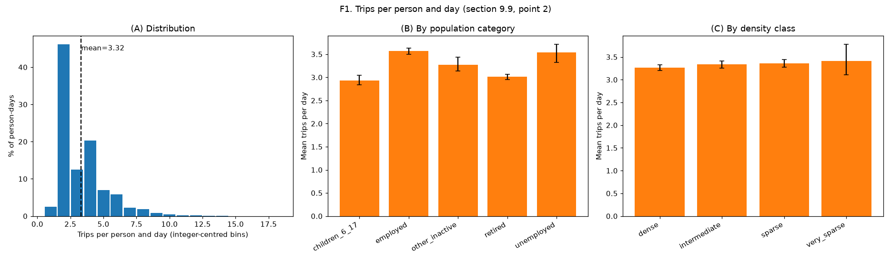

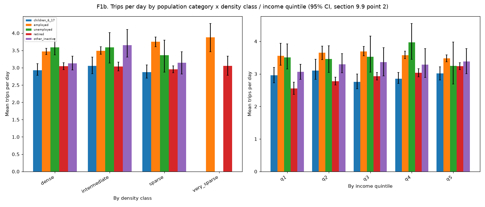

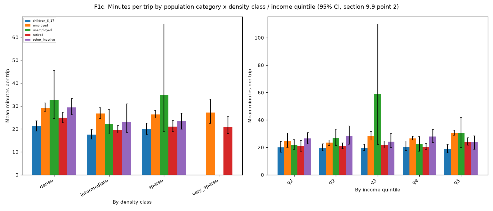

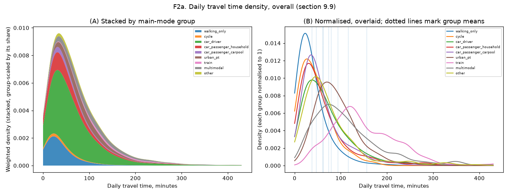

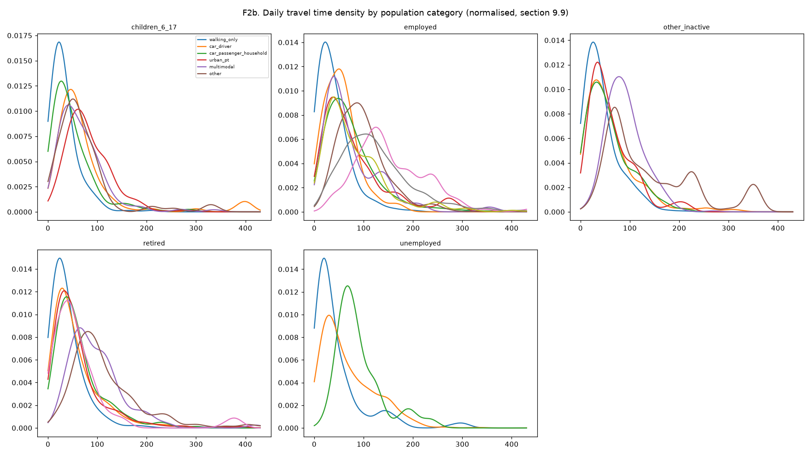

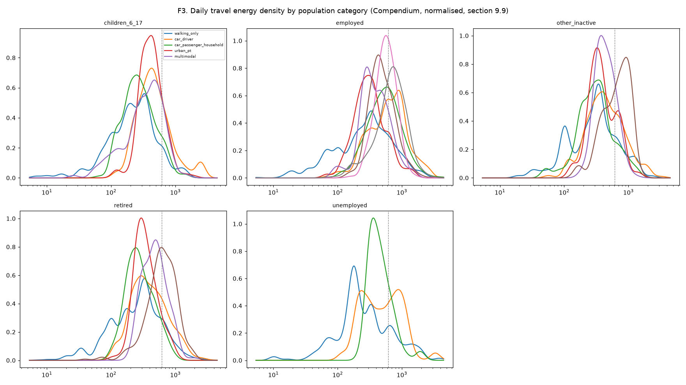

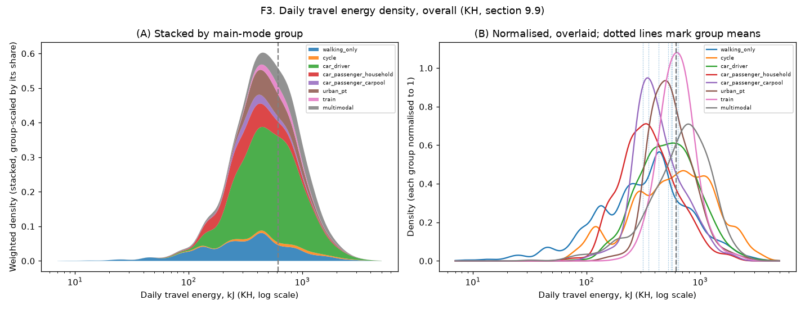

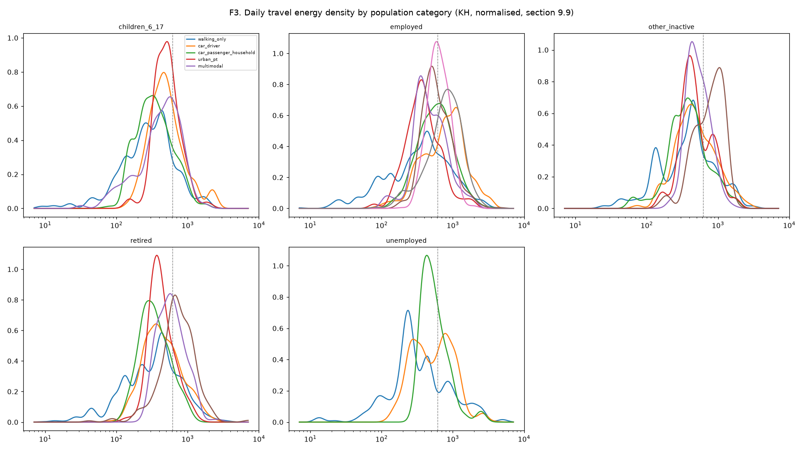

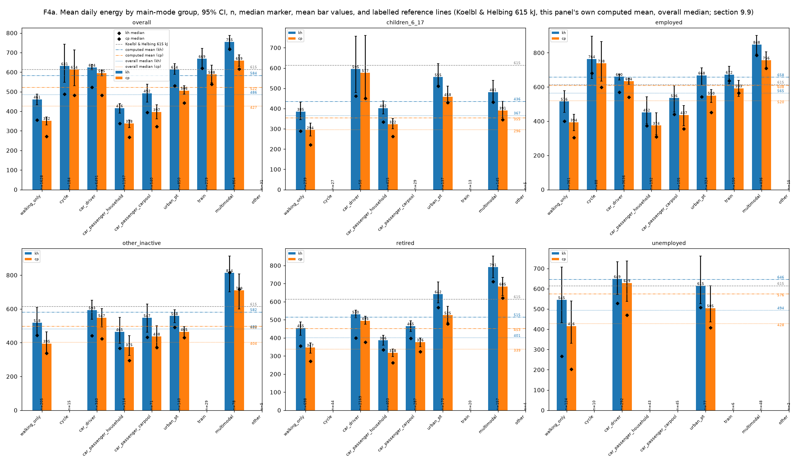

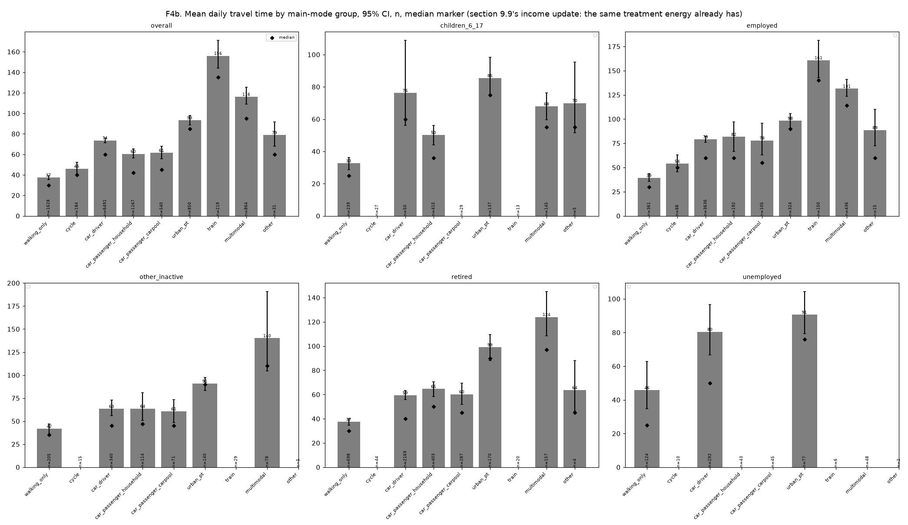

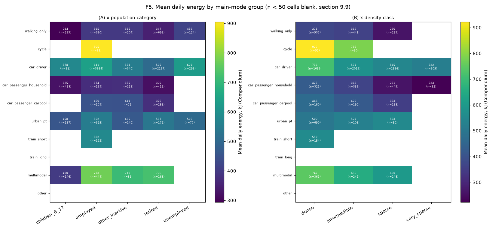

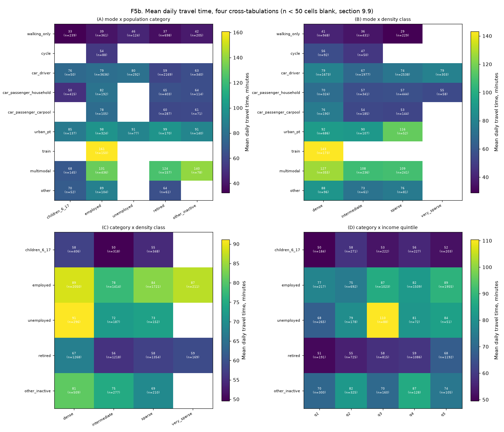

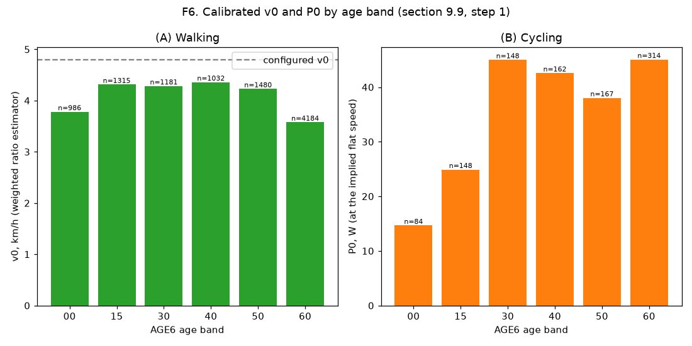

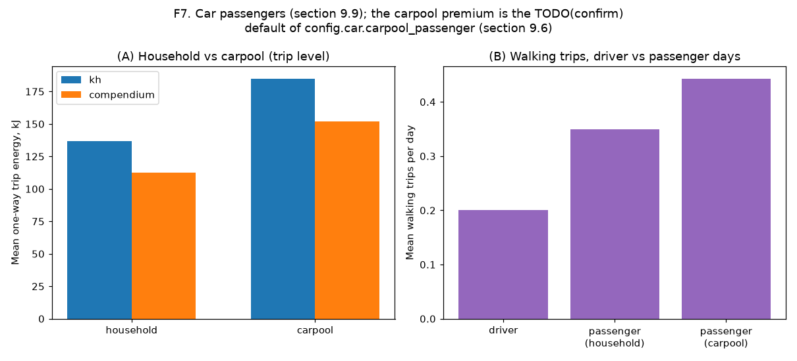

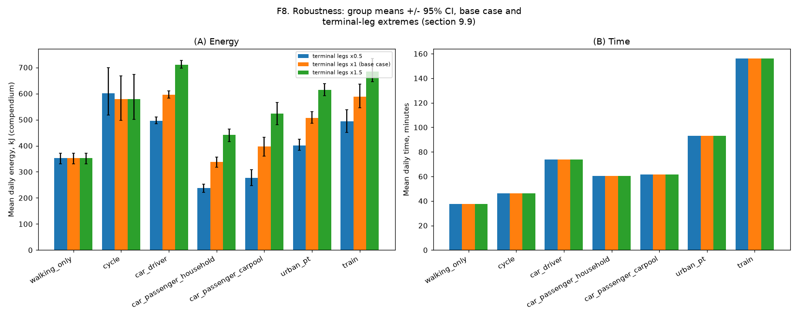

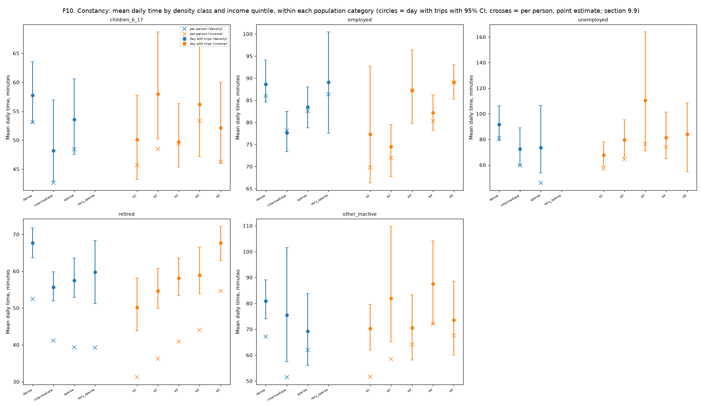

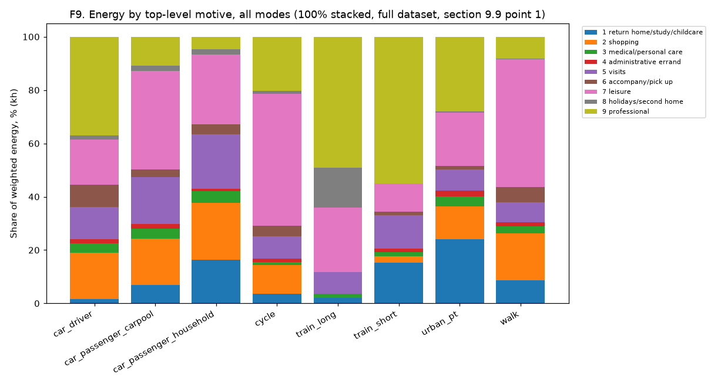

## Modelling notes and simplifications

- EMP 2019 gives no headway, station-depth or PT access-walk-distance data; `config.pt_ride.headway_min_am_peak`/`station_height_m`/`access_walk_m_by_density` are provisional TODO(confirm) defaults, used only by this step.
- Car terminal legs always use the apartment-density default: the public tables give no house/apartment split (section 9.6's `s_house`).
- `mode_group='other'` trips have no energy formula and contribute 0 kJ to a day's total; a day with only such trips is its own 'other' group, separate from 'multimodal'.
- The day's home density is the residence commune's own density (`trip_legs.residence_density`, 27 October 2026 decision), not the origin density of the home-departure trip.
- Bike get/park and stop-delay adjustment: unreliable (would consume over half, or all but under a minute, of a very short trip's declared duration) for a small share of cycling trips; these fall back to the naive whole-duration speed for both energy and the P0 estimator's ride-time denominator.
- F3/F4/F5 use the full set of day-mode groups (including multimodal and other); F8's robustness check is restricted to the seven groups the task names (walk, bike, driver, both passenger groups, urban PT, train).
- F8's figure shows bootstrap CIs for every terminal-legs variant with a CI (declared, declared + 1 min, former defaults x0.5/x1/x1.5), not every table variant (not weekdays-only, local-trips-only or the P0 reference, which have none).
