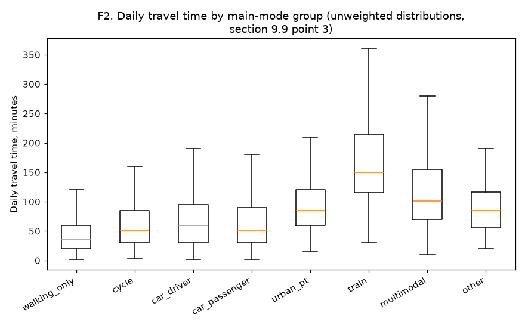
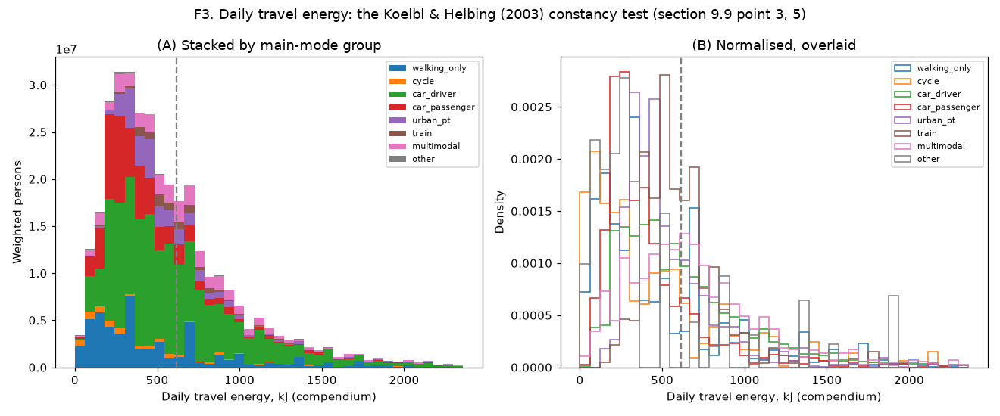
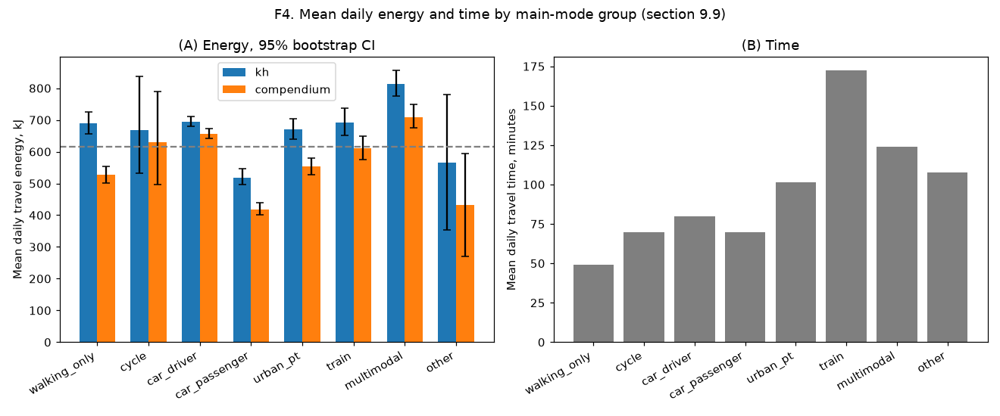
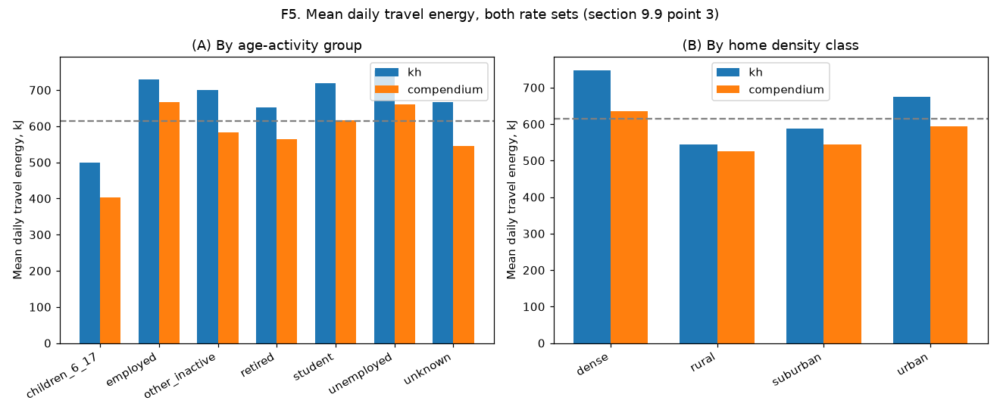

# Step 11 (`mobgrid/budget`): EMP 2019 re-estimation (section 9.9)

Generated by `python -m mobgrid.budget.emp`. Rebuilds section 9.9's re-estimation steps 1-3 and 5 on the EMP 2019 public tables (`K_DEPLOC`, `TCM_IND_KISH`, `K_INDIVIDU`, `Q_MENAGE`); terminal legs reuse sections 9.4-9.7's formulas and `config/energy.yaml`'s already-calibrated car/stairs/waiting/PT-ride defaults, plus new provisional PT headway/station-height/access-walk defaults (TODO(confirm), `config.pt_ride`). EMC² (step 4) and Ē_c (step 6) are out of scope.

**Variables used** (K_DEPLOC unless noted): mode `mtp`; duration `DUREE`; distance `MDISTTOT_fin`; purpose `MMOTIFDES`/`MOTPREC` (read, not yet used by this step's formulas); companions `MACCOMPM`/`MACCOMPHM` (household vs carpool passenger split); day `TYPEJOUR`; weights `POND_JOUR` (day) and `pond_indC` (K_INDIVIDU, individual); age band `AGE6` (TCM_IND_KISH); activity `SITUA` (TCM_IND_KISH, combined with `AGE` for the 6-17 children group); density of residence `DENSITECOM_ORI` of the home-departure trip (`MORIDOM`).

**Sample:** 13,136 respondent-days with at least one classified trip (455 of 13591 respondents report no trip that day, 2.7% by individual weight, reported apart per point 2).

## Mean daily energy and time by main-mode group (point 3)

| Group | n | weighted n | mean time (min) | mean energy kh (kJ) | 95% CI | mean energy compendium (kJ) | 95% CI |
|---|---|---|---|---|---|---|---|
| car_driver | 6852 | 165,532,364 | 79.8 | 693.4 | [679.2, 709.8] | 655.8 | [641.3, 673.1] |
| car_passenger | 1978 | 53,344,934 | 69.6 | 517.6 | [495.6, 546.0] | 417.8 | [400.9, 440.2] |
| walking_only | 1937 | 52,790,026 | 49.0 | 690.2 | [655.6, 725.0] | 526.9 | [500.4, 553.4] |
| multimodal | 981 | 29,465,364 | 124.1 | 813.0 | [774.5, 856.0] | 708.9 | [674.2, 748.9] |
| urban_pt | 885 | 26,473,853 | 101.5 | 671.3 | [638.9, 703.0] | 553.0 | [527.5, 580.3] |
| train | 232 | 7,452,934 | 172.4 | 691.8 | [651.9, 737.7] | 611.0 | [575.7, 649.1] |
| cycle | 231 | 6,812,124 | 69.6 | 669.0 | [532.7, 836.4] | 630.5 | [496.1, 789.4] |
| other | 40 | 1,452,718 | 107.7 | 564.8 | [353.5, 779.5] | 431.1 | [269.9, 595.0] |

## By age-activity group

| Group | n | weighted n | mean time (min) | mean energy kh (kJ) | 95% CI | mean energy compendium (kJ) | 95% CI |
|---|---|---|---|---|---|---|---|
| employed | 5610 | 159,240,099 | 90.5 | 729.3 | [714.6, 749.1] | 666.4 | [652.3, 685.8] |
| retired | 4512 | 78,656,691 | 71.9 | 652.1 | [628.5, 673.5] | 563.9 | [543.9, 581.4] |
| children_6_17 | 1186 | 56,532,242 | 60.1 | 498.8 | [474.2, 526.6] | 403.7 | [384.0, 427.3] |
| unemployed | 718 | 17,683,490 | 86.3 | 754.0 | [705.1, 818.6] | 659.4 | [607.6, 719.5] |
| student | 413 | 16,035,567 | 97.9 | 719.3 | [660.5, 770.2] | 616.9 | [561.5, 660.0] |
| other_inactive | 685 | 14,888,112 | 79.1 | 699.0 | [640.8, 750.2] | 582.1 | [531.0, 626.4] |
| unknown | 12 | 288,116 | 64.6 | 666.4 | [512.3, 744.1] | 544.6 | [441.7, 609.2] |

## By home density class

| Group | n | weighted n | mean time (min) | mean energy kh (kJ) | 95% CI | mean energy compendium (kJ) | 95% CI |
|---|---|---|---|---|---|---|---|
| dense | 4782 | 134,163,114 | 84.9 | 746.8 | [729.2, 766.2] | 635.8 | [620.6, 652.3] |
| suburban | 4100 | 101,063,694 | 78.3 | 587.7 | [564.1, 607.5] | 544.4 | [525.6, 562.9] |
| urban | 3762 | 96,924,974 | 78.0 | 675.1 | [651.6, 697.0] | 593.0 | [571.8, 613.8] |
| rural | 492 | 11,172,535 | 80.6 | 543.2 | [477.7, 626.5] | 525.1 | [459.0, 606.7] |

## Car passengers: household vs carpool (trip level)

| Group | n | weighted n | mean one-way energy kh (kJ) | mean one-way energy compendium (kJ) |
|---|---|---|---|---|
| car_passenger_household | 4138 | 130,739,307 | 137.5 | 113.3 |
| car_passenger_carpool | 1993 | 43,845,864 | 185.8 | 153.0 |
| walking trips of car_passenger days | 976 | 30,385,532 | 237.0 | 180.9 |

## Constancy test (point 3, 5)

- Overall weighted mean daily energy: 673.1 kJ (kh), 593.2 kJ (compendium); Koelbl & Helbing's (2003) hypothesis is 615 kJ.
- Max/min ratio of the six KH-comparable group means (walking_only, cycle, car_driver, car_passenger, urban_pt, train): 1.34 (kh), 1.57 (compendium).
- Method-of-moments gamma fit (point 5): shape=1.57, scale=429.7 kJ (kh); shape=1.49, scale=397.9 kJ (compendium).
- Mean trips per person and day: 3.50.

## Calibrated v0 and P0 (step 1)

- Overall v0: 4.45 km/h (configured: 4.8 km/h).
- Overall P0: 39.5 W (section 9.7's flat-ground reference: ~52.5 W at 16 km/h).

| Age band (AGE6) | n walk | v0 (km/h) | n cycle | P0 (W) |
|---|---|---|---|---|
| 00 | 986 | 4.45 | 84 | 24.5 |
| 15 | 1315 | 4.80 | 148 | 38.9 |
| 30 | 1181 | 4.96 | 148 | 43.8 |
| 40 | 1032 | 5.00 | 162 | 38.1 |
| 50 | 1480 | 4.76 | 167 | 35.3 |
| 60 | 4184 | 3.96 | 314 | 44.7 |

## Figures

## Modelling notes and simplifications

- EMP 2019 gives no headway, station-depth or PT access-walk-distance data; `config.pt_ride.headway_min_am_peak`/`station_height_m`/`access_walk_m_by_density` are new, provisional TODO(confirm) defaults (section 9.3's station table, section 9.4's frequency formula), used only by this step.
- Car terminal legs always use the apartment-density default (`config.car.walk_to_car.apartment_min_by_density`): the public tables give no house/apartment split (section 9.6's `s_house`).
- `mode_group='other'` trips (taxi, specialised/school transport, plane, boat, unclassified) have no energy formula and contribute 0 kJ to a day's total; a day with only such trips is its own 'other' group, separate from 'multimodal'.
- The day's home density is the origin density of its home-departure trip (`MORIDOM=1`), or the first trip by number if no such trip is recorded that day.
