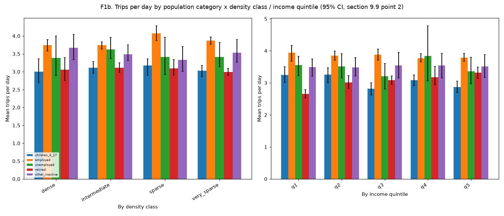
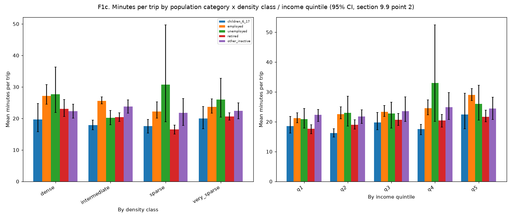
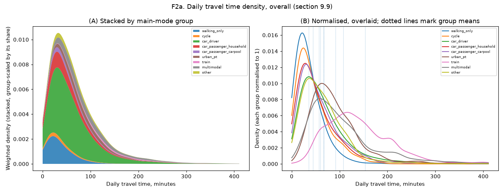
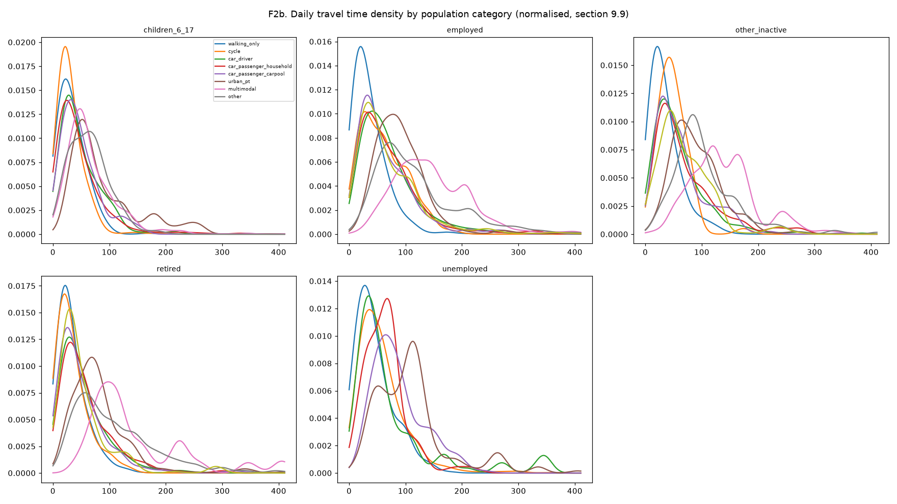
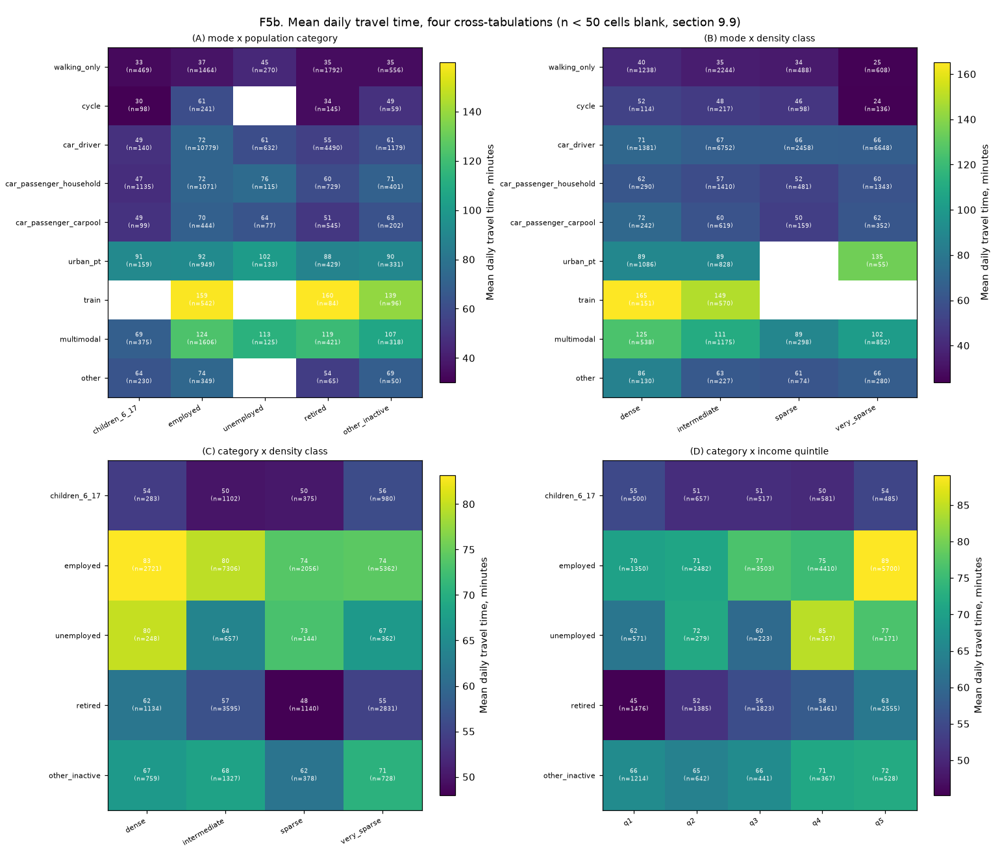
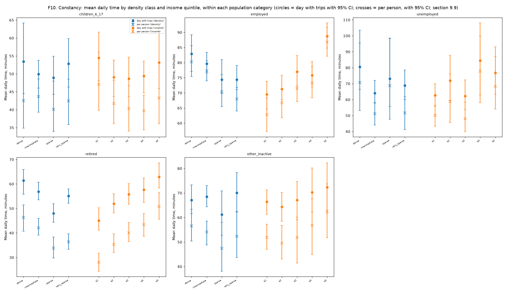

# Step 11 (`mobgrid/budget`): ENTD 2008 re-estimation (section 9.9)

Generated by `python -m mobgrid.budget.emp`. Rebuilds section 9.9's re-estimation steps 1-3 and 5 on the ENTD 2008 public tables, plus the F8 robustness check; terminal legs reuse sections 9.4-9.7's formulas and `config/energy.yaml`'s already-calibrated car/stairs/waiting/PT-ride defaults, plus provisional PT headway/station-height/access-walk defaults (TODO(confirm), `config.pt_ride`). EMC² (step 4) and Ē_c (step 6) are out of scope. Same model parameters (`config/energy.yaml`) in both surveys: differences reflect behaviour, not the model (section 9.9, "Change between 2008 and 2019"). Density: `proxy` (the INSEE grid, or section 9.9's urban-unit-status x residence-size proxy; ENTD 2008 always uses the proxy).

**Variables used** (`docs/data/entd2008.md`'s complete mapping, K_DEPLOC unless noted): mode `V2_MTP` (converted); duration `v2_mduree`/`V2_DUREE`; distance `distcor`/`V2_MDISTTOT`; purpose `V2_MMOTIFDES`/`V2_MMOTIFORI` (converted); companions `V2_MACCOMPM`/`V2_MACCOMPHM`; day `V2_TYPJOUR`, `mobloc` (from `V2_DLOCAL`); weights `POIDS_JOUR` (day) and `PONDKI` (K_INDIVIDU, individual); age band `AGE6` (Q_TCM_INDIVIDU); population category (section 6.1) from `SITUA` (Q_TCM_INDIVIDU) combined with `AGE` for the 6-17 children group; density: `Q_TCM_MENAGE.numcom_UUCat`/`TU99`, the residence commune's own density proxy (27 October 2026 decision; no density grid in ENTD 2008); non-traveller check `V2_MOBILREF` (K_INDIVIDU, reference weekday only).

**Sample flow** (persons and days kept apart, section 9.9's "Change between 2008 and 2019"; one described day per respondent in EMP 2019, up to three in ENTD 2008, weekday/Saturday/Sunday):

| Step | n |
|---|---|
| Respondents | 18,632 |
| Days with trips (15,687 weekdays, 11,670 Saturdays, 9,570 Sundays) | 36,927 |
| Days with energy | 36,253 |
| Days within scope | 33,643 |
| Days within scope with energy | 33,012 |

2,945 of 18,632 respondents report no trip on the reference weekday (15.8% unweighted, 15.0% by individual weight; reported apart per point 2).

## Main-mode-of-the-day groups (point 3)

walking only, bike, car driver, car passenger with a household driver, car passenger with a non-household driver (carpool), urban PT, train (short- and long-distance merged, step 11 round 8: train_long had too few observations to be a meaningful separate group), multimodal (two or more distinct non-walk modes in the day; driving and riding as a passenger count as two), other. **'other' contains:** powered two-wheelers under 50cm3 or unspecified (mtp 2.3-2.7), unspecified 3/4-wheeler (mtp 3.4), taxi/specialised/school transport (mtp 4.x), plane (mtp 7.x), boat (mtp 8.1), other/unspecified (mtp 9.1, missing, or the 9999 refusal code).

**Children as car drivers** (140 children_6_17 car_driver days): the raw `mtp` code is 3.1 (n=498, ages 6-17), 3.3 (n=1, ages 17-17). Both codes are `mtp` category 3 "Automobile" (3.1 "Conducteur", 3.3 "Tantot conducteur tantot passager"), not a two-wheeler code (2.x): no two-wheeler reclassification applies. `mtp` 3.1 includes "voiturette" (a license-free microcar, legal from age 14 in France), plausible for the 14-17 share, but not for the many 6-13 year olds here; most likely EMP's own household/accompanying-trip coding records the car's use rather than confirming the child personally drove.

## Density classes

INSEE's own 4-level grid names and order: dense (1, densely populated communes), intermediate (2), sparse (3, peu denses), very_sparse (4, tres peu denses). EMP 2019's `emp2019._DENSITY_LABEL_BY_CODE` maps `DENSITECOM_ORI`/`_DES` directly (grid); both surveys' `trip_legs.density_proxy_case_sql` computes the same four labels from the urban-unit-status x residence-size proxy of section 9.9's "Change between 2008 and 2019" when `density_source='proxy'` (this report: `proxy`). `trip_legs._DENSITY_KEY_TRANSLATION` re-keys `config.car`/`config.pt_ride`'s existing density defaults (chosen for step 7 as `dense`/`urban`/`suburban`/`rural`) to these same INSEE names and order, checked against `data/raw/emp2019/emp2019-categories.pdf`'s "Degre de densite" table. `home_density` (every per-day/per-person table below) is the **residence** commune's own density (`trip_legs.residence_density`; 27 October 2026 decision), from `TCM_MEN.DENSITECOM_RES`/`STATUTCOM_UU_RES` (EMP 2019) or `Q_TCM_MENAGE.numcom_UUCat`/`TU99` (ENTD 2008, proxy only) -- not the density of the trip departing from home, which this replaces: that proxy was undefined for a day with no home-departing trip in scope, and was not a property of the person.

## Time budget: constancy across density classes (point 3)

The reference constant (section 9.9, 27 October 2026 decision): is mean daily travel time the same across density classes of residence, within each population category? Day with trips, needs scope. Cells of fewer than 50 persons blank. The 95% CI column (bootstrap over households) gives time the same treatment energy already has (section 9.9's income update).

| Category | Density | n | mean time (min) | 95% CI | median time (min) |
|---|---|---|---|---|---|
| children_6_17 | dense | 278 | 53.5 | [44.5, 64.2] | 39.0 |
| children_6_17 | intermediate | 1064 | 50.0 | [46.0, 53.8] | 40.0 |
| children_6_17 | sparse | 350 | 48.9 | [44.3, 54.9] | 40.0 |
| children_6_17 | very_sparse | 831 | 52.8 | [46.3, 59.8] | 37.0 |
| employed | dense | 2647 | 83.0 | [77.1, 89.2] | 70.0 |
| employed | intermediate | 7189 | 79.7 | [76.5, 83.4] | 60.0 |
| employed | sparse | 2025 | 74.4 | [69.8, 81.0] | 60.0 |
| employed | very_sparse | 5281 | 74.4 | [71.1, 79.1] | 60.0 |
| unemployed | dense | 243 | 80.6 | [66.4, 103.5] | 65.0 |
| unemployed | intermediate | 655 | 64.1 | [57.6, 72.0] | 50.0 |
| unemployed | sparse | 143 | 73.1 | [55.7, 98.4] | 53.0 |
| unemployed | very_sparse | 356 | 69.0 | [60.0, 78.6] | 55.0 |
| retired | dense | 1124 | 61.4 | [55.8, 65.9] | 46.0 |
| retired | intermediate | 3575 | 56.9 | [53.5, 60.7] | 40.0 |
| retired | sparse | 1139 | 48.0 | [44.4, 52.0] | 32.0 |
| retired | very_sparse | 2808 | 55.1 | [52.2, 58.0] | 40.0 |
| other_inactive | dense | 753 | 67.1 | [61.6, 73.3] | 60.0 |
| other_inactive | intermediate | 1309 | 68.5 | [64.4, 73.0] | 55.0 |
| other_inactive | sparse | 369 | 61.3 | [52.8, 70.9] | 45.0 |
| other_inactive | very_sparse | 720 | 70.0 | [62.2, 78.3] | 50.0 |

### Constancy summary

| Category | dense/very_sparse | max/min | CV across classes |
|---|---|---|---|
| children_6_17 | 1.01 | 1.09 | 0.04 |
| employed | 1.11 | 1.11 | 0.05 |
| unemployed | 1.17 | 1.26 | 0.08 |
| retired | 1.11 | 1.28 | 0.09 |
| other_inactive | 0.96 | 1.14 | 0.05 |

## Time budget: constancy across income quintiles (section 9.9's income update)

Household income per consumption unit (modified OECD scale), in quintiles computed within this survey with individual weights (`docs/data/entd2008.md`'s "Income variables"): is mean daily travel time the same across income quintiles, within each population category, as income is treated as density is? Day with trips, needs scope. `'unknown'` (missing/refused income) is its own class, excluded from the constancy summary (not an ordered quantile).

| Category | Income quintile | n | mean time (min) | 95% CI | median time (min) |
|---|---|---|---|---|---|
| children_6_17 | q1 | 460 | 54.5 | [48.1, 61.7] | 40.0 |
| children_6_17 | q2 | 592 | 49.1 | [43.8, 53.8] | 40.0 |
| children_6_17 | q3 | 468 | 48.7 | [43.7, 54.6] | 38.0 |
| children_6_17 | q4 | 545 | 49.4 | [44.7, 53.6] | 40.0 |
| children_6_17 | q5 | 458 | 53.2 | [45.9, 63.2] | 40.0 |
| children_6_17 | unknown | 0 | - | - | - |
| employed | q1 | 1323 | 69.5 | [64.6, 73.9] | 58.0 |
| employed | q2 | 2432 | 71.2 | [67.8, 75.8] | 59.0 |
| employed | q3 | 3465 | 77.0 | [72.3, 82.4] | 60.0 |
| employed | q4 | 4333 | 75.8 | [72.0, 80.4] | 60.0 |
| employed | q5 | 5589 | 88.7 | [84.8, 93.1] | 70.0 |
| employed | unknown | 0 | - | - | - |
| unemployed | q1 | 567 | 62.8 | [55.8, 69.9] | 50.0 |
| unemployed | q2 | 273 | 71.9 | [59.5, 87.7] | 55.0 |
| unemployed | q3 | 221 | 62.3 | [53.8, 72.4] | 51.0 |
| unemployed | q4 | 165 | 84.5 | [63.0, 108.0] | 62.0 |
| unemployed | q5 | 171 | 76.7 | [63.5, 93.1] | 55.0 |
| unemployed | unknown | 0 | - | - | - |
| retired | q1 | 1459 | 45.0 | [41.2, 50.3] | 30.0 |
| retired | q2 | 1372 | 52.0 | [48.3, 56.0] | 40.0 |
| retired | q3 | 1815 | 55.8 | [51.7, 60.2] | 40.0 |
| retired | q4 | 1458 | 57.6 | [52.4, 62.5] | 40.0 |
| retired | q5 | 2542 | 62.9 | [58.4, 68.6] | 50.0 |
| retired | unknown | 0 | - | - | - |
| other_inactive | q1 | 1198 | 66.4 | [61.3, 71.2] | 55.0 |
| other_inactive | q2 | 634 | 64.3 | [58.5, 70.2] | 50.0 |
| other_inactive | q3 | 436 | 67.1 | [59.1, 74.7] | 52.0 |
| other_inactive | q4 | 364 | 70.3 | [62.3, 80.2] | 55.0 |
| other_inactive | q5 | 519 | 72.3 | [61.7, 82.3] | 55.0 |
| other_inactive | unknown | 0 | - | - | - |

### Constancy summary

| Category | q5/q1 | max/min | CV across classes |
|---|---|---|---|
| children_6_17 | 0.98 | 1.12 | 0.05 |
| employed | 1.28 | 1.28 | 0.09 |
| unemployed | 1.22 | 1.36 | 0.12 |
| retired | 1.40 | 1.40 | 0.11 |
| other_inactive | 1.09 | 1.12 | 0.04 |

### Quintile shares and cut points

Quintiles are cut to hold equal shares of individual weight (28 October 2026 decision): a tied income value (common -- EMP 2019's `decile_rev_uc` has only 10 distinct values, and ENTD 2008's bracket-midpoint/`NBUC` often repeats) straddling a cut point is split between the two quintiles in proportion, by a seeded random draw (`trip_legs.build_income_quintile_table`). `'unknown'` (missing/refused income) is its own row, excluded from the 20/40/60/80% cut, with its own breakdown below of *why* a value is missing (`entd2008.missing_income_breakdown`): a producer-side gap (no `Q_TCM_MENAGE` match, or a blank `TrancheRevenuMensuel`) versus this project's own code (a bracket label `income_bracket_midpoint_eur` could not parse, or a missing/zero `NBUC` making the division `NULL`).

| Quintile | n | Share of individual weight | Share of day weight |
|---|---|---|---|
| q1 | 3365 | 20.0% | 17.8% |
| q2 | 3162 | 20.0% | 19.5% |
| q3 | 3644 | 20.0% | 20.2% |
| q4 | 3671 | 20.0% | 21.1% |
| q5 | 4790 | 20.0% | 21.4% |
| unknown | 0 | 0.0% | 0.0% |

Cut points (q1/q2, q2/q3, q3/q4, q4/q5): 900.0, 1250.0, 1521.7, 2173.9.

Missing-income breakdown, of 18632 respondents: 0 (0.0%) with no matching household income record at all (a producer-side gap, not this project's code); 0 (0.0%) with a matched household but a blank `TrancheRevenuMensuel` (both producer-side); 0 (0.0%) with a bracket label this project's own `income_bracket_midpoint_eur` could not parse; 0 (0.0%) with a parsed bracket but a missing/zero `NBUC` (this project's own division, not the producer's).

## Trips per day and minutes per trip, by category, density and income quintile (section 9.9 point 2: daily time = trips/day x minutes/trip)

### Trips per day

#### By population category x density class

| Category | Density | n | mean trips/day | 95% CI | median trips/day |
|---|---|---|---|---|---|
| children_6_17 | dense | 278 | 3.00 | [2.69, 3.36] | 2.00 |
| children_6_17 | intermediate | 1064 | 3.11 | [2.95, 3.28] | 2.00 |
| children_6_17 | sparse | 350 | 3.17 | [2.90, 3.36] | 3.00 |
| children_6_17 | very_sparse | 831 | 3.03 | [2.87, 3.17] | 2.00 |
| employed | dense | 2647 | 3.74 | [3.58, 3.90] | 4.00 |
| employed | intermediate | 7189 | 3.74 | [3.64, 3.84] | 3.00 |
| employed | sparse | 2025 | 4.08 | [3.87, 4.29] | 4.00 |
| employed | very_sparse | 5281 | 3.87 | [3.77, 3.98] | 4.00 |
| unemployed | dense | 243 | 3.38 | [2.89, 4.00] | 3.00 |
| unemployed | intermediate | 655 | 3.62 | [3.36, 3.96] | 3.00 |
| unemployed | sparse | 143 | 3.42 | [2.91, 3.96] | 2.00 |
| unemployed | very_sparse | 356 | 3.41 | [3.13, 3.81] | 2.00 |
| retired | dense | 1124 | 3.05 | [2.76, 3.39] | 2.00 |
| retired | intermediate | 3575 | 3.11 | [2.99, 3.25] | 2.00 |
| retired | sparse | 1139 | 3.09 | [2.91, 3.34] | 2.00 |
| retired | very_sparse | 2808 | 2.99 | [2.90, 3.10] | 2.00 |
| other_inactive | dense | 753 | 3.67 | [3.34, 4.05] | 3.00 |
| other_inactive | intermediate | 1309 | 3.49 | [3.31, 3.75] | 3.00 |
| other_inactive | sparse | 369 | 3.33 | [3.01, 3.71] | 2.00 |
| other_inactive | very_sparse | 720 | 3.53 | [3.27, 3.90] | 3.00 |

#### By population category x income quintile

| Category | Income quintile | n | mean trips/day | 95% CI | median trips/day |
|---|---|---|---|---|---|
| children_6_17 | q1 | 460 | 3.25 | [3.01, 3.50] | 3.00 |
| children_6_17 | q2 | 592 | 3.26 | [3.00, 3.48] | 3.00 |
| children_6_17 | q3 | 468 | 2.82 | [2.63, 3.00] | 2.00 |
| children_6_17 | q4 | 545 | 3.09 | [2.91, 3.25] | 3.00 |
| children_6_17 | q5 | 458 | 2.87 | [2.69, 3.06] | 2.00 |
| children_6_17 | unknown | 0 | - | - | - |
| employed | q1 | 1323 | 3.95 | [3.68, 4.16] | 4.00 |
| employed | q2 | 2432 | 3.85 | [3.71, 4.00] | 4.00 |
| employed | q3 | 3465 | 3.88 | [3.70, 4.06] | 4.00 |
| employed | q4 | 4333 | 3.77 | [3.65, 3.92] | 3.00 |
| employed | q5 | 5589 | 3.79 | [3.67, 3.92] | 4.00 |
| employed | unknown | 0 | - | - | - |
| unemployed | q1 | 567 | 3.55 | [3.23, 3.83] | 3.00 |
| unemployed | q2 | 273 | 3.52 | [3.15, 3.91] | 3.00 |
| unemployed | q3 | 221 | 3.20 | [2.81, 3.60] | 2.00 |
| unemployed | q4 | 165 | 3.84 | [3.06, 4.78] | 3.00 |
| unemployed | q5 | 171 | 3.36 | [2.97, 3.80] | 2.00 |
| unemployed | unknown | 0 | - | - | - |
| retired | q1 | 1459 | 2.66 | [2.53, 2.79] | 2.00 |
| retired | q2 | 1372 | 3.01 | [2.83, 3.22] | 2.00 |
| retired | q3 | 1815 | 3.08 | [2.96, 3.22] | 2.00 |
| retired | q4 | 1458 | 3.18 | [2.94, 3.51] | 2.00 |
| retired | q5 | 2542 | 3.32 | [3.14, 3.49] | 2.00 |
| retired | unknown | 0 | - | - | - |
| other_inactive | q1 | 1198 | 3.49 | [3.21, 3.74] | 3.00 |
| other_inactive | q2 | 634 | 3.48 | [3.21, 3.79] | 3.00 |
| other_inactive | q3 | 436 | 3.55 | [3.15, 3.95] | 3.00 |
| other_inactive | q4 | 364 | 3.54 | [3.16, 3.93] | 3.00 |
| other_inactive | q5 | 519 | 3.51 | [3.16, 3.88] | 3.00 |
| other_inactive | unknown | 0 | - | - | - |

### Minutes per trip

#### By population category x density class

| Category | Density | n | mean min/trip | 95% CI | median min/trip |
|---|---|---|---|---|---|
| children_6_17 | dense | 278 | 19.67 | [15.80, 24.75] | 13.50 |
| children_6_17 | intermediate | 1064 | 17.87 | [16.46, 19.45] | 15.00 |
| children_6_17 | sparse | 350 | 17.54 | [15.31, 19.72] | 11.25 |
| children_6_17 | very_sparse | 831 | 20.00 | [16.68, 23.82] | 12.50 |
| employed | dense | 2647 | 27.13 | [24.51, 30.70] | 18.75 |
| employed | intermediate | 7189 | 25.57 | [24.61, 26.86] | 16.50 |
| employed | sparse | 2025 | 22.23 | [20.15, 25.26] | 14.80 |
| employed | very_sparse | 5281 | 23.67 | [21.69, 26.15] | 15.00 |
| unemployed | dense | 243 | 27.68 | [21.85, 36.29] | 21.00 |
| unemployed | intermediate | 655 | 20.18 | [18.00, 22.55] | 15.00 |
| unemployed | sparse | 143 | 30.74 | [18.97, 49.66] | 15.00 |
| unemployed | very_sparse | 356 | 25.94 | [20.45, 32.75] | 17.00 |
| retired | dense | 1124 | 23.05 | [20.62, 26.02] | 15.00 |
| retired | intermediate | 3575 | 20.37 | [19.04, 21.75] | 14.71 |
| retired | sparse | 1139 | 16.46 | [15.08, 17.85] | 11.67 |
| retired | very_sparse | 2808 | 20.66 | [19.47, 21.77] | 15.00 |
| other_inactive | dense | 753 | 22.28 | [20.14, 24.53] | 16.67 |
| other_inactive | intermediate | 1309 | 23.75 | [21.68, 25.93] | 15.00 |
| other_inactive | sparse | 369 | 21.75 | [17.78, 26.35] | 15.00 |
| other_inactive | very_sparse | 720 | 22.40 | [19.91, 24.99] | 15.00 |

#### By population category x income quintile

| Category | Income quintile | n | mean min/trip | 95% CI | median min/trip |
|---|---|---|---|---|---|
| children_6_17 | q1 | 460 | 18.60 | [16.25, 21.81] | 13.33 |
| children_6_17 | q2 | 592 | 16.25 | [14.92, 17.61] | 12.50 |
| children_6_17 | q3 | 468 | 19.78 | [17.29, 23.05] | 13.25 |
| children_6_17 | q4 | 545 | 17.50 | [15.69, 19.15] | 12.50 |
| children_6_17 | q5 | 458 | 22.42 | [17.68, 29.60] | 15.00 |
| children_6_17 | unknown | 0 | - | - | - |
| employed | q1 | 1323 | 21.18 | [19.62, 22.96] | 15.00 |
| employed | q2 | 2432 | 22.59 | [21.02, 24.99] | 15.00 |
| employed | q3 | 3465 | 23.32 | [21.78, 25.40] | 16.25 |
| employed | q4 | 4333 | 24.51 | [22.28, 27.32] | 16.25 |
| employed | q5 | 5589 | 29.05 | [27.11, 31.10] | 19.44 |
| employed | unknown | 0 | - | - | - |
| unemployed | q1 | 567 | 20.87 | [17.89, 24.48] | 15.00 |
| unemployed | q2 | 273 | 23.00 | [18.58, 28.55] | 16.67 |
| unemployed | q3 | 221 | 22.75 | [17.85, 26.56] | 16.50 |
| unemployed | q4 | 165 | 33.02 | [20.15, 52.43] | 17.50 |
| unemployed | q5 | 171 | 26.01 | [20.59, 32.20] | 20.83 |
| unemployed | unknown | 0 | - | - | - |
| retired | q1 | 1459 | 17.61 | [16.01, 19.02] | 14.50 |
| retired | q2 | 1372 | 19.02 | [17.51, 20.61] | 14.17 |
| retired | q3 | 1815 | 20.61 | [18.78, 22.74] | 14.50 |
| retired | q4 | 1458 | 20.39 | [18.21, 22.44] | 15.00 |
| retired | q5 | 2542 | 21.63 | [19.96, 23.89] | 15.00 |
| retired | unknown | 0 | - | - | - |
| other_inactive | q1 | 1198 | 22.32 | [20.09, 24.14] | 15.00 |
| other_inactive | q2 | 634 | 21.80 | [19.41, 23.95] | 15.00 |
| other_inactive | q3 | 436 | 23.55 | [20.05, 28.33] | 17.00 |
| other_inactive | q4 | 364 | 24.88 | [20.74, 29.83] | 15.00 |
| other_inactive | q5 | 519 | 24.44 | [20.76, 28.20] | 15.00 |
| other_inactive | unknown | 0 | - | - | - |

#### By density class and by income quintile (marginals)

| Group | n | weighted n | mean trips/day | 95% CI | median trips/day |
|---|---|---|---|---|---|
| intermediate | 13847 | 130,631,195 | 3.48 | [3.40, 3.55] | 3.00 |
| very_sparse | 10040 | 68,643,548 | 3.54 | [3.48, 3.61] | 3.00 |
| sparse | 4055 | 51,343,881 | 3.63 | [3.49, 3.74] | 3.00 |
| dense | 5070 | 41,447,830 | 3.48 | [3.36, 3.61] | 3.00 |

| Group | n | weighted n | mean trips/day | 95% CI | median trips/day |
|---|---|---|---|---|---|
| q5 | 9314 | 62,640,129 | 3.57 | [3.48, 3.65] | 3.00 |
| q4 | 6884 | 61,530,328 | 3.57 | [3.48, 3.67] | 3.00 |
| q3 | 6433 | 58,899,744 | 3.51 | [3.40, 3.62] | 3.00 |
| q2 | 5334 | 56,984,156 | 3.52 | [3.42, 3.61] | 3.00 |
| q1 | 5047 | 52,012,097 | 3.41 | [3.29, 3.51] | 3.00 |

| Group | n | weighted n | mean min/trip | 95% CI | median min/trip |
|---|---|---|---|---|---|
| employed | 17142 | 148,939,953 | 24.73 | [23.85, 25.88] | 16.25 |
| retired | 8646 | 57,610,905 | 20.03 | [19.21, 20.90] | 14.50 |
| children_6_17 | 2523 | 43,515,808 | 18.54 | [17.37, 19.98] | 13.00 |
| other_inactive | 3151 | 27,513,672 | 22.88 | [21.52, 24.27] | 15.00 |
| unemployed | 1397 | 11,338,057 | 23.66 | [21.10, 27.13] | 15.00 |

| Group | n | weighted n | mean min/trip | 95% CI | median min/trip |
|---|---|---|---|---|---|
| intermediate | 13847 | 130,631,195 | 22.90 | [22.23, 23.65] | 15.00 |
| very_sparse | 10040 | 68,643,548 | 22.52 | [21.25, 24.08] | 15.00 |
| sparse | 4055 | 51,343,881 | 20.31 | [18.93, 22.14] | 13.40 |
| dense | 5070 | 41,447,830 | 24.61 | [23.06, 26.66] | 17.14 |

| Group | n | weighted n | mean min/trip | 95% CI | median min/trip |
|---|---|---|---|---|---|
| q5 | 9314 | 62,640,129 | 26.29 | [25.06, 27.76] | 16.36 |
| q4 | 6884 | 61,530,328 | 23.06 | [21.41, 24.95] | 15.00 |
| q3 | 6433 | 58,899,744 | 22.09 | [21.14, 23.35] | 15.00 |
| q2 | 5334 | 56,984,156 | 20.84 | [19.83, 22.01] | 14.80 |
| q1 | 5047 | 52,012,097 | 20.11 | [19.22, 21.12] | 15.00 |

## Per-person budget, days without trips included (section 9.9 point 2b)

P(out on the weekday) x T(weekday|out), weekday only (comparable with ENTD 2008's own, unverified-weekend-eligibility budget); ENTD 2008 reports the weekday budget only: its weekend eligibility is unverified (`docs/progress.md`).

### By population category

#### Weekday

| Category | n | P(out) | T\|out (min) | budget (min) | 95% CI |
|---|---|---|---|---|---|
| children_6_17 | 1107 | 0.900 | 47.2 | 42.5 | [39.7, 45.7] |
| employed | 7700 | 0.921 | 80.4 | 74.0 | [72.1, 76.5] |
| unemployed | 619 | 0.818 | 68.6 | 56.1 | [51.2, 61.9] |
| retired | 3654 | 0.713 | 55.4 | 39.5 | [37.8, 41.7] |
| other_inactive | 1391 | 0.784 | 67.6 | 53.1 | [49.7, 56.9] |
| overall | 14546 | 0.850 | 68.6 | 58.3 | [57.1, 59.8] |

### By population category x density class (weekday budget)

| Category | Density | n | P(out) | T\|out (min) | budget (min) | 95% CI |
|---|---|---|---|---|---|---|
| children_6_17 | dense | 122 | 0.937 | 45.4 | 42.5 | [34.8, 53.3] |
| children_6_17 | intermediate | 475 | 0.907 | 48.1 | 43.7 | [39.3, 48.6] |
| children_6_17 | sparse | 161 | 0.897 | 44.7 | 40.1 | [33.9, 48.0] |
| children_6_17 | very_sparse | 349 | 0.872 | 48.7 | 42.4 | [35.9, 48.5] |
| employed | dense | 1120 | 0.955 | 84.0 | 80.3 | [75.4, 85.6] |
| employed | intermediate | 3110 | 0.934 | 82.7 | 77.2 | [74.0, 80.6] |
| employed | sparse | 951 | 0.920 | 76.6 | 70.4 | [65.5, 76.0] |
| employed | very_sparse | 2519 | 0.884 | 76.9 | 68.0 | [64.0, 71.8] |
| unemployed | dense | 97 | 0.868 | 81.5 | 70.8 | [53.2, 95.6] |
| unemployed | intermediate | 289 | 0.823 | 62.3 | 51.3 | [44.1, 58.4] |
| unemployed | sparse | 65 | 0.860 | 79.9 | 68.8 | [47.7, 98.5] |
| unemployed | very_sparse | 168 | 0.742 | 69.6 | 51.6 | [41.2, 61.8] |
| retired | dense | 456 | 0.771 | 60.2 | 46.4 | [40.8, 51.4] |
| retired | intermediate | 1485 | 0.739 | 57.0 | 42.1 | [39.2, 46.0] |
| retired | sparse | 501 | 0.725 | 46.7 | 33.9 | [29.8, 38.3] |
| retired | very_sparse | 1212 | 0.642 | 56.7 | 36.4 | [33.4, 39.6] |
| other_inactive | dense | 318 | 0.863 | 65.6 | 56.6 | [50.4, 63.4] |
| other_inactive | intermediate | 572 | 0.782 | 69.3 | 54.1 | [48.8, 58.5] |
| other_inactive | sparse | 176 | 0.785 | 60.5 | 47.5 | [38.1, 58.1] |
| other_inactive | very_sparse | 325 | 0.714 | 73.4 | 52.4 | [43.7, 62.5] |

### By population category x income quintile (weekday budget)

| Category | Income quintile | n | P(out) | T\|out (min) | budget (min) | 95% CI |
|---|---|---|---|---|---|---|
| children_6_17 | q1 | 211 | 0.920 | 51.1 | 47.0 | [39.8, 56.1] |
| children_6_17 | q2 | 255 | 0.885 | 47.1 | 41.7 | [36.1, 48.3] |
| children_6_17 | q3 | 206 | 0.880 | 45.8 | 40.3 | [34.1, 46.8] |
| children_6_17 | q4 | 238 | 0.909 | 43.7 | 39.7 | [34.4, 44.1] |
| children_6_17 | q5 | 197 | 0.908 | 47.7 | 43.3 | [36.1, 53.1] |
| employed | q1 | 625 | 0.891 | 70.5 | 62.8 | [57.3, 68.4] |
| employed | q2 | 1119 | 0.926 | 72.0 | 66.7 | [61.8, 71.2] |
| employed | q3 | 1563 | 0.910 | 78.6 | 71.5 | [67.1, 76.7] |
| employed | q4 | 1939 | 0.923 | 79.4 | 73.3 | [68.4, 78.7] |
| employed | q5 | 2454 | 0.938 | 92.6 | 86.8 | [82.2, 91.6] |
| unemployed | q1 | 258 | 0.798 | 62.9 | 50.2 | [43.3, 56.6] |
| unemployed | q2 | 120 | 0.794 | 74.1 | 58.8 | [45.6, 76.2] |
| unemployed | q3 | 95 | 0.770 | 62.3 | 48.0 | [40.1, 58.4] |
| unemployed | q4 | 73 | 0.955 | 81.4 | 77.8 | [58.2, 99.8] |
| unemployed | q5 | 73 | 0.907 | 75.2 | 68.2 | [54.0, 86.9] |
| retired | q1 | 629 | 0.609 | 46.0 | 28.0 | [24.4, 31.8] |
| retired | q2 | 577 | 0.666 | 53.0 | 35.3 | [32.0, 39.7] |
| retired | q3 | 765 | 0.739 | 54.2 | 40.0 | [36.5, 44.2] |
| retired | q4 | 623 | 0.760 | 57.1 | 43.4 | [38.6, 47.9] |
| retired | q5 | 1060 | 0.801 | 63.4 | 50.7 | [45.6, 56.5] |
| other_inactive | q1 | 547 | 0.783 | 66.3 | 51.9 | [47.1, 57.3] |
| other_inactive | q2 | 282 | 0.765 | 64.7 | 49.5 | [43.1, 56.8] |
| other_inactive | q3 | 191 | 0.762 | 68.0 | 51.8 | [41.5, 60.2] |
| other_inactive | q4 | 148 | 0.802 | 70.8 | 56.8 | [45.0, 67.6] |
| other_inactive | q5 | 223 | 0.835 | 74.9 | 62.6 | [51.8, 73.7] |

## Quirks: `distcor`/`v2_mduree` fill rate and mean change (section 9.9)

`k_deploc`'s seven undocumented correction columns (`docs/data/entd2008.md`'s "Quirks"); `distcor`/`v2_mduree` are used (when filled) by `trips_norm`, the other five are not.

- `distcor`: 0.23% filled, mean change 0.67 km (corrected - declared) where filled.
- `v2_mduree`: 0.00% filled (never filled in this release: `duration_min` always falls back to `V2_DUREE`).

## Mean daily energy and time by main-mode group (point 3)

| Group | n | weighted n | mean time (min) | median time (min) | mean energy kh (kJ) | median energy kh (kJ) | 95% CI | mean energy compendium (kJ) | median energy compendium (kJ) | 95% CI |
|---|---|---|---|---|---|---|---|---|---|---|
| car_driver | 17239 | 151,948,944 | 66.8 | 54.0 | 347.3 | 261.6 | [338.8, 355.6] | 401.4 | 325.0 | [392.4, 410.8] |
| walking_only | 4577 | 41,615,021 | 35.3 | 29.0 | 471.2 | 355.2 | [444.9, 494.7] | 359.7 | 271.1 | [339.6, 377.6] |
| car_passenger_household | 3524 | 31,557,412 | 57.1 | 40.0 | 183.9 | 107.5 | [174.2, 194.9] | 164.3 | 105.1 | [155.8, 172.4] |
| multimodal | 2863 | 27,964,346 | 107.1 | 85.0 | 458.5 | 345.0 | [430.4, 490.2] | 447.1 | 354.8 | [417.5, 476.8] |
| urban_pt | 2007 | 17,307,089 | 91.2 | 80.0 | 599.2 | 518.5 | [565.9, 631.1] | 494.7 | 435.2 | [468.9, 520.8] |
| car_passenger_carpool | 1372 | 8,576,737 | 59.9 | 44.0 | 241.3 | 139.1 | [218.9, 268.2] | 209.6 | 139.8 | [191.8, 230.7] |
| train | 784 | 6,131,176 | 153.2 | 131.0 | 759.3 | 676.6 | [707.8, 814.8] | 649.7 | 588.4 | [611.8, 694.2] |
| cycle | 565 | 6,086,548 | 44.6 | 31.0 | 610.7 | 450.7 | [528.1, 702.9] | 592.3 | 421.2 | [513.0, 676.7] |
| other | 81 | 879,181 | 72.8 | 64.0 | 291.8 | 222.0 | [243.0, 352.0] | 222.7 | 169.5 | [185.5, 268.7] |

## Section 9.9's scope: commuting and travel for needs fulfilment

Every table and figure above and below is restricted to this scope (2026-10-20 project decision, not an optional variant): trips whose corrected motive (`motive`, `MOT_SEQ_COMPL`) is sport (7.6), a destination-less stroll (7.7, "se promener sans destination precise"), going to a place to walk/ride (7.8, a destination exists, but the movement itself is the point), or any top-level motive group 8 purpose (8.1-8.4: holidays, second/occasional residence, other private reasons -- none of them a needs-fulfilment destination) are excluded from every day's energy/time sums and from day classification; a day whose only trips were these becomes a non-traveller for this analysis. A missing/refused motive is kept, not excluded. See F9 and the table below for the evidence behind this decision, computed on the full, pre-exclusion dataset.

| Group | excluded trip share | n excluded / n total | excluded share of day energy (kh) | excluded share of day energy (cp) |
|---|---|---|---|---|
| car_driver | 8.1% | 6,944 / 65,699 | 15.0% | 13.1% |
| car_passenger_carpool | 14.4% | 682 / 4,145 | 26.8% | 26.3% |
| car_passenger_household | 14.9% | 2,117 / 11,670 | 26.2% | 25.2% |
| cycle | 25.1% | 780 / 2,421 | 42.9% | 43.1% |
| multimodal | 12.1% | 2,598 / 17,392 | 24.1% | 23.5% |
| other | 17.2% | 100 / 518 | 32.0% | 32.0% |
| train | 7.3% | 175 / 1,866 | 9.5% | 9.3% |
| urban_pt | 8.4% | 712 / 6,482 | 13.4% | 13.1% |
| walking_only | 18.9% | 3,735 / 15,259 | 30.7% | 30.7% |

## Data-quality correction: implausible door-to-door speeds

Trips are corrected, not dropped (section 9.9, step 11 round 5): flagged above an upper speed bound only -- walk > 7 km/h, bike > 35 km/h, car (driver or passenger) > 130 km/h -- their declared distance is replaced by declared duration x the mode's own median speed (from its not-flagged trips). Cycling energy's main work term is time-based (round 4), but its "stops" sub-term still multiplies by distance and by the distance-derived ride speed squared (section 9.7), so a flagged bike trip's distance is corrected too, like walk and car (round 9).

- car_driver: 319 of 66,480 trips corrected
- car_passenger_carpool: 29 of 5,432 trips corrected
- car_passenger_household: 65 of 13,390 trips corrected
- cycle: 25 of 3,266 trips corrected
- other: 0 of 2,858 trips corrected
- train: 0 of 2,215 trips corrected
- urban_pt: 0 of 6,029 trips corrected
- walk: 467 of 27,429 trips corrected

## Mean daily energy and time by main-mode group, overall and by population category (F4)

### overall

| Group | n | weighted n | mean time (min) | median time (min) | mean energy kh (kJ) | median energy kh (kJ) | 95% CI | mean energy compendium (kJ) | median energy compendium (kJ) | 95% CI |
|---|---|---|---|---|---|---|---|---|---|---|
| car_driver | 17239 | 151,948,944 | 66.8 | 54.0 | 347.3 | 261.6 | [338.8, 355.6] | 401.4 | 325.0 | [392.4, 410.8] |
| walking_only | 4577 | 41,615,021 | 35.3 | 29.0 | 471.2 | 355.2 | [444.9, 494.7] | 359.7 | 271.1 | [339.6, 377.6] |
| car_passenger_household | 3524 | 31,557,412 | 57.1 | 40.0 | 183.9 | 107.5 | [174.2, 194.9] | 164.3 | 105.1 | [155.8, 172.4] |
| multimodal | 2863 | 27,964,346 | 107.1 | 85.0 | 458.5 | 345.0 | [430.4, 490.2] | 447.1 | 354.8 | [417.5, 476.8] |
| urban_pt | 2007 | 17,307,089 | 91.2 | 80.0 | 599.2 | 518.5 | [565.9, 631.1] | 494.7 | 435.2 | [468.9, 520.8] |
| car_passenger_carpool | 1372 | 8,576,737 | 59.9 | 44.0 | 241.3 | 139.1 | [218.9, 268.2] | 209.6 | 139.8 | [191.8, 230.7] |
| train | 784 | 6,131,176 | 153.2 | 131.0 | 759.3 | 676.6 | [707.8, 814.8] | 649.7 | 588.4 | [611.8, 694.2] |
| cycle | 565 | 6,086,548 | 44.6 | 31.0 | 610.7 | 450.7 | [528.1, 702.9] | 592.3 | 421.2 | [513.0, 676.7] |
| other | 81 | 879,181 | 72.8 | 64.0 | 291.8 | 222.0 | [243.0, 352.0] | 222.7 | 169.5 | [185.5, 268.7] |

### children_6_17

| Group | n | weighted n | mean time (min) | median time (min) | mean energy kh (kJ) | median energy kh (kJ) | 95% CI | mean energy compendium (kJ) | median energy compendium (kJ) | 95% CI |
|---|---|---|---|---|---|---|---|---|---|---|
| car_passenger_household | 1135 | 16,067,591 | 47.4 | 35.0 | 166.9 | 96.0 | [147.9, 188.0] | 146.6 | 97.5 | [130.9, 162.6] |
| walking_only | 469 | 10,797,323 | 33.3 | 30.0 | 446.8 | 399.6 | [400.5, 500.1] | 341.1 | 305.0 | [305.7, 381.7] |
| multimodal | 375 | 6,800,844 | 69.3 | 55.0 | 246.9 | 139.5 | [193.2, 300.8] | 222.6 | 131.6 | [174.5, 265.4] |
| urban_pt | 159 | 3,079,751 | 91.2 | 60.0 | 545.2 | 399.7 | [419.6, 658.9] | 451.8 | 338.8 | [349.7, 543.0] |
| car_driver | 140 | 2,632,870 | 48.7 | 36.0 | 251.6 | 209.9 | [212.3, 294.3] | 291.2 | 233.8 | [248.7, 342.2] |
| cycle | 98 | 1,872,962 | 30.2 | 23.0 | 419.5 | 325.1 | [350.6, 490.7] | 404.8 | 326.2 | [343.1, 468.0] |
| car_passenger_carpool | 99 | 1,274,399 | 49.0 | 44.0 | 164.6 | 114.9 | [113.9, 211.7] | 147.7 | 112.1 | [108.7, 180.9] |
| train | 35 | 647,622 | 116.4 | 63.0 | 760.5 | 752.8 | [565.2, 981.8] | 628.4 | 588.4 | [469.5, 817.9] |
| other | 13 | 342,445 | 59.7 | 62.0 | 260.4 | 199.8 | [170.4, 402.4] | 198.8 | 152.5 | [130.1, 307.2] |

### employed

| Group | n | weighted n | mean time (min) | median time (min) | mean energy kh (kJ) | median energy kh (kJ) | 95% CI | mean energy compendium (kJ) | median energy compendium (kJ) | 95% CI |
|---|---|---|---|---|---|---|---|---|---|---|
| car_driver | 10779 | 100,755,648 | 72.1 | 60.0 | 366.3 | 285.2 | [355.9, 378.3] | 428.3 | 336.1 | [416.9, 441.2] |
| multimodal | 1606 | 14,456,313 | 123.8 | 101.0 | 529.2 | 431.3 | [497.6, 572.9] | 529.5 | 449.9 | [498.9, 571.9] |
| walking_only | 1463 | 10,618,359 | 37.0 | 30.0 | 528.8 | 399.6 | [473.5, 607.5] | 403.6 | 305.0 | [361.4, 463.7] |
| urban_pt | 949 | 7,441,285 | 92.3 | 85.0 | 636.2 | 559.2 | [594.5, 669.0] | 525.0 | 474.7 | [491.1, 550.5] |
| car_passenger_household | 1071 | 5,880,923 | 71.8 | 55.0 | 224.8 | 129.1 | [195.2, 257.8] | 202.1 | 130.0 | [179.3, 227.9] |
| train | 542 | 4,169,189 | 159.2 | 140.0 | 737.7 | 669.1 | [687.6, 794.4] | 637.3 | 587.2 | [595.4, 682.3] |
| car_passenger_carpool | 444 | 3,115,892 | 70.1 | 50.0 | 270.7 | 177.3 | [228.1, 314.6] | 237.1 | 178.8 | [204.2, 275.1] |
| cycle | 241 | 2,204,699 | 61.0 | 60.0 | 829.3 | 777.0 | [690.9, 984.7] | 800.1 | 766.1 | [674.5, 945.8] |
| other | 47 | 297,646 | 80.8 | 66.0 | 310.5 | 266.4 | [251.2, 386.4] | 237.0 | 203.4 | [191.7, 295.0] |

### other_inactive

| Group | n | weighted n | mean time (min) | median time (min) | mean energy kh (kJ) | median energy kh (kJ) | 95% CI | mean energy compendium (kJ) | median energy compendium (kJ) | 95% CI |
|---|---|---|---|---|---|---|---|---|---|---|
| car_driver | 1179 | 10,705,942 | 61.4 | 45.0 | 346.7 | 252.0 | [309.0, 380.5] | 384.9 | 297.9 | [349.8, 420.8] |
| walking_only | 556 | 5,280,693 | 34.7 | 29.0 | 497.5 | 421.8 | [435.4, 558.4] | 379.8 | 322.0 | [332.4, 426.2] |
| urban_pt | 331 | 3,357,119 | 90.5 | 80.0 | 597.8 | 523.5 | [541.4, 667.8] | 493.4 | 454.5 | [450.5, 545.1] |
| car_passenger_household | 401 | 2,777,068 | 70.5 | 52.0 | 246.0 | 126.0 | [189.8, 293.2] | 216.4 | 130.0 | [171.0, 254.3] |
| multimodal | 318 | 2,581,524 | 106.7 | 90.0 | 559.1 | 527.3 | [484.6, 630.0] | 516.5 | 504.1 | [453.1, 578.3] |
| car_passenger_carpool | 202 | 1,171,470 | 62.6 | 55.0 | 287.1 | 129.9 | [188.7, 373.9] | 244.7 | 132.6 | [170.0, 311.6] |
| train | 96 | 854,993 | 139.1 | 128.0 | 819.1 | 672.8 | [696.1, 935.0] | 688.2 | 567.8 | [590.7, 772.5] |
| cycle | 59 | 654,859 | 48.6 | 45.0 | 669.6 | 620.9 | [542.2, 808.5] | 651.9 | 620.9 | [528.1, 764.2] |
| other | 9 | 130,004 | 70.1 | 80.0 | 269.0 | 244.2 | [223.3, 465.4] | 205.3 | 186.4 | [170.5, 355.2] |

### retired

| Group | n | weighted n | mean time (min) | median time (min) | mean energy kh (kJ) | median energy kh (kJ) | 95% CI | mean energy compendium (kJ) | median energy compendium (kJ) | 95% CI |
|---|---|---|---|---|---|---|---|---|---|---|
| car_driver | 4490 | 32,366,693 | 54.9 | 40.0 | 300.4 | 235.2 | [287.7, 316.8] | 338.1 | 268.3 | [324.3, 354.9] |
| walking_only | 1792 | 11,559,622 | 34.7 | 25.0 | 407.6 | 310.8 | [380.5, 433.6] | 311.1 | 237.2 | [290.4, 330.9] |
| car_passenger_household | 729 | 4,975,407 | 60.4 | 45.0 | 160.6 | 107.5 | [140.9, 181.4] | 149.2 | 97.5 | [131.9, 166.5] |
| car_passenger_carpool | 545 | 2,474,663 | 51.4 | 35.0 | 207.3 | 117.9 | [170.0, 252.6] | 179.9 | 112.1 | [149.5, 214.1] |
| multimodal | 421 | 2,432,222 | 118.8 | 90.0 | 541.4 | 368.5 | [448.3, 639.8] | 532.9 | 409.7 | [451.3, 624.9] |
| urban_pt | 429 | 2,233,795 | 88.5 | 75.0 | 544.5 | 495.0 | [487.5, 601.3] | 448.6 | 410.4 | [403.1, 493.5] |
| cycle | 145 | 1,161,258 | 34.3 | 28.0 | 465.6 | 365.9 | [347.9, 619.5] | 460.1 | 366.1 | [342.0, 614.4] |
| train | 84 | 298,531 | 160.0 | 120.0 | 772.0 | 700.1 | [694.8, 864.3] | 658.0 | 571.8 | [595.7, 730.6] |
| other | 11 | 108,715 | 95.3 | 65.0 | 367.0 | 222.0 | [153.7, 578.1] | 280.2 | 169.5 | [117.3, 441.3] |

### unemployed

| Group | n | weighted n | mean time (min) | median time (min) | mean energy kh (kJ) | median energy kh (kJ) | 95% CI | mean energy compendium (kJ) | median energy compendium (kJ) | 95% CI |
|---|---|---|---|---|---|---|---|---|---|---|
| car_driver | 632 | 5,111,860 | 60.7 | 50.0 | 327.7 | 252.0 | [295.5, 366.2] | 371.7 | 311.5 | [337.2, 411.8] |
| walking_only | 270 | 2,629,877 | 45.1 | 35.0 | 635.3 | 532.8 | [552.0, 719.7] | 485.0 | 406.7 | [421.4, 549.4] |
| multimodal | 125 | 1,145,197 | 113.0 | 108.0 | 538.9 | 400.3 | [404.8, 708.5] | 513.7 | 405.4 | [396.8, 665.3] |
| urban_pt | 133 | 898,081 | 101.6 | 80.0 | 665.4 | 586.4 | [571.9, 797.0] | 549.8 | 494.8 | [470.1, 660.4] |
| car_passenger_household | 115 | 787,954 | 75.6 | 45.0 | 227.4 | 150.1 | [162.3, 318.6] | 206.1 | 128.5 | [150.6, 277.7] |
| car_passenger_carpool | 77 | 456,847 | 64.1 | 60.0 | 328.5 | 215.1 | [218.9, 436.0] | 275.7 | 195.7 | [195.5, 361.6] |
| cycle | 19 | 161,338 | 49.3 | 50.0 | 681.2 | 680.2 | [433.3, 987.2] | 665.8 | 680.4 | [430.5, 947.2] |
| train | 25 | 146,532 | 217.1 | 185.0 | 1008.1 | 1015.5 | [846.8, 1147.1] | 867.8 | 914.1 | [724.4, 1009.1] |
| other | 1 | 370 | 129.0 | 129.0 | 111.0 | 111.0 | [111.0, 111.0] | 84.7 | 84.7 | [84.7, 84.7] |

## By population category (section 6.1)

| Group | n | weighted n | mean time (min) | median time (min) | mean energy kh (kJ) | median energy kh (kJ) | 95% CI | mean energy compendium (kJ) | median energy compendium (kJ) | 95% CI |
|---|---|---|---|---|---|---|---|---|---|---|
| employed | 17142 | 148,939,953 | 77.9 | 60.0 | 416.7 | 315.0 | [406.0, 428.6] | 439.2 | 352.1 | [427.7, 452.2] |
| retired | 8646 | 57,610,905 | 55.4 | 40.0 | 331.4 | 252.0 | [321.9, 343.6] | 326.1 | 242.8 | [317.7, 336.6] |
| children_6_17 | 2523 | 43,515,808 | 50.9 | 40.0 | 301.1 | 205.1 | [279.4, 324.8] | 255.8 | 184.3 | [238.1, 272.9] |
| other_inactive | 3151 | 27,513,672 | 67.2 | 55.0 | 435.5 | 311.0 | [412.8, 457.9] | 401.5 | 314.5 | [382.0, 423.7] |
| unemployed | 1397 | 11,338,057 | 68.6 | 55.0 | 454.0 | 312.9 | [424.3, 493.2] | 421.6 | 325.0 | [396.5, 454.2] |
| unknown | 153 | 3,148,059 | 50.9 | 40.0 | 213.6 | 168.0 | [165.6, 257.6] | 198.6 | 152.5 | [150.1, 242.5] |

## By home density class

| Group | n | weighted n | mean time (min) | median time (min) | mean energy kh (kJ) | median energy kh (kJ) | 95% CI | mean energy compendium (kJ) | median energy compendium (kJ) | 95% CI |
|---|---|---|---|---|---|---|---|---|---|---|
| intermediate | 13847 | 130,631,195 | 68.5 | 53.0 | 403.3 | 297.8 | [393.0, 416.2] | 393.1 | 309.9 | [381.6, 404.6] |
| very_sparse | 10040 | 68,643,548 | 67.0 | 50.0 | 302.4 | 225.0 | [291.7, 314.2] | 338.5 | 243.8 | [325.5, 352.6] |
| sparse | 4055 | 51,343,881 | 63.2 | 47.0 | 337.5 | 252.0 | [322.8, 358.5] | 353.0 | 262.3 | [336.4, 374.3] |
| dense | 5070 | 41,447,830 | 72.3 | 60.0 | 513.7 | 408.6 | [490.3, 538.0] | 460.5 | 379.9 | [439.0, 480.8] |

## Car passengers (F7)

- Carpool trips: 36,264,658 of 143,673,370 weighted passenger trips (25.2% share).
- Daily totals of both passenger groups: see `car_passenger_household`/`car_passenger_carpool` rows of the main-mode-group table above.
- Mean walking trips per day: driver 0.20, household passenger 0.28, carpool passenger 0.43.
- **Carpool premium** (the extra origin-side walk/wait before the car, section 9.6): `config.car.carpool_passenger.walk_to_meeting_point_min` = 5 min, `.wait_standing_min` = 3 min -- TODO(confirm), no survey or observed pickup pattern.

## F8 robustness (time and energy; max/min ratio and CV of the group means, walk/bike/driver/both passenger groups/urban PT/train, over the terminal-legs variants: declared (base case), declared + 1 min, and the former section 9.4-9.7 defaults at x0.5/x1/x1.5, plus weekdays-only, local-trips-only and P0)

| Variant | Scope | Statistic | energy ratio (kh) | CV (kh) | min/max group (kh) | energy ratio (cp) | CV (cp) | min/max group (cp) | time ratio | time CV | min/max group (time) |
|---|---|---|---|---|---|---|---|---|---|---|---|
| declared (base case) | full | mean | 4.13 | 0.43 | car_passenger_household / train | 3.95 | 0.41 | car_passenger_household / train | 4.34 | 0.51 | walking_only / train |
| declared (base case) | full | median | 6.29 | 0.53 | car_passenger_household / train | 5.60 | 0.49 | car_passenger_household / train | 4.52 | 0.58 | walking_only / train |
| declared (base case) | core | mean | 2.19 | 0.28 | car_driver / train | 1.81 | 0.23 | walking_only / train | 4.34 | 0.50 | walking_only / train |
| declared (base case) | core | median | 2.59 | 0.35 | car_driver / train | 2.17 | 0.30 | walking_only / train | 4.52 | 0.51 | walking_only / train |
| declared + 1 min (car/bike/urban PT) | full | mean | 3.37 | 0.37 | car_passenger_household / train | 3.34 | 0.37 | car_passenger_household / train | 4.34 | 0.51 | walking_only / train |
| declared + 1 min (car/bike/urban PT) | full | median | 4.42 | 0.46 | car_passenger_household / train | 4.28 | 0.44 | car_passenger_household / train | 4.52 | 0.58 | walking_only / train |
| declared + 1 min (car/bike/urban PT) | core | mean | 1.92 | 0.25 | car_driver / train | 1.81 | 0.22 | walking_only / train | 4.34 | 0.50 | walking_only / train |
| declared + 1 min (car/bike/urban PT) | core | median | 2.19 | 0.31 | car_driver / train | 2.17 | 0.29 | walking_only / train | 4.52 | 0.51 | walking_only / train |
| former defaults, terminal legs x0.5 | full | mean | 2.46 | 0.26 | car_passenger_household / cycle | 2.79 | 0.30 | car_passenger_household / cycle | 4.34 | 0.51 | walking_only / train |
| former defaults, terminal legs x0.5 | full | median | 2.73 | 0.28 | car_passenger_household / train | 2.84 | 0.31 | car_passenger_household / train | 4.52 | 0.58 | walking_only / train |
| former defaults, terminal legs x0.5 | core | mean | 1.33 | 0.10 | car_driver / train | 1.38 | 0.12 | walking_only / train | 4.34 | 0.50 | walking_only / train |
| former defaults, terminal legs x0.5 | core | median | 1.46 | 0.16 | car_driver / train | 1.68 | 0.18 | walking_only / train | 4.52 | 0.51 | walking_only / train |
| former defaults, terminal legs x1 | full | mean | 2.06 | 0.21 | car_passenger_household / train | 2.16 | 0.24 | car_passenger_household / train | 4.34 | 0.51 | walking_only / train |
| former defaults, terminal legs x1 | full | median | 2.34 | 0.27 | car_passenger_household / train | 2.45 | 0.29 | car_passenger_household / train | 4.52 | 0.58 | walking_only / train |
| former defaults, terminal legs x1 | core | mean | 1.51 | 0.16 | walking_only / train | 1.71 | 0.18 | walking_only / train | 4.34 | 0.50 | walking_only / train |
| former defaults, terminal legs x1 | core | median | 1.86 | 0.23 | walking_only / train | 2.13 | 0.25 | walking_only / train | 4.52 | 0.51 | walking_only / train |
| former defaults, terminal legs x1.5 | full | mean | 1.93 | 0.23 | car_passenger_household / train | 2.04 | 0.24 | walking_only / train | 4.34 | 0.51 | walking_only / train |
| former defaults, terminal legs x1.5 | full | median | 2.28 | 0.30 | walking_only / train | 2.50 | 0.30 | walking_only / train | 4.52 | 0.58 | walking_only / train |
| former defaults, terminal legs x1.5 | core | mean | 1.85 | 0.22 | walking_only / train | 2.04 | 0.24 | walking_only / train | 4.34 | 0.50 | walking_only / train |
| former defaults, terminal legs x1.5 | core | median | 2.28 | 0.28 | walking_only / train | 2.50 | 0.29 | walking_only / train | 4.52 | 0.51 | walking_only / train |
| weekdays only | full | mean | 4.00 | 0.42 | car_passenger_household / train | 3.92 | 0.41 | car_passenger_household / train | 4.12 | 0.50 | walking_only / train |
| weekdays only | full | median | 6.13 | 0.51 | car_passenger_household / train | 5.56 | 0.48 | car_passenger_household / train | 4.33 | 0.56 | walking_only / train |
| weekdays only | core | mean | 2.11 | 0.27 | car_driver / train | 1.74 | 0.22 | walking_only / train | 4.12 | 0.48 | walking_only / train |
| weekdays only | core | median | 2.47 | 0.33 | car_driver / train | 2.01 | 0.28 | walking_only / train | 4.33 | 0.50 | walking_only / train |
| local trips only (MOBLOC=1) | full | mean | 4.29 | 0.44 | car_passenger_household / train | 4.11 | 0.43 | car_passenger_household / train | 3.62 | 0.44 | walking_only / train |
| local trips only (MOBLOC=1) | full | median | 7.10 | 0.56 | car_passenger_household / train | 6.08 | 0.51 | car_passenger_household / train | 4.14 | 0.55 | walking_only / train |
| local trips only (MOBLOC=1) | core | mean | 2.27 | 0.29 | car_driver / train | 1.78 | 0.24 | walking_only / train | 3.62 | 0.43 | walking_only / train |
| local trips only (MOBLOC=1) | core | median | 2.76 | 0.37 | car_driver / train | 2.19 | 0.31 | walking_only / train | 4.14 | 0.49 | walking_only / train |
| P0 = 52.5 W (section 9.7 reference) | full | mean | 4.25 | 0.46 | car_passenger_household / cycle | 4.65 | 0.47 | car_passenger_household / cycle | 4.34 | 0.51 | walking_only / train |
| P0 = 52.5 W (section 9.7 reference) | full | median | 6.29 | 0.54 | car_passenger_household / train | 5.60 | 0.51 | car_passenger_household / train | 4.52 | 0.58 | walking_only / train |
| P0 = 52.5 W (section 9.7 reference) | core | mean | 2.19 | 0.28 | car_driver / train | 1.81 | 0.23 | walking_only / train | 4.34 | 0.50 | walking_only / train |
| P0 = 52.5 W (section 9.7 reference) | core | median | 2.59 | 0.35 | car_driver / train | 2.17 | 0.30 | walking_only / train | 4.52 | 0.51 | walking_only / train |

## Constancy test (point 3, 5): energy (Kolbl & Helbing's hypothesis)

- Overall weighted mean daily energy: 383.7 kJ (kh), 382.8 kJ (compendium); Koelbl & Helbing's (2003) hypothesis is 615 kJ.
- Max/min ratio of the day-mode-group means (walking_only, cycle, car_driver, car_passenger_household, car_passenger_carpool, urban_pt, train): 4.13 (kh), 3.95 (compendium).
- Method-of-moments gamma fit (point 5): shape=1.07, scale=357.7 kJ (kh); shape=1.20, scale=319.6 kJ (compendium).
- Mean trips per person and day: 3.52 (95% CI [3.47, 3.56]).

## Calibrated v0 and P0 (step 1)

- **v0 estimator:** the ratio of weighted sums of distance and duration, sum(POND_JOUR*distance)/sum(POND_JOUR*duration), not an average of per-trip speeds (avoids the bias of averaging a ratio).
- Overall v0: 3.63 km/h, n=20348 (configured: 4.8 km/h).
- **P0 estimator:** the trip's own terminal-leg walk (27 October 2026 decision: `terminal_legs='declared'`, each trip's own `MTEMPSMAP`/`V2_MTEMPSMAP`, falling back to the section 9.4-9.7 defaults where missing) and the expected stop delays (section 9.7, Webster 1958) are subtracted from the declared duration at the naive speed before computing the ride speed; P0 is `bike.required_power_w` at the single ratio-estimated implied flat speed (not an average of per-trip, nonlinear P0 values). EMP 2019's own mode codes do not separate e-bikes from bicycles (`mtp` 2.1 includes "assistance electrique"), so they cannot be excluded or reported apart.
- Overall P0: 26.7 W at an implied flat speed of 11.84 km/h, n=2146 (configured `config.bike.power.p0_w` = 34.8 W; section 9.7's reference: 52.5 W at 16 km/h). `config/energy.yaml` is not changed by this calibration.

| Age band (AGE6) | n walk | v0 (km/h) | n cycle | implied flat speed (km/h) | P0 (W) |
|---|---|---|---|---|---|
| 00 | 1650 | 3.53 | 272 | 10.65 | 22.0 |
| 15 | 3102 | 3.96 | 330 | 12.85 | 31.3 |
| 30 | 2945 | 3.79 | 295 | 13.16 | 32.8 |
| 40 | 2879 | 3.69 | 333 | 10.05 | 19.8 |
| 50 | 3232 | 3.75 | 391 | 12.75 | 30.8 |
| 60 | 6540 | 3.18 | 525 | 10.84 | 22.7 |

## Declared vs modelled walk/wait minutes, by mode group (step 1)

Unweighted trip-level means. Since the 27 October 2026 decision, the declared value *is* the model's terminal-leg walk/wait by default (`terminal_legs='declared'`, falling back to the modelled default where missing): "modelled" below is the section 9.4-9.7 default this report no longer uses by default, kept as the comparison point.

| Mode group | n | declared walk (min) | modelled walk (min) | declared wait (min) | modelled wait (min) |
|---|---|---|---|---|---|
| car_driver | 66480 | 1.2 | 4.7 | 1.6 | - |
| car_passenger_carpool | 5432 | 1.5 | 5.3 | 0.0 | - |
| car_passenger_household | 13390 | 1.2 | 4.7 | 1.9 | - |
| train | 2215 | 11.7 | 9.9 | 9.7 | 4.9 |
| urban_pt | 6029 | 7.9 | 8.9 | 5.2 | 4.0 |

## Cycle group, after the fix (point 3)

Cycling energy's work term is now time-based at the single calibrated P0 (34.8 W, declared ride minutes x riding rate), not at each trip's own implied, per-trip power (section 9.9, step 11 third round: see `build_trip_legs`'s docstring for why the per-trip approach inflated energy).

| Variant | n | mean energy kh (kJ) | median energy kh (kJ) | mean energy cp (kJ) | median energy cp (kJ) |
|---|---|---|---|---|---|
| all days | 565 | 610.7 | 450.7 | 592.3 | 421.2 |
| weekdays only | 272 | 631.7 | 491.2 | 611.7 | 447.2 |

### Post-fix cycle-day decomposition (point 3)

Ride work, unloaded pedalling and stops are the same formula in both rate sets (section 9.7's mechanical/physiological terms); only get/park (a standing activity rate) and the day's walking legs (c0) differ by rate set.

- Mean ride time: 34.8 min; ride work: 302.4 kJ; unloaded pedalling: 188.3 kJ.
- Stops: 49.2 kJ/day, 13.76 stops/day at `config.bike.stops.stops_per_km` = 2/km; 3.57 kJ/stop.
- Get/park: 2 min/day fixed, 5.2 kJ (kh), 5.4 kJ (cp).
- Walking trips of the same day: 5.4 min/day, 78.8 kJ (kh), 60.2 kJ (cp).

### Cycling energy by motive (point 1 follow-up)

`MOT_SEQ_COMPL`, EMP's own chain-level, corrected trip purpose (unlike the raw `MMOTIFDES`); excludes "return home"/"return to residence" codes 1.1-1.3 (a return leg is recoded to the purpose of the outward leg it closes). Full, pre-exclusion dataset (unlike every other table in this report): this is the evidence behind the needs-only scope above, not itself scoped to it; see also F9 for the same breakdown, every mode, top-level motive only.

| Motive | n | weighted n | trip share | energy share (kh) | energy share (cp) | mean distance (km) | mean duration (min) |
|---|---|---|---|---|---|---|---|
| 7.7 stroll, no specific destination | 510 | 3,575,720 | 10.9% | 22.5% | 22.5% | 6.66 | 50.4 |
| 7.6 sport | 361 | 3,197,832 | 9.8% | 22.0% | 22.0% | 9.30 | 54.0 |
| 9.1 work, fixed usual workplace | 347 | 3,616,834 | 11.1% | 8.5% | 8.5% | 3.07 | 15.5 |
| 2.2 shopping, local store | 617 | 4,850,054 | 14.9% | 8.3% | 8.3% | 1.80 | 10.8 |
| 7.8 go to a place for walking | 199 | 2,141,343 | 6.6% | 6.4% | 6.4% | 4.75 | 31.1 |
| 1.4 study (school/university) | 139 | 3,329,092 | 10.2% | 6.0% | 6.0% | 2.46 | 13.8 |
| 5.2 visit friends | 252 | 2,714,123 | 8.3% | 5.4% | 5.4% | 2.41 | 13.8 |
| 5.1 visit family | 155 | 1,661,495 | 5.1% | 3.0% | 3.0% | 2.00 | 11.3 |
| 9.2 work, outside fixed workplace | 38 | 1,214,137 | 3.7% | 2.8% | 2.8% | 2.31 | 14.2 |
| 4.1 administrative errand | 105 | 1,220,376 | 3.7% | 2.7% | 2.7% | 2.25 | 13.0 |
| 7.2 leisure centre/amusement park/fair | 31 | 378,230 | 1.2% | 1.8% | 1.8% | 4.31 | 23.9 |
| 7.1 association/religious/meeting | 75 | 636,444 | 1.9% | 1.4% | 1.4% | 2.30 | 13.7 |
| 2.1 shopping, mall/large store | 109 | 762,839 | 2.3% | 1.4% | 1.4% | 2.33 | 13.5 |
| 3.1 medical/personal care | 27 | 481,216 | 1.5% | 1.2% | 1.2% | 2.30 | 14.1 |
| 6.2 accompany elsewhere | 42 | 570,071 | 1.7% | 1.2% | 1.2% | 2.47 | 14.8 |
| 9.3 training/conference/exhibition | 9 | 290,221 | 0.9% | 1.0% | 1.0% | 3.90 | 23.3 |
| 6.4 pick up elsewhere | 40 | 588,555 | 1.8% | 0.9% | 0.9% | 1.65 | 9.2 |
| 8.4 other personal reason | 48 | 454,279 | 1.4% | 0.9% | 0.9% | 1.96 | 11.5 |
| 7.5 cultural/sports show, conference | 59 | 317,414 | 1.0% | 0.7% | 0.7% | 3.04 | 17.9 |
| 7.3 eat/drink out | 61 | 354,848 | 1.1% | 0.7% | 0.7% | 2.50 | 14.9 |
| 9.5 other professional reason | 10 | 86,894 | 0.3% | 0.5% | 0.5% | 4.24 | 22.0 |
| 6.3 pick up from station/airport | 6 | 83,854 | 0.3% | 0.3% | 0.3% | 2.00 | 13.3 |
| 9.4 professional rounds/patient visits | 8 | 25,119 | 0.1% | 0.1% | 0.1% | 5.00 | 38.1 |
| 1.1 return home | 2 | 32,206 | 0.1% | 0.1% | 0.1% | 3.50 | 17.5 |
| 7.4 visit monument/historic site | 5 | 21,474 | 0.1% | 0.1% | 0.1% | 3.00 | 19.6 |
| 1.3 return to parents'/friends' home | 4 | 24,231 | 0.1% | 0.1% | 0.1% | 3.30 | 16.2 |
| 1.5 young-child childcare drop-off | 4 | 23,826 | 0.1% | 0.0% | 0.0% | 1.02 | 7.0 |
| 8.2 go to second home | 2 | 3,087 | 0.0% | 0.0% | 0.0% | 4.45 | 37.0 |
| 1.2 return to occasional residence | 1 | 1,995 | 0.0% | 0.0% | 0.0% | 4.70 | 20.0 |

**Excluded from the main report's scope** (motives 7.6, 7.7, 7.8, 8.1, 8.2, 8.3, 8.4: sport, stroll, no specific destination, go to a place for walking, holiday, away from second home, go to second home, go to occasional residence, other personal reason), among cycling trips: 28.7% of weighted trips, 51.8% of weighted energy (kh), 51.8% (cp).

## Non-traveller immobility (point 2)

Identified as: `k_individu.V2_MOBILREF = 0` (not mobile) on the reference weekday, weighted by `PONDKI` (`docs/data/entd2008.md`'s "Persons without trips"); weekend immobility (`V2_MIMMOSAM`/`V2_MIMMODIM`) is not used, matching EMP 2019, which identifies weekday non-travellers only. Weekday share of persons without trips: 15.8% unweighted, 15.0% by individual weight.

## Figures

## Modelling notes and simplifications

- EMP 2019 gives no headway, station-depth or PT access-walk-distance data; `config.pt_ride.headway_min_am_peak`/`station_height_m`/`access_walk_m_by_density` are provisional TODO(confirm) defaults, used only by this step.
- Car terminal legs always use the apartment-density default: the public tables give no house/apartment split (section 9.6's `s_house`).
- `mode_group='other'` trips have no energy formula and contribute 0 kJ to a day's total; a day with only such trips is its own 'other' group, separate from 'multimodal'.
- The day's home density is the residence commune's own density (`trip_legs.residence_density`, 27 October 2026 decision), not the origin density of the home-departure trip.
- Bike get/park and stop-delay adjustment: unreliable (would consume over half, or all but under a minute, of a very short trip's declared duration) for a small share of cycling trips; these fall back to the naive whole-duration speed for both energy and the P0 estimator's ride-time denominator.
- F3/F4/F5 use the full set of day-mode groups (including multimodal and other); F8's robustness check is restricted to the seven groups the task names (walk, bike, driver, both passenger groups, urban PT, train).
- F8's figure shows bootstrap CIs for every terminal-legs variant with a CI (declared, declared + 1 min, former defaults x0.5/x1/x1.5), not every table variant (not weekdays-only, local-trips-only or the P0 reference, which have none).
