# Step 11 (`mobgrid/budget`): ENTD 2008 re-estimation (section 9.9) — Round-trip days · destination purposes · local (≤ 80 km)

**Scope:** Round-trip days · destination purposes · local (≤ 80 km) (`round-dest-local`).
**Days:** Monday-Friday; EMP 2019's all-days table is a sensitivity only.

Generated by `python -m mobgrid.budget.emp`. Rebuilds section 9.9's re-estimation steps 1-3 and 5 on the ENTD 2008 public tables, plus the F8 robustness check; terminal legs reuse sections 9.4-9.7's formulas and `config/energy.yaml`'s already-calibrated car/stairs/waiting/PT-ride defaults, plus provisional PT headway/station-height/access-walk defaults (TODO(confirm), `config.pt_ride`). EMC² (step 4) and Ē_c (step 6) are out of scope. Same model parameters (`config/energy.yaml`) in both surveys: differences reflect behaviour, not the model (section 9.9, "Change between 2008 and 2019"). Density: `proxy` (the INSEE grid, or section 9.9's urban-unit-status x residence-size proxy; ENTD 2008 always uses the proxy).

**Variables used** (`docs/data/entd2008.md`'s complete mapping, K_DEPLOC unless noted): mode `V2_MTP` (converted); duration `v2_mduree`/`V2_DUREE`; distance `distcor`/`V2_MDISTTOT`; purpose `V2_MMOTIFDES`/`V2_MMOTIFORI` (converted); companions `V2_MACCOMPM`/`V2_MACCOMPHM`; day `V2_TYPJOUR`, `mobloc` (from `V2_DLOCAL`); weights `POIDS_JOUR` (day) and `PONDKI` (K_INDIVIDU, individual); age band `AGE6` (Q_TCM_INDIVIDU); population category (section 6.1) from `SITUA` (Q_TCM_INDIVIDU) combined with `AGE` for the 6-17 children group; density: `Q_TCM_MENAGE.numcom_UUCat`/`TU99`, the residence commune's own density proxy (27 October 2026 decision; no density grid in ENTD 2008); non-traveller check `V2_MOBILREF` (K_INDIVIDU, reference weekday only).

## Choices made

- ENTD 2008: residents aged 6+ in every scope; 90 respondents removed (90 aged under 6; 0 age missing, including unmatched demographics). 18,632 respondents before, 18,542 after; the difference is fully accounted for by these age exclusions.

**Sample flow** (persons and days kept apart, section 9.9's "Change between 2008 and 2019"; one described day per respondent in EMP 2019, reference weekday in ENTD 2008; Monday-Friday only):

| Step | n |
|---|---|
| Respondents | 18,542 |
| Days with trips (15,605 weekdays) | 15,605 |
| Days with energy | 15,202 |
| Days within scope | 14,006 |
| Days within scope with energy | 13,640 |

2,937 of 18,542 respondents report no trip on the reference weekday (15.8% unweighted, 15.0% by individual weight; reported apart per point 2).

## Main-mode-of-the-day groups (point 3)

walking only, bike, car driver, car passenger with a household driver, car passenger with a non-household driver (carpool), urban PT, train (short- and long-distance merged, step 11 round 8: train_long had too few observations to be a meaningful separate group), multimodal (two or more distinct non-walk modes in the day; driving and riding as a passenger count as two), other. **'other' contains:** powered two-wheelers under 50cm3 or unspecified (mtp 2.3-2.7), unspecified 3/4-wheeler (mtp 3.4), taxi/specialised/school transport (mtp 4.x), plane (mtp 7.x), boat (mtp 8.1), other/unspecified (mtp 9.1, missing, or the 9999 refusal code).

**Children as car drivers** (60 children_6_17 car_driver days): the raw `mtp` code is 3.1 (n=242, ages 6-17). Both codes are `mtp` category 3 "Automobile" (3.1 "Conducteur", 3.3 "Tantot conducteur tantot passager"), not a two-wheeler code (2.x): no two-wheeler reclassification applies. `mtp` 3.1 includes "voiturette" (a license-free microcar, legal from age 14 in France), plausible for the 14-17 share, but not for the many 6-13 year olds here; most likely EMP's own household/accompanying-trip coding records the car's use rather than confirming the child personally drove.

## Density classes

INSEE's own 4-level grid names and order: dense (1, densely populated communes), intermediate (2), sparse (3, peu denses), very_sparse (4, tres peu denses). EMP 2019's `emp2019._DENSITY_LABEL_BY_CODE` maps `DENSITECOM_ORI`/`_DES` directly (grid); both surveys' `trip_legs.density_proxy_case_sql` computes the same four labels from the urban-unit-status x residence-size proxy of section 9.9's "Change between 2008 and 2019" when `density_source='proxy'` (this report: `proxy`). `trip_legs._DENSITY_KEY_TRANSLATION` re-keys `config.car`/`config.pt_ride`'s existing density defaults (chosen for step 7 as `dense`/`urban`/`suburban`/`rural`) to these same INSEE names and order, checked against `data/raw/emp2019/emp2019-categories.pdf`'s "Degre de densite" table. `home_density` (every per-day/per-person table below) is the **residence** commune's own density (`trip_legs.residence_density`; 27 October 2026 decision), from `TCM_MEN.DENSITECOM_RES`/`STATUTCOM_UU_RES` (EMP 2019) or `Q_TCM_MENAGE.numcom_UUCat`/`TU99` (ENTD 2008, proxy only) -- not the density of the trip departing from home, which this replaces: that proxy was undefined for a day with no home-departing trip in scope, and was not a property of the person.

## Time budget: constancy across density classes (point 3)

The reference constant (section 9.9, 27 October 2026 decision): is mean daily travel time the same across density classes of residence, within each population category? Day with trips, selected scope. Cells of fewer than 50 persons blank. The 95% CI column (bootstrap over households) gives time the same treatment energy already has (section 9.9's income update).

| Category | Density | n | mean time (min) | 95% CI | p25 time (min) | median time (min) | p75 time (min) |
|---|---|---|---|---|---|---|---|
| children_6_17 | dense | 117 | 45.7 | [41.0, 55.2] | 20.0 | 40.0 | 60.0 |
| children_6_17 | intermediate | 472 | 52.4 | [48.0, 57.4] | 25.0 | 42.0 | 67.0 |
| children_6_17 | sparse | 159 | 43.7 | [40.7, 51.5] | 20.0 | 35.0 | 60.0 |
| children_6_17 | very_sparse | 343 | 46.5 | [48.9, 58.6] | 20.0 | 38.0 | 60.0 |
| employed | dense | 1017 | 76.9 | [72.7, 80.6] | 43.0 | 70.0 | 100.0 |
| employed | intermediate | 2872 | 75.2 | [72.7, 77.7] | 40.0 | 63.0 | 100.0 |
| employed | sparse | 849 | 67.6 | [61.3, 72.9] | 32.0 | 58.0 | 85.0 |
| employed | very_sparse | 2314 | 67.1 | [64.6, 69.6] | 34.0 | 60.0 | 87.0 |
| unemployed | dense | 91 | 76.4 | [55.3, 101.6] | 35.0 | 60.0 | 94.0 |
| unemployed | intermediate | 275 | 62.2 | [54.5, 69.4] | 30.0 | 50.0 | 90.0 |
| unemployed | sparse | 64 | 56.6 | [47.6, 65.3] | 30.0 | 50.0 | 78.0 |
| unemployed | very_sparse | 161 | 66.7 | [54.7, 73.5] | 30.0 | 60.0 | 80.0 |
| retired | dense | 440 | 57.7 | [52.3, 64.5] | 25.0 | 46.0 | 80.0 |
| retired | intermediate | 1465 | 55.7 | [52.1, 58.8] | 25.0 | 45.0 | 75.0 |
| retired | sparse | 496 | 46.9 | [42.3, 52.7] | 20.0 | 35.0 | 60.0 |
| retired | very_sparse | 1199 | 56.2 | [52.4, 59.0] | 24.0 | 40.0 | 70.0 |
| other_inactive | dense | 293 | 63.5 | [58.4, 70.2] | 30.0 | 60.0 | 86.0 |
| other_inactive | intermediate | 537 | 66.0 | [59.8, 72.0] | 30.0 | 55.0 | 90.0 |
| other_inactive | sparse | 173 | 64.3 | [56.0, 76.9] | 30.0 | 55.0 | 85.0 |
| other_inactive | very_sparse | 302 | 66.5 | [58.7, 77.3] | 30.0 | 50.0 | 90.0 |

### Constancy summary

| Category | dense/very_sparse | max/min | CV across classes |
|---|---|---|---|
| children_6_17 | 0.98 | 1.20 | 0.07 |
| employed | 1.15 | 1.15 | 0.06 |
| unemployed | 1.15 | 1.35 | 0.11 |
| retired | 1.03 | 1.23 | 0.08 |
| other_inactive | 0.96 | 1.05 | 0.02 |

### Equivalence to the category mean (TOST)

Ratio of each density-class mean to its population-category mean; 90% household-bootstrap CI. `equivalent` means the full interval lies within the configured margin; `different` means it lies wholly outside; otherwise the result is `inconclusive`. Cells under 50 respondents are suppressed.

| Category | Group | n | Ratio to category mean | 90% CI | ±15% verdict | ±10% verdict |
|---|---|---|---|---|---|---|
| children_6_17 | dense | 120 | 0.934 | [0.835, 1.078] | inconclusive | inconclusive |
| children_6_17 | intermediate | 494 | 1.030 | [0.968, 1.090] | equivalent | equivalent |
| children_6_17 | sparse | 176 | 0.893 | [0.811, 0.992] | inconclusive | inconclusive |
| children_6_17 | very_sparse | 463 | 1.056 | [0.981, 1.126] | equivalent | inconclusive |
| employed | dense | 1046 | 1.064 | [1.025, 1.112] | equivalent | inconclusive |
| employed | intermediate | 2929 | 1.044 | [1.021, 1.065] | equivalent | equivalent |
| employed | sparse | 864 | 0.932 | [0.873, 0.996] | equivalent | inconclusive |
| employed | very_sparse | 2358 | 0.932 | [0.904, 0.959] | equivalent | equivalent |
| other_inactive | dense | 293 | 0.972 | [0.899, 1.052] | equivalent | inconclusive |
| other_inactive | intermediate | 546 | 1.003 | [0.940, 1.058] | equivalent | equivalent |
| other_inactive | sparse | 177 | 0.992 | [0.885, 1.128] | equivalent | inconclusive |
| other_inactive | very_sparse | 308 | 1.031 | [0.930, 1.129] | equivalent | inconclusive |
| retired | dense | 444 | 1.063 | [0.988, 1.153] | inconclusive | inconclusive |
| retired | intermediate | 1480 | 1.025 | [0.987, 1.065] | equivalent | equivalent |
| retired | sparse | 497 | 0.863 | [0.801, 0.932] | inconclusive | inconclusive |
| retired | very_sparse | 1214 | 1.028 | [0.975, 1.080] | equivalent | equivalent |
| unemployed | dense | 93 | 1.183 | [0.947, 1.475] | inconclusive | inconclusive |
| unemployed | intermediate | 276 | 0.965 | [0.889, 1.037] | equivalent | inconclusive |
| unemployed | sparse | 65 | 0.882 | [0.759, 1.040] | inconclusive | inconclusive |
| unemployed | very_sparse | 162 | 1.016 | [0.891, 1.128] | equivalent | inconclusive |

## Time budget: constancy across income quintiles (section 9.9's income update)

Household income per consumption unit (modified OECD scale), in quintiles computed within this survey with individual weights (`docs/data/entd2008.md`'s "Income variables"): is mean daily travel time the same across income quintiles, within each population category, as income is treated as density is? Day with trips, selected scope. `'unknown'` (missing/refused income) is its own class, excluded from the constancy summary (not an ordered quantile).

| Category | Income quintile | n | mean time (min) | 95% CI | p25 time (min) | median time (min) | p75 time (min) |
|---|---|---|---|---|---|---|---|
| children_6_17 | q1 | 205 | 52.4 | [46.4, 62.1] | 25.0 | 40.0 | 61.0 |
| children_6_17 | q2 | 255 | 48.7 | [46.7, 57.5] | 20.0 | 40.0 | 65.0 |
| children_6_17 | q3 | 208 | 48.3 | [45.4, 56.0] | 20.0 | 40.0 | 61.0 |
| children_6_17 | q4 | 236 | 45.2 | [42.6, 51.9] | 20.0 | 40.0 | 60.0 |
| children_6_17 | q5 | 187 | 47.6 | [42.0, 57.7] | 24.0 | 40.0 | 60.0 |
| employed | q1 | 593 | 69.5 | [65.6, 75.6] | 37.0 | 60.0 | 90.0 |
| employed | q2 | 1066 | 66.3 | [62.0, 70.1] | 34.0 | 57.0 | 90.0 |
| employed | q3 | 1437 | 69.0 | [64.8, 72.6] | 38.0 | 60.0 | 90.0 |
| employed | q4 | 1762 | 71.7 | [67.9, 75.0] | 36.0 | 60.0 | 95.0 |
| employed | q5 | 2194 | 80.7 | [77.1, 83.7] | 43.0 | 70.0 | 105.0 |
| unemployed | q1 | 240 | 58.3 | [51.0, 65.7] | 30.0 | 45.0 | 80.0 |
| unemployed | q2 | 118 | 70.5 | [56.4, 90.5] | 34.0 | 57.0 | 85.0 |
| unemployed | q3 | 93 | 72.5 | [55.2, 83.3] | 35.0 | 68.0 | 100.0 |
| unemployed | q4 | 71 | 64.7 | [49.4, 80.3] | 30.0 | 55.0 | 85.0 |
| unemployed | q5 | 69 | 70.6 | [56.9, 85.1] | 35.0 | 57.0 | 100.0 |
| retired | q1 | 630 | 46.6 | [41.9, 51.0] | 20.0 | 31.0 | 62.0 |
| retired | q2 | 575 | 52.3 | [47.3, 56.1] | 25.0 | 40.0 | 70.0 |
| retired | q3 | 773 | 54.0 | [49.7, 59.1] | 25.0 | 40.0 | 70.0 |
| retired | q4 | 586 | 57.1 | [52.0, 63.3] | 25.0 | 44.0 | 80.0 |
| retired | q5 | 1036 | 60.1 | [56.4, 64.7] | 27.0 | 50.0 | 80.0 |
| other_inactive | q1 | 518 | 64.9 | [58.9, 70.9] | 30.0 | 55.0 | 90.0 |
| other_inactive | q2 | 263 | 63.0 | [55.8, 70.3] | 30.0 | 50.0 | 80.0 |
| other_inactive | q3 | 172 | 66.8 | [56.5, 74.8] | 30.0 | 60.0 | 90.0 |
| other_inactive | q4 | 144 | 70.3 | [60.0, 80.0] | 38.0 | 60.0 | 90.0 |
| other_inactive | q5 | 208 | 65.6 | [56.9, 75.4] | 30.0 | 55.0 | 89.0 |

### Constancy summary

| Category | q5/q1 | max/min | CV across classes |
|---|---|---|---|
| children_6_17 | 0.91 | 1.16 | 0.05 |
| employed | 1.16 | 1.22 | 0.07 |
| unemployed | 1.21 | 1.24 | 0.08 |
| retired | 1.29 | 1.29 | 0.09 |
| other_inactive | 1.01 | 1.12 | 0.04 |

### Equivalence to the category mean (TOST)

Ratio of each income-quintile mean to its population-category mean; 90% household-bootstrap CI. `equivalent` means the full interval lies within the configured margin; `different` means it lies wholly outside; otherwise the result is `inconclusive`. Cells under 50 respondents are suppressed.

| Category | Group | n | Ratio to category mean | 90% CI | ±15% verdict | ±10% verdict |
|---|---|---|---|---|---|---|
| children_6_17 | q1 | 242 | 1.050 | [0.953, 1.160] | inconclusive | inconclusive |
| children_6_17 | q2 | 307 | 1.023 | [0.932, 1.106] | equivalent | inconclusive |
| children_6_17 | q3 | 239 | 1.003 | [0.917, 1.081] | equivalent | equivalent |
| children_6_17 | q4 | 263 | 0.926 | [0.845, 1.027] | inconclusive | inconclusive |
| children_6_17 | q5 | 202 | 0.971 | [0.848, 1.089] | inconclusive | inconclusive |
| employed | q1 | 608 | 0.986 | [0.929, 1.050] | equivalent | equivalent |
| employed | q2 | 1091 | 0.917 | [0.878, 0.960] | equivalent | inconclusive |
| employed | q3 | 1455 | 0.956 | [0.914, 0.989] | equivalent | equivalent |
| employed | q4 | 1804 | 0.988 | [0.952, 1.021] | equivalent | equivalent |
| employed | q5 | 2239 | 1.119 | [1.083, 1.157] | inconclusive | inconclusive |
| other_inactive | q1 | 525 | 0.997 | [0.935, 1.056] | equivalent | equivalent |
| other_inactive | q2 | 266 | 0.968 | [0.894, 1.051] | equivalent | inconclusive |
| other_inactive | q3 | 176 | 1.004 | [0.903, 1.119] | equivalent | inconclusive |
| other_inactive | q4 | 144 | 1.076 | [0.944, 1.203] | inconclusive | inconclusive |
| other_inactive | q5 | 213 | 1.002 | [0.885, 1.125] | equivalent | inconclusive |
| retired | q1 | 640 | 0.855 | [0.797, 0.909] | inconclusive | inconclusive |
| retired | q2 | 584 | 0.954 | [0.891, 1.018] | equivalent | inconclusive |
| retired | q3 | 779 | 0.998 | [0.940, 1.053] | equivalent | equivalent |
| retired | q4 | 589 | 1.053 | [0.981, 1.140] | equivalent | inconclusive |
| retired | q5 | 1043 | 1.104 | [1.050, 1.159] | inconclusive | inconclusive |
| unemployed | q1 | 241 | 0.905 | [0.820, 0.997] | inconclusive | inconclusive |
| unemployed | q2 | 121 | 1.094 | [0.920, 1.310] | inconclusive | inconclusive |
| unemployed | q3 | 94 | 1.093 | [0.938, 1.266] | inconclusive | inconclusive |
| unemployed | q4 | 71 | 1.009 | [0.831, 1.198] | inconclusive | inconclusive |
| unemployed | q5 | 69 | 1.100 | [0.930, 1.304] | inconclusive | inconclusive |

### Quintile shares and cut points

Quintiles are cut to hold equal shares of individual weight (28 October 2026 decision): a tied income value (common -- EMP 2019's `decile_rev_uc` has only 10 distinct values, and ENTD 2008's bracket-midpoint/`NBUC` often repeats) straddling a cut point is split between the two quintiles in proportion, by a seeded random draw (`trip_legs.build_income_quintile_table`). `'unknown'` (missing/refused income) is its own row, excluded from the 20/40/60/80% cut, with its own breakdown below of *why* a value is missing (`entd2008.missing_income_breakdown`): a producer-side gap (no `Q_TCM_MENAGE` match, or a blank `TrancheRevenuMensuel`) versus this project's own code (a bracket label `income_bracket_midpoint_eur` could not parse, or a missing/zero `NBUC` making the division `NULL`).

| Quintile | n | Share of individual weight | Share of day weight |
|---|---|---|---|
| q1 | 3359 | 20.0% | 18.6% |
| q2 | 3159 | 20.0% | 19.8% |
| q3 | 3615 | 20.0% | 20.0% |
| q4 | 3657 | 20.0% | 20.9% |
| q5 | 4752 | 20.0% | 20.7% |

Cut points (q1/q2, q2/q3, q3/q4, q4/q5): 900.0, 1250.0, 1527.8, 2173.9.

Missing-income breakdown, of 18542 respondents: 0 (0.0%) with no matching household income record at all (a producer-side gap, not this project's code); 0 (0.0%) with a matched household but a blank `TrancheRevenuMensuel` (both producer-side); 0 (0.0%) with a bracket label this project's own `income_bracket_midpoint_eur` could not parse; 0 (0.0%) with a parsed bracket but a missing/zero `NBUC` (this project's own division, not the producer's).

## Trips per day and minutes per trip, by category, density and income quintile (section 9.9 point 2: daily time = trips/day x minutes/trip)

### Trips per day

#### By population category x density class

| Category | Density | n | mean trips/day | 95% CI | p25 trips/day | median trips/day | p75 trips/day |
|---|---|---|---|---|---|---|---|
| children_6_17 | dense | 120 | 3.19 | [2.86, 3.64] | 2.00 | 3.00 | 4.00 |
| children_6_17 | intermediate | 494 | 3.37 | [3.17, 3.55] | 2.00 | 3.00 | 4.00 |
| children_6_17 | sparse | 176 | 3.40 | [3.17, 3.65] | 2.00 | 3.00 | 4.00 |
| children_6_17 | very_sparse | 463 | 3.07 | [2.89, 3.25] | 2.00 | 2.00 | 4.00 |
| employed | dense | 1046 | 3.96 | [3.76, 4.24] | 2.00 | 4.00 | 5.00 |
| employed | intermediate | 2929 | 3.91 | [3.79, 4.03] | 2.00 | 4.00 | 5.00 |
| employed | sparse | 864 | 4.20 | [3.99, 4.40] | 2.00 | 4.00 | 6.00 |
| employed | very_sparse | 2358 | 4.09 | [3.94, 4.24] | 2.00 | 4.00 | 5.00 |
| unemployed | dense | 93 | 3.60 | [3.07, 4.05] | 2.00 | 4.00 | 5.00 |
| unemployed | intermediate | 276 | 3.87 | [3.50, 4.33] | 2.00 | 4.00 | 5.00 |
| unemployed | sparse | 65 | 3.69 | [3.06, 4.30] | 2.00 | 3.00 | 4.00 |
| unemployed | very_sparse | 162 | 3.60 | [3.21, 4.07] | 2.00 | 3.00 | 5.00 |
| retired | dense | 444 | 3.24 | [2.88, 3.74] | 2.00 | 2.00 | 4.00 |
| retired | intermediate | 1480 | 3.30 | [3.15, 3.48] | 2.00 | 2.00 | 4.00 |
| retired | sparse | 497 | 3.29 | [3.04, 3.55] | 2.00 | 2.00 | 4.00 |
| retired | very_sparse | 1214 | 3.14 | [3.01, 3.27] | 2.00 | 2.00 | 4.00 |
| other_inactive | dense | 293 | 4.00 | [3.58, 4.60] | 2.00 | 4.00 | 5.00 |
| other_inactive | intermediate | 546 | 3.73 | [3.49, 4.10] | 2.00 | 3.00 | 4.00 |
| other_inactive | sparse | 177 | 3.63 | [3.26, 4.04] | 2.00 | 3.00 | 4.00 |
| other_inactive | very_sparse | 308 | 3.69 | [3.37, 3.96] | 2.00 | 3.00 | 5.00 |

#### By population category x income quintile

| Category | Income quintile | n | mean trips/day | 95% CI | p25 trips/day | median trips/day | p75 trips/day |
|---|---|---|---|---|---|---|---|
| children_6_17 | q1 | 242 | 3.45 | [3.17, 3.73] | 2.00 | 3.00 | 4.00 |
| children_6_17 | q2 | 307 | 3.35 | [3.14, 3.58] | 2.00 | 3.00 | 4.00 |
| children_6_17 | q3 | 239 | 3.01 | [2.76, 3.24] | 2.00 | 2.00 | 4.00 |
| children_6_17 | q4 | 263 | 3.20 | [2.99, 3.44] | 2.00 | 3.00 | 4.00 |
| children_6_17 | q5 | 202 | 3.29 | [3.02, 3.54] | 2.00 | 3.00 | 4.00 |
| employed | q1 | 608 | 4.21 | [3.92, 4.48] | 2.00 | 4.00 | 5.00 |
| employed | q2 | 1091 | 3.99 | [3.80, 4.16] | 2.00 | 4.00 | 5.00 |
| employed | q3 | 1455 | 4.07 | [3.87, 4.26] | 2.00 | 4.00 | 5.00 |
| employed | q4 | 1804 | 3.93 | [3.80, 4.10] | 2.00 | 4.00 | 5.00 |
| employed | q5 | 2239 | 3.98 | [3.84, 4.13] | 2.00 | 4.00 | 5.00 |
| unemployed | q1 | 241 | 3.73 | [3.43, 4.10] | 2.00 | 3.00 | 5.00 |
| unemployed | q2 | 121 | 3.65 | [3.32, 4.07] | 2.00 | 3.00 | 4.00 |
| unemployed | q3 | 94 | 3.80 | [3.29, 4.27] | 2.00 | 4.00 | 4.00 |
| unemployed | q4 | 71 | 4.01 | [3.08, 5.29] | 2.00 | 4.00 | 4.00 |
| unemployed | q5 | 69 | 3.62 | [3.11, 4.19] | 2.00 | 4.00 | 5.00 |
| retired | q1 | 640 | 2.87 | [2.69, 3.04] | 2.00 | 2.00 | 4.00 |
| retired | q2 | 584 | 3.05 | [2.82, 3.32] | 2.00 | 2.00 | 4.00 |
| retired | q3 | 779 | 3.23 | [3.05, 3.41] | 2.00 | 2.00 | 4.00 |
| retired | q4 | 589 | 3.46 | [3.18, 3.84] | 2.00 | 3.00 | 4.00 |
| retired | q5 | 1043 | 3.56 | [3.38, 3.85] | 2.00 | 3.00 | 4.00 |
| other_inactive | q1 | 525 | 3.78 | [3.48, 4.12] | 2.00 | 3.00 | 4.00 |
| other_inactive | q2 | 266 | 3.76 | [3.48, 4.15] | 2.00 | 3.00 | 5.00 |
| other_inactive | q3 | 176 | 3.68 | [3.31, 4.05] | 2.00 | 3.00 | 4.00 |
| other_inactive | q4 | 144 | 3.72 | [3.28, 4.31] | 2.00 | 3.00 | 4.00 |
| other_inactive | q5 | 213 | 3.76 | [3.38, 4.23] | 2.00 | 3.00 | 4.00 |

### Minutes per trip

#### By population category x density class

| Category | Density | n | mean min/trip | 95% CI | p25 min/trip | median min/trip | p75 min/trip |
|---|---|---|---|---|---|---|---|
| children_6_17 | dense | 120 | 15.04 | [12.84, 17.68] | 9.00 | 13.75 | 17.50 |
| children_6_17 | intermediate | 494 | 17.12 | [15.43, 19.24] | 9.00 | 14.50 | 20.00 |
| children_6_17 | sparse | 176 | 15.67 | [13.67, 17.89] | 6.00 | 10.00 | 20.00 |
| children_6_17 | very_sparse | 463 | 19.13 | [17.45, 20.81] | 8.50 | 14.50 | 27.50 |
| employed | dense | 1046 | 22.04 | [20.65, 23.43] | 11.67 | 18.00 | 28.57 |
| employed | intermediate | 2929 | 22.15 | [21.27, 23.15] | 10.75 | 15.80 | 27.75 |
| employed | sparse | 864 | 20.30 | [16.78, 24.93] | 8.50 | 13.75 | 22.50 |
| employed | very_sparse | 2358 | 18.86 | [18.17, 19.69] | 10.00 | 15.00 | 23.83 |
| unemployed | dense | 93 | 22.71 | [16.36, 31.84] | 9.50 | 20.00 | 24.33 |
| unemployed | intermediate | 276 | 17.14 | [15.49, 19.19] | 10.00 | 15.00 | 21.25 |
| unemployed | sparse | 65 | 17.44 | [13.86, 20.54] | 10.00 | 15.00 | 24.17 |
| unemployed | very_sparse | 162 | 20.32 | [17.56, 23.87] | 10.00 | 16.00 | 25.00 |
| retired | dense | 444 | 18.94 | [16.93, 20.68] | 10.00 | 15.00 | 25.00 |
| retired | intermediate | 1480 | 18.45 | [17.17, 19.64] | 10.00 | 14.50 | 21.67 |
| retired | sparse | 497 | 14.72 | [13.21, 16.72] | 7.50 | 11.67 | 16.67 |
| retired | very_sparse | 1214 | 18.80 | [17.56, 20.03] | 10.00 | 15.00 | 22.50 |
| other_inactive | dense | 293 | 18.13 | [16.67, 19.79] | 10.00 | 15.00 | 25.00 |
| other_inactive | intermediate | 546 | 20.38 | [18.46, 22.37] | 10.00 | 15.00 | 25.00 |
| other_inactive | sparse | 177 | 20.39 | [16.07, 24.84] | 9.67 | 15.00 | 27.50 |
| other_inactive | very_sparse | 308 | 20.73 | [17.88, 23.27] | 10.00 | 15.00 | 25.00 |

#### By population category x income quintile

| Category | Income quintile | n | mean min/trip | 95% CI | p25 min/trip | median min/trip | p75 min/trip |
|---|---|---|---|---|---|---|---|
| children_6_17 | q1 | 242 | 17.54 | [14.69, 20.87] | 9.00 | 13.50 | 20.00 |
| children_6_17 | q2 | 307 | 16.61 | [15.00, 18.25] | 7.50 | 13.25 | 22.50 |
| children_6_17 | q3 | 239 | 18.71 | [16.80, 21.12] | 10.00 | 15.00 | 22.50 |
| children_6_17 | q4 | 263 | 16.24 | [14.19, 18.20] | 7.67 | 12.50 | 19.50 |
| children_6_17 | q5 | 202 | 16.36 | [13.65, 19.71] | 7.75 | 12.50 | 18.50 |
| employed | q1 | 608 | 20.18 | [18.36, 21.92] | 10.00 | 15.00 | 25.00 |
| employed | q2 | 1091 | 19.10 | [17.87, 20.25] | 10.00 | 14.14 | 24.75 |
| employed | q3 | 1455 | 20.41 | [18.04, 23.84] | 10.00 | 15.00 | 23.00 |
| employed | q4 | 1804 | 20.61 | [19.56, 21.82] | 10.00 | 16.00 | 25.00 |
| employed | q5 | 2239 | 23.63 | [22.52, 24.78] | 11.43 | 18.25 | 30.00 |
| unemployed | q1 | 241 | 16.72 | [14.70, 19.19] | 10.00 | 13.75 | 22.00 |
| unemployed | q2 | 121 | 21.43 | [17.15, 27.69] | 10.00 | 16.67 | 25.00 |
| unemployed | q3 | 94 | 20.18 | [16.12, 24.02] | 10.00 | 16.56 | 22.00 |
| unemployed | q4 | 71 | 18.13 | [14.75, 21.57] | 10.50 | 15.00 | 21.25 |
| unemployed | q5 | 69 | 20.39 | [17.37, 22.88] | 13.00 | 20.00 | 25.00 |
| retired | q1 | 640 | 17.08 | [15.38, 18.78] | 10.00 | 13.75 | 21.33 |
| retired | q2 | 584 | 17.79 | [16.33, 19.13] | 10.00 | 15.00 | 21.25 |
| retired | q3 | 779 | 18.59 | [16.69, 20.76] | 10.00 | 14.00 | 20.00 |
| retired | q4 | 589 | 17.81 | [16.26, 19.81] | 10.00 | 13.75 | 20.00 |
| retired | q5 | 1043 | 17.96 | [16.99, 19.12] | 10.00 | 14.75 | 24.29 |
| other_inactive | q1 | 525 | 19.73 | [17.74, 22.24] | 8.75 | 15.00 | 25.00 |
| other_inactive | q2 | 266 | 19.37 | [16.91, 22.24] | 10.00 | 15.00 | 25.00 |
| other_inactive | q3 | 176 | 20.18 | [17.42, 25.12] | 10.00 | 15.00 | 23.60 |
| other_inactive | q4 | 144 | 22.45 | [18.30, 27.67] | 10.67 | 15.00 | 26.75 |
| other_inactive | q5 | 213 | 20.00 | [17.06, 23.76] | 10.00 | 14.29 | 30.00 |

#### By density class and by income quintile (marginals)

| Group | n | weighted n | mean trips/day | 95% CI | p25 trips/day | median trips/day | p75 trips/day |
|---|---|---|---|---|---|---|---|
| intermediate | 5726 | 95,273,919 | 3.68 | [3.59, 3.75] | 2.00 | 3.00 | 4.00 |
| very_sparse | 4505 | 51,333,894 | 3.68 | [3.59, 3.77] | 2.00 | 3.00 | 4.00 |
| sparse | 1779 | 36,466,649 | 3.79 | [3.65, 3.93] | 2.00 | 4.00 | 5.00 |
| dense | 1996 | 30,327,473 | 3.71 | [3.56, 3.88] | 2.00 | 4.00 | 4.00 |

| Group | n | weighted n | mean trips/day | 95% CI | p25 trips/day | median trips/day | p75 trips/day |
|---|---|---|---|---|---|---|---|
| q4 | 2871 | 44,632,567 | 3.73 | [3.63, 3.85] | 2.00 | 3.00 | 5.00 |
| q5 | 3767 | 44,151,568 | 3.79 | [3.68, 3.91] | 2.00 | 4.00 | 5.00 |
| q3 | 2743 | 42,731,943 | 3.68 | [3.56, 3.80] | 2.00 | 3.00 | 4.00 |
| q2 | 2369 | 42,199,390 | 3.65 | [3.55, 3.76] | 2.00 | 3.00 | 4.00 |
| q1 | 2256 | 39,686,467 | 3.64 | [3.53, 3.78] | 2.00 | 3.00 | 4.00 |

| Group | n | weighted n | mean min/trip | 95% CI | p25 min/trip | median min/trip | p75 min/trip |
|---|---|---|---|---|---|---|---|
| employed | 7197 | 105,969,118 | 20.99 | [20.34, 21.95] | 10.00 | 15.12 | 26.25 |
| retired | 3635 | 42,708,861 | 17.90 | [17.19, 18.59] | 10.00 | 14.30 | 21.67 |
| children_6_17 | 1253 | 36,391,035 | 17.10 | [16.00, 18.55] | 8.33 | 13.33 | 21.25 |
| other_inactive | 1324 | 19,741,354 | 20.02 | [18.91, 21.73] | 10.00 | 15.00 | 25.00 |
| unemployed | 596 | 8,576,402 | 18.68 | [17.10, 20.65] | 10.00 | 15.00 | 22.50 |

| Group | n | weighted n | mean min/trip | 95% CI | p25 min/trip | median min/trip | p75 min/trip |
|---|---|---|---|---|---|---|---|
| intermediate | 5726 | 95,273,919 | 20.14 | [19.53, 20.76] | 10.00 | 15.00 | 23.75 |
| very_sparse | 4505 | 51,333,894 | 19.06 | [18.37, 19.75] | 10.00 | 15.00 | 25.00 |
| sparse | 1779 | 36,466,649 | 18.21 | [16.39, 20.43] | 8.00 | 12.71 | 20.71 |
| dense | 1996 | 30,327,473 | 19.95 | [18.99, 20.95] | 10.00 | 16.25 | 25.00 |

| Group | n | weighted n | mean min/trip | 95% CI | p25 min/trip | median min/trip | p75 min/trip |
|---|---|---|---|---|---|---|---|
| q4 | 2871 | 44,632,567 | 19.48 | [18.60, 20.40] | 10.00 | 15.00 | 23.33 |
| q5 | 3767 | 44,151,568 | 21.29 | [20.43, 22.04] | 10.00 | 15.86 | 28.00 |
| q3 | 2743 | 42,731,943 | 19.70 | [18.23, 21.32] | 10.00 | 15.00 | 22.50 |
| q2 | 2369 | 42,199,390 | 18.45 | [17.62, 19.26] | 10.00 | 14.50 | 23.00 |
| q1 | 2256 | 39,686,467 | 18.57 | [17.54, 19.82] | 9.17 | 14.67 | 22.50 |

## Per-person budget, days without trips included (section 9.9 point 2b)

Direct producer-weighted sum of selected-scope day values over the full respondent roster. EMP 2019 weekdays use Σ pond_jour × value ÷ 5 ÷ Σ pond_indC; ENTD 2008 uses the weighted reference-weekday total ÷ Σ POIDS_JOUR for the full Kish roster. The weekday estimates are comparable; ENTD 2008 reports weekdays only; weekend estimates are not used.

Among described weekdays with trips (all motives), the producer-weighted share with zero local trips is 2.46% (437/15605 days; 5,798,542/236,059,394 weighted days).

### By population category

#### Weekday

| Category | n respondents | min/person/day | 95% CI |
|---|---:|---:|---|
| children_6_17 | 1502 | 44.8 | [42.3, 47.9] |
| employed | 8658 | 64.4 | [62.6, 66.3] |
| unemployed | 796 | 49.2 | [44.2, 55.2] |
| retired | 5709 | 35.7 | [34.2, 37.4] |
| other_inactive | 1876 | 49.0 | [45.3, 51.8] |
| overall | 18542 | 52.0 | [51.1, 53.2] |

### By population category x density class (weekday budget)

| Category | Density | n respondents | min/person/day | 95% CI |
|---|---|---:|---:|---|
| children_6_17 | dense | 141 | 42.8 | [35.9, 50.7] |
| children_6_17 | intermediate | 577 | 46.7 | [42.2, 51.6] |
| children_6_17 | sparse | 211 | 39.9 | [34.4, 46.2] |
| children_6_17 | very_sparse | 573 | 45.9 | [41.6, 50.5] |
| employed | dense | 1243 | 71.7 | [67.9, 76.2] |
| employed | intermediate | 3432 | 68.6 | [65.8, 71.5] |
| employed | sparse | 1065 | 58.8 | [54.3, 65.3] |
| employed | very_sparse | 2918 | 57.3 | [54.7, 60.3] |
| unemployed | dense | 123 | 61.3 | [43.8, 86.2] |
| unemployed | intermediate | 352 | 49.6 | [43.4, 55.9] |
| unemployed | sparse | 91 | 37.7 | [25.0, 54.0] |
| unemployed | very_sparse | 230 | 46.8 | [38.0, 55.4] |
| retired | dense | 630 | 41.8 | [36.7, 47.7] |
| retired | intermediate | 2157 | 38.8 | [35.7, 42.0] |
| retired | sparse | 788 | 30.7 | [27.2, 35.1] |
| retired | very_sparse | 2134 | 31.7 | [29.2, 34.6] |
| other_inactive | dense | 394 | 52.1 | [45.5, 59.1] |
| other_inactive | intermediate | 749 | 49.5 | [45.4, 54.3] |
| other_inactive | sparse | 241 | 48.7 | [39.4, 58.9] |
| other_inactive | very_sparse | 492 | 45.2 | [37.9, 52.3] |

### By population category x income quintile (weekday budget)

| Category | Income quintile | n respondents | min/person/day | 95% CI |
|---|---|---:|---:|---|
| children_6_17 | q1 | 287 | 48.1 | [42.0, 56.4] |
| children_6_17 | q2 | 379 | 44.8 | [39.0, 49.8] |
| children_6_17 | q3 | 286 | 43.9 | [38.6, 49.6] |
| children_6_17 | q4 | 313 | 42.4 | [37.9, 48.0] |
| children_6_17 | q5 | 237 | 43.6 | [36.9, 51.5] |
| employed | q1 | 743 | 62.3 | [57.6, 67.6] |
| employed | q2 | 1266 | 59.0 | [55.2, 63.3] |
| employed | q3 | 1758 | 61.2 | [56.9, 65.6] |
| employed | q4 | 2180 | 63.8 | [60.2, 67.2] |
| employed | q5 | 2711 | 72.7 | [69.6, 75.6] |
| unemployed | q1 | 336 | 42.0 | [35.1, 49.1] |
| unemployed | q2 | 160 | 53.8 | [41.0, 70.2] |
| unemployed | q3 | 125 | 51.6 | [38.2, 63.0] |
| unemployed | q4 | 89 | 60.0 | [47.2, 73.6] |
| unemployed | q5 | 86 | 62.7 | [49.2, 75.0] |
| retired | q1 | 1229 | 24.9 | [22.1, 27.8] |
| retired | q2 | 983 | 31.3 | [28.2, 34.9] |
| retired | q3 | 1190 | 37.2 | [33.5, 40.7] |
| retired | q4 | 880 | 40.4 | [35.5, 45.1] |
| retired | q5 | 1427 | 45.6 | [42.7, 49.3] |
| other_inactive | q1 | 764 | 48.0 | [42.0, 53.6] |
| other_inactive | q2 | 371 | 47.6 | [40.2, 54.6] |
| other_inactive | q3 | 256 | 46.9 | [37.5, 55.9] |
| other_inactive | q4 | 195 | 54.9 | [44.0, 66.4] |
| other_inactive | q5 | 290 | 52.7 | [45.0, 60.8] |

## Quirks: `distcor`/`v2_mduree` fill rate and mean change (section 9.9)

`k_deploc`'s seven undocumented correction columns (`docs/data/entd2008.md`'s "Quirks"); `distcor`/`v2_mduree` are used (when filled) by `trips_norm`, the other five are not.

- `distcor`: 0.28% filled, mean change 0.63 km (corrected - declared) where filled.
- `v2_mduree`: 0.00% filled (never filled in this release: `duration_min` always falls back to `V2_DUREE`).

## Mean daily energy and time by main-mode group (point 3)

| Group | n | weighted n | mean time (min) | p25 time (min) | median time (min) | p75 time (min) | mean energy kh (kJ) | p25 energy kh (kJ) | median energy kh (kJ) | p75 energy kh (kJ) | 95% CI | mean energy compendium (kJ) | p25 energy compendium (kJ) | median energy compendium (kJ) | p75 energy compendium (kJ) | 95% CI |
|---|---|---|---|---|---|---|---|---|---|---|---|---|---|---|---|
| car_driver | 7632 | 109,104,259 | 63.6 | 30.0 | 55.0 | 83.0 | 332.8 | 160.2 | 264.6 | 432.6 | [323.6, 341.3] | 383.2 | 189.6 | 325.0 | 498.3 | [373.7, 392.2] |
| walking_only | 1831 | 30,307,869 | 36.5 | 19.0 | 30.0 | 50.0 | 491.3 | 222.0 | 399.6 | 643.8 | [461.4, 519.4] | 375.0 | 169.5 | 305.0 | 491.4 | [352.2, 396.5] |
| multimodal | 1188 | 20,071,605 | 94.2 | 55.0 | 84.0 | 120.0 | 440.2 | 149.3 | 333.3 | 637.9 | [406.0, 473.6] | 423.1 | 159.2 | 343.3 | 575.0 | [391.0, 454.6] |
| car_passenger_household | 887 | 17,732,092 | 48.2 | 22.0 | 40.0 | 60.0 | 188.5 | 47.5 | 116.3 | 222.6 | [173.4, 207.7] | 162.8 | 48.8 | 109.4 | 197.2 | [150.7, 178.5] |
| urban_pt | 1044 | 13,936,892 | 91.0 | 56.0 | 80.0 | 115.0 | 613.2 | 299.8 | 532.5 | 802.6 | [575.2, 652.9] | 505.2 | 258.6 | 457.6 | 651.8 | [473.7, 535.2] |
| car_passenger_carpool | 361 | 5,049,369 | 53.8 | 25.0 | 44.0 | 70.0 | 272.3 | 64.2 | 164.1 | 333.6 | [218.9, 326.9] | 229.2 | 68.3 | 150.7 | 289.7 | [186.4, 269.9] |
| cycle | 265 | 4,480,824 | 45.4 | 22.0 | 38.0 | 60.0 | 622.8 | 325.1 | 530.4 | 826.7 | [534.5, 707.7] | 605.1 | 326.2 | 490.2 | 826.7 | [517.3, 686.9] |
| train | 382 | 4,238,123 | 127.9 | 90.0 | 120.0 | 159.0 | 777.3 | 545.8 | 737.1 | 931.5 | [743.9, 824.3] | 655.4 | 468.5 | 609.0 | 792.2 | [626.9, 690.4] |
| other | 50 | 799,698 | 73.5 | 45.0 | 62.0 | 80.0 | 279.3 | 133.2 | 222.0 | 310.8 | [231.8, 362.5] | 213.2 | 101.7 | 169.5 | 237.2 | [177.0, 276.7] |

## Data-quality correction: implausible door-to-door speeds

Trips are corrected, not dropped (section 9.9, step 11 round 5): flagged above an upper speed bound only -- walk > 7 km/h, bike > 35 km/h, car (driver or passenger) > 130 km/h -- their declared distance is replaced by declared duration x the mode's own median speed (from its not-flagged trips). Cycling energy's main work term is time-based (round 4), but its "stops" sub-term still multiplies by distance and by the distance-derived ride speed squared (section 9.7), so a flagged bike trip's distance is corrected too, like walk and car (round 9).

- car_driver: 117 of 29,545 trips corrected
- car_passenger_carpool: 1 of 1,508 trips corrected
- car_passenger_household: 8 of 3,405 trips corrected
- cycle: 5 of 1,025 trips corrected
- other: 0 of 1,491 trips corrected
- train: 0 of 1,101 trips corrected
- urban_pt: 0 of 3,008 trips corrected
- walk: 176 of 9,607 trips corrected

## Mean daily energy and time by main-mode group, overall and by population category (F4)

### overall

| Group | n | weighted n | mean time (min) | p25 time (min) | median time (min) | p75 time (min) | mean energy kh (kJ) | p25 energy kh (kJ) | median energy kh (kJ) | p75 energy kh (kJ) | 95% CI | mean energy compendium (kJ) | p25 energy compendium (kJ) | median energy compendium (kJ) | p75 energy compendium (kJ) | 95% CI |
|---|---|---|---|---|---|---|---|---|---|---|---|---|---|---|---|
| car_driver | 7632 | 109,104,259 | 63.6 | 30.0 | 55.0 | 83.0 | 332.8 | 160.2 | 264.6 | 432.6 | [323.6, 341.3] | 383.2 | 189.6 | 325.0 | 498.3 | [373.7, 392.2] |
| walking_only | 1831 | 30,307,869 | 36.5 | 19.0 | 30.0 | 50.0 | 491.3 | 222.0 | 399.6 | 643.8 | [461.4, 519.4] | 375.0 | 169.5 | 305.0 | 491.4 | [352.2, 396.5] |
| multimodal | 1188 | 20,071,605 | 94.2 | 55.0 | 84.0 | 120.0 | 440.2 | 149.3 | 333.3 | 637.9 | [406.0, 473.6] | 423.1 | 159.2 | 343.3 | 575.0 | [391.0, 454.6] |
| car_passenger_household | 887 | 17,732,092 | 48.2 | 22.0 | 40.0 | 60.0 | 188.5 | 47.5 | 116.3 | 222.6 | [173.4, 207.7] | 162.8 | 48.8 | 109.4 | 197.2 | [150.7, 178.5] |
| urban_pt | 1044 | 13,936,892 | 91.0 | 56.0 | 80.0 | 115.0 | 613.2 | 299.8 | 532.5 | 802.6 | [575.2, 652.9] | 505.2 | 258.6 | 457.6 | 651.8 | [473.7, 535.2] |
| car_passenger_carpool | 361 | 5,049,369 | 53.8 | 25.0 | 44.0 | 70.0 | 272.3 | 64.2 | 164.1 | 333.6 | [218.9, 326.9] | 229.2 | 68.3 | 150.7 | 289.7 | [186.4, 269.9] |
| cycle | 265 | 4,480,824 | 45.4 | 22.0 | 38.0 | 60.0 | 622.8 | 325.1 | 530.4 | 826.7 | [534.5, 707.7] | 605.1 | 326.2 | 490.2 | 826.7 | [517.3, 686.9] |
| train | 382 | 4,238,123 | 127.9 | 90.0 | 120.0 | 159.0 | 777.3 | 545.8 | 737.1 | 931.5 | [743.9, 824.3] | 655.4 | 468.5 | 609.0 | 792.2 | [626.9, 690.4] |
| other | 50 | 799,698 | 73.5 | 45.0 | 62.0 | 80.0 | 279.3 | 133.2 | 222.0 | 310.8 | [231.8, 362.5] | 213.2 | 101.7 | 169.5 | 237.2 | [177.0, 276.7] |

### children_6_17

| Group | n | weighted n | mean time (min) | p25 time (min) | median time (min) | p75 time (min) | mean energy kh (kJ) | p25 energy kh (kJ) | median energy kh (kJ) | p75 energy kh (kJ) | 95% CI | mean energy compendium (kJ) | p25 energy compendium (kJ) | median energy compendium (kJ) | p75 energy compendium (kJ) | 95% CI |
|---|---|---|---|---|---|---|---|---|---|---|---|---|---|---|---|
| car_passenger_household | 387 | 10,606,649 | 39.6 | 20.0 | 31.0 | 55.0 | 176.3 | 40.5 | 102.0 | 211.7 | [146.4, 206.6] | 149.2 | 40.6 | 99.1 | 184.3 | [127.0, 171.7] |
| walking_only | 244 | 8,732,673 | 34.7 | 20.0 | 30.0 | 47.0 | 464.2 | 266.4 | 399.6 | 621.6 | [409.6, 520.4] | 354.4 | 203.4 | 305.0 | 474.5 | [312.6, 397.3] |
| multimodal | 219 | 5,923,762 | 67.3 | 40.0 | 55.0 | 85.0 | 230.7 | 52.5 | 145.8 | 339.9 | [186.2, 275.8] | 211.8 | 55.3 | 132.4 | 285.0 | [171.7, 252.9] |
| urban_pt | 89 | 2,584,642 | 87.6 | 45.0 | 60.0 | 100.0 | 549.6 | 254.4 | 417.7 | 683.6 | [436.0, 696.8] | 451.6 | 202.7 | 338.8 | 548.4 | [364.4, 567.0] |
| car_driver | 60 | 1,909,559 | 51.8 | 29.0 | 45.0 | 65.0 | 282.3 | 126.0 | 261.6 | 390.6 | [224.9, 339.2] | 317.2 | 157.1 | 254.6 | 439.6 | [252.0, 375.7] |
| cycle | 42 | 1,194,668 | 31.8 | 20.0 | 30.0 | 38.0 | 443.2 | 277.7 | 373.7 | 530.4 | [356.1, 536.2] | 422.2 | 277.7 | 374.3 | 530.4 | [347.6, 505.5] |
| car_passenger_carpool | 17 | 561,456 | 42.3 | 25.0 | 44.0 | 44.0 | 231.2 | 51.6 | 178.2 | 319.1 | [88.0, 347.3] | 192.6 | 55.3 | 159.3 | 257.3 | [87.0, 281.5] |
| train | 19 | 513,402 | 79.9 | 55.0 | 62.0 | 105.0 | 653.4 | 461.5 | 752.8 | 755.0 | [550.0, 733.9] | 534.8 | 378.1 | 588.4 | 607.2 | [453.4, 594.9] |
| other | 14 | 338,318 | 73.7 | 45.0 | 62.0 | 78.0 | 251.3 | 133.2 | 199.8 | 266.4 | [173.3, 394.2] | 191.8 | 101.7 | 152.5 | 203.4 | [132.3, 300.9] |

### employed

| Group | n | weighted n | mean time (min) | p25 time (min) | median time (min) | p75 time (min) | mean energy kh (kJ) | p25 energy kh (kJ) | median energy kh (kJ) | p75 energy kh (kJ) | 95% CI | mean energy compendium (kJ) | p25 energy compendium (kJ) | median energy compendium (kJ) | p75 energy compendium (kJ) | 95% CI |
|---|---|---|---|---|---|---|---|---|---|---|---|---|---|---|---|
| car_driver | 4784 | 72,012,753 | 67.5 | 35.0 | 60.0 | 85.0 | 343.3 | 168.0 | 279.1 | 441.0 | [333.6, 353.6] | 401.3 | 216.7 | 335.3 | 514.6 | [390.5, 413.5] |
| multimodal | 608 | 9,531,769 | 107.2 | 69.0 | 99.0 | 133.0 | 517.2 | 229.2 | 428.8 | 720.8 | [460.6, 572.3] | 504.8 | 258.9 | 446.3 | 666.3 | [458.8, 557.3] |
| walking_only | 481 | 6,995,547 | 39.1 | 17.0 | 32.0 | 55.0 | 563.2 | 244.2 | 466.2 | 821.4 | [498.1, 618.6] | 429.9 | 186.4 | 355.9 | 627.0 | [380.2, 472.2] |
| urban_pt | 511 | 6,083,109 | 93.1 | 60.0 | 85.0 | 118.0 | 653.9 | 362.4 | 573.4 | 837.2 | [605.3, 698.4] | 538.8 | 310.7 | 482.3 | 660.5 | [502.2, 572.9] |
| train | 286 | 2,856,242 | 133.5 | 96.0 | 130.0 | 163.0 | 757.4 | 541.0 | 710.6 | 922.4 | [716.9, 811.4] | 644.7 | 458.3 | 621.9 | 773.6 | [608.1, 687.6] |
| car_passenger_household | 142 | 2,147,021 | 60.5 | 30.0 | 50.0 | 85.0 | 219.5 | 67.5 | 120.0 | 290.1 | [158.0, 293.3] | 192.3 | 73.1 | 130.0 | 243.8 | [142.6, 251.3] |
| car_passenger_carpool | 102 | 1,833,200 | 54.6 | 27.0 | 45.0 | 80.0 | 263.0 | 74.1 | 169.8 | 463.7 | [198.0, 343.8] | 223.8 | 72.2 | 152.8 | 357.7 | [172.0, 288.7] |
| cycle | 117 | 1,675,882 | 59.1 | 30.0 | 60.0 | 90.0 | 804.4 | 396.4 | 783.0 | 1118.6 | [649.8, 960.4] | 784.7 | 380.7 | 783.6 | 1118.6 | [630.8, 928.6] |
| other | 21 | 233,473 | 70.8 | 50.0 | 60.0 | 75.0 | 296.0 | 133.2 | 266.4 | 444.0 | [211.1, 384.4] | 225.9 | 101.7 | 203.4 | 338.9 | [161.1, 293.4] |

### unemployed

| Group | n | weighted n | mean time (min) | p25 time (min) | median time (min) | p75 time (min) | mean energy kh (kJ) | p25 energy kh (kJ) | median energy kh (kJ) | p75 energy kh (kJ) | 95% CI | mean energy compendium (kJ) | p25 energy compendium (kJ) | median energy compendium (kJ) | p75 energy compendium (kJ) | 95% CI |
|---|---|---|---|---|---|---|---|---|---|---|---|---|---|---|---|
| car_driver | 288 | 3,803,287 | 59.7 | 30.0 | 50.0 | 78.0 | 332.5 | 166.7 | 252.0 | 398.4 | [288.4, 377.2] | 372.0 | 189.6 | 319.6 | 480.9 | [327.8, 412.6] |
| walking_only | 128 | 2,233,169 | 43.6 | 20.0 | 35.0 | 60.0 | 612.4 | 310.8 | 510.6 | 821.4 | [490.9, 727.2] | 467.4 | 237.2 | 389.8 | 627.0 | [374.7, 555.1] |
| multimodal | 55 | 952,125 | 99.9 | 75.0 | 100.0 | 125.0 | 510.6 | 286.7 | 400.3 | 575.6 | [363.5, 651.4] | 480.2 | 264.5 | 325.5 | 606.7 | [354.3, 608.9] |
| urban_pt | 52 | 620,008 | 115.3 | 60.0 | 85.0 | 130.0 | 744.6 | 463.2 | 623.6 | 1093.5 | [617.2, 874.3] | 616.5 | 388.9 | 509.2 | 893.9 | [506.7, 733.9] |
| car_passenger_household | 25 | 314,503 | 50.2 | 30.0 | 40.0 | 65.0 | 174.6 | 45.0 | 97.5 | 230.1 | [94.2, 320.3] | 154.1 | 48.8 | 105.6 | 192.4 | [88.1, 270.0] |
| car_passenger_carpool | 22 | 206,505 | 63.9 | 50.0 | 60.0 | 75.0 | 380.2 | 121.6 | 215.1 | 593.2 | [230.2, 518.7] | 313.2 | 119.7 | 196.9 | 465.8 | [201.4, 416.9] |
| cycle | 11 | 175,569 | 45.9 | 20.0 | 40.0 | 59.0 | 633.0 | 277.0 | 548.3 | 794.7 | [431.6, 857.0] | 621.1 | 277.0 | 548.3 | 795.2 | [428.4, 828.0] |
| train | 10 | 93,821 | 161.2 | 120.0 | 165.0 | 200.0 | 1050.5 | 666.5 | 1159.2 | 1393.4 | [797.1, 1298.6] | 876.5 | 521.0 | 970.5 | 1145.0 | [670.9, 1080.6] |

### retired

| Group | n | weighted n | mean time (min) | p25 time (min) | median time (min) | p75 time (min) | mean energy kh (kJ) | p25 energy kh (kJ) | median energy kh (kJ) | p75 energy kh (kJ) | 95% CI | mean energy compendium (kJ) | p25 energy compendium (kJ) | median energy compendium (kJ) | p75 energy compendium (kJ) | 95% CI |
|---|---|---|---|---|---|---|---|---|---|---|---|---|---|---|---|
| car_driver | 1959 | 23,900,952 | 54.8 | 25.0 | 45.0 | 75.0 | 303.2 | 126.0 | 243.2 | 408.6 | [289.3, 316.6] | 339.5 | 162.5 | 271.0 | 460.4 | [323.5, 353.8] |
| walking_only | 720 | 8,354,426 | 34.8 | 20.0 | 29.0 | 45.0 | 417.4 | 222.0 | 310.8 | 532.8 | [385.5, 452.4] | 318.6 | 169.5 | 237.2 | 406.7 | [294.3, 345.3] |
| car_passenger_household | 230 | 3,219,242 | 57.7 | 30.0 | 50.0 | 79.0 | 162.6 | 60.0 | 117.9 | 192.6 | [134.0, 195.5] | 149.4 | 65.0 | 113.2 | 170.1 | [127.1, 174.3] |
| multimodal | 201 | 1,922,205 | 102.8 | 55.0 | 85.0 | 142.0 | 546.7 | 210.0 | 332.9 | 755.7 | [451.4, 647.7] | 540.9 | 220.5 | 357.5 | 741.8 | [455.2, 630.1] |
| urban_pt | 216 | 1,907,907 | 80.6 | 50.0 | 75.0 | 100.0 | 553.3 | 297.0 | 502.4 | 758.6 | [503.8, 614.5] | 452.8 | 246.4 | 417.5 | 626.0 | [412.1, 500.0] |
| car_passenger_carpool | 161 | 1,694,574 | 52.5 | 20.0 | 40.0 | 70.0 | 283.6 | 51.6 | 107.9 | 356.7 | [177.5, 423.1] | 235.9 | 55.3 | 104.0 | 287.6 | [155.3, 344.2] |
| cycle | 70 | 924,937 | 36.3 | 16.0 | 30.0 | 50.0 | 497.0 | 224.2 | 421.3 | 705.6 | [385.9, 605.2] | 487.2 | 224.2 | 421.3 | 706.0 | [378.7, 605.2] |
| train | 34 | 219,150 | 133.2 | 90.0 | 120.0 | 150.0 | 872.8 | 536.8 | 742.1 | 1047.4 | [692.3, 1031.5] | 725.0 | 440.8 | 702.1 | 863.1 | [597.1, 838.3] |
| other | 9 | 106,717 | 90.3 | 50.0 | 65.0 | 107.0 | 370.4 | 133.2 | 310.8 | 510.6 | [174.5, 633.2] | 282.8 | 101.7 | 237.2 | 389.8 | [133.2, 483.3] |

### other_inactive

| Group | n | weighted n | mean time (min) | p25 time (min) | median time (min) | p75 time (min) | mean energy kh (kJ) | p25 energy kh (kJ) | median energy kh (kJ) | p75 energy kh (kJ) | 95% CI | mean energy compendium (kJ) | p25 energy compendium (kJ) | median energy compendium (kJ) | p75 energy compendium (kJ) | 95% CI |
|---|---|---|---|---|---|---|---|---|---|---|---|---|---|---|---|
| car_driver | 541 | 7,477,709 | 58.2 | 30.0 | 48.0 | 77.0 | 338.6 | 147.0 | 252.0 | 450.2 | [302.6, 384.6] | 370.8 | 162.5 | 298.1 | 487.5 | [336.2, 415.9] |
| walking_only | 258 | 3,992,054 | 35.9 | 15.0 | 30.0 | 45.0 | 511.1 | 222.0 | 444.0 | 666.0 | [448.7, 573.9] | 390.2 | 169.5 | 338.9 | 508.4 | [342.5, 438.1] |
| urban_pt | 176 | 2,741,227 | 91.7 | 60.0 | 85.0 | 115.0 | 594.9 | 299.8 | 523.5 | 802.6 | [524.2, 673.9] | 492.4 | 258.4 | 462.2 | 634.4 | [436.7, 551.8] |
| multimodal | 105 | 1,741,743 | 101.4 | 75.0 | 90.0 | 120.0 | 575.8 | 291.1 | 566.2 | 774.9 | [482.6, 667.3] | 532.8 | 262.3 | 549.1 | 701.1 | [449.3, 614.4] |
| car_passenger_household | 103 | 1,444,677 | 70.6 | 35.0 | 55.0 | 100.0 | 292.1 | 77.5 | 172.5 | 391.1 | [201.8, 366.5] | 249.7 | 72.6 | 157.7 | 379.3 | [179.2, 304.6] |
| car_passenger_carpool | 58 | 738,468 | 60.7 | 30.0 | 60.0 | 70.0 | 273.1 | 80.7 | 164.1 | 301.6 | [167.7, 398.1] | 233.7 | 86.1 | 171.8 | 256.9 | [153.2, 328.6] |
| train | 33 | 555,509 | 136.0 | 115.0 | 135.0 | 168.0 | 910.1 | 586.1 | 829.7 | 1288.4 | [751.3, 1088.5] | 757.3 | 487.2 | 709.1 | 1033.7 | [627.2, 891.4] |
| cycle | 25 | 509,768 | 48.7 | 35.0 | 45.0 | 65.0 | 671.6 | 417.9 | 620.9 | 942.3 | [527.4, 848.6] | 652.0 | 417.9 | 620.9 | 878.2 | [520.2, 816.9] |
| other | 6 | 121,190 | 63.3 | 37.0 | 80.0 | 80.0 | 245.0 | 222.0 | 244.2 | 244.2 | [196.2, 399.6] | 187.0 | 169.5 | 186.4 | 186.4 | [149.8, 305.0] |

## By population category (section 6.1)

| Group | n | weighted n | mean time (min) | p25 time (min) | median time (min) | p75 time (min) | mean energy kh (kJ) | p25 energy kh (kJ) | median energy kh (kJ) | p75 energy kh (kJ) | 95% CI | mean energy compendium (kJ) | p25 energy compendium (kJ) | median energy compendium (kJ) | p75 energy compendium (kJ) | 95% CI |
|---|---|---|---|---|---|---|---|---|---|---|---|---|---|---|---|
| employed | 7052 | 103,368,995 | 72.1 | 38.0 | 60.0 | 95.0 | 407.3 | 180.2 | 314.6 | 531.5 | [395.5, 419.0] | 426.0 | 216.7 | 357.5 | 565.6 | [414.2, 437.1] |
| retired | 3600 | 42,250,110 | 54.4 | 25.0 | 40.0 | 70.0 | 344.0 | 133.2 | 255.5 | 445.8 | [329.7, 357.4] | 336.1 | 146.3 | 264.9 | 449.8 | [322.2, 348.5] |
| children_6_17 | 1091 | 32,365,130 | 48.7 | 21.0 | 40.0 | 60.0 | 319.2 | 88.8 | 237.8 | 466.2 | [291.0, 347.2] | 267.5 | 81.3 | 202.7 | 406.7 | [243.5, 291.0] |
| other_inactive | 1305 | 19,322,345 | 65.3 | 30.0 | 55.0 | 87.0 | 450.6 | 177.6 | 329.5 | 615.4 | [418.4, 475.7] | 409.7 | 186.4 | 325.0 | 549.5 | [383.3, 431.5] |
| unemployed | 591 | 8,398,987 | 64.7 | 30.0 | 55.0 | 85.0 | 467.1 | 168.0 | 340.5 | 621.6 | [424.7, 510.0] | 428.9 | 200.6 | 330.4 | 574.2 | [392.9, 467.2] |

## By home density class

| Group | n | weighted n | mean time (min) | p25 time (min) | median time (min) | p75 time (min) | mean energy kh (kJ) | p25 energy kh (kJ) | median energy kh (kJ) | p75 energy kh (kJ) | 95% CI | mean energy compendium (kJ) | p25 energy compendium (kJ) | median energy compendium (kJ) | p75 energy compendium (kJ) | 95% CI |
|---|---|---|---|---|---|---|---|---|---|---|---|---|---|---|---|
| intermediate | 5622 | 92,923,172 | 65.9 | 30.0 | 55.0 | 90.0 | 412.7 | 170.4 | 312.4 | 555.0 | [398.0, 427.8] | 396.8 | 184.2 | 325.0 | 541.7 | [384.6, 408.9] |
| very_sparse | 4319 | 47,830,467 | 61.8 | 30.0 | 52.0 | 80.0 | 289.6 | 126.0 | 235.1 | 378.0 | [278.5, 299.5] | 325.6 | 135.6 | 268.2 | 436.1 | [314.2, 336.6] |
| sparse | 1741 | 35,436,377 | 58.4 | 26.0 | 45.0 | 75.0 | 337.0 | 127.3 | 252.0 | 428.9 | [314.2, 359.0] | 346.7 | 140.8 | 268.2 | 440.6 | [323.4, 369.0] |
| dense | 1958 | 29,530,715 | 67.0 | 35.0 | 60.0 | 90.0 | 523.6 | 253.4 | 439.2 | 711.7 | [495.6, 545.6] | 463.3 | 227.5 | 406.3 | 637.8 | [440.4, 483.0] |

## Car passengers (F7)

- Carpool trips: 23,530,007 of 92,612,128 weighted passenger trips (25.4% share).
- Daily totals of both passenger groups: see `car_passenger_household`/`car_passenger_carpool` rows of the main-mode-group table above.
- Mean walking trips per day: driver 0.22, household passenger 0.52, carpool passenger 0.68.
- **Carpool premium** (the extra origin-side walk/wait before the car, section 9.6): `config.car.carpool_passenger.walk_to_meeting_point_min` = 5 min, `.wait_standing_min` = 3 min -- TODO(confirm), no survey or observed pickup pattern.

## F8 robustness (time and energy; max/min ratio and CV of the group means, walk/bike/driver/both passenger groups/urban PT/train, over the terminal-legs variants: declared (base case), declared + 1 min, and the former section 9.4-9.7 defaults at x0.5/x1/x1.5, plus weekdays-only, local-trips-only and P0)

| Variant | Scope | Statistic | energy ratio (kh) | CV (kh) | min/max group (kh) | energy ratio (cp) | CV (cp) | min/max group (cp) | time ratio | time CV | min/max group (time) |
|---|---|---|---|---|---|---|---|---|---|---|---|
| declared (base case) | full | mean | 4.12 | 0.42 | car_passenger_household / train | 4.03 | 0.41 | car_passenger_household / train | 3.50 | 0.45 | walking_only / train |
| declared (base case) | full | median | 6.34 | 0.53 | car_passenger_household / train | 5.57 | 0.48 | car_passenger_household / train | 4.00 | 0.51 | walking_only / train |
| declared (base case) | core | mean | 2.34 | 0.29 | car_driver / train | 1.75 | 0.24 | walking_only / train | 3.50 | 0.42 | walking_only / train |
| declared (base case) | core | median | 2.79 | 0.36 | car_driver / train | 2.00 | 0.29 | walking_only / train | 4.00 | 0.47 | walking_only / train |
| declared + 1 min (car/bike/urban PT) | full | mean | 3.34 | 0.37 | car_passenger_household / train | 3.36 | 0.36 | car_passenger_household / train | 3.50 | 0.45 | walking_only / train |
| declared + 1 min (car/bike/urban PT) | full | median | 4.42 | 0.46 | car_passenger_household / train | 4.08 | 0.43 | car_passenger_household / train | 4.00 | 0.51 | walking_only / train |
| declared + 1 min (car/bike/urban PT) | core | mean | 2.03 | 0.26 | car_driver / train | 1.75 | 0.22 | walking_only / train | 3.50 | 0.42 | walking_only / train |
| declared + 1 min (car/bike/urban PT) | core | median | 2.34 | 0.32 | car_driver / train | 2.00 | 0.27 | walking_only / train | 4.00 | 0.47 | walking_only / train |
| former defaults, terminal legs x0.5 | full | mean | 2.38 | 0.25 | car_passenger_household / cycle | 2.79 | 0.29 | car_passenger_household / cycle | 3.50 | 0.45 | walking_only / train |
| former defaults, terminal legs x0.5 | full | median | 2.59 | 0.27 | car_passenger_household / cycle | 2.88 | 0.30 | car_passenger_household / cycle | 4.00 | 0.51 | walking_only / train |
| former defaults, terminal legs x0.5 | core | mean | 1.34 | 0.10 | car_driver / train | 1.31 | 0.10 | walking_only / train | 3.50 | 0.42 | walking_only / train |
| former defaults, terminal legs x0.5 | core | median | 1.41 | 0.13 | car_driver / train | 1.46 | 0.14 | walking_only / train | 4.00 | 0.47 | walking_only / train |
| former defaults, terminal legs x1 | full | mean | 1.96 | 0.19 | car_passenger_household / train | 2.08 | 0.22 | car_passenger_household / train | 3.50 | 0.45 | walking_only / train |
| former defaults, terminal legs x1 | full | median | 2.19 | 0.23 | car_passenger_household / train | 2.32 | 0.26 | car_passenger_household / train | 4.00 | 0.51 | walking_only / train |
| former defaults, terminal legs x1 | core | mean | 1.46 | 0.15 | walking_only / train | 1.63 | 0.17 | walking_only / train | 3.50 | 0.42 | walking_only / train |
| former defaults, terminal legs x1 | core | median | 1.65 | 0.19 | walking_only / train | 1.88 | 0.21 | walking_only / train | 4.00 | 0.47 | walking_only / train |
| former defaults, terminal legs x1.5 | full | mean | 1.84 | 0.22 | car_passenger_household / train | 1.96 | 0.23 | walking_only / train | 3.50 | 0.45 | walking_only / train |
| former defaults, terminal legs x1.5 | full | median | 2.03 | 0.26 | walking_only / train | 2.21 | 0.26 | walking_only / train | 4.00 | 0.51 | walking_only / train |
| former defaults, terminal legs x1.5 | core | mean | 1.80 | 0.21 | walking_only / train | 1.96 | 0.23 | walking_only / train | 3.50 | 0.42 | walking_only / train |
| former defaults, terminal legs x1.5 | core | median | 2.03 | 0.25 | walking_only / train | 2.21 | 0.26 | walking_only / train | 4.00 | 0.47 | walking_only / train |
| weekdays only | full | mean | 4.12 | 0.42 | car_passenger_household / train | 4.03 | 0.41 | car_passenger_household / train | 3.50 | 0.45 | walking_only / train |
| weekdays only | full | median | 6.34 | 0.53 | car_passenger_household / train | 5.57 | 0.48 | car_passenger_household / train | 4.00 | 0.51 | walking_only / train |
| weekdays only | core | mean | 2.34 | 0.29 | car_driver / train | 1.75 | 0.24 | walking_only / train | 3.50 | 0.42 | walking_only / train |
| weekdays only | core | median | 2.79 | 0.36 | car_driver / train | 2.00 | 0.29 | walking_only / train | 4.00 | 0.47 | walking_only / train |
| local trips only (MOBLOC=1) | full | mean | 4.12 | 0.42 | car_passenger_household / train | 4.03 | 0.41 | car_passenger_household / train | 3.50 | 0.45 | walking_only / train |
| local trips only (MOBLOC=1) | full | median | 6.34 | 0.53 | car_passenger_household / train | 5.57 | 0.48 | car_passenger_household / train | 4.00 | 0.51 | walking_only / train |
| local trips only (MOBLOC=1) | core | mean | 2.34 | 0.29 | car_driver / train | 1.75 | 0.24 | walking_only / train | 3.50 | 0.42 | walking_only / train |
| local trips only (MOBLOC=1) | core | median | 2.79 | 0.36 | car_driver / train | 2.00 | 0.29 | walking_only / train | 4.00 | 0.47 | walking_only / train |
| P0 = 52.5 W (section 9.7 reference) | full | mean | 4.24 | 0.45 | car_passenger_household / cycle | 4.80 | 0.47 | car_passenger_household / cycle | 3.50 | 0.45 | walking_only / train |
| P0 = 52.5 W (section 9.7 reference) | full | median | 6.34 | 0.54 | car_passenger_household / train | 5.57 | 0.51 | car_passenger_household / train | 4.00 | 0.51 | walking_only / train |
| P0 = 52.5 W (section 9.7 reference) | core | mean | 2.34 | 0.29 | car_driver / train | 1.75 | 0.24 | walking_only / train | 3.50 | 0.42 | walking_only / train |
| P0 = 52.5 W (section 9.7 reference) | core | median | 2.79 | 0.36 | car_driver / train | 2.00 | 0.29 | walking_only / train | 4.00 | 0.47 | walking_only / train |

## Constancy test (point 3, 5): energy (Kolbl & Helbing's hypothesis)

- Overall weighted mean daily energy: 386.9 kJ (kh), 381.2 kJ (compendium); Koelbl & Helbing's (2003) hypothesis is 615 kJ.
- Max/min ratio of the day-mode-group means (walking_only, cycle, car_driver, car_passenger_household, car_passenger_carpool, urban_pt, train): 4.12 (kh), 4.03 (compendium).
- Method-of-moments gamma fit (point 5): shape=1.30, scale=296.7 kJ (kh); shape=1.53, scale=248.5 kJ (compendium). A zero weighted variance cannot be fit.- Mean trips per person and day: 3.70 (95% CI [3.65, 3.75]).

## Calibrated v0 and P0 (step 1)

- **v0 estimator:** the ratio of weighted sums of distance and duration, sum(POND_JOUR*distance)/sum(POND_JOUR*duration), not an average of per-trip speeds (avoids the bias of averaging a ratio).
- Overall v0: 3.65 km/h, n=9607 (configured: 4.8 km/h).
- **P0 estimator:** the trip's own terminal-leg walk (27 October 2026 decision: `terminal_legs='declared'`, each trip's own `MTEMPSMAP`/`V2_MTEMPSMAP`, falling back to the section 9.4-9.7 defaults where missing) and the expected stop delays (section 9.7, Webster 1958) are subtracted from the declared duration at the naive speed before computing the ride speed; P0 is `bike.required_power_w` at the single ratio-estimated implied flat speed (not an average of per-trip, nonlinear P0 values). EMP 2019's own mode codes do not separate e-bikes from bicycles (`mtp` 2.1 includes "assistance electrique"), so they cannot be excluded or reported apart.
- Overall P0: 26.0 W at an implied flat speed of 11.68 km/h, n=1025 (configured `config.bike.power.p0_w` = 34.8 W; section 9.7's reference: 52.5 W at 16 km/h). `config/energy.yaml` is not changed by this calibration.

| Age band (AGE6) | n walk | v0 (km/h) | n cycle | implied flat speed (km/h) | P0 (W) |
|---|---|---|---|---|---|
| 00 | 1003 | 3.56 | 123 | 10.55 | 21.6 |
| 15 | 1491 | 3.97 | 162 | 13.03 | 32.2 |
| 30 | 1398 | 3.82 | 159 | 12.79 | 31.0 |
| 40 | 1310 | 3.69 | 146 | 9.79 | 18.9 |
| 50 | 1497 | 3.78 | 185 | 12.90 | 31.5 |
| 60 | 2908 | 3.24 | 250 | 10.08 | 19.9 |

## Declared vs modelled walk/wait minutes, by mode group (step 1)

Unweighted trip-level means. Since the 27 October 2026 decision, the declared value *is* the model's terminal-leg walk/wait by default (`terminal_legs='declared'`, falling back to the modelled default where missing): "modelled" below is the section 9.4-9.7 default this report no longer uses by default, kept as the comparison point.

| Mode group | n | declared walk (min) | modelled walk (min) | declared wait (min) | modelled wait (min) |
|---|---|---|---|---|---|
| car_driver | 29545 | 1.0 | 4.7 | 0.0 | - |
| car_passenger_carpool | 1508 | 1.4 | 5.0 | - | - |
| car_passenger_household | 3405 | 1.0 | 4.6 | 15.0 | - |
| train | 1101 | 11.9 | 9.8 | 7.5 | 5.0 |
| urban_pt | 3008 | 7.9 | 8.9 | 5.0 | 4.0 |

## Cycle group, after the fix (point 3)

Cycling energy's work term is now time-based at the single calibrated P0 (34.8 W, declared ride minutes x riding rate), not at each trip's own implied, per-trip power (section 9.9, step 11 third round: see `build_trip_legs`'s docstring for why the per-trip approach inflated energy).

| Variant | n | mean energy kh (kJ) | median energy kh (kJ) | mean energy cp (kJ) | median energy cp (kJ) |
|---|---|---|---|---|---|
| all days | 265 | 622.8 | 530.4 | 605.1 | 490.2 |
| weekdays only | 265 | 622.8 | 530.4 | 605.1 | 490.2 |

### Post-fix cycle-day decomposition (point 3)

Ride work, unloaded pedalling and stops are the same formula in both rate sets (section 9.7's mechanical/physiological terms); only get/park (a standing activity rate) and the day's walking legs (c0) differ by rate set.

- Mean ride time: 35.7 min; ride work: 310.6 kJ; unloaded pedalling: 193.4 kJ.
- Stops: 54.4 kJ/day, 14.24 stops/day at `config.bike.stops.stops_per_km` = 2/km; 3.82 kJ/stop.
- Get/park: 2 min/day fixed, 5.2 kJ (kh), 5.4 kJ (cp).
- Walking trips of the same day: 5.2 min/day, 75.8 kJ (kh), 57.8 kJ (cp).

### Cycling energy by motive (point 1 follow-up)

Trip motive uses `MMOTIFDES`, except returns home or to a residence (codes 1.1-1.3), which take the origin motive from `MOTPREC`, harmonised with ENTD 2008. This is a trip-level table; `MOT_SEQ_COMPL` is only used on unique sequences in the step-12 sequence-level option. This trip-level table uses the selected scope; F9 shows every mode at the top-level motive only.

| Motive | n | weighted n | trip share | energy share (kh) | energy share (cp) | mean distance (km) | mean duration (min) |
|---|---|---|---|---|---|---|---|
| 9.1 work, fixed usual workplace | 252 | 3,149,371 | 17.2% | 18.2% | 18.2% | 2.96 | 15.3 |
| 2.2 shopping, local store | 218 | 3,383,602 | 18.5% | 14.5% | 14.5% | 1.57 | 9.9 |
| 1.4 study (school/university) | 102 | 2,971,907 | 16.2% | 13.6% | 13.6% | 2.50 | 13.8 |
| 7.6 sport | 60 | 1,173,848 | 6.4% | 12.3% | 12.3% | 4.30 | 31.9 |
| 5.2 visit friends | 77 | 1,370,531 | 7.5% | 6.4% | 6.4% | 1.86 | 11.4 |
| 9.2 work, outside fixed workplace | 16 | 1,134,195 | 6.2% | 6.2% | 6.2% | 2.52 | 14.2 |
| 5.1 visit family | 47 | 1,165,165 | 6.4% | 4.8% | 4.8% | 1.59 | 9.3 |
| 4.1 administrative errand | 46 | 686,413 | 3.7% | 4.1% | 4.1% | 2.75 | 16.0 |
| 7.2 leisure centre/amusement park/fair | 10 | 325,768 | 1.8% | 3.9% | 3.9% | 3.22 | 25.0 |
| 3.1 medical/personal care | 21 | 355,934 | 1.9% | 2.5% | 2.5% | 2.14 | 13.4 |
| 9.3 training/conference/exhibition | 7 | 284,317 | 1.6% | 2.4% | 2.4% | 4.24 | 25.7 |
| 2.1 shopping, mall/large store | 51 | 441,610 | 2.4% | 2.1% | 2.1% | 2.31 | 12.4 |
| 6.4 pick up elsewhere | 23 | 497,289 | 2.7% | 2.1% | 2.1% | 1.76 | 10.4 |
| 7.1 association/religious/meeting | 30 | 417,741 | 2.3% | 2.1% | 2.1% | 1.88 | 10.2 |
| 6.2 accompany elsewhere | 16 | 470,131 | 2.6% | 1.9% | 1.9% | 2.15 | 10.4 |
| 7.3 eat/drink out | 19 | 202,687 | 1.1% | 1.1% | 1.1% | 2.61 | 13.9 |
| 9.5 other professional reason | 8 | 65,042 | 0.4% | 0.8% | 0.8% | 3.24 | 16.9 |
| 7.5 cultural/sports show, conference | 11 | 152,198 | 0.8% | 0.7% | 0.7% | 2.51 | 13.2 |
| 7.7 stroll, no specific destination | 2 | 22,166 | 0.1% | 0.1% | 0.1% | 1.25 | 7.5 |
| 9.4 professional rounds/patient visits | 2 | 3,908 | 0.0% | 0.1% | 0.1% | 7.75 | 47.5 |
| 1.5 young-child childcare drop-off | 4 | 23,826 | 0.1% | 0.0% | 0.0% | 1.02 | 7.0 |
| 6.3 pick up from station/airport | 2 | 12,750 | 0.1% | 0.0% | 0.0% | 0.70 | 5.0 |
| 1.3 return to parents'/friends' home | 1 | 7,706 | 0.0% | 0.0% | 0.0% | 0.90 | 5.0 |

## Non-traveller immobility (point 2)

Identified as: `k_individu.V2_MOBILREF = 0` (not mobile) on the reference weekday, weighted by `PONDKI` (`docs/data/entd2008.md`'s "Persons without trips"); weekend immobility (`V2_MIMMOSAM`/`V2_MIMMODIM`) is not used, matching EMP 2019, which identifies weekday non-travellers only. Weekday share of persons without trips: 15.8% unweighted, 15.0% by individual weight.

## Figures

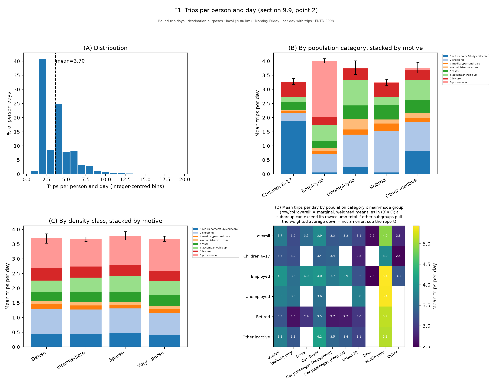

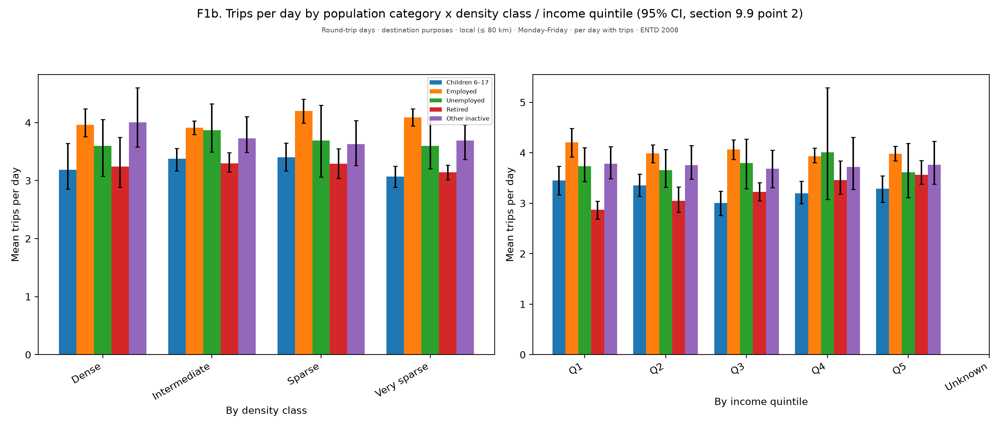

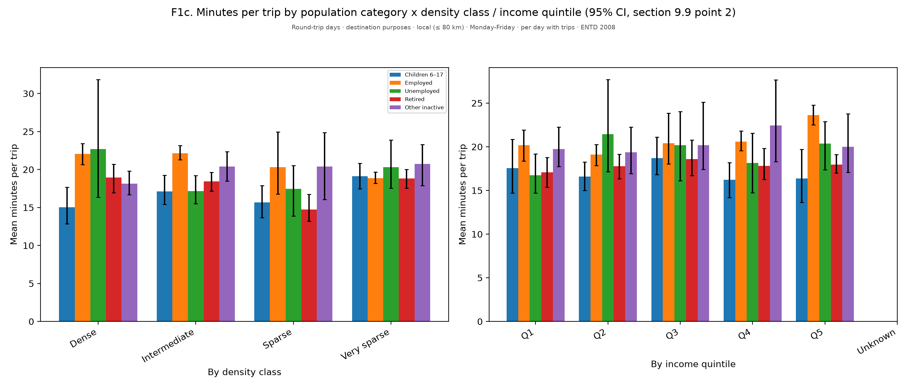

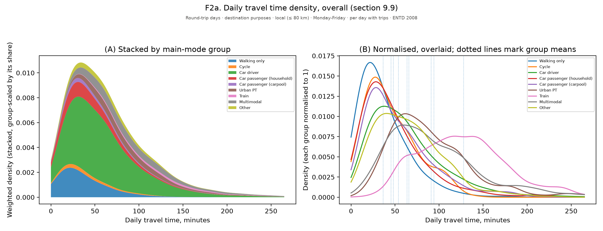

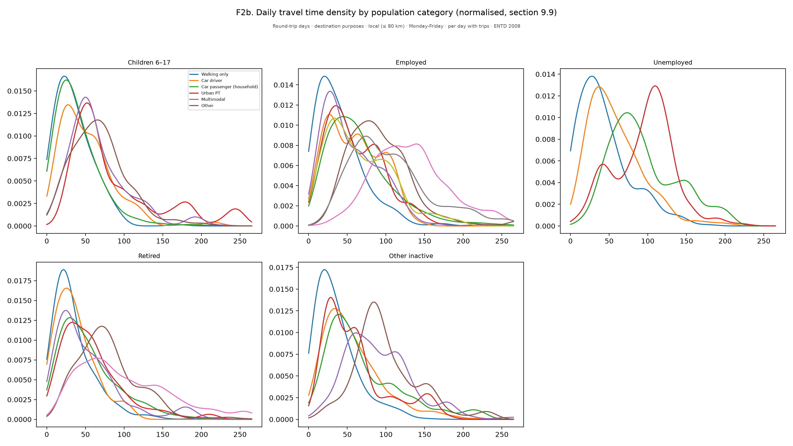

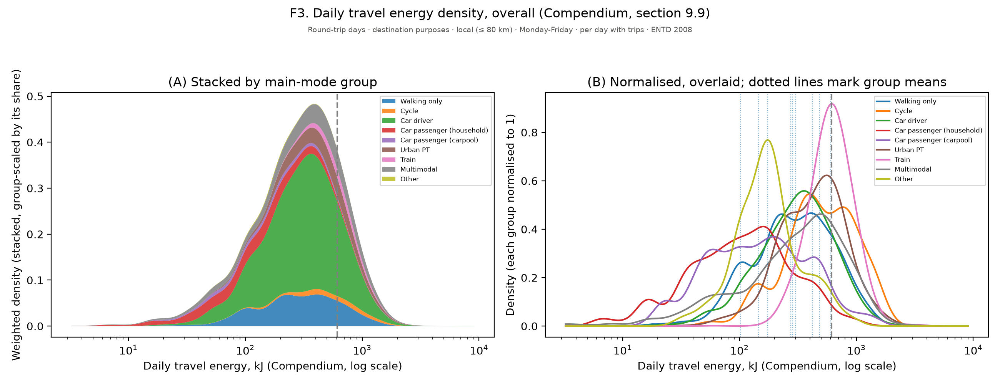

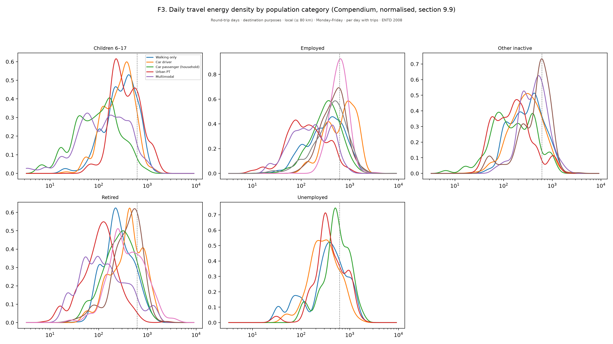

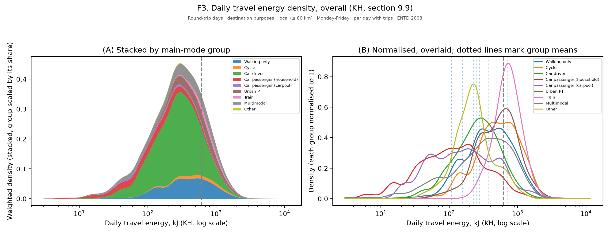

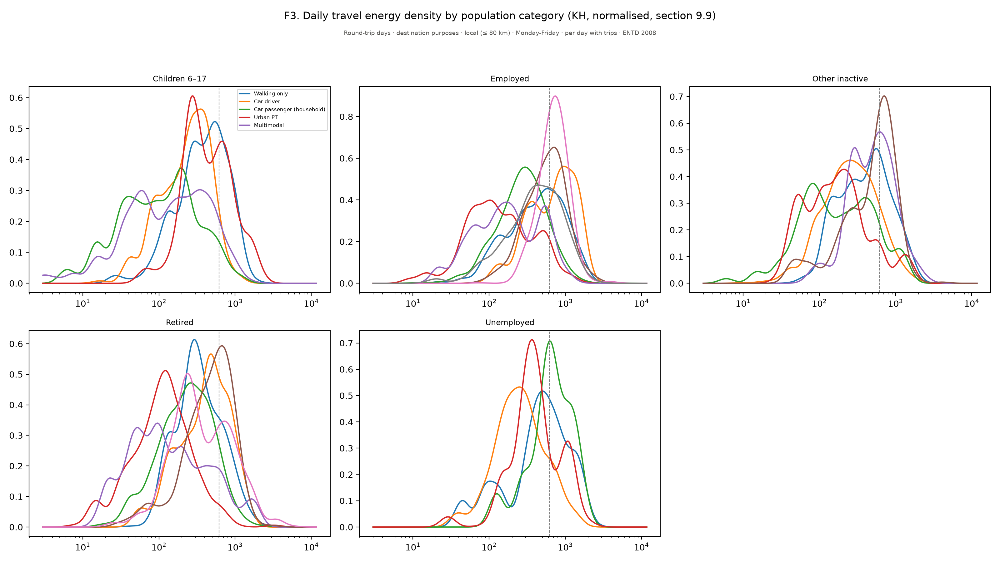

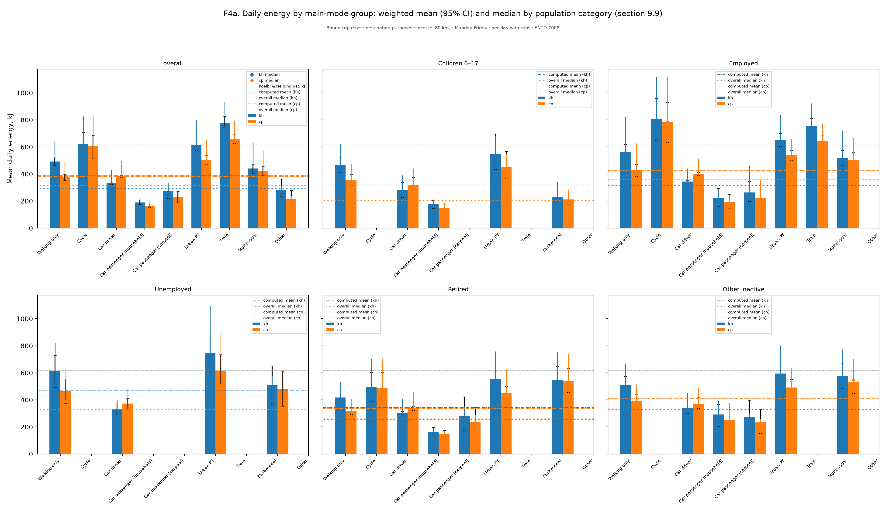

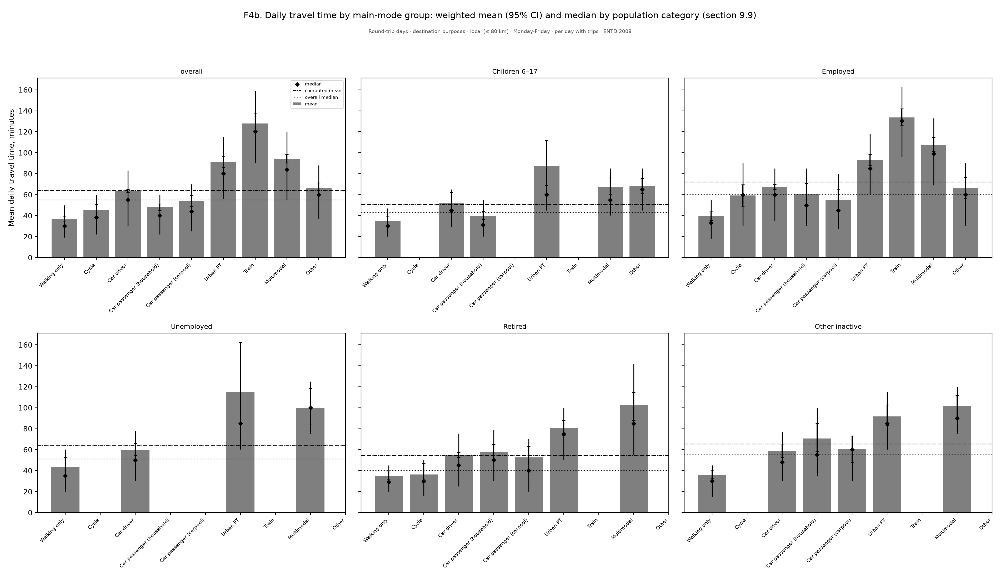

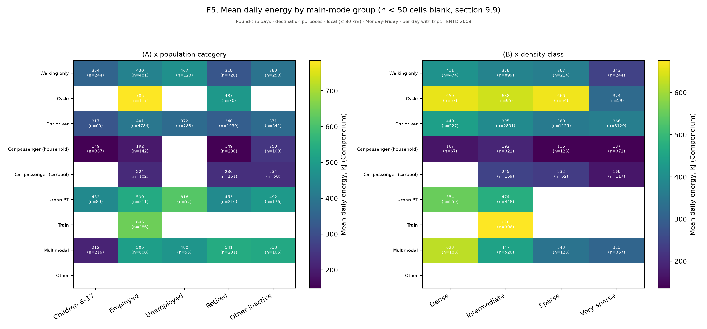

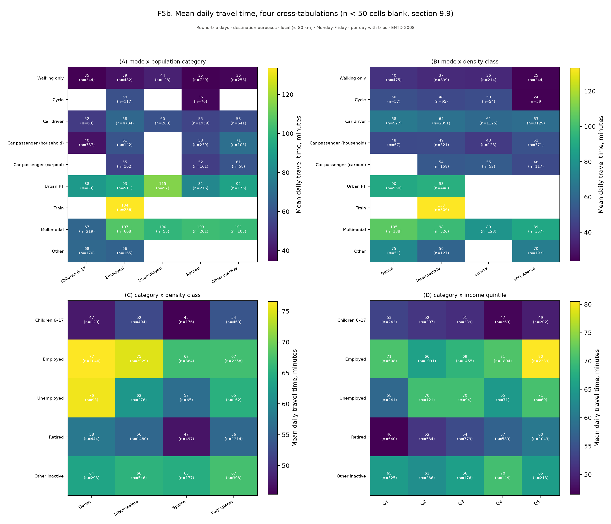

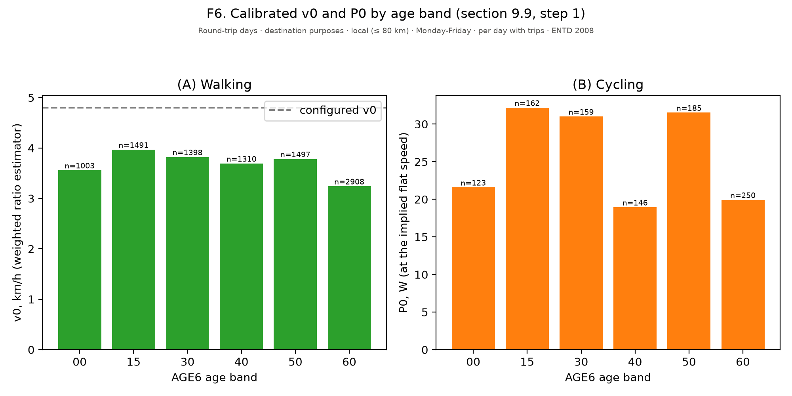

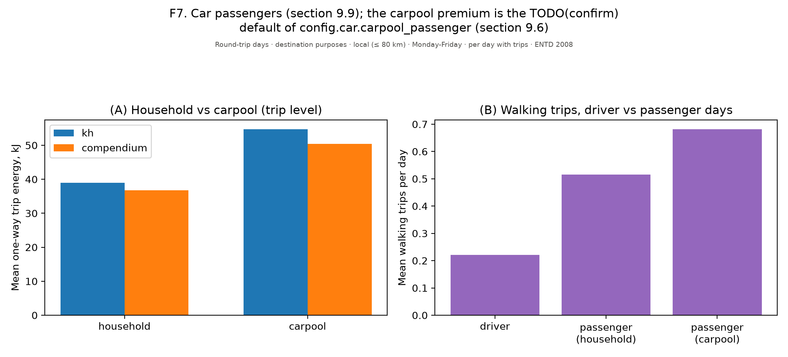

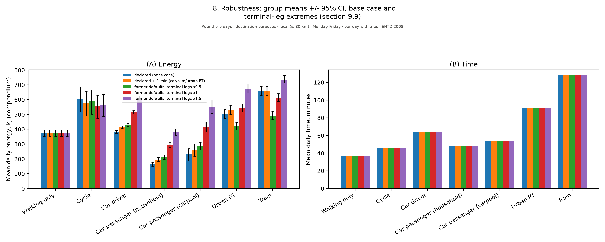

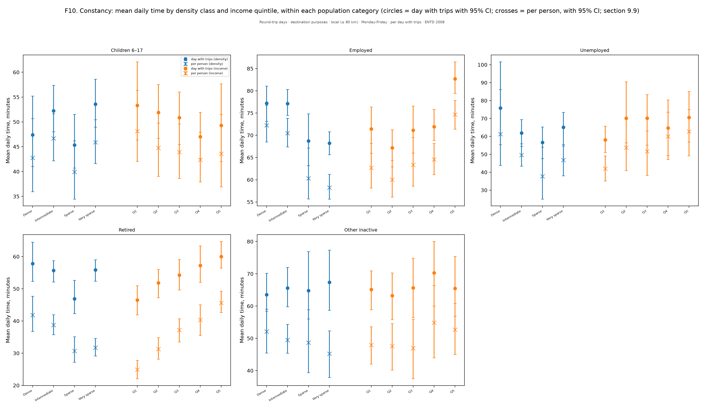

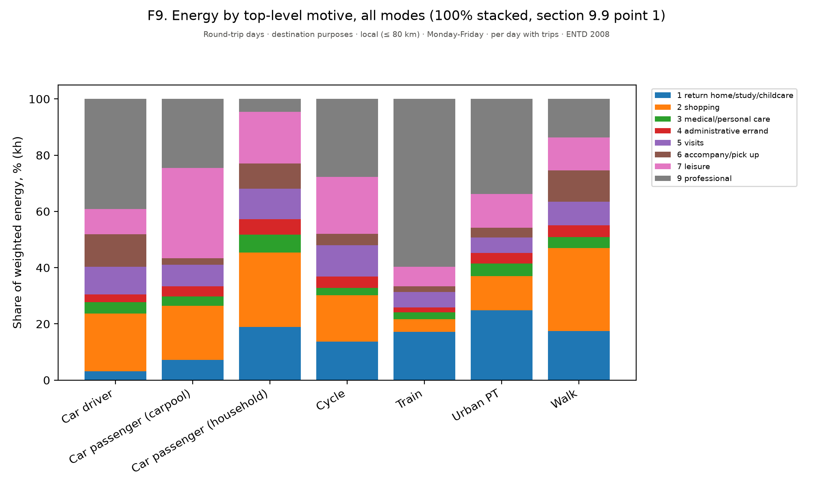

## Modelling notes and simplifications

- EMP 2019 gives no headway, station-depth or PT access-walk-distance data; `config.pt_ride.headway_min_am_peak`/`station_height_m`/`access_walk_m_by_density` are provisional TODO(confirm) defaults, used only by this step.
- Car terminal legs always use the apartment-density default: the public tables give no house/apartment split (section 9.6's `s_house`).
- `mode_group='other'` trips have no energy formula and contribute 0 kJ to a day's total; a day with only such trips is its own 'other' group, separate from 'multimodal'.
- The day's home density is the residence commune's own density (`trip_legs.residence_density`, 27 October 2026 decision), not the origin density of the home-departure trip.
- Bike get/park and stop-delay adjustment: unreliable (would consume over half, or all but under a minute, of a very short trip's declared duration) for a small share of cycling trips; these fall back to the naive whole-duration speed for both energy and the P0 estimator's ride-time denominator.
- F3/F4/F5 use the full set of day-mode groups (including multimodal and other); F8's robustness check is restricted to the seven groups the task names (walk, bike, driver, both passenger groups, urban PT, train).
- F8's figure shows bootstrap CIs for every terminal-legs variant with a CI (declared, declared + 1 min, former defaults x0.5/x1/x1.5), not every table variant (not weekdays-only, local-trips-only or the P0 reference, which have none).
