# Step 11 (`mobgrid/budget`): ENTD 2008 re-estimation (section 9.9)

Generated by `python -m mobgrid.budget.emp`. Rebuilds section 9.9's re-estimation steps 1-3 and 5 on the ENTD 2008 public tables, plus the F8 robustness check; terminal legs reuse sections 9.4-9.7's formulas and `config/energy.yaml`'s already-calibrated car/stairs/waiting/PT-ride defaults, plus provisional PT headway/station-height/access-walk defaults (TODO(confirm), `config.pt_ride`). EMC² (step 4) and Ē_c (step 6) are out of scope. Same model parameters (`config/energy.yaml`) in both surveys: differences reflect behaviour, not the model (section 9.9, "Change between 2008 and 2019"). Density: `proxy` (the INSEE grid, or section 9.9's urban-unit-status x residence-size proxy; ENTD 2008 always uses the proxy).

**Variables used** (`docs/data/entd2008.md`'s complete mapping, K_DEPLOC unless noted): mode `V2_MTP` (converted); duration `v2_mduree`/`V2_DUREE`; distance `distcor`/`V2_MDISTTOT`; purpose `V2_MMOTIFDES`/`V2_MMOTIFORI` (converted); companions `V2_MACCOMPM`/`V2_MACCOMPHM`; day `V2_TYPJOUR`, `mobloc` (from `V2_DLOCAL`); weights `POIDS_JOUR` (day) and `PONDKI` (K_INDIVIDU, individual); age band `AGE6` (Q_TCM_INDIVIDU); population category (section 6.1) from `SITUA` (Q_TCM_INDIVIDU) combined with `AGE` for the 6-17 children group; density: the urban-unit-status x residence-size proxy (no density grid in ENTD 2008); non-traveller check `V2_MOBILREF` (K_INDIVIDU, reference weekday only).

**Sample:** 33,012 described days with at least one classified trip (2945 of 35957 respondents report no trip that day, 15.5% by individual weight, reported apart per point 2).

## Main-mode-of-the-day groups (point 3)

walking only, bike, car driver, car passenger with a household driver, car passenger with a non-household driver (carpool), urban PT, train (short- and long-distance merged, step 11 round 8: train_long had too few observations to be a meaningful separate group), multimodal (two or more distinct non-walk modes in the day; driving and riding as a passenger count as two), other. **'other' contains:** powered two-wheelers under 50cm3 or unspecified (mtp 2.3-2.7), unspecified 3/4-wheeler (mtp 3.4), taxi/specialised/school transport (mtp 4.x), plane (mtp 7.x), boat (mtp 8.1), other/unspecified (mtp 9.1, missing, or the 9999 refusal code).

**Children as car drivers** (148 children_6_17 car_driver days): the raw `mtp` code is 3.1 (n=568, ages 6-17), 3.3 (n=1, ages 17-17). Both codes are `mtp` category 3 "Automobile" (3.1 "Conducteur", 3.3 "Tantot conducteur tantot passager"), not a two-wheeler code (2.x): no two-wheeler reclassification applies. `mtp` 3.1 includes "voiturette" (a license-free microcar, legal from age 14 in France), plausible for the 14-17 share, but not for the many 6-13 year olds here; most likely EMP's own household/accompanying-trip coding records the car's use rather than confirming the child personally drove.

## Density classes

INSEE's own 4-level grid names and order: dense (1, densely populated communes), intermediate (2), sparse (3, peu denses), very_sparse (4, tres peu denses). EMP 2019's `emp2019._DENSITY_LABEL_BY_CODE` maps `DENSITECOM_ORI`/`_DES` directly (grid); both surveys' `trip_legs.density_proxy_case_sql` computes the same four labels from the urban-unit-status x residence-size proxy of section 9.9's "Change between 2008 and 2019" when `density_source='proxy'` (this report: `proxy`). `trip_legs._DENSITY_KEY_TRANSLATION` re-keys `config.car`/`config.pt_ride`'s existing density defaults (chosen for step 7 as `dense`/`urban`/`suburban`/`rural`) to these same INSEE names and order, checked against `data/raw/emp2019/emp2019-categories.pdf`'s "Degre de densite" table.

## Quirks: `distcor`/`v2_mduree` fill rate and mean change (section 9.9)

`k_deploc`'s seven undocumented correction columns (`docs/data/entd2008.md`'s "Quirks"); `distcor`/`v2_mduree` are used (when filled) by `trips_norm`, the other five are not.

- `distcor`: 0.23% filled, mean change 0.67 km (corrected - declared) where filled.
- `v2_mduree`: 0.00% filled (never filled in this release: `duration_min` always falls back to `V2_DUREE`).

## Mean daily energy and time by main-mode group (point 3)

| Group | n | weighted n | mean time (min) | median time (min) | mean energy kh (kJ) | median energy kh (kJ) | 95% CI | mean energy compendium (kJ) | median energy compendium (kJ) | 95% CI |
|---|---|---|---|---|---|---|---|---|---|---|
| car_driver | 17239 | 151,948,944 | 66.8 | 54.0 | 541.6 | 453.4 | [531.7, 550.6] | 523.8 | 430.8 | [512.7, 533.8] |
| walking_only | 4577 | 41,615,021 | 35.3 | 29.0 | 471.2 | 355.2 | [444.9, 494.7] | 359.7 | 271.1 | [339.6, 377.6] |
| car_passenger_household | 3524 | 31,557,412 | 57.1 | 40.0 | 345.8 | 282.0 | [332.8, 359.3] | 283.8 | 235.6 | [274.3, 294.8] |
| multimodal | 2863 | 27,964,346 | 107.1 | 85.0 | 687.7 | 647.0 | [660.6, 714.9] | 605.9 | 556.3 | [578.5, 630.0] |
| urban_pt | 2007 | 17,307,089 | 91.2 | 80.0 | 654.5 | 564.1 | [624.8, 688.7] | 535.1 | 471.8 | [512.7, 560.5] |
| car_passenger_carpool | 1372 | 8,576,737 | 59.9 | 44.0 | 485.3 | 388.0 | [453.6, 513.7] | 390.9 | 313.0 | [366.0, 413.0] |
| train | 784 | 6,131,176 | 153.2 | 131.0 | 712.5 | 661.1 | [680.7, 748.7] | 614.0 | 578.1 | [587.0, 646.3] |
| cycle | 565 | 6,086,548 | 44.6 | 31.0 | 588.0 | 421.1 | [510.6, 687.4] | 570.0 | 390.2 | [495.8, 660.4] |
| other | 81 | 879,181 | 72.8 | 64.0 | 291.8 | 222.0 | [243.0, 352.0] | 222.7 | 169.5 | [185.5, 268.7] |

## Section 9.9's scope: commuting and travel for needs fulfilment

Every table and figure above and below is restricted to this scope (2026-10-20 project decision, not an optional variant): trips whose corrected motive (`motive`, `MOT_SEQ_COMPL`) is sport (7.6), a destination-less stroll (7.7, "se promener sans destination precise"), going to a place to walk/ride (7.8, a destination exists, but the movement itself is the point), or any top-level motive group 8 purpose (8.1-8.4: holidays, second/occasional residence, other private reasons -- none of them a needs-fulfilment destination) are excluded from every day's energy/time sums and from day classification; a day whose only trips were these becomes a non-traveller for this analysis. A missing/refused motive is kept, not excluded. See F9 and the table below for the evidence behind this decision, computed on the full, pre-exclusion dataset.

| Group | excluded trip share | n excluded / n total | excluded share of day energy (kh) | excluded share of day energy (cp) |
|---|---|---|---|---|
| car_driver | 8.1% | 6,944 / 65,699 | 11.6% | 11.2% |
| car_passenger_carpool | 14.4% | 682 / 4,145 | 19.2% | 19.5% |
| car_passenger_household | 14.9% | 2,117 / 11,670 | 20.3% | 20.2% |
| cycle | 25.1% | 780 / 2,421 | 43.2% | 43.3% |
| multimodal | 12.1% | 2,598 / 17,392 | 19.6% | 20.2% |
| other | 17.2% | 100 / 518 | 32.0% | 32.0% |
| train | 7.3% | 175 / 1,866 | 8.6% | 8.5% |
| urban_pt | 8.4% | 712 / 6,482 | 12.4% | 12.2% |
| walking_only | 18.9% | 3,735 / 15,259 | 30.7% | 30.7% |

## Data-quality correction: implausible door-to-door speeds

Trips are corrected, not dropped (section 9.9, step 11 round 5): flagged above an upper speed bound only -- walk > 7 km/h, bike > 35 km/h, car (driver or passenger) > 130 km/h -- their declared distance is replaced by declared duration x the mode's own median speed (from its not-flagged trips). Cycling energy's main work term is time-based (round 4), but its "stops" sub-term still multiplies by distance and by the distance-derived ride speed squared (section 9.7), so a flagged bike trip's distance is corrected too, like walk and car (round 9).

- car_driver: 319 of 66,480 trips corrected
- car_passenger_carpool: 29 of 5,432 trips corrected
- car_passenger_household: 65 of 13,390 trips corrected
- cycle: 25 of 3,266 trips corrected
- other: 0 of 2,858 trips corrected
- train: 0 of 2,215 trips corrected
- urban_pt: 0 of 6,029 trips corrected
- walk: 467 of 27,429 trips corrected

## Mean daily energy and time by main-mode group, overall and by population category (F4)

### overall

| Group | n | weighted n | mean time (min) | median time (min) | mean energy kh (kJ) | median energy kh (kJ) | 95% CI | mean energy compendium (kJ) | median energy compendium (kJ) | 95% CI |
|---|---|---|---|---|---|---|---|---|---|---|
| car_driver | 17239 | 151,948,944 | 66.8 | 54.0 | 541.6 | 453.4 | [531.7, 550.6] | 523.8 | 430.8 | [512.7, 533.8] |
| walking_only | 4577 | 41,615,021 | 35.3 | 29.0 | 471.2 | 355.2 | [444.9, 494.7] | 359.7 | 271.1 | [339.6, 377.6] |
| car_passenger_household | 3524 | 31,557,412 | 57.1 | 40.0 | 345.8 | 282.0 | [332.8, 359.3] | 283.8 | 235.6 | [274.3, 294.8] |
| multimodal | 2863 | 27,964,346 | 107.1 | 85.0 | 687.7 | 647.0 | [660.6, 714.9] | 605.9 | 556.3 | [578.5, 630.0] |
| urban_pt | 2007 | 17,307,089 | 91.2 | 80.0 | 654.5 | 564.1 | [624.8, 688.7] | 535.1 | 471.8 | [512.7, 560.5] |
| car_passenger_carpool | 1372 | 8,576,737 | 59.9 | 44.0 | 485.3 | 388.0 | [453.6, 513.7] | 390.9 | 313.0 | [366.0, 413.0] |
| train | 784 | 6,131,176 | 153.2 | 131.0 | 712.5 | 661.1 | [680.7, 748.7] | 614.0 | 578.1 | [587.0, 646.3] |
| cycle | 565 | 6,086,548 | 44.6 | 31.0 | 588.0 | 421.1 | [510.6, 687.4] | 570.0 | 390.2 | [495.8, 660.4] |
| other | 81 | 879,181 | 72.8 | 64.0 | 291.8 | 222.0 | [243.0, 352.0] | 222.7 | 169.5 | [185.5, 268.7] |

### children_6_17

| Group | n | weighted n | mean time (min) | median time (min) | mean energy kh (kJ) | median energy kh (kJ) | 95% CI | mean energy compendium (kJ) | median energy compendium (kJ) | 95% CI |
|---|---|---|---|---|---|---|---|---|---|---|
| car_passenger_household | 1135 | 16,067,591 | 47.4 | 35.0 | 331.5 | 276.6 | [312.0, 358.5] | 268.3 | 229.8 | [253.2, 288.7] |
| walking_only | 469 | 10,797,323 | 33.3 | 30.0 | 446.8 | 399.6 | [400.5, 500.1] | 341.1 | 305.0 | [305.7, 381.7] |
| multimodal | 375 | 6,800,844 | 69.3 | 55.0 | 433.6 | 353.7 | [380.9, 493.5] | 358.5 | 285.4 | [311.4, 405.4] |
| urban_pt | 159 | 3,079,751 | 91.2 | 60.0 | 677.9 | 533.4 | [553.4, 809.5] | 549.8 | 455.9 | [448.5, 655.4] |
| car_driver | 140 | 2,632,870 | 48.7 | 36.0 | 406.0 | 364.7 | [346.8, 465.6] | 389.0 | 331.4 | [336.1, 443.9] |
| cycle | 98 | 1,872,962 | 30.2 | 23.0 | 384.5 | 291.5 | [316.8, 453.6] | 370.2 | 272.8 | [309.2, 428.7] |
| car_passenger_carpool | 99 | 1,274,399 | 49.0 | 44.0 | 357.5 | 356.1 | [319.6, 393.8] | 290.8 | 297.1 | [257.2, 320.0] |
| train | 35 | 647,622 | 116.4 | 63.0 | 704.9 | 658.7 | [570.4, 822.3] | 586.1 | 549.9 | [482.4, 691.7] |
| other | 13 | 342,445 | 59.7 | 62.0 | 260.4 | 199.8 | [170.4, 402.4] | 198.8 | 152.5 | [130.1, 307.2] |

### employed

| Group | n | weighted n | mean time (min) | median time (min) | mean energy kh (kJ) | median energy kh (kJ) | 95% CI | mean energy compendium (kJ) | median energy compendium (kJ) | 95% CI |
|---|---|---|---|---|---|---|---|---|---|---|
| car_driver | 10779 | 100,755,648 | 72.1 | 60.0 | 573.5 | 495.4 | [561.4, 588.7] | 558.7 | 466.2 | [546.3, 574.3] |
| multimodal | 1606 | 14,456,313 | 123.8 | 101.0 | 772.4 | 729.9 | [744.1, 809.8] | 694.6 | 658.5 | [667.5, 729.0] |
| walking_only | 1463 | 10,618,359 | 37.0 | 30.0 | 528.8 | 399.6 | [473.5, 607.5] | 403.6 | 305.0 | [361.4, 463.7] |
| urban_pt | 949 | 7,441,285 | 92.3 | 85.0 | 650.9 | 570.6 | [620.8, 679.0] | 535.1 | 487.3 | [510.1, 558.2] |
| car_passenger_household | 1071 | 5,880,923 | 71.8 | 55.0 | 397.3 | 308.3 | [359.1, 443.3] | 329.4 | 260.6 | [298.4, 364.2] |
| train | 542 | 4,169,189 | 159.2 | 140.0 | 700.9 | 672.3 | [669.7, 733.0] | 609.0 | 590.3 | [578.4, 639.6] |
| car_passenger_carpool | 444 | 3,115,892 | 70.1 | 50.0 | 554.2 | 504.0 | [502.7, 596.4] | 447.7 | 412.5 | [410.5, 480.8] |
| cycle | 241 | 2,204,699 | 61.0 | 60.0 | 822.4 | 742.4 | [662.3, 984.2] | 793.8 | 731.3 | [643.2, 947.5] |
| other | 47 | 297,646 | 80.8 | 66.0 | 310.5 | 266.4 | [251.2, 386.4] | 237.0 | 203.4 | [191.7, 295.0] |

### other_inactive

| Group | n | weighted n | mean time (min) | median time (min) | mean energy kh (kJ) | median energy kh (kJ) | 95% CI | mean energy compendium (kJ) | median energy compendium (kJ) | 95% CI |
|---|---|---|---|---|---|---|---|---|---|---|
| car_driver | 1179 | 10,705,942 | 61.4 | 45.0 | 536.6 | 427.0 | [500.1, 572.0] | 505.4 | 402.3 | [471.0, 542.0] |
| walking_only | 556 | 5,280,693 | 34.7 | 29.0 | 497.5 | 421.8 | [435.4, 558.4] | 379.8 | 322.0 | [332.4, 426.2] |
| urban_pt | 331 | 3,357,119 | 90.5 | 80.0 | 669.8 | 611.3 | [621.7, 720.7] | 545.8 | 486.1 | [507.1, 586.0] |
| car_passenger_household | 401 | 2,777,068 | 70.5 | 52.0 | 395.9 | 301.4 | [338.4, 453.4] | 326.7 | 260.3 | [280.1, 372.9] |
| multimodal | 318 | 2,581,524 | 106.7 | 90.0 | 793.9 | 705.5 | [712.7, 863.7] | 682.3 | 605.4 | [611.6, 746.6] |
| car_passenger_carpool | 202 | 1,171,470 | 62.6 | 55.0 | 545.7 | 410.8 | [447.7, 640.9] | 436.5 | 332.8 | [359.9, 511.2] |
| train | 96 | 854,993 | 139.1 | 128.0 | 755.6 | 621.1 | [642.6, 880.8] | 640.3 | 538.6 | [552.1, 739.7] |
| cycle | 59 | 654,859 | 48.6 | 45.0 | 651.6 | 554.2 | [510.6, 816.3] | 634.3 | 555.0 | [500.2, 787.3] |
| other | 9 | 130,004 | 70.1 | 80.0 | 269.0 | 244.2 | [223.3, 465.4] | 205.3 | 186.4 | [170.5, 355.2] |

### retired

| Group | n | weighted n | mean time (min) | median time (min) | mean energy kh (kJ) | median energy kh (kJ) | 95% CI | mean energy compendium (kJ) | median energy compendium (kJ) | 95% CI |
|---|---|---|---|---|---|---|---|---|---|---|
| car_driver | 4490 | 32,366,693 | 54.9 | 40.0 | 464.0 | 370.1 | [444.2, 487.9] | 441.1 | 359.8 | [424.9, 463.2] |
| walking_only | 1792 | 11,559,622 | 34.7 | 25.0 | 407.6 | 310.8 | [380.5, 433.6] | 311.1 | 237.2 | [290.4, 330.9] |
| car_passenger_household | 729 | 4,975,407 | 60.4 | 45.0 | 300.7 | 256.4 | [277.3, 319.4] | 252.4 | 211.9 | [233.0, 269.0] |
| car_passenger_carpool | 545 | 2,474,663 | 51.4 | 35.0 | 440.4 | 335.5 | [401.8, 483.4] | 353.1 | 271.0 | [322.9, 387.1] |
| multimodal | 421 | 2,432,222 | 118.8 | 90.0 | 768.4 | 658.6 | [684.4, 832.3] | 686.9 | 574.1 | [614.1, 745.5] |
| urban_pt | 429 | 2,233,795 | 88.5 | 75.0 | 610.7 | 522.0 | [570.9, 657.6] | 497.9 | 428.4 | [466.5, 535.6] |
| cycle | 145 | 1,161,258 | 34.3 | 28.0 | 433.8 | 323.2 | [310.5, 592.5] | 428.4 | 324.0 | [302.2, 589.2] |
| train | 84 | 298,531 | 160.0 | 120.0 | 681.7 | 623.4 | [612.2, 761.5] | 591.2 | 551.8 | [522.4, 666.5] |
| other | 11 | 108,715 | 95.3 | 65.0 | 367.0 | 222.0 | [153.7, 578.1] | 280.2 | 169.5 | [117.3, 441.3] |

### unemployed

| Group | n | weighted n | mean time (min) | median time (min) | mean energy kh (kJ) | median energy kh (kJ) | 95% CI | mean energy compendium (kJ) | median energy compendium (kJ) | 95% CI |
|---|---|---|---|---|---|---|---|---|---|---|
| car_driver | 632 | 5,111,860 | 60.7 | 50.0 | 494.5 | 401.2 | [459.4, 540.7] | 475.8 | 390.1 | [441.0, 518.3] |
| walking_only | 270 | 2,629,877 | 45.1 | 35.0 | 635.3 | 532.8 | [552.0, 719.7] | 485.0 | 406.7 | [421.4, 549.4] |
| multimodal | 125 | 1,145,197 | 113.0 | 108.0 | 820.3 | 705.5 | [685.3, 978.8] | 710.1 | 618.2 | [589.7, 849.4] |
| urban_pt | 133 | 898,081 | 101.6 | 80.0 | 724.2 | 612.5 | [625.8, 831.7] | 593.5 | 518.8 | [509.6, 693.6] |
| car_passenger_household | 115 | 787,954 | 75.6 | 45.0 | 374.2 | 270.7 | [310.1, 478.2] | 314.4 | 221.5 | [256.7, 395.4] |
| car_passenger_carpool | 77 | 456,847 | 64.1 | 60.0 | 487.8 | 354.7 | [387.8, 609.4] | 393.7 | 282.5 | [318.9, 487.6] |
| cycle | 19 | 161,338 | 49.3 | 50.0 | 638.1 | 637.3 | [389.9, 944.7] | 623.0 | 637.7 | [387.4, 907.2] |
| train | 25 | 146,532 | 217.1 | 185.0 | 893.0 | 826.2 | [766.1, 1036.9] | 776.6 | 725.4 | [670.2, 908.2] |
| other | 1 | 370 | 129.0 | 129.0 | 111.0 | 111.0 | [111.0, 111.0] | 84.7 | 84.7 | [84.7, 84.7] |

## By population category (section 6.1)

| Group | n | weighted n | mean time (min) | median time (min) | mean energy kh (kJ) | median energy kh (kJ) | 95% CI | mean energy compendium (kJ) | median energy compendium (kJ) | 95% CI |
|---|---|---|---|---|---|---|---|---|---|---|
| employed | 17142 | 148,939,953 | 77.9 | 60.0 | 592.8 | 514.3 | [580.7, 604.5] | 552.5 | 471.3 | [540.3, 565.2] |
| retired | 8646 | 57,610,905 | 55.4 | 40.0 | 456.4 | 360.5 | [443.1, 468.8] | 407.7 | 314.4 | [395.9, 419.5] |
| children_6_17 | 2523 | 43,515,808 | 50.9 | 40.0 | 413.1 | 337.6 | [394.8, 433.8] | 336.9 | 274.1 | [322.7, 353.2] |
| other_inactive | 3151 | 27,513,672 | 67.2 | 55.0 | 564.0 | 487.4 | [541.4, 587.7] | 487.7 | 407.4 | [467.0, 506.8] |
| unemployed | 1397 | 11,338,057 | 68.6 | 55.0 | 576.8 | 466.2 | [544.5, 617.0] | 502.4 | 402.5 | [474.3, 537.1] |
| unknown | 153 | 3,148,059 | 50.9 | 40.0 | 357.6 | 310.8 | [280.5, 422.2] | 301.2 | 255.4 | [233.1, 355.8] |

## By home density class

| Group | n | weighted n | mean time (min) | median time (min) | mean energy kh (kJ) | median energy kh (kJ) | 95% CI | mean energy compendium (kJ) | median energy compendium (kJ) | 95% CI |
|---|---|---|---|---|---|---|---|---|---|---|
| intermediate | 13529 | 129,088,281 | 68.3 | 52.0 | 593.4 | 520.6 | [580.6, 606.8] | 517.9 | 437.1 | [506.6, 529.5] |
| very_sparse | 8672 | 61,753,076 | 65.7 | 50.0 | 382.4 | 305.6 | [371.3, 394.3] | 388.8 | 301.9 | [375.0, 402.3] |
| sparse | 5797 | 60,095,174 | 66.5 | 50.0 | 472.5 | 385.0 | [457.4, 491.6] | 443.3 | 369.8 | [426.5, 466.7] |
| dense | 5014 | 41,129,923 | 70.9 | 60.0 | 659.9 | 565.0 | [635.8, 684.7] | 559.2 | 475.6 | [537.5, 581.1] |

## Car passengers (F7)

- Carpool trips: 36,264,658 of 143,673,370 weighted passenger trips (25.2% share).
- Daily totals of both passenger groups: see `car_passenger_household`/`car_passenger_carpool` rows of the main-mode-group table above.
- Mean walking trips per day: driver 0.20, household passenger 0.28, carpool passenger 0.43.
- **Carpool premium** (the extra origin-side walk/wait before the car, section 9.6): `config.car.carpool_passenger.walk_to_meeting_point_min` = 5 min, `.wait_standing_min` = 3 min -- TODO(confirm), no survey or observed pickup pattern.

## F8 robustness (max/min ratio and CV of the group means, walk/bike/driver/both passenger groups/urban PT/train)

| Variant | Scope | Statistic | energy ratio (kh) | CV (kh) | min/max group (kh) | energy ratio (cp) | CV (cp) | min/max group (cp) | time ratio | time CV | min/max group (time) |
|---|---|---|---|---|---|---|---|---|---|---|---|
| terminal legs x0.5 | full | mean | 2.48 | 0.26 | car_passenger_household / cycle | 2.81 | 0.30 | car_passenger_household / cycle | 4.34 | 0.51 | walking_only / train |
| terminal legs x0.5 | full | median | 2.73 | 0.28 | car_passenger_household / train | 2.84 | 0.31 | car_passenger_household / train | 4.52 | 0.58 | walking_only / train |
| terminal legs x0.5 | core | mean | 1.33 | 0.10 | car_driver / train | 1.38 | 0.12 | walking_only / train | 4.34 | 0.50 | walking_only / train |
| terminal legs x0.5 | core | median | 1.46 | 0.16 | car_driver / train | 1.68 | 0.18 | walking_only / train | 4.52 | 0.51 | walking_only / train |
| terminal legs x1 (base case) | full | mean | 2.06 | 0.21 | car_passenger_household / train | 2.16 | 0.24 | car_passenger_household / train | 4.34 | 0.51 | walking_only / train |
| terminal legs x1 (base case) | full | median | 2.34 | 0.27 | car_passenger_household / train | 2.45 | 0.29 | car_passenger_household / train | 4.52 | 0.58 | walking_only / train |
| terminal legs x1 (base case) | core | mean | 1.51 | 0.16 | walking_only / train | 1.71 | 0.18 | walking_only / train | 4.34 | 0.50 | walking_only / train |
| terminal legs x1 (base case) | core | median | 1.86 | 0.23 | walking_only / train | 2.13 | 0.25 | walking_only / train | 4.52 | 0.51 | walking_only / train |
| weekdays only | full | mean | 2.00 | 0.20 | car_passenger_household / train | 2.13 | 0.24 | car_passenger_household / train | 4.12 | 0.50 | walking_only / train |
| weekdays only | full | median | 2.27 | 0.25 | car_passenger_household / train | 2.41 | 0.28 | car_passenger_household / train | 4.33 | 0.56 | walking_only / train |
| weekdays only | core | mean | 1.48 | 0.15 | walking_only / train | 1.67 | 0.18 | walking_only / train | 4.12 | 0.48 | walking_only / train |
| weekdays only | core | median | 1.76 | 0.20 | walking_only / train | 2.01 | 0.23 | walking_only / train | 4.33 | 0.50 | walking_only / train |
| local trips only (MOBLOC=1) | full | mean | 2.02 | 0.21 | car_passenger_household / train | 2.13 | 0.24 | car_passenger_household / train | 3.62 | 0.44 | walking_only / train |
| local trips only (MOBLOC=1) | full | median | 2.35 | 0.26 | car_passenger_household / train | 2.42 | 0.28 | car_passenger_household / train | 4.14 | 0.55 | walking_only / train |
| local trips only (MOBLOC=1) | core | mean | 1.48 | 0.16 | walking_only / train | 1.66 | 0.17 | walking_only / train | 3.62 | 0.43 | walking_only / train |
| local trips only (MOBLOC=1) | core | median | 1.79 | 0.22 | walking_only / train | 2.03 | 0.24 | walking_only / train | 4.14 | 0.49 | walking_only / train |
| terminal legs x1.5 | full | mean | 1.93 | 0.23 | car_passenger_household / train | 2.04 | 0.24 | walking_only / train | 4.34 | 0.51 | walking_only / train |
| terminal legs x1.5 | full | median | 2.28 | 0.30 | walking_only / train | 2.50 | 0.30 | walking_only / train | 4.52 | 0.58 | walking_only / train |
| terminal legs x1.5 | core | mean | 1.85 | 0.22 | walking_only / train | 2.04 | 0.24 | walking_only / train | 4.34 | 0.50 | walking_only / train |
| terminal legs x1.5 | core | median | 2.28 | 0.28 | walking_only / train | 2.50 | 0.29 | walking_only / train | 4.52 | 0.51 | walking_only / train |
| P0 = 52.5 W (section 9.7 reference) | full | mean | 2.09 | 0.23 | car_passenger_household / cycle | 2.49 | 0.28 | car_passenger_household / cycle | 4.34 | 0.51 | walking_only / train |
| P0 = 52.5 W (section 9.7 reference) | full | median | 2.34 | 0.26 | car_passenger_household / train | 2.45 | 0.29 | car_passenger_household / train | 4.52 | 0.58 | walking_only / train |
| P0 = 52.5 W (section 9.7 reference) | core | mean | 1.51 | 0.16 | walking_only / train | 1.71 | 0.18 | walking_only / train | 4.34 | 0.50 | walking_only / train |
| P0 = 52.5 W (section 9.7 reference) | core | median | 1.86 | 0.23 | walking_only / train | 2.13 | 0.25 | walking_only / train | 4.52 | 0.51 | walking_only / train |

## Constancy test (point 3, 5)

- Overall weighted mean daily energy: 533.3 kJ (kh), 481.1 kJ (compendium); Koelbl & Helbing's (2003) hypothesis is 615 kJ.
- Max/min ratio of the day-mode-group means (walking_only, cycle, car_driver, car_passenger_household, car_passenger_carpool, urban_pt, train): 2.06 (kh), 2.16 (compendium).
- Method-of-moments gamma fit (point 5): shape=2.02, scale=263.7 kJ (kh); shape=1.82, scale=264.2 kJ (compendium).
- Mean trips per person and day: 3.52 (95% CI [3.47, 3.56]).

## Calibrated v0 and P0 (step 1)

- **v0 estimator:** the ratio of weighted sums of distance and duration, sum(POND_JOUR*distance)/sum(POND_JOUR*duration), not an average of per-trip speeds (avoids the bias of averaging a ratio).
- Overall v0: 3.63 km/h, n=20348 (configured: 4.8 km/h).
- **P0 estimator:** get/park bike (2 min total) and the expected stop delays (section 9.7, Webster 1958) are subtracted from the declared duration at the naive speed before computing the ride speed; P0 is `bike.required_power_w` at the single ratio-estimated implied flat speed (not an average of per-trip, nonlinear P0 values). EMP 2019's own mode codes do not separate e-bikes from bicycles (`mtp` 2.1 includes "assistance electrique"), so they cannot be excluded or reported apart.
- Overall P0: 34.0 W at an implied flat speed of 13.39 km/h, n=2146 (section 9.7's reference: 52.5 W at 16 km/h).

| Age band (AGE6) | n walk | v0 (km/h) | n cycle | implied flat speed (km/h) | P0 (W) |
|---|---|---|---|---|---|
| 00 | 1650 | 3.53 | 272 | 12.43 | 29.3 |
| 15 | 3102 | 3.96 | 330 | 14.65 | 41.0 |
| 30 | 2945 | 3.79 | 295 | 14.22 | 38.5 |
| 40 | 2879 | 3.69 | 333 | 11.42 | 24.9 |
| 50 | 3232 | 3.75 | 391 | 14.32 | 39.1 |
| 60 | 6540 | 3.18 | 525 | 12.48 | 29.6 |

## Declared vs modelled walk/wait minutes, by mode group (step 1)

Unweighted trip-level means; a check only, since neither declared value is used to build the terminal legs themselves (section 9.9, "Outputs of the re-estimation").

| Mode group | n | declared walk (min) | modelled walk (min) | declared wait (min) | modelled wait (min) |
|---|---|---|---|---|---|
| car_driver | 66480 | 1.2 | 19.1 | 1.6 | - |
| car_passenger_carpool | 5432 | 1.5 | 18.6 | 0.0 | - |
| car_passenger_household | 13390 | 1.2 | 19.2 | 1.9 | - |
| train | 2215 | 11.7 | 16.9 | 9.7 | 4.9 |
| urban_pt | 6029 | 7.9 | 16.7 | 5.2 | 4.0 |

## Cycle group, after the fix (point 3)

Cycling energy's work term is now time-based at the single calibrated P0 (34.8 W, declared ride minutes x riding rate), not at each trip's own implied, per-trip power (section 9.9, step 11 third round: see `build_trip_legs`'s docstring for why the per-trip approach inflated energy).

| Variant | n | mean energy kh (kJ) | median energy kh (kJ) | mean energy cp (kJ) | median energy cp (kJ) |
|---|---|---|---|---|---|
| all days | 565 | 588.0 | 421.1 | 570.0 | 390.2 |
| weekdays only | 272 | 611.0 | 458.0 | 591.3 | 404.6 |

### Post-fix cycle-day decomposition (point 3)

Ride work, unloaded pedalling and stops are the same formula in both rate sets (section 9.7's mechanical/physiological terms); only get/park (a standing activity rate) and the day's walking legs (c0) differ by rate set.

- Mean ride time: 30.8 min; ride work: 268.0 kJ; unloaded pedalling: 166.8 kJ.
- Stops: 59.8 kJ/day, 13.76 stops/day at `config.bike.stops.stops_per_km` = 2/km; 4.35 kJ/stop.
- Get/park: 2 min/day fixed, 5.2 kJ (kh), 5.4 kJ (cp).
- Walking trips of the same day: 5.4 min/day, 78.8 kJ (kh), 60.2 kJ (cp).

### Cycling energy by motive (point 1 follow-up)

`MOT_SEQ_COMPL`, EMP's own chain-level, corrected trip purpose (unlike the raw `MMOTIFDES`); excludes "return home"/"return to residence" codes 1.1-1.3 (a return leg is recoded to the purpose of the outward leg it closes). Full, pre-exclusion dataset (unlike every other table in this report): this is the evidence behind the needs-only scope above, not itself scoped to it; see also F9 for the same breakdown, every mode, top-level motive only.

| Motive | n | weighted n | trip share | energy share (kh) | energy share (cp) | mean distance (km) | mean duration (min) |
|---|---|---|---|---|---|---|---|
| 7.6 sport | 361 | 3,197,832 | 9.8% | 22.9% | 22.9% | 9.30 | 54.0 |
| 7.7 stroll, no specific destination | 510 | 3,575,720 | 10.9% | 22.4% | 22.4% | 6.66 | 50.4 |
| 9.1 work, fixed usual workplace | 347 | 3,616,834 | 11.1% | 9.5% | 9.5% | 3.07 | 15.5 |
| 2.2 shopping, local store | 617 | 4,850,054 | 14.9% | 7.7% | 7.7% | 1.80 | 10.8 |
| 7.8 go to a place for walking | 199 | 2,141,343 | 6.6% | 6.2% | 6.2% | 4.75 | 31.1 |
| 1.4 study (school/university) | 139 | 3,329,092 | 10.2% | 5.7% | 5.7% | 2.46 | 13.8 |
| 5.2 visit friends | 252 | 2,714,123 | 8.3% | 5.5% | 5.5% | 2.41 | 13.8 |
| 5.1 visit family | 155 | 1,661,495 | 5.1% | 2.9% | 2.9% | 2.00 | 11.3 |
| 4.1 administrative errand | 105 | 1,220,376 | 3.7% | 2.8% | 2.8% | 2.25 | 13.0 |
| 9.2 work, outside fixed workplace | 38 | 1,214,137 | 3.7% | 2.5% | 2.5% | 2.31 | 14.2 |
| 7.2 leisure centre/amusement park/fair | 31 | 378,230 | 1.2% | 1.7% | 1.7% | 4.31 | 23.9 |
| 7.1 association/religious/meeting | 75 | 636,444 | 1.9% | 1.4% | 1.4% | 2.30 | 13.7 |
| 2.1 shopping, mall/large store | 109 | 762,839 | 2.3% | 1.3% | 1.3% | 2.33 | 13.5 |
| 3.1 medical/personal care | 27 | 481,216 | 1.5% | 1.2% | 1.2% | 2.30 | 14.1 |
| 6.2 accompany elsewhere | 42 | 570,071 | 1.7% | 1.1% | 1.2% | 2.47 | 14.8 |
| 9.3 training/conference/exhibition | 9 | 290,221 | 0.9% | 0.9% | 0.9% | 3.90 | 23.3 |
| 6.4 pick up elsewhere | 40 | 588,555 | 1.8% | 0.9% | 0.9% | 1.65 | 9.2 |
| 8.4 other personal reason | 48 | 454,279 | 1.4% | 0.8% | 0.8% | 1.96 | 11.5 |
| 7.3 eat/drink out | 61 | 354,848 | 1.1% | 0.7% | 0.7% | 2.50 | 14.9 |
| 7.5 cultural/sports show, conference | 59 | 317,414 | 1.0% | 0.7% | 0.7% | 3.04 | 17.9 |
| 9.5 other professional reason | 10 | 86,894 | 0.3% | 0.5% | 0.5% | 4.24 | 22.0 |
| 6.3 pick up from station/airport | 6 | 83,854 | 0.3% | 0.3% | 0.3% | 2.00 | 13.3 |
| 9.4 professional rounds/patient visits | 8 | 25,119 | 0.1% | 0.1% | 0.1% | 5.00 | 38.1 |
| 1.1 return home | 2 | 32,206 | 0.1% | 0.1% | 0.1% | 3.50 | 17.5 |
| 7.4 visit monument/historic site | 5 | 21,474 | 0.1% | 0.1% | 0.1% | 3.00 | 19.6 |
| 1.3 return to parents'/friends' home | 4 | 24,231 | 0.1% | 0.1% | 0.1% | 3.30 | 16.2 |
| 1.5 young-child childcare drop-off | 4 | 23,826 | 0.1% | 0.0% | 0.0% | 1.02 | 7.0 |
| 8.2 go to second home | 2 | 3,087 | 0.0% | 0.0% | 0.0% | 4.45 | 37.0 |
| 1.2 return to occasional residence | 1 | 1,995 | 0.0% | 0.0% | 0.0% | 4.70 | 20.0 |

**Excluded from the main report's scope** (motives 7.6, 7.7, 7.8, 8.1, 8.2, 8.3, 8.4: sport, stroll, no specific destination, go to a place for walking, holiday, away from second home, go to second home, go to occasional residence, other personal reason), among cycling trips: 28.7% of weighted trips, 52.3% of weighted energy (kh), 52.3% (cp).

## Non-traveller immobility (point 2)

Identified as: `k_individu.V2_MOBILREF = 0` (not mobile) on the reference weekday, weighted by `PONDKI` (`docs/data/entd2008.md`'s "Persons without trips"); weekend immobility (`V2_MIMMOSAM`/`V2_MIMMODIM`) is not used, matching EMP 2019, which identifies weekday non-travellers only. Weekday share of persons without trips: 15.5%.

## Figures

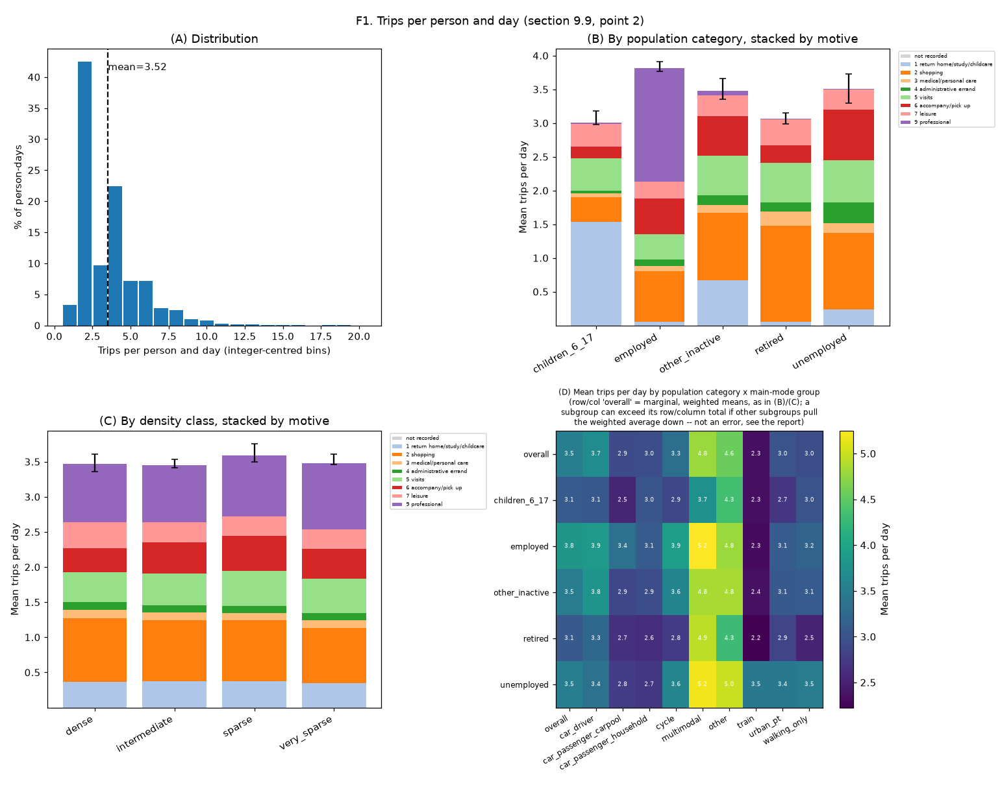

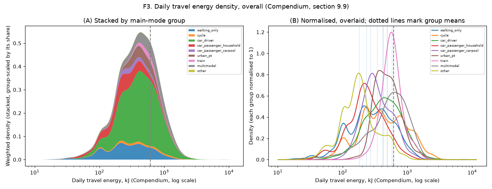

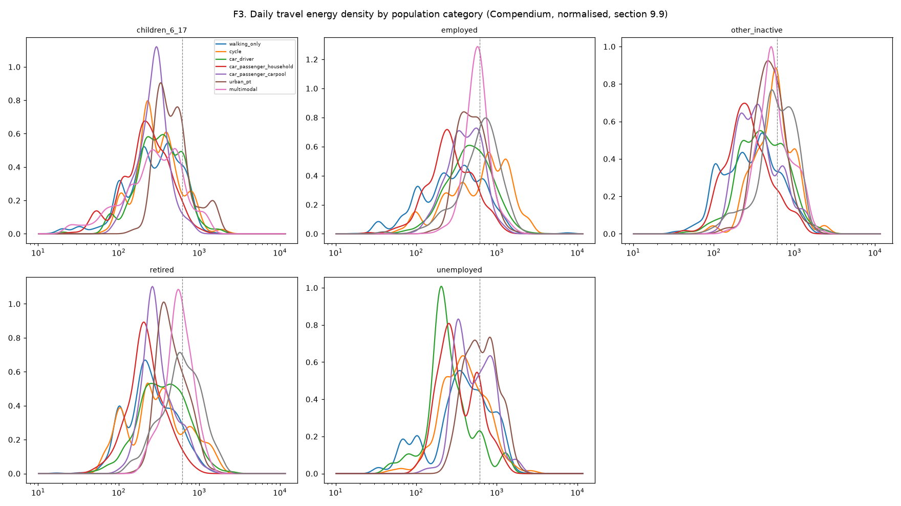

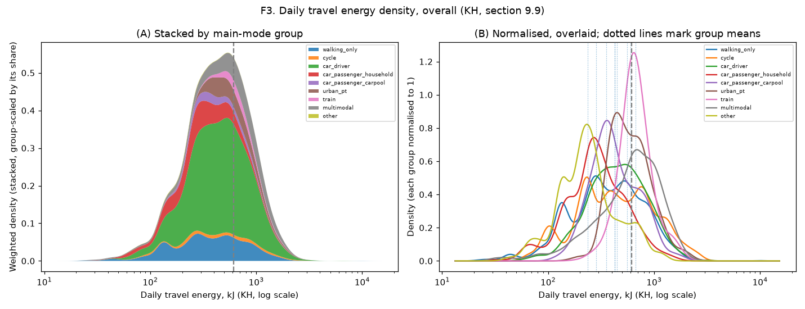

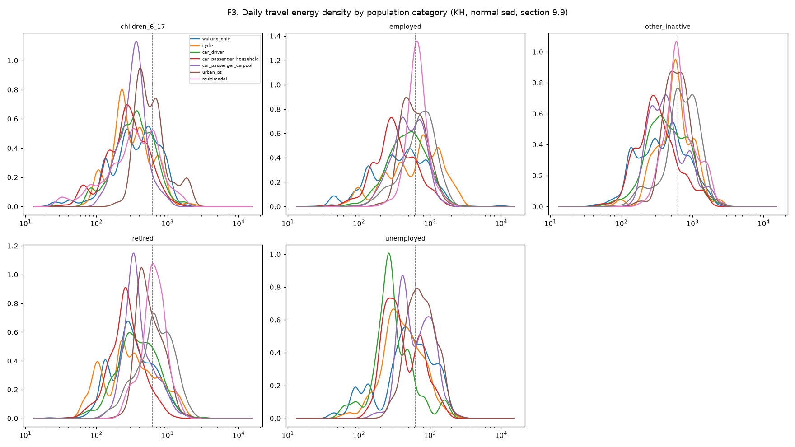

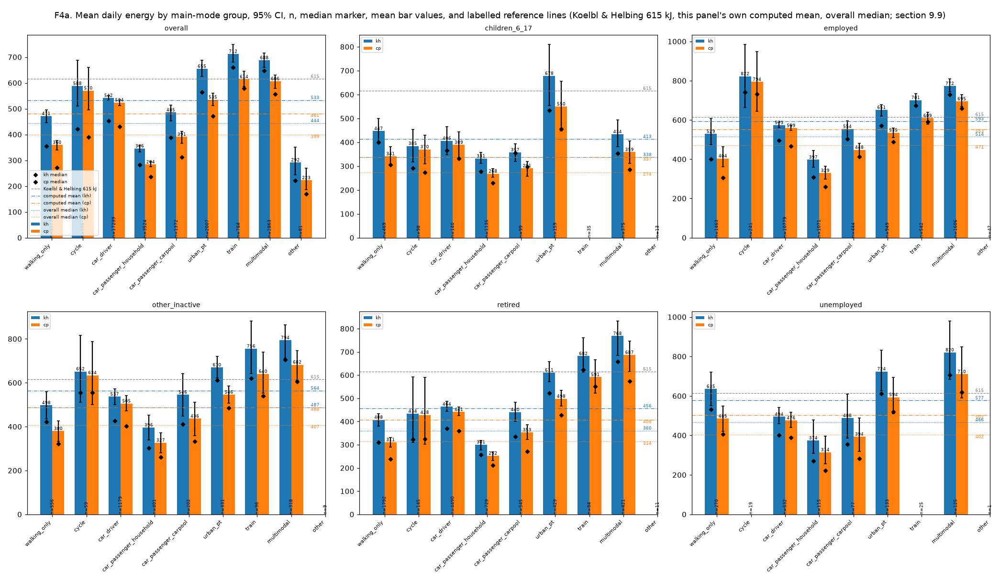

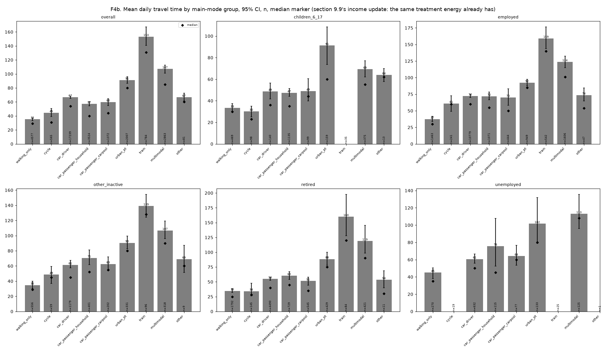

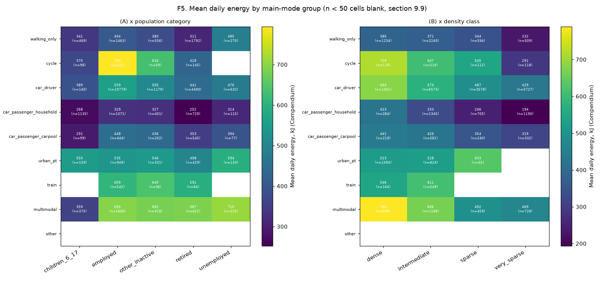

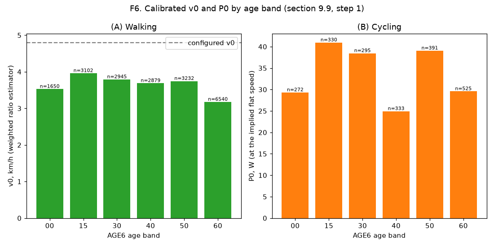

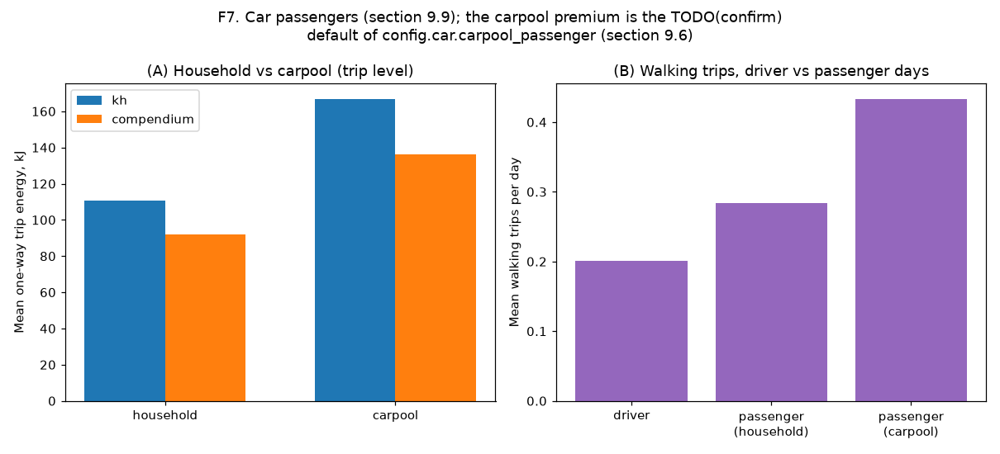

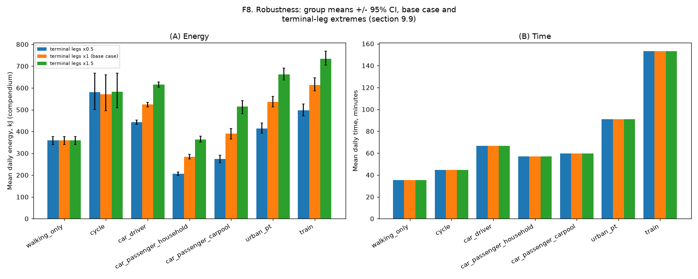

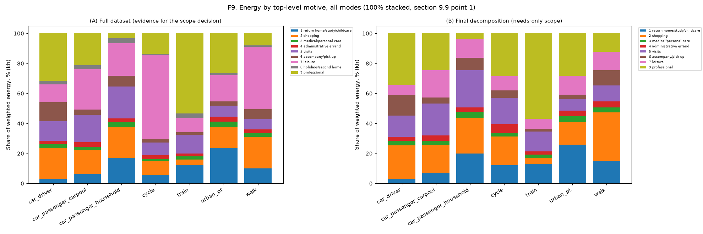

## Modelling notes and simplifications

- EMP 2019 gives no headway, station-depth or PT access-walk-distance data; `config.pt_ride.headway_min_am_peak`/`station_height_m`/`access_walk_m_by_density` are provisional TODO(confirm) defaults, used only by this step.
- Car terminal legs always use the apartment-density default: the public tables give no house/apartment split (section 9.6's `s_house`).
- `mode_group='other'` trips have no energy formula and contribute 0 kJ to a day's total; a day with only such trips is its own 'other' group, separate from 'multimodal'.
- The day's home density is the origin density of its home-departure trip (`MORIDOM=1`), or the first trip by number if no such trip is recorded that day.
- Bike get/park and stop-delay adjustment: unreliable (would consume over half, or all but under a minute, of a very short trip's declared duration) for a small share of cycling trips; these fall back to the naive whole-duration speed for both energy and the P0 estimator's ride-time denominator.
- F3/F4/F5 use the full set of day-mode groups (including multimodal and other); F8's robustness check is restricted to the six groups the task names (walk, bike, driver, both passenger groups, urban PT, train).
- F8's figure shows bootstrap CIs for the base case and the terminal-legs x0.5/x1.5 extremes only (not every table variant), per the task's "figure ... for the base case and the extremes".
