# Step 11 (`mobgrid/budget`): ENTD 2008 re-estimation (section 9.9) — Round-trip days · destination purposes · local (≤ 80 km)

**Scope:** Round-trip days · destination purposes · local (≤ 80 km) (`round-dest-local`).

Generated by `python -m mobgrid.budget.emp`. Rebuilds section 9.9's re-estimation steps 1-3 and 5 on the ENTD 2008 public tables, plus the F8 robustness check; terminal legs reuse sections 9.4-9.7's formulas and `config/energy.yaml`'s already-calibrated car/stairs/waiting/PT-ride defaults, plus provisional PT headway/station-height/access-walk defaults (TODO(confirm), `config.pt_ride`). EMC² (step 4) and Ē_c (step 6) are out of scope. Same model parameters (`config/energy.yaml`) in both surveys: differences reflect behaviour, not the model (section 9.9, "Change between 2008 and 2019"). Density: `proxy` (the INSEE grid, or section 9.9's urban-unit-status x residence-size proxy; ENTD 2008 always uses the proxy).

**Variables used** (`docs/data/entd2008.md`'s complete mapping, K_DEPLOC unless noted): mode `V2_MTP` (converted); duration `v2_mduree`/`V2_DUREE`; distance `distcor`/`V2_MDISTTOT`; purpose `V2_MMOTIFDES`/`V2_MMOTIFORI` (converted); companions `V2_MACCOMPM`/`V2_MACCOMPHM`; day `V2_TYPJOUR`, `mobloc` (from `V2_DLOCAL`); weights `POIDS_JOUR` (day) and `PONDKI` (K_INDIVIDU, individual); age band `AGE6` (Q_TCM_INDIVIDU); population category (section 6.1) from `SITUA` (Q_TCM_INDIVIDU) combined with `AGE` for the 6-17 children group; density: `Q_TCM_MENAGE.numcom_UUCat`/`TU99`, the residence commune's own density proxy (27 October 2026 decision; no density grid in ENTD 2008); non-traveller check `V2_MOBILREF` (K_INDIVIDU, reference weekday only).

**Sample flow** (persons and days kept apart, section 9.9's "Change between 2008 and 2019"; one described day per respondent in EMP 2019, up to three in ENTD 2008, weekday/Saturday/Sunday):

| Step | n |
|---|---|
| Respondents | 18,632 |
| Days with trips (15,687 weekdays, 11,670 Saturdays, 9,570 Sundays) | 36,927 |
| Days with energy | 36,253 |
| Days within scope | 30,786 |
| Days within scope with energy | 30,237 |

2,945 of 18,632 respondents report no trip on the reference weekday (15.8% unweighted, 15.0% by individual weight; reported apart per point 2).

## Main-mode-of-the-day groups (point 3) — Round-trip days · destination purposes · local (≤ 80 km)

walking only, bike, car driver, car passenger with a household driver, car passenger with a non-household driver (carpool), urban PT, train (short- and long-distance merged, step 11 round 8: train_long had too few observations to be a meaningful separate group), multimodal (two or more distinct non-walk modes in the day; driving and riding as a passenger count as two), other. **'other' contains:** powered two-wheelers under 50cm3 or unspecified (mtp 2.3-2.7), unspecified 3/4-wheeler (mtp 3.4), taxi/specialised/school transport (mtp 4.x), plane (mtp 7.x), boat (mtp 8.1), other/unspecified (mtp 9.1, missing, or the 9999 refusal code).

**Children as car drivers** (138 children_6_17 car_driver days): the raw `mtp` code is 3.1 (n=530, ages 6-17). Both codes are `mtp` category 3 "Automobile" (3.1 "Conducteur", 3.3 "Tantot conducteur tantot passager"), not a two-wheeler code (2.x): no two-wheeler reclassification applies. `mtp` 3.1 includes "voiturette" (a license-free microcar, legal from age 14 in France), plausible for the 14-17 share, but not for the many 6-13 year olds here; most likely EMP's own household/accompanying-trip coding records the car's use rather than confirming the child personally drove.

## Density classes — Round-trip days · destination purposes · local (≤ 80 km)

INSEE's own 4-level grid names and order: dense (1, densely populated communes), intermediate (2), sparse (3, peu denses), very_sparse (4, tres peu denses). EMP 2019's `emp2019._DENSITY_LABEL_BY_CODE` maps `DENSITECOM_ORI`/`_DES` directly (grid); both surveys' `trip_legs.density_proxy_case_sql` computes the same four labels from the urban-unit-status x residence-size proxy of section 9.9's "Change between 2008 and 2019" when `density_source='proxy'` (this report: `proxy`). `trip_legs._DENSITY_KEY_TRANSLATION` re-keys `config.car`/`config.pt_ride`'s existing density defaults (chosen for step 7 as `dense`/`urban`/`suburban`/`rural`) to these same INSEE names and order, checked against `data/raw/emp2019/emp2019-categories.pdf`'s "Degre de densite" table. `home_density` (every per-day/per-person table below) is the **residence** commune's own density (`trip_legs.residence_density`; 27 October 2026 decision), from `TCM_MEN.DENSITECOM_RES`/`STATUTCOM_UU_RES` (EMP 2019) or `Q_TCM_MENAGE.numcom_UUCat`/`TU99` (ENTD 2008, proxy only) -- not the density of the trip departing from home, which this replaces: that proxy was undefined for a day with no home-departing trip in scope, and was not a property of the person.

## Time budget: constancy across density classes (point 3) — Round-trip days · destination purposes · local (≤ 80 km)

The reference constant (section 9.9, 27 October 2026 decision): is mean daily travel time the same across density classes of residence, within each population category? Day with trips, selected scope. Cells of fewer than 50 persons blank. The 95% CI column (bootstrap over households) gives time the same treatment energy already has (section 9.9's income update).

| Category | Density | n | mean time (min) | 95% CI | median time (min) |
|---|---|---|---|---|---|
| children_6_17 | dense | 242 | 48.7 | [43.2, 56.3] | 40.0 |
| children_6_17 | intermediate | 1024 | 53.4 | [48.1, 57.1] | 40.0 |
| children_6_17 | sparse | 327 | 48.6 | [43.5, 53.3] | 40.0 |
| children_6_17 | very_sparse | 775 | 47.8 | [43.5, 51.7] | 40.0 |
| employed | dense | 2226 | 75.5 | [72.2, 79.9] | 65.0 |
| employed | intermediate | 6429 | 74.0 | [70.7, 77.1] | 60.0 |
| employed | sparse | 1805 | 68.1 | [62.7, 73.5] | 55.0 |
| employed | very_sparse | 4798 | 66.1 | [63.9, 68.5] | 60.0 |
| unemployed | dense | 212 | 73.8 | [55.8, 93.3] | 60.0 |
| unemployed | intermediate | 593 | 62.2 | [56.4, 68.6] | 50.0 |
| unemployed | sparse | 141 | 54.5 | [45.5, 64.4] | 44.0 |
| unemployed | very_sparse | 331 | 67.3 | [59.1, 76.6] | 53.0 |
| retired | dense | 1049 | 56.6 | [51.4, 61.4] | 45.0 |
| retired | intermediate | 3439 | 55.1 | [52.2, 57.7] | 45.0 |
| retired | sparse | 1124 | 46.3 | [42.4, 49.4] | 35.0 |
| retired | very_sparse | 2776 | 54.7 | [51.5, 56.9] | 40.0 |
| other_inactive | dense | 608 | 64.2 | [59.6, 69.5] | 59.0 |
| other_inactive | intermediate | 1180 | 64.6 | [59.6, 70.0] | 53.0 |
| other_inactive | sparse | 358 | 64.2 | [56.0, 74.1] | 55.0 |
| other_inactive | very_sparse | 652 | 64.2 | [57.3, 72.0] | 50.0 |

### Constancy summary — Round-trip days · destination purposes · local (≤ 80 km)

| Category | dense/very_sparse | max/min | CV across classes |
|---|---|---|---|
| children_6_17 | 1.02 | 1.12 | 0.04 |
| employed | 1.14 | 1.14 | 0.06 |
| unemployed | 1.10 | 1.35 | 0.11 |
| retired | 1.03 | 1.22 | 0.08 |
| other_inactive | 1.00 | 1.01 | 0.00 |

### Equivalence to the category mean (TOST) — Round-trip days · destination purposes · local (≤ 80 km)

Ratio of each density-class mean to its population-category mean; 90% household-bootstrap CI. `equivalent` means the full interval lies within the configured margin; `different` means it lies wholly outside; otherwise the result is `inconclusive`. Cells under 50 respondents are suppressed.

| Category | Group | n | Ratio to category mean | 90% CI | ±15% verdict | ±10% verdict |
|---|---|---|---|---|---|---|
| children_6_17 | dense | 242 | 0.962 | [0.865, 1.076] | equivalent | inconclusive |
| children_6_17 | intermediate | 1024 | 1.053 | [1.003, 1.098] | equivalent | equivalent |
| children_6_17 | sparse | 327 | 0.959 | [0.881, 1.043] | equivalent | inconclusive |
| children_6_17 | very_sparse | 775 | 0.943 | [0.875, 1.022] | equivalent | inconclusive |
| employed | dense | 2226 | 1.060 | [1.021, 1.108] | equivalent | inconclusive |
| employed | intermediate | 6429 | 1.039 | [1.019, 1.062] | equivalent | equivalent |
| employed | sparse | 1805 | 0.957 | [0.905, 1.015] | equivalent | equivalent |
| employed | very_sparse | 4798 | 0.928 | [0.900, 0.953] | equivalent | inconclusive |
| other_inactive | dense | 608 | 0.997 | [0.932, 1.081] | equivalent | equivalent |
| other_inactive | intermediate | 1180 | 1.003 | [0.959, 1.049] | equivalent | equivalent |
| other_inactive | sparse | 358 | 0.998 | [0.888, 1.100] | equivalent | inconclusive |
| other_inactive | very_sparse | 652 | 0.997 | [0.908, 1.080] | equivalent | equivalent |
| retired | dense | 1049 | 1.057 | [0.982, 1.137] | equivalent | inconclusive |
| retired | intermediate | 3439 | 1.029 | [1.003, 1.058] | equivalent | equivalent |
| retired | sparse | 1124 | 0.866 | [0.816, 0.922] | inconclusive | inconclusive |
| retired | very_sparse | 2776 | 1.022 | [0.978, 1.057] | equivalent | equivalent |
| unemployed | dense | 212 | 1.153 | [0.960, 1.432] | inconclusive | inconclusive |
| unemployed | intermediate | 593 | 0.972 | [0.900, 1.034] | equivalent | inconclusive |
| unemployed | sparse | 141 | 0.852 | [0.735, 0.996] | inconclusive | inconclusive |
| unemployed | very_sparse | 331 | 1.051 | [0.931, 1.176] | inconclusive | inconclusive |

## Time budget: constancy across income quintiles (section 9.9's income update) — Round-trip days · destination purposes · local (≤ 80 km)

Household income per consumption unit (modified OECD scale), in quintiles computed within this survey with individual weights (`docs/data/entd2008.md`'s "Income variables"): is mean daily travel time the same across income quintiles, within each population category, as income is treated as density is? Day with trips, selected scope. `'unknown'` (missing/refused income) is its own class, excluded from the constancy summary (not an ordered quantile).

| Category | Income quintile | n | mean time (min) | 95% CI | median time (min) |
|---|---|---|---|---|---|
| children_6_17 | q1 | 424 | 53.2 | [46.2, 60.2] | 40.0 |
| children_6_17 | q2 | 551 | 49.3 | [45.3, 53.7] | 40.0 |
| children_6_17 | q3 | 440 | 52.7 | [47.9, 57.8] | 40.0 |
| children_6_17 | q4 | 521 | 47.8 | [44.0, 52.6] | 40.0 |
| children_6_17 | q5 | 432 | 50.2 | [44.1, 57.2] | 40.0 |
| children_6_17 | unknown | 0 | - | - | - |
| employed | q1 | 1206 | 67.3 | [63.2, 72.5] | 60.0 |
| employed | q2 | 2219 | 65.2 | [61.7, 68.6] | 55.0 |
| employed | q3 | 3118 | 71.1 | [66.7, 77.0] | 60.0 |
| employed | q4 | 3841 | 69.6 | [66.4, 72.5] | 60.0 |
| employed | q5 | 4874 | 78.8 | [75.8, 81.9] | 67.0 |
| employed | unknown | 0 | - | - | - |
| unemployed | q1 | 522 | 57.2 | [49.4, 63.4] | 45.0 |
| unemployed | q2 | 250 | 72.2 | [61.5, 89.4] | 55.0 |
| unemployed | q3 | 205 | 65.4 | [57.7, 75.3] | 58.0 |
| unemployed | q4 | 144 | 69.2 | [56.8, 82.7] | 60.0 |
| unemployed | q5 | 156 | 69.1 | [58.5, 78.6] | 57.0 |
| unemployed | unknown | 0 | - | - | - |
| retired | q1 | 1453 | 44.2 | [40.3, 47.3] | 30.0 |
| retired | q2 | 1373 | 52.7 | [48.6, 56.6] | 40.0 |
| retired | q3 | 1795 | 53.1 | [49.7, 57.1] | 40.0 |
| retired | q4 | 1364 | 57.5 | [52.8, 62.1] | 45.0 |
| retired | q5 | 2403 | 58.7 | [55.4, 62.0] | 50.0 |
| retired | unknown | 0 | - | - | - |
| other_inactive | q1 | 1043 | 64.3 | [58.9, 69.7] | 55.0 |
| other_inactive | q2 | 579 | 63.1 | [57.0, 68.5] | 49.0 |
| other_inactive | q3 | 389 | 65.0 | [57.0, 72.3] | 60.0 |
| other_inactive | q4 | 331 | 67.9 | [58.7, 79.0] | 55.0 |
| other_inactive | q5 | 456 | 63.3 | [55.6, 74.0] | 55.0 |
| other_inactive | unknown | 0 | - | - | - |

### Constancy summary — Round-trip days · destination purposes · local (≤ 80 km)

| Category | q5/q1 | max/min | CV across classes |
|---|---|---|---|
| children_6_17 | 0.94 | 1.11 | 0.04 |
| employed | 1.17 | 1.21 | 0.07 |
| unemployed | 1.21 | 1.26 | 0.08 |
| retired | 1.33 | 1.33 | 0.10 |
| other_inactive | 0.98 | 1.08 | 0.03 |

### Equivalence to the category mean (TOST) — Round-trip days · destination purposes · local (≤ 80 km)

Ratio of each income-quintile mean to its population-category mean; 90% household-bootstrap CI. `equivalent` means the full interval lies within the configured margin; `different` means it lies wholly outside; otherwise the result is `inconclusive`. Cells under 50 respondents are suppressed.

| Category | Group | n | Ratio to category mean | 90% CI | ±15% verdict | ±10% verdict |
|---|---|---|---|---|---|---|
| children_6_17 | q1 | 424 | 1.051 | [0.936, 1.163] | inconclusive | inconclusive |
| children_6_17 | q2 | 551 | 0.974 | [0.909, 1.044] | equivalent | equivalent |
| children_6_17 | q3 | 440 | 1.041 | [0.952, 1.135] | equivalent | inconclusive |
| children_6_17 | q4 | 521 | 0.944 | [0.879, 1.030] | equivalent | inconclusive |
| children_6_17 | q5 | 432 | 0.990 | [0.879, 1.102] | equivalent | inconclusive |
| employed | q1 | 1206 | 0.945 | [0.893, 0.999] | equivalent | inconclusive |
| employed | q2 | 2219 | 0.916 | [0.880, 0.950] | equivalent | inconclusive |
| employed | q3 | 3118 | 0.999 | [0.948, 1.064] | equivalent | equivalent |
| employed | q4 | 3841 | 0.978 | [0.940, 1.012] | equivalent | equivalent |
| employed | q5 | 4874 | 1.107 | [1.073, 1.145] | equivalent | inconclusive |
| other_inactive | q1 | 1043 | 0.999 | [0.953, 1.044] | equivalent | equivalent |
| other_inactive | q2 | 579 | 0.980 | [0.903, 1.058] | equivalent | equivalent |
| other_inactive | q3 | 389 | 1.009 | [0.906, 1.123] | equivalent | inconclusive |
| other_inactive | q4 | 331 | 1.054 | [0.933, 1.174] | inconclusive | inconclusive |
| other_inactive | q5 | 456 | 0.983 | [0.883, 1.085] | equivalent | inconclusive |
| retired | q1 | 1453 | 0.825 | [0.778, 0.876] | inconclusive | different |
| retired | q2 | 1373 | 0.985 | [0.937, 1.038] | equivalent | equivalent |
| retired | q3 | 1795 | 0.992 | [0.947, 1.043] | equivalent | equivalent |
| retired | q4 | 1364 | 1.075 | [1.007, 1.146] | equivalent | inconclusive |
| retired | q5 | 2403 | 1.097 | [1.049, 1.146] | equivalent | inconclusive |
| unemployed | q1 | 522 | 0.894 | [0.818, 0.973] | inconclusive | inconclusive |
| unemployed | q2 | 250 | 1.128 | [0.969, 1.318] | inconclusive | inconclusive |
| unemployed | q3 | 205 | 1.021 | [0.883, 1.160] | inconclusive | inconclusive |
| unemployed | q4 | 144 | 1.081 | [0.908, 1.279] | inconclusive | inconclusive |
| unemployed | q5 | 156 | 1.079 | [0.917, 1.223] | inconclusive | inconclusive |

### Quintile shares and cut points — Round-trip days · destination purposes · local (≤ 80 km)

Quintiles are cut to hold equal shares of individual weight (28 October 2026 decision): a tied income value (common -- EMP 2019's `decile_rev_uc` has only 10 distinct values, and ENTD 2008's bracket-midpoint/`NBUC` often repeats) straddling a cut point is split between the two quintiles in proportion, by a seeded random draw (`trip_legs.build_income_quintile_table`). `'unknown'` (missing/refused income) is its own row, excluded from the 20/40/60/80% cut, with its own breakdown below of *why* a value is missing (`entd2008.missing_income_breakdown`): a producer-side gap (no `Q_TCM_MENAGE` match, or a blank `TrancheRevenuMensuel`) versus this project's own code (a bracket label `income_bracket_midpoint_eur` could not parse, or a missing/zero `NBUC` making the division `NULL`).

| Quintile | n | Share of individual weight | Share of day weight |
|---|---|---|---|
| q1 | 3365 | 20.0% | 18.3% |
| q2 | 3162 | 20.0% | 19.6% |
| q3 | 3644 | 20.0% | 20.3% |
| q4 | 3671 | 20.0% | 20.9% |
| q5 | 4790 | 20.0% | 20.9% |
| unknown | 0 | 0.0% | 0.0% |

Cut points (q1/q2, q2/q3, q3/q4, q4/q5): 900.0, 1250.0, 1521.7, 2173.9.

Missing-income breakdown, of 18632 respondents: 0 (0.0%) with no matching household income record at all (a producer-side gap, not this project's code); 0 (0.0%) with a matched household but a blank `TrancheRevenuMensuel` (both producer-side); 0 (0.0%) with a bracket label this project's own `income_bracket_midpoint_eur` could not parse; 0 (0.0%) with a parsed bracket but a missing/zero `NBUC` (this project's own division, not the producer's).

## Trips per day and minutes per trip, by category, density and income quintile (section 9.9 point 2: daily time = trips/day x minutes/trip) — Round-trip days · destination purposes · local (≤ 80 km)

### Trips per day — Round-trip days · destination purposes · local (≤ 80 km)

#### By population category x density class — Round-trip days · destination purposes · local (≤ 80 km)

| Category | Density | n | mean trips/day | 95% CI | median trips/day |
|---|---|---|---|---|---|
| children_6_17 | dense | 242 | 3.24 | [2.91, 3.63] | 3.00 |
| children_6_17 | intermediate | 1024 | 3.31 | [3.16, 3.47] | 3.00 |
| children_6_17 | sparse | 327 | 3.46 | [3.25, 3.67] | 4.00 |
| children_6_17 | very_sparse | 775 | 3.23 | [3.07, 3.40] | 3.00 |
| employed | dense | 2226 | 3.87 | [3.71, 4.04] | 4.00 |
| employed | intermediate | 6429 | 3.87 | [3.75, 4.00] | 4.00 |
| employed | sparse | 1805 | 4.10 | [3.90, 4.30] | 4.00 |
| employed | very_sparse | 4798 | 3.98 | [3.87, 4.10] | 4.00 |
| unemployed | dense | 212 | 3.49 | [3.03, 3.95] | 3.00 |
| unemployed | intermediate | 593 | 3.71 | [3.44, 4.01] | 3.00 |
| unemployed | sparse | 141 | 3.40 | [3.01, 3.94] | 2.00 |
| unemployed | very_sparse | 331 | 3.53 | [3.20, 3.81] | 3.00 |
| retired | dense | 1049 | 3.12 | [2.79, 3.57] | 2.00 |
| retired | intermediate | 3439 | 3.24 | [3.10, 3.36] | 2.00 |
| retired | sparse | 1124 | 3.16 | [2.99, 3.38] | 2.00 |
| retired | very_sparse | 2776 | 3.10 | [2.99, 3.20] | 2.00 |
| other_inactive | dense | 608 | 3.84 | [3.51, 4.27] | 4.00 |
| other_inactive | intermediate | 1180 | 3.55 | [3.34, 3.84] | 3.00 |
| other_inactive | sparse | 358 | 3.52 | [3.20, 3.87] | 3.00 |
| other_inactive | very_sparse | 652 | 3.63 | [3.30, 3.95] | 3.00 |

#### By population category x income quintile — Round-trip days · destination purposes · local (≤ 80 km)

| Category | Income quintile | n | mean trips/day | 95% CI | median trips/day |
|---|---|---|---|---|---|
| children_6_17 | q1 | 424 | 3.45 | [3.25, 3.72] | 3.00 |
| children_6_17 | q2 | 551 | 3.41 | [3.16, 3.62] | 3.00 |
| children_6_17 | q3 | 440 | 3.18 | [2.98, 3.45] | 2.00 |
| children_6_17 | q4 | 521 | 3.23 | [2.98, 3.43] | 3.00 |
| children_6_17 | q5 | 432 | 3.14 | [2.92, 3.36] | 3.00 |
| children_6_17 | unknown | 0 | - | - | - |
| employed | q1 | 1206 | 4.04 | [3.81, 4.30] | 4.00 |
| employed | q2 | 2219 | 3.92 | [3.78, 4.09] | 4.00 |
| employed | q3 | 3118 | 3.99 | [3.81, 4.21] | 4.00 |
| employed | q4 | 3841 | 3.85 | [3.74, 3.98] | 4.00 |
| employed | q5 | 4874 | 3.94 | [3.84, 4.07] | 4.00 |
| employed | unknown | 0 | - | - | - |
| unemployed | q1 | 522 | 3.53 | [3.21, 3.83] | 2.00 |
| unemployed | q2 | 250 | 3.51 | [3.14, 3.81] | 3.00 |
| unemployed | q3 | 205 | 3.62 | [3.27, 4.03] | 3.00 |
| unemployed | q4 | 144 | 4.01 | [3.33, 4.93] | 4.00 |
| unemployed | q5 | 156 | 3.48 | [3.02, 3.85] | 4.00 |
| unemployed | unknown | 0 | - | - | - |
| retired | q1 | 1453 | 2.69 | [2.54, 2.84] | 2.00 |
| retired | q2 | 1373 | 3.11 | [2.95, 3.34] | 2.00 |
| retired | q3 | 1795 | 3.14 | [3.03, 3.30] | 2.00 |
| retired | q4 | 1364 | 3.38 | [3.15, 3.69] | 2.00 |
| retired | q5 | 2403 | 3.47 | [3.29, 3.69] | 3.00 |
| retired | unknown | 0 | - | - | - |
| other_inactive | q1 | 1043 | 3.63 | [3.39, 3.91] | 3.00 |
| other_inactive | q2 | 579 | 3.55 | [3.30, 3.89] | 3.00 |
| other_inactive | q3 | 389 | 3.67 | [3.27, 4.14] | 3.00 |
| other_inactive | q4 | 331 | 3.61 | [3.17, 4.12] | 3.00 |
| other_inactive | q5 | 456 | 3.62 | [3.25, 3.97] | 3.00 |
| other_inactive | unknown | 0 | - | - | - |

### Minutes per trip — Round-trip days · destination purposes · local (≤ 80 km)

#### By population category x density class — Round-trip days · destination purposes · local (≤ 80 km)

| Category | Density | n | mean min/trip | 95% CI | median min/trip |
|---|---|---|---|---|---|
| children_6_17 | dense | 242 | 15.36 | [13.93, 17.21] | 13.75 |
| children_6_17 | intermediate | 1024 | 17.79 | [15.88, 19.76] | 15.00 |
| children_6_17 | sparse | 327 | 15.85 | [14.08, 17.75] | 10.75 |
| children_6_17 | very_sparse | 775 | 15.53 | [14.32, 16.68] | 12.50 |
| employed | dense | 2226 | 21.84 | [20.71, 23.36] | 18.00 |
| employed | intermediate | 6429 | 21.59 | [20.79, 22.36] | 15.00 |
| employed | sparse | 1805 | 19.15 | [17.35, 21.34] | 13.75 |
| employed | very_sparse | 4798 | 18.79 | [17.96, 19.52] | 15.00 |
| unemployed | dense | 212 | 22.46 | [17.41, 30.29] | 20.00 |
| unemployed | intermediate | 593 | 18.26 | [16.59, 20.31] | 15.00 |
| unemployed | sparse | 141 | 17.36 | [14.03, 20.47] | 15.00 |
| unemployed | very_sparse | 331 | 21.35 | [18.94, 24.43] | 16.00 |
| retired | dense | 1049 | 19.30 | [17.79, 21.04] | 15.00 |
| retired | intermediate | 3439 | 18.41 | [17.51, 19.35] | 14.71 |
| retired | sparse | 1124 | 15.14 | [13.85, 16.18] | 11.67 |
| retired | very_sparse | 2776 | 18.73 | [17.74, 19.58] | 15.00 |
| other_inactive | dense | 608 | 19.04 | [17.69, 20.90] | 15.00 |
| other_inactive | intermediate | 1180 | 20.77 | [19.27, 22.53] | 15.00 |
| other_inactive | sparse | 358 | 20.33 | [17.38, 23.55] | 15.00 |
| other_inactive | very_sparse | 652 | 19.71 | [17.99, 21.78] | 15.00 |

#### By population category x income quintile — Round-trip days · destination purposes · local (≤ 80 km)

| Category | Income quintile | n | mean min/trip | 95% CI | median min/trip |
|---|---|---|---|---|---|
| children_6_17 | q1 | 424 | 17.10 | [14.44, 20.39] | 13.33 |
| children_6_17 | q2 | 551 | 15.25 | [14.00, 16.51] | 12.50 |
| children_6_17 | q3 | 440 | 17.78 | [15.84, 19.58] | 14.33 |
| children_6_17 | q4 | 521 | 16.08 | [14.72, 17.77] | 12.50 |
| children_6_17 | q5 | 432 | 17.55 | [15.10, 20.49] | 13.33 |
| children_6_17 | unknown | 0 | - | - | - |
| employed | q1 | 1206 | 19.39 | [18.06, 21.21] | 15.00 |
| employed | q2 | 2219 | 18.97 | [17.85, 20.24] | 14.17 |
| employed | q3 | 3118 | 19.89 | [18.79, 21.06] | 15.00 |
| employed | q4 | 3841 | 20.25 | [19.32, 21.26] | 15.50 |
| employed | q5 | 4874 | 22.84 | [21.82, 23.84] | 17.50 |
| employed | unknown | 0 | - | - | - |
| unemployed | q1 | 522 | 17.34 | [15.25, 18.99] | 13.75 |
| unemployed | q2 | 250 | 23.03 | [18.58, 29.95] | 15.83 |
| unemployed | q3 | 205 | 20.12 | [17.44, 23.15] | 16.25 |
| unemployed | q4 | 144 | 18.91 | [16.67, 22.65] | 15.00 |
| unemployed | q5 | 156 | 20.68 | [18.47, 23.20] | 20.00 |
| unemployed | unknown | 0 | - | - | - |
| retired | q1 | 1453 | 16.99 | [15.84, 18.28] | 13.75 |
| retired | q2 | 1373 | 18.05 | [16.84, 19.37] | 14.30 |
| retired | q3 | 1795 | 18.44 | [17.14, 20.08] | 14.50 |
| retired | q4 | 1364 | 18.28 | [16.88, 19.75] | 14.00 |
| retired | q5 | 2403 | 17.99 | [16.93, 18.92] | 14.50 |
| retired | unknown | 0 | - | - | - |
| other_inactive | q1 | 1043 | 20.05 | [18.34, 21.96] | 15.00 |
| other_inactive | q2 | 579 | 20.17 | [17.94, 22.68] | 15.00 |
| other_inactive | q3 | 389 | 19.90 | [17.92, 22.12] | 15.00 |
| other_inactive | q4 | 331 | 21.51 | [17.97, 25.82] | 15.00 |
| other_inactive | q5 | 456 | 19.82 | [17.04, 22.73] | 14.60 |
| other_inactive | unknown | 0 | - | - | - |

#### By density class and by income quintile (marginals) — Round-trip days · destination purposes · local (≤ 80 km)

| Group | n | weighted n | mean trips/day | 95% CI | median trips/day |
|---|---|---|---|---|---|
| intermediate | 12716 | 123,067,759 | 3.60 | [3.53, 3.69] | 3.00 |
| very_sparse | 9375 | 64,060,533 | 3.64 | [3.57, 3.72] | 3.00 |
| sparse | 3786 | 48,091,595 | 3.70 | [3.59, 3.81] | 3.00 |
| dense | 4360 | 37,830,662 | 3.61 | [3.49, 3.75] | 3.00 |

| Group | n | weighted n | mean trips/day | 95% CI | median trips/day |
|---|---|---|---|---|---|
| q5 | 8353 | 57,120,729 | 3.72 | [3.64, 3.81] | 3.00 |
| q4 | 6222 | 56,965,218 | 3.67 | [3.57, 3.77] | 3.00 |
| q3 | 5976 | 55,517,198 | 3.64 | [3.54, 3.77] | 3.00 |
| q2 | 5000 | 53,463,451 | 3.60 | [3.50, 3.70] | 3.00 |
| q1 | 4686 | 49,983,954 | 3.49 | [3.38, 3.63] | 3.00 |

| Group | n | weighted n | mean min/trip | 95% CI | median min/trip |
|---|---|---|---|---|---|
| employed | 15258 | 135,108,488 | 20.50 | [19.99, 21.06] | 15.00 |
| retired | 8388 | 57,068,796 | 17.98 | [17.38, 18.57] | 14.30 |
| children_6_17 | 2368 | 41,724,195 | 16.62 | [15.65, 17.71] | 12.80 |
| other_inactive | 2798 | 25,077,652 | 20.19 | [19.03, 21.18] | 15.00 |
| unemployed | 1277 | 10,989,411 | 19.39 | [17.89, 21.46] | 15.00 |

| Group | n | weighted n | mean min/trip | 95% CI | median min/trip |
|---|---|---|---|---|---|
| intermediate | 12716 | 123,067,759 | 20.03 | [19.52, 20.61] | 15.00 |
| very_sparse | 9375 | 64,060,533 | 18.44 | [17.88, 18.94] | 15.00 |
| sparse | 3786 | 48,091,595 | 17.69 | [16.64, 18.71] | 13.00 |
| dense | 4360 | 37,830,662 | 20.03 | [19.29, 21.04] | 16.25 |

| Group | n | weighted n | mean min/trip | 95% CI | median min/trip |
|---|---|---|---|---|---|
| q5 | 8353 | 57,120,729 | 20.89 | [20.17, 21.56] | 15.00 |
| q4 | 6222 | 56,965,218 | 19.29 | [18.50, 20.06] | 15.00 |
| q3 | 5976 | 55,517,198 | 19.13 | [18.30, 19.93] | 15.00 |
| q2 | 5000 | 53,463,451 | 18.43 | [17.65, 19.22] | 14.29 |
| q1 | 4686 | 49,983,954 | 18.31 | [17.46, 19.16] | 14.50 |

## Per-person budget, days without trips included (section 9.9 point 2b) — Round-trip days · destination purposes · local (≤ 80 km)

Direct producer-weighted sum of selected-scope day values over the full respondent roster. EMP 2019 weekdays use Σ pond_jour × value ÷ 5 ÷ Σ pond_indC; ENTD 2008 uses the weighted reference-weekday total ÷ Σ POIDS_JOUR for the full Kish roster. The weekday estimates are comparable; ENTD 2008 reports weekdays only; weekend estimates are not used.

Among described weekdays with trips (all motives), the producer-weighted share with zero local trips is 2.47% (440/15687 days; 5,886,475/238,726,796 weighted days).

### By population category — Round-trip days · destination purposes · local (≤ 80 km)

#### Weekday — Round-trip days · destination purposes · local (≤ 80 km)

| Category | n respondents | min/person/day | 95% CI |
|---|---:|---:|---|
| children_6_17 | 1502 | 42.3 | [39.7, 45.1] |
| employed | 8658 | 61.1 | [59.5, 63.1] |
| unemployed | 796 | 47.2 | [42.5, 52.3] |
| retired | 5709 | 34.6 | [33.0, 36.5] |
| other_inactive | 1876 | 45.9 | [42.7, 49.2] |
| overall | 18632 | 49.5 | [48.5, 50.9] |

### By population category x density class (weekday budget) — Round-trip days · destination purposes · local (≤ 80 km)

| Category | Density | n respondents | min/person/day | 95% CI |
|---|---|---:|---:|---|
| children_6_17 | dense | 141 | 40.1 | [32.6, 46.7] |
| children_6_17 | intermediate | 577 | 44.1 | [39.4, 48.6] |
| children_6_17 | sparse | 211 | 37.9 | [33.3, 43.1] |
| children_6_17 | very_sparse | 573 | 43.4 | [38.9, 47.8] |
| employed | dense | 1243 | 67.5 | [63.7, 71.6] |
| employed | intermediate | 3432 | 65.7 | [62.9, 68.9] |
| employed | sparse | 1065 | 54.8 | [49.3, 59.5] |
| employed | very_sparse | 2918 | 54.6 | [52.5, 57.2] |
| unemployed | dense | 123 | 58.5 | [42.0, 83.6] |
| unemployed | intermediate | 352 | 48.1 | [41.6, 55.9] |
| unemployed | sparse | 91 | 34.7 | [22.5, 50.9] |
| unemployed | very_sparse | 230 | 45.2 | [36.4, 54.1] |
| retired | dense | 630 | 39.9 | [34.3, 45.1] |
| retired | intermediate | 2157 | 37.6 | [34.9, 40.6] |
| retired | sparse | 788 | 30.0 | [25.9, 34.5] |
| retired | very_sparse | 2134 | 30.8 | [28.3, 33.9] |
| other_inactive | dense | 394 | 47.6 | [41.5, 55.6] |
| other_inactive | intermediate | 749 | 45.9 | [41.4, 50.3] |
| other_inactive | sparse | 241 | 47.6 | [38.4, 55.6] |
| other_inactive | very_sparse | 492 | 42.8 | [34.8, 50.1] |

### By population category x income quintile (weekday budget) — Round-trip days · destination purposes · local (≤ 80 km)

| Category | Income quintile | n respondents | min/person/day | 95% CI |
|---|---|---:|---:|---|
| children_6_17 | q1 | 287 | 45.9 | [38.9, 54.1] |
| children_6_17 | q2 | 367 | 42.1 | [38.1, 47.8] |
| children_6_17 | q3 | 292 | 42.1 | [36.4, 48.5] |
| children_6_17 | q4 | 313 | 40.1 | [35.0, 44.3] |
| children_6_17 | q5 | 243 | 40.2 | [32.9, 47.9] |
| employed | q1 | 736 | 59.1 | [53.3, 63.9] |
| employed | q2 | 1255 | 56.5 | [52.7, 60.4] |
| employed | q3 | 1764 | 59.9 | [55.1, 65.9] |
| employed | q4 | 2177 | 59.5 | [55.8, 63.1] |
| employed | q5 | 2726 | 68.0 | [65.0, 71.5] |
| unemployed | q1 | 340 | 40.7 | [33.7, 47.3] |
| unemployed | q2 | 156 | 51.4 | [39.8, 69.4] |
| unemployed | q3 | 124 | 47.6 | [37.8, 59.3] |
| unemployed | q4 | 90 | 59.1 | [45.4, 72.2] |
| unemployed | q5 | 86 | 59.0 | [47.2, 73.7] |
| retired | q1 | 1234 | 23.4 | [20.2, 26.5] |
| retired | q2 | 979 | 31.3 | [27.8, 35.2] |
| retired | q3 | 1188 | 36.4 | [33.3, 40.3] |
| retired | q4 | 881 | 39.4 | [34.8, 44.2] |
| retired | q5 | 1427 | 43.4 | [40.5, 46.5] |
| other_inactive | q1 | 745 | 46.1 | [41.2, 51.8] |
| other_inactive | q2 | 386 | 44.3 | [37.5, 51.5] |
| other_inactive | q3 | 258 | 40.3 | [32.3, 47.2] |
| other_inactive | q4 | 196 | 52.9 | [41.4, 63.4] |
| other_inactive | q5 | 291 | 48.4 | [41.1, 58.7] |

## Quirks: `distcor`/`v2_mduree` fill rate and mean change (section 9.9) — Round-trip days · destination purposes · local (≤ 80 km)

`k_deploc`'s seven undocumented correction columns (`docs/data/entd2008.md`'s "Quirks"); `distcor`/`v2_mduree` are used (when filled) by `trips_norm`, the other five are not.

- `distcor`: 0.23% filled, mean change 0.67 km (corrected - declared) where filled.
- `v2_mduree`: 0.00% filled (never filled in this release: `duration_min` always falls back to `V2_DUREE`).

## Mean daily energy and time by main-mode group (point 3) — Round-trip days · destination purposes · local (≤ 80 km)

| Group | n | weighted n | mean time (min) | median time (min) | mean energy kh (kJ) | median energy kh (kJ) | 95% CI | mean energy compendium (kJ) | median energy compendium (kJ) | 95% CI |
|---|---|---|---|---|---|---|---|---|---|---|
| car_driver | 15954 | 142,388,331 | 63.4 | 54.0 | 337.6 | 260.0 | [329.3, 347.3] | 385.8 | 325.0 | [377.8, 395.8] |
| walking_only | 4316 | 39,682,344 | 35.0 | 30.0 | 470.9 | 355.2 | [451.7, 491.6] | 359.5 | 271.1 | [344.8, 375.3] |
| car_passenger_household | 3250 | 30,182,464 | 52.7 | 40.0 | 182.5 | 110.0 | [169.9, 196.5] | 160.9 | 105.6 | [151.5, 171.7] |
| multimodal | 2558 | 25,566,176 | 94.9 | 81.0 | 449.0 | 329.5 | [423.1, 475.4] | 433.8 | 333.9 | [408.3, 459.4] |
| urban_pt | 1884 | 16,624,182 | 89.2 | 80.0 | 603.9 | 522.0 | [568.9, 641.5] | 497.3 | 438.7 | [469.2, 527.2] |
| car_passenger_carpool | 1070 | 7,150,390 | 54.8 | 44.0 | 265.2 | 145.9 | [226.4, 310.7] | 224.5 | 141.4 | [194.5, 258.9] |
| cycle | 552 | 5,879,377 | 43.9 | 35.0 | 602.0 | 499.4 | [543.6, 668.1] | 585.6 | 447.2 | [529.4, 649.6] |
| train | 579 | 4,697,654 | 128.9 | 120.0 | 783.4 | 737.3 | [744.2, 835.3] | 660.5 | 609.6 | [629.9, 702.8] |
| other | 74 | 879,631 | 75.6 | 64.0 | 280.5 | 222.0 | [226.7, 334.7] | 214.1 | 169.5 | [173.0, 255.5] |

## Data-quality correction: implausible door-to-door speeds — Round-trip days · destination purposes · local (≤ 80 km)

Trips are corrected, not dropped (section 9.9, step 11 round 5): flagged above an upper speed bound only -- walk > 7 km/h, bike > 35 km/h, car (driver or passenger) > 130 km/h -- their declared distance is replaced by declared duration x the mode's own median speed (from its not-flagged trips). Cycling energy's main work term is time-based (round 4), but its "stops" sub-term still multiplies by distance and by the distance-derived ride speed squared (section 9.7), so a flagged bike trip's distance is corrected too, like walk and car (round 9).

- car_driver: 205 of 58,302 trips corrected
- car_passenger_carpool: 6 of 3,811 trips corrected
- car_passenger_household: 28 of 11,122 trips corrected
- cycle: 16 of 2,169 trips corrected
- other: 0 of 2,337 trips corrected
- train: 0 of 1,658 trips corrected
- urban_pt: 0 of 5,242 trips corrected
- walk: 351 of 19,526 trips corrected

## Mean daily energy and time by main-mode group, overall and by population category (F4) — Round-trip days · destination purposes · local (≤ 80 km)

### overall — Round-trip days · destination purposes · local (≤ 80 km)

| Group | n | weighted n | mean time (min) | median time (min) | mean energy kh (kJ) | median energy kh (kJ) | 95% CI | mean energy compendium (kJ) | median energy compendium (kJ) | 95% CI |
|---|---|---|---|---|---|---|---|---|---|---|
| car_driver | 15954 | 142,388,331 | 63.4 | 54.0 | 337.6 | 260.0 | [329.3, 347.3] | 385.8 | 325.0 | [377.8, 395.8] |
| walking_only | 4316 | 39,682,344 | 35.0 | 30.0 | 470.9 | 355.2 | [451.7, 491.6] | 359.5 | 271.1 | [344.8, 375.3] |
| car_passenger_household | 3250 | 30,182,464 | 52.7 | 40.0 | 182.5 | 110.0 | [169.9, 196.5] | 160.9 | 105.6 | [151.5, 171.7] |
| multimodal | 2558 | 25,566,176 | 94.9 | 81.0 | 449.0 | 329.5 | [423.1, 475.4] | 433.8 | 333.9 | [408.3, 459.4] |
| urban_pt | 1884 | 16,624,182 | 89.2 | 80.0 | 603.9 | 522.0 | [568.9, 641.5] | 497.3 | 438.7 | [469.2, 527.2] |
| car_passenger_carpool | 1070 | 7,150,390 | 54.8 | 44.0 | 265.2 | 145.9 | [226.4, 310.7] | 224.5 | 141.4 | [194.5, 258.9] |
| cycle | 552 | 5,879,377 | 43.9 | 35.0 | 602.0 | 499.4 | [543.6, 668.1] | 585.6 | 447.2 | [529.4, 649.6] |
| train | 579 | 4,697,654 | 128.9 | 120.0 | 783.4 | 737.3 | [744.2, 835.3] | 660.5 | 609.6 | [629.9, 702.8] |
| other | 74 | 879,631 | 75.6 | 64.0 | 280.5 | 222.0 | [226.7, 334.7] | 214.1 | 169.5 | [173.0, 255.5] |

### children_6_17 — Round-trip days · destination purposes · local (≤ 80 km)

| Group | n | weighted n | mean time (min) | median time (min) | mean energy kh (kJ) | median energy kh (kJ) | 95% CI | mean energy compendium (kJ) | median energy compendium (kJ) | 95% CI |
|---|---|---|---|---|---|---|---|---|---|---|
| car_passenger_household | 1058 | 15,423,382 | 46.1 | 35.0 | 174.0 | 97.5 | [156.3, 199.8] | 151.0 | 98.1 | [136.6, 170.4] |
| walking_only | 442 | 10,170,886 | 34.2 | 30.0 | 459.4 | 399.6 | [413.2, 505.7] | 350.7 | 305.0 | [315.4, 386.0] |
| multimodal | 384 | 7,024,777 | 69.4 | 55.0 | 256.1 | 154.7 | [217.3, 296.4] | 237.2 | 151.4 | [200.3, 275.7] |
| urban_pt | 147 | 3,016,735 | 87.9 | 60.0 | 547.0 | 420.2 | [433.6, 690.4] | 450.9 | 338.8 | [359.7, 565.2] |
| car_driver | 138 | 2,619,617 | 52.5 | 45.0 | 284.7 | 256.2 | [238.6, 327.3] | 322.3 | 297.9 | [276.4, 365.8] |
| cycle | 102 | 1,797,325 | 32.6 | 30.0 | 453.3 | 387.9 | [384.5, 520.0] | 435.2 | 388.4 | [375.7, 497.4] |
| car_passenger_carpool | 53 | 750,778 | 43.9 | 44.0 | 235.7 | 148.2 | [141.0, 326.4] | 197.0 | 159.3 | [123.4, 267.8] |
| train | 29 | 572,137 | 81.6 | 63.0 | 634.7 | 752.8 | [506.2, 749.7] | 522.0 | 588.4 | [430.0, 614.2] |
| other | 15 | 348,559 | 77.1 | 62.0 | 245.9 | 199.8 | [160.6, 366.5] | 187.7 | 152.5 | [122.6, 279.7] |

### employed — Round-trip days · destination purposes · local (≤ 80 km)

| Group | n | weighted n | mean time (min) | median time (min) | mean energy kh (kJ) | median energy kh (kJ) | 95% CI | mean energy compendium (kJ) | median energy compendium (kJ) | 95% CI |
|---|---|---|---|---|---|---|---|---|---|---|
| car_driver | 9750 | 92,661,018 | 67.8 | 60.0 | 351.8 | 275.9 | [340.7, 363.5] | 407.0 | 330.5 | [394.4, 418.2] |
| multimodal | 1362 | 12,146,874 | 107.9 | 90.0 | 525.3 | 431.1 | [487.5, 566.1] | 515.6 | 446.3 | [480.3, 559.2] |
| walking_only | 1349 | 9,901,631 | 35.7 | 30.0 | 514.7 | 399.6 | [469.9, 563.0] | 392.9 | 305.0 | [358.7, 429.7] |
| urban_pt | 882 | 7,040,058 | 91.4 | 85.0 | 646.2 | 571.4 | [607.0, 685.0] | 532.2 | 475.9 | [500.9, 564.5] |
| car_passenger_household | 924 | 5,406,749 | 61.6 | 50.0 | 208.7 | 120.0 | [182.7, 246.8] | 184.9 | 128.5 | [163.8, 216.2] |
| train | 412 | 3,085,756 | 134.3 | 130.0 | 763.4 | 714.7 | [724.1, 808.5] | 649.7 | 627.7 | [615.3, 685.4] |
| car_passenger_carpool | 309 | 2,550,692 | 56.6 | 44.0 | 267.7 | 169.8 | [219.8, 324.5] | 227.9 | 150.7 | [190.0, 272.0] |
| cycle | 232 | 2,023,904 | 57.3 | 60.0 | 780.9 | 777.0 | [661.4, 890.0] | 760.9 | 766.1 | [641.9, 875.7] |
| other | 38 | 291,807 | 70.6 | 64.0 | 294.4 | 266.4 | [233.7, 377.0] | 224.7 | 203.4 | [178.4, 287.8] |

### other_inactive — Round-trip days · destination purposes · local (≤ 80 km)

| Group | n | weighted n | mean time (min) | median time (min) | mean energy kh (kJ) | median energy kh (kJ) | 95% CI | mean energy compendium (kJ) | median energy compendium (kJ) | 95% CI |
|---|---|---|---|---|---|---|---|---|---|---|
| car_driver | 1064 | 9,753,451 | 58.7 | 45.0 | 340.7 | 252.0 | [311.6, 368.9] | 373.6 | 297.9 | [344.2, 403.9] |
| walking_only | 529 | 5,043,436 | 35.6 | 30.0 | 509.2 | 421.8 | [460.6, 573.9] | 388.7 | 322.0 | [351.6, 438.1] |
| urban_pt | 303 | 3,145,368 | 91.5 | 85.0 | 593.7 | 523.5 | [521.2, 671.0] | 491.1 | 452.7 | [436.3, 547.1] |
| car_passenger_household | 374 | 2,520,422 | 66.0 | 50.0 | 241.0 | 133.6 | [188.9, 290.6] | 210.4 | 130.0 | [170.3, 247.3] |
| multimodal | 261 | 2,277,708 | 99.8 | 88.0 | 560.2 | 542.0 | [490.6, 634.4] | 521.1 | 520.2 | [451.2, 587.1] |
| car_passenger_carpool | 151 | 969,107 | 62.5 | 60.0 | 299.3 | 164.1 | [198.7, 434.3] | 253.6 | 171.8 | [176.2, 356.2] |
| cycle | 54 | 624,358 | 46.6 | 45.0 | 641.5 | 620.9 | [503.5, 766.6] | 623.5 | 620.9 | [480.6, 739.9] |
| train | 53 | 613,799 | 133.2 | 135.0 | 892.3 | 820.2 | [744.0, 1031.2] | 742.6 | 689.6 | [631.7, 849.8] |
| other | 9 | 130,004 | 70.9 | 80.0 | 269.0 | 244.2 | [212.1, 500.8] | 205.3 | 186.4 | [161.9, 382.3] |

### retired — Round-trip days · destination purposes · local (≤ 80 km)

| Group | n | weighted n | mean time (min) | median time (min) | mean energy kh (kJ) | median energy kh (kJ) | 95% CI | mean energy compendium (kJ) | median energy compendium (kJ) | 95% CI |
|---|---|---|---|---|---|---|---|---|---|---|
| car_driver | 4385 | 31,984,400 | 53.9 | 41.0 | 300.4 | 237.0 | [288.1, 316.3] | 335.3 | 270.8 | [323.2, 350.1] |
| walking_only | 1707 | 11,111,885 | 34.1 | 27.0 | 411.3 | 310.8 | [386.4, 440.4] | 314.0 | 237.2 | [295.0, 336.1] |
| car_passenger_household | 723 | 5,105,440 | 58.3 | 50.0 | 167.9 | 115.0 | [146.6, 193.6] | 153.6 | 113.2 | [137.6, 175.2] |
| multimodal | 429 | 2,517,007 | 100.7 | 85.0 | 545.5 | 333.3 | [462.3, 628.5] | 537.8 | 366.1 | [468.2, 604.5] |
| car_passenger_carpool | 495 | 2,490,194 | 52.5 | 40.0 | 251.1 | 118.5 | [177.1, 355.6] | 212.4 | 113.5 | [153.1, 295.2] |
| urban_pt | 431 | 2,292,824 | 79.1 | 75.0 | 549.8 | 499.4 | [497.3, 617.7] | 449.3 | 410.7 | [408.6, 503.5] |
| cycle | 143 | 1,203,524 | 36.9 | 30.0 | 504.4 | 421.2 | [408.1, 647.0] | 496.0 | 421.2 | [400.1, 638.9] |
| train | 64 | 254,630 | 134.0 | 120.0 | 869.3 | 742.1 | [692.8, 1028.2] | 722.4 | 686.3 | [588.8, 838.4] |
| other | 11 | 108,891 | 90.0 | 65.0 | 368.6 | 266.4 | [167.6, 622.0] | 281.4 | 203.4 | [127.9, 474.8] |

### unemployed — Round-trip days · destination purposes · local (≤ 80 km)

| Group | n | weighted n | mean time (min) | median time (min) | mean energy kh (kJ) | median energy kh (kJ) | 95% CI | mean energy compendium (kJ) | median energy compendium (kJ) | 95% CI |
|---|---|---|---|---|---|---|---|---|---|---|
| car_driver | 599 | 4,997,662 | 60.7 | 50.0 | 342.8 | 252.0 | [305.9, 383.0] | 380.9 | 317.0 | [345.1, 420.2] |
| walking_only | 261 | 2,704,294 | 42.6 | 33.0 | 597.4 | 488.4 | [507.9, 707.4] | 456.0 | 372.8 | [387.7, 540.0] |
| multimodal | 102 | 1,042,317 | 99.6 | 100.0 | 513.5 | 400.3 | [387.2, 670.0] | 481.8 | 325.5 | [368.2, 629.3] |
| urban_pt | 116 | 835,891 | 104.4 | 80.0 | 688.7 | 601.9 | [570.2, 818.2] | 568.4 | 494.8 | [467.6, 674.4] |
| car_passenger_household | 103 | 733,793 | 53.3 | 35.0 | 168.2 | 76.5 | [117.7, 237.1] | 151.1 | 82.9 | [109.0, 202.6] |
| car_passenger_carpool | 57 | 306,152 | 62.8 | 55.0 | 334.8 | 196.7 | [217.8, 435.1] | 279.8 | 185.3 | [190.6, 356.2] |
| cycle | 19 | 211,909 | 43.2 | 40.0 | 596.4 | 548.3 | [414.1, 856.9] | 585.8 | 548.3 | [412.7, 826.5] |
| train | 19 | 157,023 | 169.6 | 185.0 | 1170.7 | 1264.7 | [839.7, 1441.6] | 965.6 | 1014.2 | [710.4, 1181.2] |
| other | 1 | 370 | 129.0 | 129.0 | 111.0 | 111.0 | [111.0, 111.0] | 84.7 | 84.7 | [84.7, 84.7] |

## By population category (section 6.1) — Round-trip days · destination purposes · local (≤ 80 km)

| Group | n | weighted n | mean time (min) | median time (min) | mean energy kh (kJ) | median energy kh (kJ) | 95% CI | mean energy compendium (kJ) | median energy compendium (kJ) | 95% CI |
|---|---|---|---|---|---|---|---|---|---|---|
| employed | 15258 | 135,108,488 | 71.2 | 60.0 | 403.1 | 307.6 | [390.8, 416.7] | 420.4 | 346.7 | [409.8, 432.2] |
| retired | 8388 | 57,068,796 | 53.5 | 40.0 | 335.8 | 252.0 | [323.1, 346.7] | 328.1 | 243.9 | [315.1, 338.9] |
| children_6_17 | 2368 | 41,724,195 | 50.7 | 40.0 | 311.4 | 222.6 | [288.3, 332.5] | 265.1 | 195.7 | [248.2, 281.0] |
| other_inactive | 2798 | 25,077,652 | 64.4 | 55.0 | 435.3 | 311.0 | [408.4, 462.5] | 398.1 | 314.5 | [375.9, 419.6] |
| unemployed | 1277 | 10,989,411 | 64.0 | 50.0 | 452.8 | 326.3 | [413.7, 490.4] | 417.3 | 325.0 | [381.3, 448.3] |
| unknown | 148 | 3,082,008 | 46.1 | 40.0 | 208.5 | 165.8 | [160.7, 246.5] | 192.1 | 152.5 | [148.0, 227.1] |

## By home density class — Round-trip days · destination purposes · local (≤ 80 km)

| Group | n | weighted n | mean time (min) | median time (min) | mean energy kh (kJ) | median energy kh (kJ) | 95% CI | mean energy compendium (kJ) | median energy compendium (kJ) | 95% CI |
|---|---|---|---|---|---|---|---|---|---|---|
| intermediate | 12716 | 123,067,759 | 65.0 | 53.0 | 402.2 | 303.6 | [389.3, 416.1] | 387.6 | 314.2 | [376.8, 401.9] |
| very_sparse | 9375 | 64,060,533 | 60.9 | 50.0 | 287.1 | 222.6 | [277.8, 296.4] | 319.5 | 243.8 | [309.0, 330.1] |
| sparse | 3786 | 48,091,595 | 59.0 | 45.0 | 331.5 | 245.5 | [311.9, 348.9] | 341.5 | 256.9 | [321.7, 359.1] |
| dense | 4360 | 37,830,662 | 66.3 | 60.0 | 510.4 | 419.7 | [489.9, 536.0] | 453.4 | 382.7 | [434.3, 473.0] |

## Car passengers (F7) — Round-trip days · destination purposes · local (≤ 80 km)

- Carpool trips: 31,599,932 of 140,308,003 weighted passenger trips (22.5% share).
- Daily totals of both passenger groups: see `car_passenger_household`/`car_passenger_carpool` rows of the main-mode-group table above.
- Mean walking trips per day: driver 0.21, household passenger 0.31, carpool passenger 0.50.
- **Carpool premium** (the extra origin-side walk/wait before the car, section 9.6): `config.car.carpool_passenger.walk_to_meeting_point_min` = 5 min, `.wait_standing_min` = 3 min -- TODO(confirm), no survey or observed pickup pattern.

## F8 robustness (time and energy; max/min ratio and CV of the group means, walk/bike/driver/both passenger groups/urban PT/train, over the terminal-legs variants: declared (base case), declared + 1 min, and the former section 9.4-9.7 defaults at x0.5/x1/x1.5, plus weekdays-only, local-trips-only and P0) — Round-trip days · destination purposes · local (≤ 80 km)

| Variant | Scope | Statistic | energy ratio (kh) | CV (kh) | min/max group (kh) | energy ratio (cp) | CV (cp) | min/max group (cp) | time ratio | time CV | min/max group (time) |
|---|---|---|---|---|---|---|---|---|---|---|---|
| declared (base case) | full | mean | 4.29 | 0.43 | car_passenger_household / train | 4.10 | 0.41 | car_passenger_household / train | 3.68 | 0.45 | walking_only / train |
| declared (base case) | full | median | 6.70 | 0.56 | car_passenger_household / train | 5.77 | 0.50 | car_passenger_household / train | 4.00 | 0.52 | walking_only / train |
| declared (base case) | core | mean | 2.32 | 0.30 | car_driver / train | 1.84 | 0.25 | walking_only / train | 3.68 | 0.44 | walking_only / train |
| declared (base case) | core | median | 2.84 | 0.39 | car_driver / train | 2.25 | 0.32 | walking_only / train | 4.00 | 0.47 | walking_only / train |
| declared + 1 min (car/bike/urban PT) | full | mean | 3.46 | 0.37 | car_passenger_household / train | 3.42 | 0.37 | car_passenger_household / train | 3.68 | 0.45 | walking_only / train |
| declared + 1 min (car/bike/urban PT) | full | median | 4.65 | 0.48 | car_passenger_household / train | 4.23 | 0.45 | car_passenger_household / train | 4.00 | 0.52 | walking_only / train |
| declared + 1 min (car/bike/urban PT) | core | mean | 2.02 | 0.27 | car_driver / train | 1.84 | 0.23 | walking_only / train | 3.68 | 0.44 | walking_only / train |
| declared + 1 min (car/bike/urban PT) | core | median | 2.39 | 0.35 | car_driver / train | 2.25 | 0.31 | walking_only / train | 4.00 | 0.47 | walking_only / train |
| former defaults, terminal legs x0.5 | full | mean | 2.41 | 0.25 | car_passenger_household / cycle | 2.77 | 0.29 | car_passenger_household / cycle | 3.68 | 0.45 | walking_only / train |
| former defaults, terminal legs x0.5 | full | median | 2.64 | 0.28 | car_passenger_household / train | 2.79 | 0.31 | car_passenger_household / train | 4.00 | 0.52 | walking_only / train |
| former defaults, terminal legs x0.5 | core | mean | 1.35 | 0.11 | car_driver / train | 1.36 | 0.11 | walking_only / train | 3.68 | 0.44 | walking_only / train |
| former defaults, terminal legs x0.5 | core | median | 1.45 | 0.15 | car_driver / train | 1.66 | 0.18 | walking_only / train | 4.00 | 0.47 | walking_only / train |
| former defaults, terminal legs x1 | full | mean | 2.03 | 0.20 | car_passenger_household / train | 2.13 | 0.23 | car_passenger_household / train | 3.68 | 0.45 | walking_only / train |
| former defaults, terminal legs x1 | full | median | 2.26 | 0.25 | car_passenger_household / train | 2.37 | 0.28 | car_passenger_household / train | 4.00 | 0.52 | walking_only / train |
| former defaults, terminal legs x1 | core | mean | 1.52 | 0.16 | walking_only / train | 1.69 | 0.18 | walking_only / train | 3.68 | 0.44 | walking_only / train |
| former defaults, terminal legs x1 | core | median | 1.86 | 0.23 | walking_only / train | 2.11 | 0.25 | walking_only / train | 4.00 | 0.47 | walking_only / train |
| former defaults, terminal legs x1.5 | full | mean | 1.89 | 0.23 | car_passenger_household / train | 2.04 | 0.24 | walking_only / train | 3.68 | 0.45 | walking_only / train |
| former defaults, terminal legs x1.5 | full | median | 2.28 | 0.28 | walking_only / train | 2.49 | 0.29 | walking_only / train | 4.00 | 0.52 | walking_only / train |
| former defaults, terminal legs x1.5 | core | mean | 1.87 | 0.22 | walking_only / train | 2.04 | 0.24 | walking_only / train | 3.68 | 0.44 | walking_only / train |
| former defaults, terminal legs x1.5 | core | median | 2.28 | 0.28 | walking_only / train | 2.49 | 0.29 | walking_only / train | 4.00 | 0.47 | walking_only / train |
| weekdays only | full | mean | 4.18 | 0.42 | car_passenger_household / train | 4.07 | 0.41 | car_passenger_household / train | 3.54 | 0.45 | walking_only / train |
| weekdays only | full | median | 6.55 | 0.53 | car_passenger_household / train | 5.77 | 0.49 | car_passenger_household / train | 4.00 | 0.51 | walking_only / train |
| weekdays only | core | mean | 2.28 | 0.29 | car_driver / train | 1.77 | 0.24 | walking_only / train | 3.54 | 0.42 | walking_only / train |
| weekdays only | core | median | 2.70 | 0.36 | car_driver / train | 2.11 | 0.30 | walking_only / train | 4.00 | 0.47 | walking_only / train |
| local trips only (MOBLOC=1) | full | mean | 4.29 | 0.43 | car_passenger_household / train | 4.10 | 0.41 | car_passenger_household / train | 3.68 | 0.45 | walking_only / train |
| local trips only (MOBLOC=1) | full | median | 6.70 | 0.56 | car_passenger_household / train | 5.77 | 0.50 | car_passenger_household / train | 4.00 | 0.52 | walking_only / train |
| local trips only (MOBLOC=1) | core | mean | 2.32 | 0.30 | car_driver / train | 1.84 | 0.25 | walking_only / train | 3.68 | 0.44 | walking_only / train |
| local trips only (MOBLOC=1) | core | median | 2.84 | 0.39 | car_driver / train | 2.25 | 0.32 | walking_only / train | 4.00 | 0.47 | walking_only / train |
| P0 = 52.5 W (section 9.7 reference) | full | mean | 4.29 | 0.46 | car_passenger_household / train | 4.70 | 0.46 | car_passenger_household / cycle | 3.68 | 0.45 | walking_only / train |
| P0 = 52.5 W (section 9.7 reference) | full | median | 6.70 | 0.56 | car_passenger_household / train | 5.77 | 0.52 | car_passenger_household / train | 4.00 | 0.52 | walking_only / train |
| P0 = 52.5 W (section 9.7 reference) | core | mean | 2.32 | 0.30 | car_driver / train | 1.84 | 0.25 | walking_only / train | 3.68 | 0.44 | walking_only / train |
| P0 = 52.5 W (section 9.7 reference) | core | median | 2.84 | 0.39 | car_driver / train | 2.25 | 0.32 | walking_only / train | 4.00 | 0.47 | walking_only / train |

## Constancy test (point 3, 5): energy (Kolbl & Helbing's hypothesis) — Round-trip days · destination purposes · local (≤ 80 km)

- Overall weighted mean daily energy: 377.8 kJ (kh), 372.6 kJ (compendium); Koelbl & Helbing's (2003) hypothesis is 615 kJ.
- Max/min ratio of the day-mode-group means (walking_only, cycle, car_driver, car_passenger_household, car_passenger_carpool, urban_pt, train): 4.29 (kh), 4.10 (compendium).
- Method-of-moments gamma fit (point 5): shape=1.15, scale=328.2 kJ (kh); shape=1.34, scale=278.7 kJ (compendium).
- Mean trips per person and day: 3.63 (95% CI [3.59, 3.68]).

## Calibrated v0 and P0 (step 1) — Round-trip days · destination purposes · local (≤ 80 km)

- **v0 estimator:** the ratio of weighted sums of distance and duration, sum(POND_JOUR*distance)/sum(POND_JOUR*duration), not an average of per-trip speeds (avoids the bias of averaging a ratio).
- Overall v0: 3.65 km/h, n=19525 (configured: 4.8 km/h).
- **P0 estimator:** the trip's own terminal-leg walk (27 October 2026 decision: `terminal_legs='declared'`, each trip's own `MTEMPSMAP`/`V2_MTEMPSMAP`, falling back to the section 9.4-9.7 defaults where missing) and the expected stop delays (section 9.7, Webster 1958) are subtracted from the declared duration at the naive speed before computing the ride speed; P0 is `bike.required_power_w` at the single ratio-estimated implied flat speed (not an average of per-trip, nonlinear P0 values). EMP 2019's own mode codes do not separate e-bikes from bicycles (`mtp` 2.1 includes "assistance electrique"), so they cannot be excluded or reported apart.
- Overall P0: 24.8 W at an implied flat speed of 11.39 km/h, n=2169 (configured `config.bike.power.p0_w` = 34.8 W; section 9.7's reference: 52.5 W at 16 km/h). `config/energy.yaml` is not changed by this calibration.

| Age band (AGE6) | n walk | v0 (km/h) | n cycle | implied flat speed (km/h) | P0 (W) |
|---|---|---|---|---|---|
| 00 | 1720 | 3.56 | 295 | 10.47 | 21.3 |
| 15 | 2776 | 3.95 | 308 | 12.32 | 28.8 |
| 30 | 2790 | 3.80 | 306 | 12.75 | 30.8 |
| 40 | 2730 | 3.71 | 309 | 9.80 | 19.0 |
| 50 | 3102 | 3.77 | 412 | 12.01 | 27.4 |
| 60 | 6407 | 3.25 | 539 | 10.07 | 19.9 |

## Declared vs modelled walk/wait minutes, by mode group (step 1) — Round-trip days · destination purposes · local (≤ 80 km)

Unweighted trip-level means. Since the 27 October 2026 decision, the declared value *is* the model's terminal-leg walk/wait by default (`terminal_legs='declared'`, falling back to the modelled default where missing): "modelled" below is the section 9.4-9.7 default this report no longer uses by default, kept as the comparison point.

| Mode group | n | declared walk (min) | modelled walk (min) | declared wait (min) | modelled wait (min) |
|---|---|---|---|---|---|
| car_driver | 58302 | 1.1 | 4.7 | 0.2 | - |
| car_passenger_carpool | 3811 | 1.5 | 5.2 | 0.0 | - |
| car_passenger_household | 11122 | 1.2 | 4.7 | 1.9 | - |
| train | 1658 | 11.8 | 9.7 | 8.0 | 5.0 |
| urban_pt | 5242 | 7.7 | 8.8 | 5.3 | 4.0 |

## Cycle group, after the fix (point 3) — Round-trip days · destination purposes · local (≤ 80 km)

Cycling energy's work term is now time-based at the single calibrated P0 (34.8 W, declared ride minutes x riding rate), not at each trip's own implied, per-trip power (section 9.9, step 11 third round: see `build_trip_legs`'s docstring for why the per-trip approach inflated energy).

| Variant | n | mean energy kh (kJ) | median energy kh (kJ) | mean energy cp (kJ) | median energy cp (kJ) |
|---|---|---|---|---|---|
| all days | 552 | 602.0 | 499.4 | 585.6 | 447.2 |
| weekdays only | 266 | 623.1 | 530.4 | 605.4 | 489.8 |

### Post-fix cycle-day decomposition (point 3) — Round-trip days · destination purposes · local (≤ 80 km)

Ride work, unloaded pedalling and stops are the same formula in both rate sets (section 9.7's mechanical/physiological terms); only get/park (a standing activity rate) and the day's walking legs (c0) differ by rate set.

- Mean ride time: 34.8 min; ride work: 302.4 kJ; unloaded pedalling: 188.3 kJ.
- Stops: 48.5 kJ/day, 13.70 stops/day at `config.bike.stops.stops_per_km` = 2/km; 3.54 kJ/stop.
- Get/park: 2 min/day fixed, 5.2 kJ (kh), 5.4 kJ (cp).
- Walking trips of the same day: 4.9 min/day, 70.4 kJ (kh), 53.8 kJ (cp).

### Cycling energy by motive (point 1 follow-up) — Round-trip days · destination purposes · local (≤ 80 km)

Trip motive uses `MMOTIFDES`, except returns home or to a residence (codes 1.1-1.3), which take the origin motive from `MOTPREC`, harmonised with ENTD 2008. This is a trip-level table; `MOT_SEQ_COMPL` is only used on unique sequences in the step-12 sequence-level option. This trip-level table uses the selected scope; F9 shows every mode at the top-level motive only.

| Motive | n | weighted n | trip share | energy share (kh) | energy share (cp) | mean distance (km) | mean duration (min) |
|---|---|---|---|---|---|---|---|
| 7.6 sport | 184 | 1,900,311 | 8.1% | 16.1% | 16.1% | 4.62 | 36.9 |
| 2.2 shopping, local store | 570 | 4,594,572 | 19.7% | 14.9% | 14.9% | 1.73 | 10.5 |
| 9.1 work, fixed usual workplace | 329 | 3,305,937 | 14.2% | 14.3% | 14.3% | 3.02 | 15.3 |
| 1.4 study (school/university) | 125 | 3,068,835 | 13.1% | 10.6% | 10.6% | 2.44 | 13.8 |
| 5.2 visit friends | 234 | 2,525,400 | 10.8% | 9.4% | 9.4% | 2.32 | 13.7 |
| 5.1 visit family | 145 | 1,480,401 | 6.3% | 5.1% | 5.1% | 1.92 | 10.9 |
| 9.2 work, outside fixed workplace | 23 | 1,138,759 | 4.9% | 4.7% | 4.7% | 2.66 | 15.1 |
| 4.1 administrative errand | 99 | 957,275 | 4.1% | 4.1% | 4.1% | 2.25 | 12.9 |
| 7.2 leisure centre/amusement park/fair | 27 | 370,419 | 1.6% | 3.2% | 3.2% | 3.64 | 21.9 |
| 2.1 shopping, mall/large store | 106 | 755,419 | 3.2% | 2.6% | 2.6% | 2.32 | 13.4 |
| 7.1 association/religious/meeting | 67 | 592,640 | 2.5% | 2.5% | 2.5% | 2.19 | 12.7 |
| 6.2 accompany elsewhere | 42 | 570,071 | 2.4% | 2.3% | 2.3% | 2.47 | 14.8 |
| 3.1 medical/personal care | 25 | 402,241 | 1.7% | 2.1% | 2.1% | 2.27 | 14.0 |
| 9.3 training/conference/exhibition | 7 | 284,317 | 1.2% | 1.8% | 1.8% | 4.24 | 25.7 |
| 6.4 pick up elsewhere | 38 | 542,174 | 2.3% | 1.7% | 1.7% | 1.60 | 9.1 |
| 7.5 cultural/sports show, conference | 52 | 301,565 | 1.3% | 1.3% | 1.3% | 2.97 | 18.1 |
| 7.3 eat/drink out | 55 | 272,042 | 1.2% | 1.3% | 1.3% | 2.47 | 14.7 |
| 6.3 pick up from station/airport | 6 | 83,854 | 0.4% | 0.6% | 0.6% | 2.00 | 13.3 |
| 9.5 other professional reason | 8 | 65,042 | 0.3% | 0.6% | 0.6% | 3.28 | 16.9 |
| 9.4 professional rounds/patient visits | 8 | 25,119 | 0.1% | 0.3% | 0.3% | 5.00 | 38.1 |
| 1.1 return home | 2 | 32,206 | 0.1% | 0.1% | 0.1% | 3.50 | 17.5 |
| 7.7 stroll, no specific destination | 4 | 27,718 | 0.1% | 0.1% | 0.1% | 14.28 | 64.8 |
| 1.3 return to parents'/friends' home | 4 | 24,231 | 0.1% | 0.1% | 0.1% | 3.30 | 16.2 |
| 7.4 visit monument/historic site | 3 | 11,508 | 0.0% | 0.1% | 0.1% | 2.53 | 18.3 |
| 7.8 go to a place for walking | 1 | 936 | 0.0% | 0.0% | 0.0% | 58.40 | 120.0 |
| 1.5 young-child childcare drop-off | 4 | 23,826 | 0.1% | 0.0% | 0.0% | 1.02 | 7.0 |
| 1.2 return to occasional residence | 1 | 1,995 | 0.0% | 0.0% | 0.0% | 4.70 | 20.0 |

## Non-traveller immobility (point 2) — Round-trip days · destination purposes · local (≤ 80 km)

Identified as: `k_individu.V2_MOBILREF = 0` (not mobile) on the reference weekday, weighted by `PONDKI` (`docs/data/entd2008.md`'s "Persons without trips"); weekend immobility (`V2_MIMMOSAM`/`V2_MIMMODIM`) is not used, matching EMP 2019, which identifies weekday non-travellers only. Weekday share of persons without trips: 15.8% unweighted, 15.0% by individual weight.

## Figures — Round-trip days · destination purposes · local (≤ 80 km)

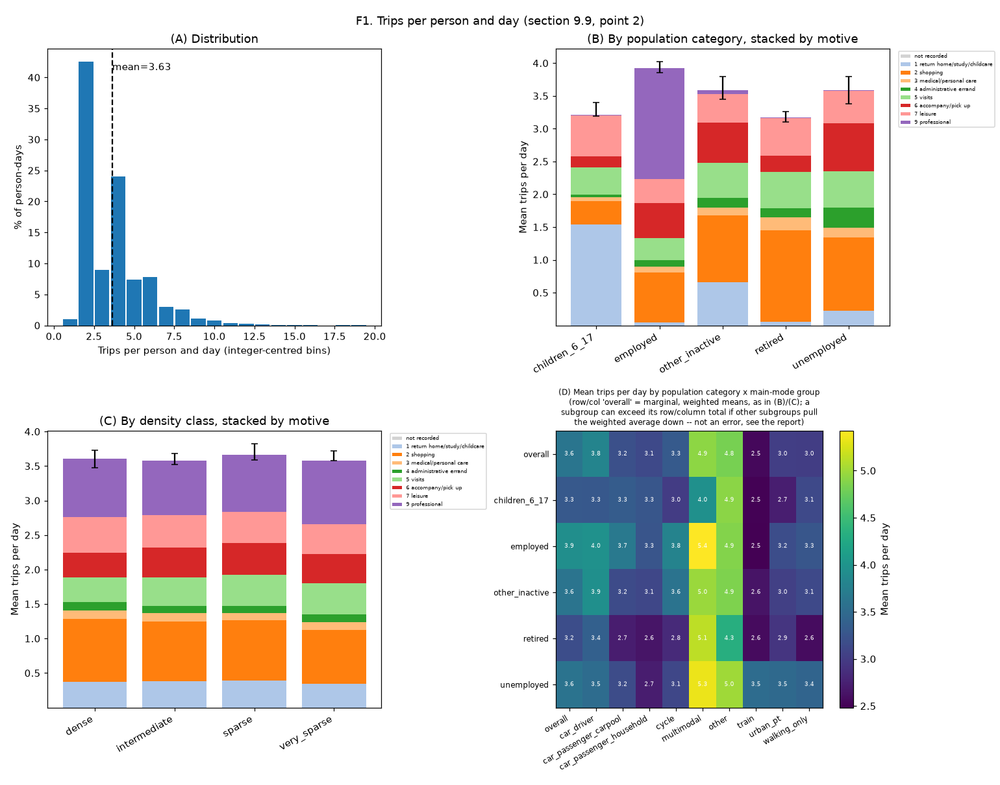

*Scope: Round-trip days · destination purposes · local (≤ 80 km)*

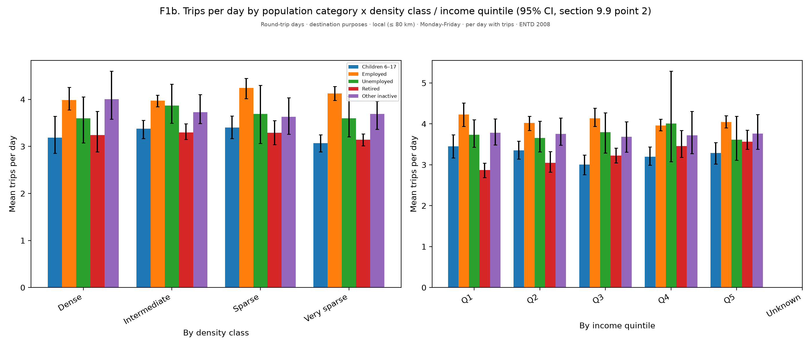

*Scope: Round-trip days · destination purposes · local (≤ 80 km)*

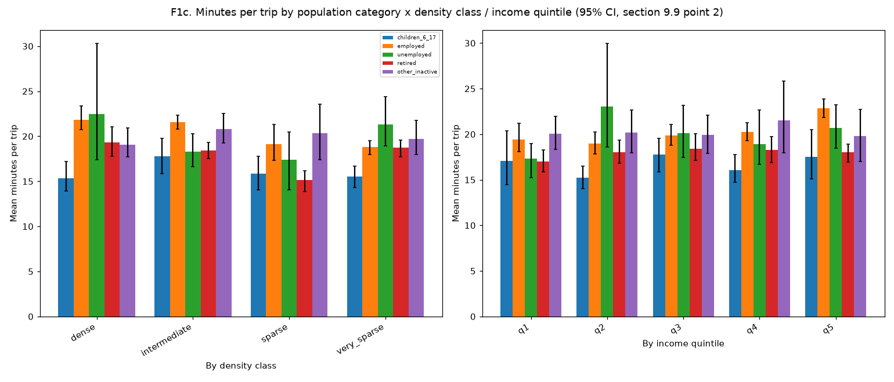

*Scope: Round-trip days · destination purposes · local (≤ 80 km)*

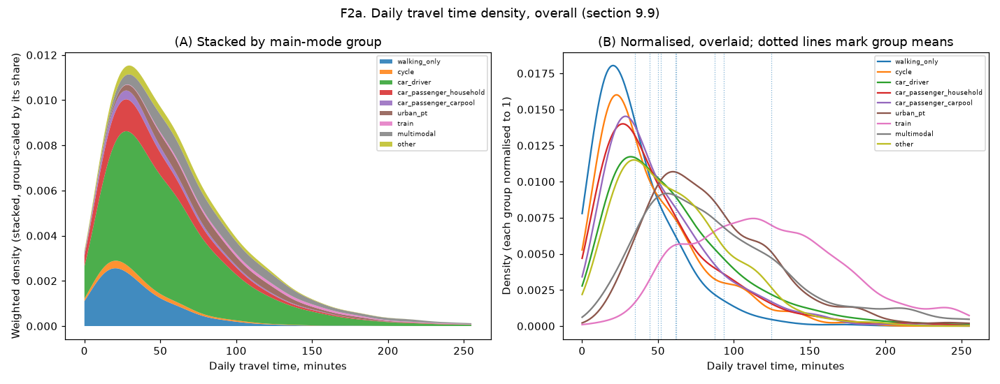

*Scope: Round-trip days · destination purposes · local (≤ 80 km)*

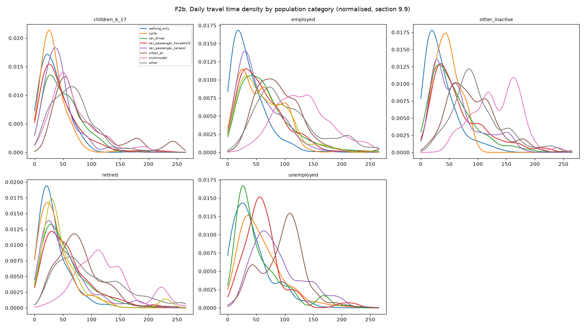

*Scope: Round-trip days · destination purposes · local (≤ 80 km)*

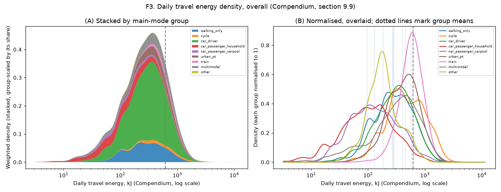

*Scope: Round-trip days · destination purposes · local (≤ 80 km)*

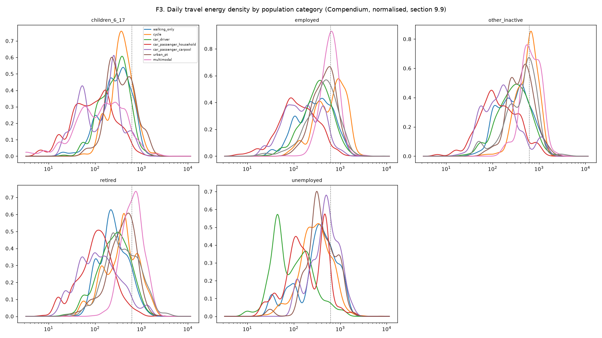

*Scope: Round-trip days · destination purposes · local (≤ 80 km)*

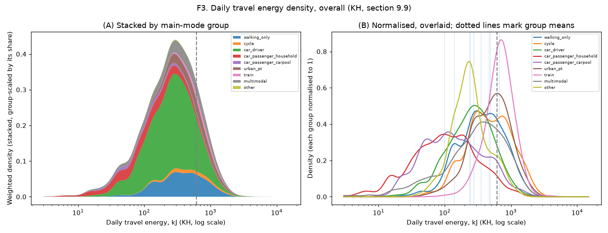

*Scope: Round-trip days · destination purposes · local (≤ 80 km)*

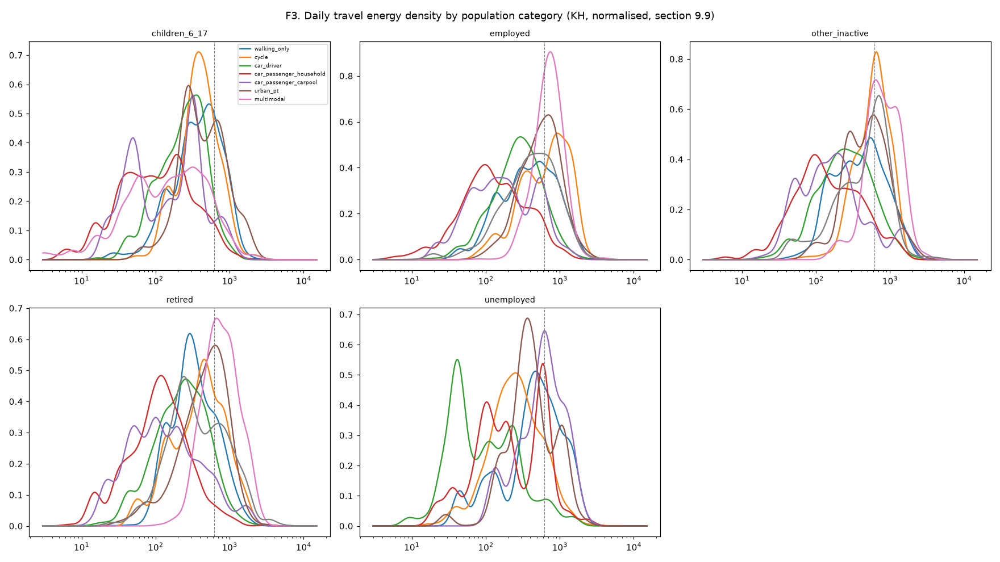

*Scope: Round-trip days · destination purposes · local (≤ 80 km)*

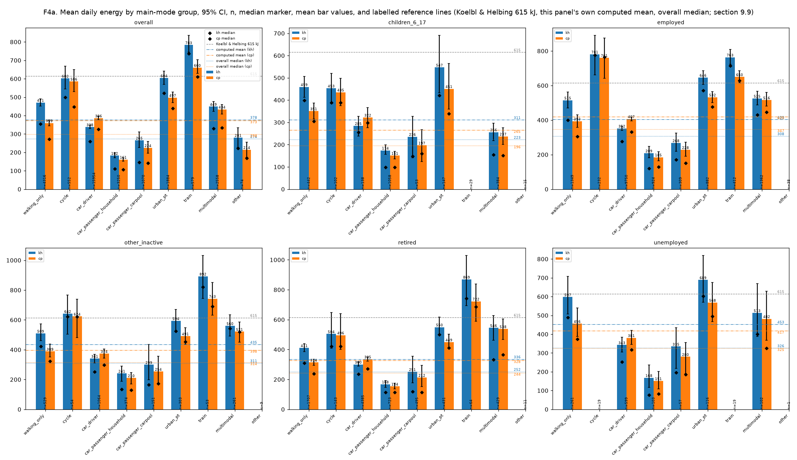

*Scope: Round-trip days · destination purposes · local (≤ 80 km)*

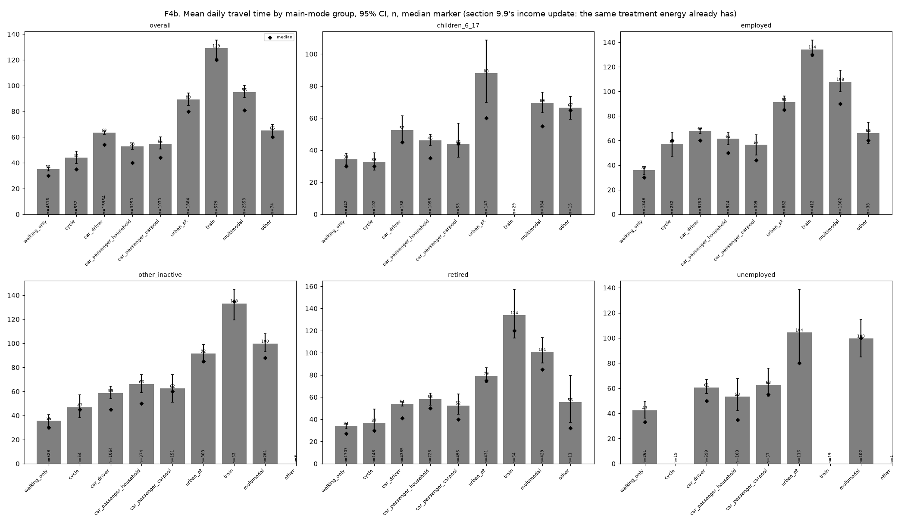

*Scope: Round-trip days · destination purposes · local (≤ 80 km)*

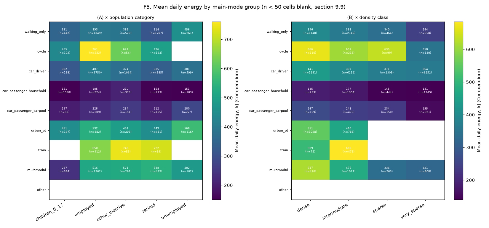

*Scope: Round-trip days · destination purposes · local (≤ 80 km)*

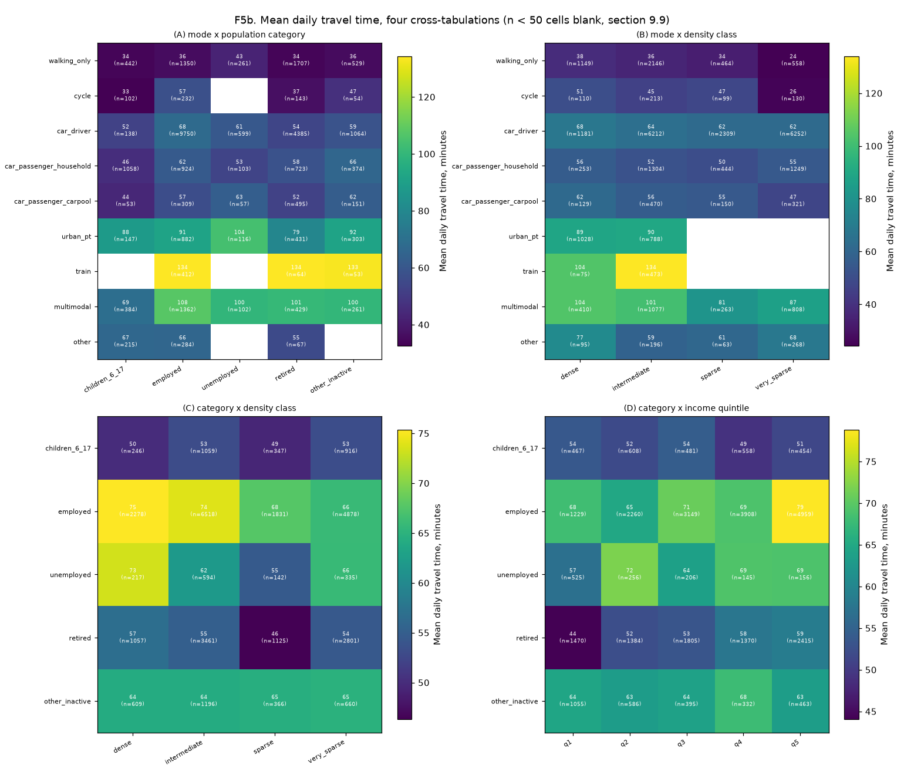

*Scope: Round-trip days · destination purposes · local (≤ 80 km)*

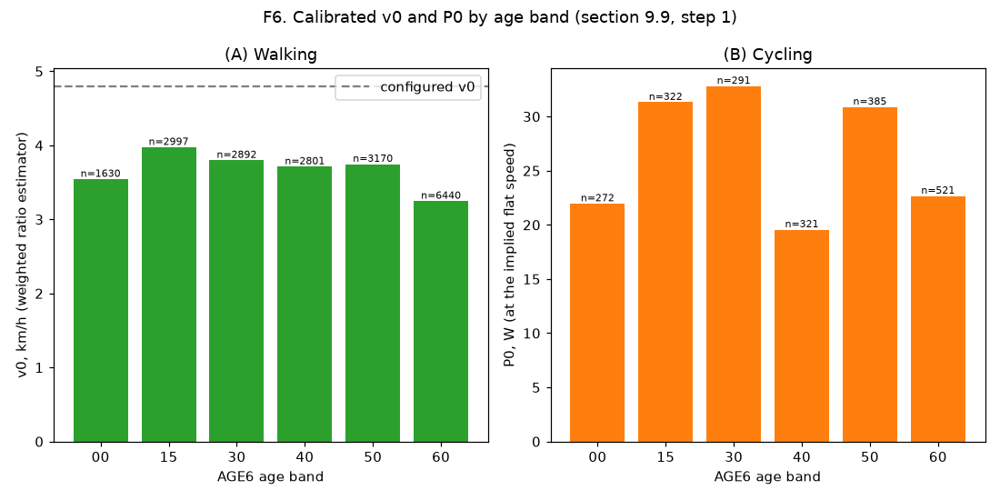

*Scope: Round-trip days · destination purposes · local (≤ 80 km)*

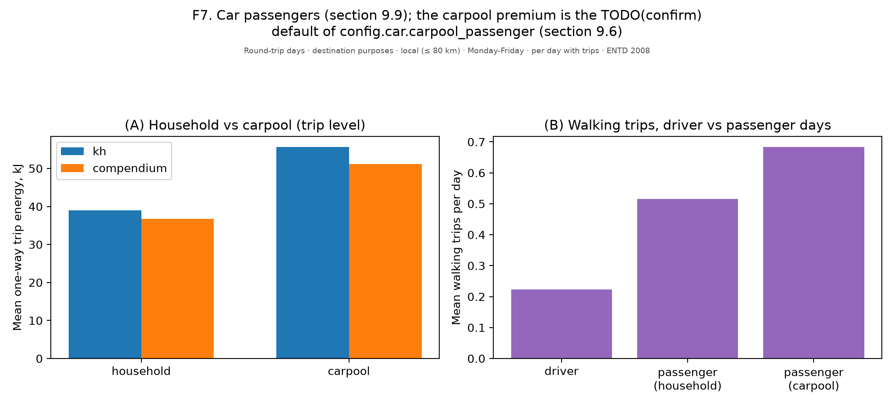

*Scope: Round-trip days · destination purposes · local (≤ 80 km)*

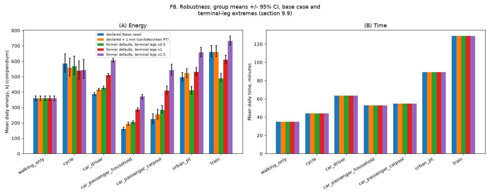

*Scope: Round-trip days · destination purposes · local (≤ 80 km)*

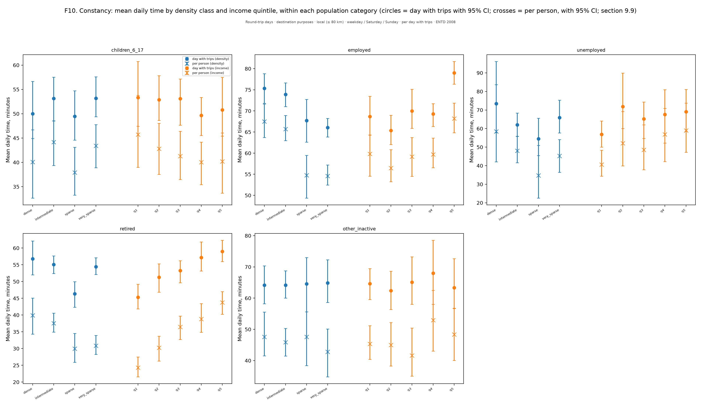

*Scope: Round-trip days · destination purposes · local (≤ 80 km)*

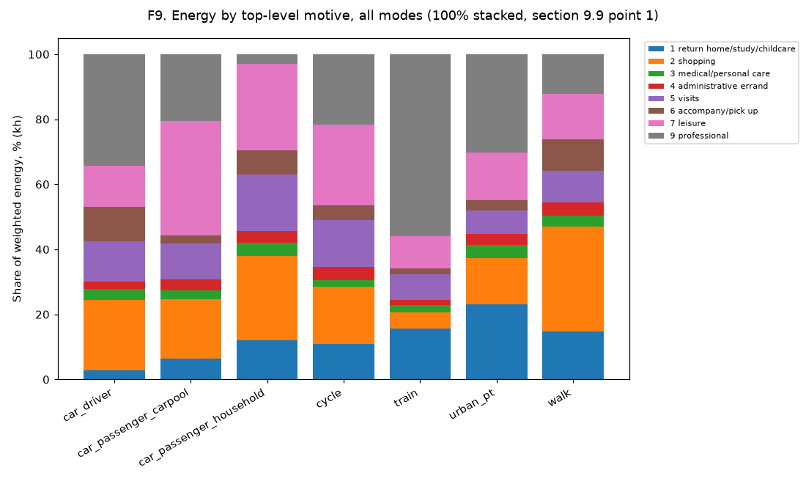

*Scope: Round-trip days · destination purposes · local (≤ 80 km)*

## Modelling notes and simplifications — Round-trip days · destination purposes · local (≤ 80 km)

- EMP 2019 gives no headway, station-depth or PT access-walk-distance data; `config.pt_ride.headway_min_am_peak`/`station_height_m`/`access_walk_m_by_density` are provisional TODO(confirm) defaults, used only by this step.
- Car terminal legs always use the apartment-density default: the public tables give no house/apartment split (section 9.6's `s_house`).
- `mode_group='other'` trips have no energy formula and contribute 0 kJ to a day's total; a day with only such trips is its own 'other' group, separate from 'multimodal'.
- The day's home density is the residence commune's own density (`trip_legs.residence_density`, 27 October 2026 decision), not the origin density of the home-departure trip.
- Bike get/park and stop-delay adjustment: unreliable (would consume over half, or all but under a minute, of a very short trip's declared duration) for a small share of cycling trips; these fall back to the naive whole-duration speed for both energy and the P0 estimator's ride-time denominator.
- F3/F4/F5 use the full set of day-mode groups (including multimodal and other); F8's robustness check is restricted to the seven groups the task names (walk, bike, driver, both passenger groups, urban PT, train).
- F8's figure shows bootstrap CIs for every terminal-legs variant with a CI (declared, declared + 1 min, former defaults x0.5/x1/x1.5), not every table variant (not weekdays-only, local-trips-only or the P0 reference, which have none).
