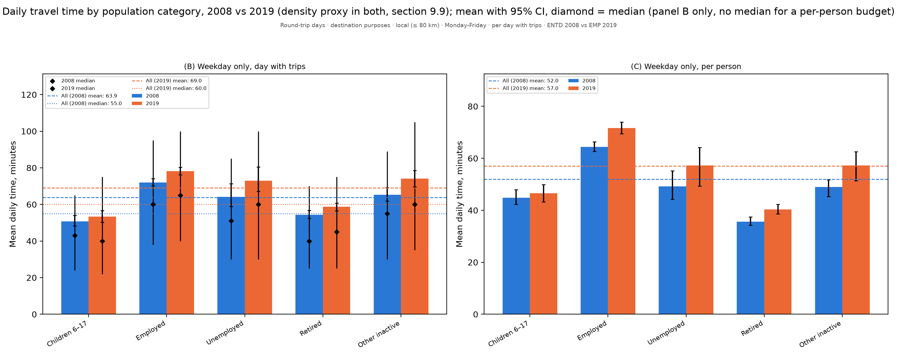
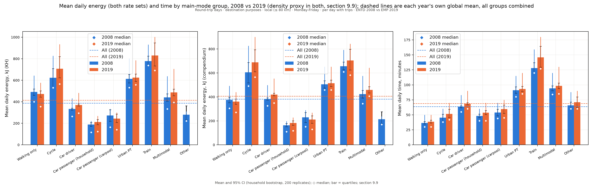

# Step 11 (`mobgrid/budget`): 2008-2019 comparison (section 9.9) — Round-trip days · destination purposes · local (≤ 80 km)

**Scope:** Round-trip days · destination purposes · local (≤ 80 km) (`round-dest-local`).
**Days:** Monday-Friday in every table and figure.

## Choices made

- ENTD 2008: residents aged 6+ in every scope; 90 respondents removed (90 aged under 6; 0 age missing, including unmatched demographics). 18,632 respondents before, 18,542 after; the difference is fully accounted for by these age exclusions.
- EMP 2019: residents aged 6+ in every scope; 0 respondents removed (0 aged under 6; 0 age missing, including unmatched demographics). 13,825 respondents before, 13,825 after; the difference is fully accounted for by these age exclusions.

Generated by `python -m mobgrid.budget.emp --compare`. Same model parameters in both years (`config/energy.yaml`); EMP 2019 is run with both the INSEE density grid and section 9.9's urban-unit-status x residence-size proxy, ENTD 2008 with the proxy only (no density grid in ENTD 2008).

## Group table, 2008 vs 2019 (density proxy in both)

| Group | n (2008) | n (2019) | mean time (2008) | mean time (2019) | p25 time (2008) | median time (2008) | p75 time (2008) | p25 time (2019) | median time (2019) | p75 time (2019) | mean kh (2008) [CI] | mean kh (2019) [CI] | p25 kh (2008) | median kh (2008) | p75 kh (2008) | p25 kh (2019) | median kh (2019) | p75 kh (2019) | mean cp (2008) [CI] | mean cp (2019) [CI] | p25 cp (2008) | median cp (2008) | p75 cp (2008) | p25 cp (2019) | median cp (2019) | p75 cp (2019) |
|---|---|---|---|---|---|---|---|---|---|---|---|---|---|---|---|---|---|---|---|---|---|---|---|---|---|
| car_driver | 7632 | 5132 | 63.6 | 68.4 | 30.0 | 55.0 | 83.0 | 33.0 | 60.0 | 90.0 | 332.8 [323.6, 341.3] | 369.3 [361.0, 380.4] | 160.2 | 264.6 | 432.6 | 168.0 | 294.0 | 483.0 | 383.2 [373.7, 392.2] | 419.3 [410.6, 430.3] | 189.6 | 325.0 | 498.3 | 214.0 | 349.4 | 552.6 |
| walking_only | 1831 | 1198 | 36.5 | 38.6 | 19.0 | 30.0 | 50.0 | 20.0 | 30.0 | 50.0 | 491.3 [461.4, 519.4] | 472.4 [443.6, 501.0] | 222.0 | 399.6 | 643.8 | 198.6 | 355.2 | 577.2 | 375.0 [352.2, 396.5] | 360.6 [338.6, 382.4] | 169.5 | 305.0 | 491.4 | 151.6 | 271.1 | 440.6 |
| multimodal | 1188 | 741 | 94.2 | 98.2 | 55.0 | 84.0 | 120.0 | 58.0 | 85.0 | 130.0 | 440.2 [406.0, 473.6] | 486.6 [456.8, 516.6] | 149.3 | 333.3 | 637.9 | 182.9 | 393.6 | 705.8 | 423.1 [391.0, 454.6] | 458.2 [433.5, 485.8] | 159.2 | 343.3 | 575.0 | 189.6 | 406.0 | 643.3 |
| car_passenger_household | 887 | 781 | 48.2 | 53.5 | 22.0 | 40.0 | 60.0 | 25.0 | 40.0 | 70.0 | 188.5 [173.4, 207.7] | 211.3 [187.3, 234.7] | 47.5 | 116.3 | 222.6 | 52.5 | 123.8 | 267.6 | 162.8 [150.7, 178.5] | 182.2 [163.3, 200.7] | 48.8 | 109.4 | 197.2 | 56.9 | 117.0 | 227.7 |
| urban_pt | 1044 | 700 | 91.0 | 93.2 | 56.0 | 80.0 | 115.0 | 60.0 | 85.0 | 120.0 | 613.2 [575.2, 652.9] | 624.7 [590.1, 657.8] | 299.8 | 532.5 | 802.6 | 352.7 | 558.3 | 785.8 | 505.2 [473.7, 535.2] | 514.0 [486.1, 539.9] | 258.6 | 457.6 | 651.8 | 304.9 | 458.5 | 652.4 |
| car_passenger_carpool | 361 | 364 | 53.8 | 59.5 | 25.0 | 44.0 | 70.0 | 30.0 | 45.0 | 75.0 | 272.3 [218.9, 326.9] | 244.0 [207.0, 285.2] | 64.2 | 164.1 | 333.6 | 63.9 | 141.6 | 299.9 | 229.2 [186.4, 269.9] | 210.7 [180.3, 242.2] | 68.3 | 150.7 | 289.7 | 63.9 | 128.5 | 268.6 |
| cycle | 265 | 154 | 45.4 | 51.5 | 22.0 | 38.0 | 60.0 | 25.0 | 42.0 | 70.0 | 622.8 [534.5, 707.7] | 707.1 [622.5, 819.7] | 325.1 | 530.4 | 826.7 | 326.3 | 564.9 | 933.6 | 605.1 [517.3, 686.9] | 688.4 [610.2, 793.5] | 326.2 | 490.2 | 826.7 | 309.9 | 564.9 | 900.8 |
| train | 382 | 150 | 127.9 | 145.8 | 90.0 | 120.0 | 159.0 | 95.0 | 127.0 | 180.0 | 777.3 [743.9, 824.3] | 830.3 [732.4, 947.8] | 545.8 | 737.1 | 931.5 | 538.1 | 690.5 | 1002.8 | 655.4 [626.9, 690.4] | 704.3 [624.4, 797.2] | 468.5 | 609.0 | 792.2 | 446.9 | 581.8 | 843.6 |
| other | 50 | 23 | 73.5 | 102.5 | 45.0 | 62.0 | 80.0 | 55.0 | 88.0 | 120.0 | 279.3 [231.8, 362.5] | 323.7 [210.9, 478.6] | 133.2 | 222.0 | 310.8 | 133.2 | 310.8 | 444.0 | 213.2 [177.0, 276.7] | 247.1 [161.0, 365.3] | 101.7 | 169.5 | 237.2 | 101.7 | 237.2 | 338.9 |

## Time budget: by population category, 2008 vs 2019 (density proxy in both, section 9.9's 27 October 2026 decision)

| Group | n (2008) | n (2019) | mean time (2008) | mean time (2019) | p25 time (2008) | median time (2008) | p75 time (2008) | p25 time (2019) | median time (2019) | p75 time (2019) | mean kh (2008) [CI] | mean kh (2019) [CI] | p25 kh (2008) | median kh (2008) | p75 kh (2008) | p25 kh (2019) | median kh (2019) | p75 kh (2019) | mean cp (2008) [CI] | mean cp (2019) [CI] | p25 cp (2008) | median cp (2008) | p75 cp (2008) | p25 cp (2019) | median cp (2019) | p75 cp (2019) |
|---|---|---|---|---|---|---|---|---|---|---|---|---|---|---|---|---|---|---|---|---|---|---|---|---|---|
| employed | 7052 | 3977 | 72.1 | 78.5 | 38.0 | 60.0 | 95.0 | 40.0 | 67.0 | 100.0 | 407.3 [395.5, 419.0] | 451.8 [438.9, 465.7] | 180.2 | 314.6 | 531.5 | 222.0 | 367.9 | 591.2 | 426.0 [414.2, 437.1] | 468.3 [457.3, 480.1] | 216.7 | 357.5 | 565.6 | 249.2 | 406.3 | 614.8 |
| retired | 3600 | 3178 | 54.4 | 58.5 | 25.0 | 40.0 | 70.0 | 25.0 | 45.0 | 75.0 | 344.0 [329.7, 357.4] | 371.9 [358.3, 388.0] | 133.2 | 255.5 | 445.8 | 126.0 | 252.0 | 483.0 | 336.1 [322.2, 348.5] | 358.2 [347.0, 374.3] | 146.3 | 264.9 | 449.8 | 139.9 | 270.8 | 483.0 |
| children_6_17 | 1091 | 820 | 48.7 | 52.8 | 21.0 | 40.0 | 60.0 | 22.0 | 40.0 | 74.0 | 319.2 [291.0, 347.2] | 314.6 [293.9, 340.9] | 88.8 | 237.8 | 466.2 | 95.0 | 225.0 | 444.0 | 267.5 [243.5, 291.0] | 263.3 [246.9, 284.4] | 81.3 | 202.7 | 406.7 | 84.5 | 197.0 | 363.3 |
| other_inactive | 1305 | 760 | 65.3 | 74.4 | 30.0 | 55.0 | 87.0 | 35.0 | 60.0 | 105.0 | 450.6 [418.4, 475.7] | 458.8 [429.0, 494.9] | 177.6 | 329.5 | 615.4 | 172.6 | 372.6 | 599.4 | 409.7 [383.3, 431.5] | 415.2 [389.1, 446.2] | 186.4 | 325.0 | 549.5 | 169.5 | 338.9 | 557.8 |
| unemployed | 591 | 498 | 64.7 | 72.9 | 30.0 | 55.0 | 85.0 | 30.0 | 60.0 | 100.0 | 467.1 [424.7, 510.0] | 512.6 [454.9, 570.9] | 168.0 | 340.5 | 621.6 | 177.6 | 378.0 | 667.8 | 428.9 [392.9, 467.2] | 477.5 [429.8, 526.2] | 200.6 | 330.4 | 574.2 | 173.3 | 362.9 | 650.0 |

### Constancy summary (density within category), both years

| Category | dense/very_sparse 2008 | dense/very_sparse 2019 | max/min 2008 | max/min 2019 | CV 2008 | CV 2019 |
|---|---|---|---|---|---|---|
| children_6_17 | 0.98 | 1.03 | 1.20 | 1.26 | 0.07 | 0.08 |
| employed | 1.15 | 1.02 | 1.15 | 1.16 | 0.06 | 0.06 |
| unemployed | 1.15 | 1.29 | 1.35 | 1.44 | 0.11 | 0.14 |
| retired | 1.03 | 1.23 | 1.23 | 1.30 | 0.08 | 0.10 |
| other_inactive | 0.96 | 1.25 | 1.05 | 1.25 | 0.02 | 0.08 |

### Within-survey equivalence: density proxy

| Category | Group | n 2008 | Ratio 2008 | 90% CI 2008 | ±15% verdict 2008 | ±10% verdict 2008 | n 2019 | Ratio 2019 | 90% CI 2019 | ±15% verdict 2019 | ±10% verdict 2019 |
|---|---|---|---|---|---|---|---|---|---|---|---|
| children_6_17 | dense | 120 | 0.934 | [0.835, 1.078] | inconclusive | inconclusive | 107 | 0.964 | [0.877, 1.063] | equivalent | inconclusive |
| children_6_17 | intermediate | 494 | 1.030 | [0.968, 1.090] | equivalent | equivalent | 426 | 1.069 | [1.025, 1.117] | equivalent | inconclusive |
| children_6_17 | sparse | 176 | 0.893 | [0.811, 0.992] | inconclusive | inconclusive | 134 | 0.850 | [0.744, 0.938] | inconclusive | inconclusive |
| children_6_17 | very_sparse | 463 | 1.056 | [0.981, 1.126] | equivalent | inconclusive | 194 | 0.982 | [0.896, 1.074] | equivalent | inconclusive |
| employed | dense | 1046 | 1.064 | [1.025, 1.112] | equivalent | inconclusive | 549 | 1.021 | [0.972, 1.066] | equivalent | equivalent |
| employed | intermediate | 2929 | 1.044 | [1.021, 1.065] | equivalent | equivalent | 1835 | 1.035 | [1.014, 1.057] | equivalent | equivalent |
| employed | sparse | 864 | 0.932 | [0.873, 0.996] | equivalent | inconclusive | 607 | 0.897 | [0.855, 0.947] | equivalent | inconclusive |
| employed | very_sparse | 2358 | 0.932 | [0.904, 0.959] | equivalent | equivalent | 1054 | 0.994 | [0.959, 1.031] | equivalent | equivalent |
| other_inactive | dense | 293 | 0.972 | [0.899, 1.052] | equivalent | inconclusive | 162 | 1.059 | [0.961, 1.160] | inconclusive | inconclusive |
| other_inactive | intermediate | 546 | 1.003 | [0.940, 1.058] | equivalent | equivalent | 393 | 1.026 | [0.965, 1.086] | equivalent | equivalent |
| other_inactive | sparse | 177 | 0.992 | [0.885, 1.128] | equivalent | inconclusive | 114 | 0.974 | [0.822, 1.120] | inconclusive | inconclusive |
| other_inactive | very_sparse | 308 | 1.031 | [0.930, 1.129] | equivalent | inconclusive | 109 | 0.840 | [0.746, 0.939] | inconclusive | inconclusive |
| retired | dense | 444 | 1.063 | [0.988, 1.153] | inconclusive | inconclusive | 369 | 1.144 | [1.067, 1.217] | inconclusive | inconclusive |
| retired | intermediate | 1480 | 1.025 | [0.987, 1.065] | equivalent | equivalent | 1440 | 1.041 | [1.007, 1.079] | equivalent | equivalent |
| retired | sparse | 497 | 0.863 | [0.801, 0.932] | inconclusive | inconclusive | 591 | 0.893 | [0.844, 0.940] | inconclusive | inconclusive |
| retired | very_sparse | 1214 | 1.028 | [0.975, 1.080] | equivalent | equivalent | 822 | 0.942 | [0.888, 0.996] | equivalent | inconclusive |
| unemployed | dense | 93 | 1.183 | [0.947, 1.475] | inconclusive | inconclusive | 100 | 1.164 | [1.030, 1.292] | inconclusive | inconclusive |
| unemployed | intermediate | 276 | 0.965 | [0.889, 1.037] | equivalent | inconclusive | 245 | 1.040 | [0.965, 1.138] | equivalent | inconclusive |
| unemployed | sparse | 65 | 0.882 | [0.759, 1.040] | inconclusive | inconclusive | 79 | 0.808 | [0.650, 0.954] | inconclusive | inconclusive |
| unemployed | very_sparse | 162 | 1.016 | [0.891, 1.128] | equivalent | inconclusive | 78 | 0.902 | [0.749, 1.080] | inconclusive | inconclusive |

### Within-survey equivalence: income quintile

| Category | Group | n 2008 | Ratio 2008 | 90% CI 2008 | ±15% verdict 2008 | ±10% verdict 2008 | n 2019 | Ratio 2019 | 90% CI 2019 | ±15% verdict 2019 | ±10% verdict 2019 |
|---|---|---|---|---|---|---|---|---|---|---|---|
| children_6_17 | q1 | 242 | 1.050 | [0.953, 1.160] | inconclusive | inconclusive | 233 | 1.053 | [0.973, 1.132] | equivalent | inconclusive |
| children_6_17 | q2 | 307 | 1.023 | [0.932, 1.106] | equivalent | inconclusive | 184 | 0.926 | [0.843, 1.004] | inconclusive | inconclusive |
| children_6_17 | q3 | 239 | 1.003 | [0.917, 1.081] | equivalent | equivalent | 165 | 1.013 | [0.916, 1.125] | equivalent | inconclusive |
| children_6_17 | q4 | 263 | 0.926 | [0.845, 1.027] | inconclusive | inconclusive | 161 | 0.948 | [0.843, 1.061] | inconclusive | inconclusive |
| children_6_17 | q5 | 202 | 0.971 | [0.848, 1.089] | inconclusive | inconclusive | 118 | 1.059 | [0.953, 1.178] | inconclusive | inconclusive |
| employed | q1 | 608 | 0.986 | [0.929, 1.050] | equivalent | equivalent | 385 | 0.908 | [0.845, 0.964] | inconclusive | inconclusive |
| employed | q2 | 1091 | 0.917 | [0.878, 0.960] | equivalent | inconclusive | 669 | 0.955 | [0.901, 1.011] | equivalent | equivalent |
| employed | q3 | 1455 | 0.956 | [0.914, 0.989] | equivalent | equivalent | 852 | 0.991 | [0.950, 1.032] | equivalent | equivalent |
| employed | q4 | 1804 | 0.988 | [0.952, 1.021] | equivalent | equivalent | 973 | 1.003 | [0.965, 1.037] | equivalent | equivalent |
| employed | q5 | 2239 | 1.119 | [1.083, 1.157] | inconclusive | inconclusive | 1166 | 1.071 | [1.038, 1.108] | equivalent | inconclusive |
| other_inactive | q1 | 525 | 0.997 | [0.935, 1.056] | equivalent | equivalent | 369 | 0.931 | [0.874, 0.994] | equivalent | inconclusive |
| other_inactive | q2 | 266 | 0.968 | [0.894, 1.051] | equivalent | inconclusive | 189 | 1.017 | [0.923, 1.106] | equivalent | inconclusive |
| other_inactive | q3 | 176 | 1.004 | [0.903, 1.119] | equivalent | inconclusive | 101 | 1.053 | [0.924, 1.156] | inconclusive | inconclusive |
| other_inactive | q4 | 144 | 1.076 | [0.944, 1.203] | inconclusive | inconclusive | 65 | 1.086 | [0.951, 1.283] | inconclusive | inconclusive |
| other_inactive | q5 | 213 | 1.002 | [0.885, 1.125] | equivalent | inconclusive | 54 | 1.078 | [0.844, 1.327] | inconclusive | inconclusive |
| retired | q1 | 640 | 0.855 | [0.797, 0.909] | inconclusive | inconclusive | 358 | 0.889 | [0.815, 0.985] | inconclusive | inconclusive |
| retired | q2 | 584 | 0.954 | [0.891, 1.018] | equivalent | inconclusive | 711 | 0.929 | [0.873, 0.979] | equivalent | inconclusive |
| retired | q3 | 779 | 0.998 | [0.940, 1.053] | equivalent | equivalent | 668 | 0.966 | [0.906, 1.020] | equivalent | equivalent |
| retired | q4 | 589 | 1.053 | [0.981, 1.140] | equivalent | inconclusive | 742 | 1.024 | [0.973, 1.071] | equivalent | equivalent |
| retired | q5 | 1043 | 1.104 | [1.050, 1.159] | inconclusive | inconclusive | 743 | 1.126 | [1.077, 1.186] | inconclusive | inconclusive |
| unemployed | q1 | 241 | 0.905 | [0.820, 0.997] | inconclusive | inconclusive | 279 | 1.038 | [0.965, 1.107] | equivalent | inconclusive |
| unemployed | q2 | 121 | 1.094 | [0.920, 1.310] | inconclusive | inconclusive | 89 | 0.930 | [0.792, 1.063] | inconclusive | inconclusive |
| unemployed | q3 | 94 | 1.093 | [0.938, 1.266] | inconclusive | inconclusive | 64 | 1.026 | [0.875, 1.191] | inconclusive | inconclusive |
| unemployed | q4 | 71 | 1.009 | [0.831, 1.198] | inconclusive | inconclusive | 44 | - | - | - | - |
| unemployed | q5 | 69 | 1.100 | [0.930, 1.304] | inconclusive | inconclusive | 26 | - | - | - | - |

## EMP 2019: density grid vs proxy, same groups

| Group | n (grid) | n (proxy) | mean time (grid) | mean time (proxy) | p25 time (grid) | median time (grid) | p75 time (grid) | p25 time (proxy) | median time (proxy) | p75 time (proxy) | mean kh (grid) [CI] | mean kh (proxy) [CI] | p25 kh (grid) | median kh (grid) | p75 kh (grid) | p25 kh (proxy) | median kh (proxy) | p75 kh (proxy) | mean cp (grid) [CI] | mean cp (proxy) [CI] | p25 cp (grid) | median cp (grid) | p75 cp (grid) | p25 cp (proxy) | median cp (proxy) | p75 cp (proxy) |
|---|---|---|---|---|---|---|---|---|---|---|---|---|---|---|---|---|---|---|---|---|---|---|---|---|---|
| car_driver | 5132 | 5132 | 68.4 | 68.4 | 33.0 | 60.0 | 90.0 | 33.0 | 60.0 | 90.0 | 370.1 [361.7, 381.3] | 369.3 [361.0, 380.4] | 168.0 | 294.0 | 483.6 | 168.0 | 294.0 | 483.0 | 420.1 [411.2, 431.3] | 419.3 [410.6, 430.3] | 216.7 | 349.4 | 552.9 | 214.0 | 349.4 | 552.6 |
| walking_only | 1198 | 1198 | 38.6 | 38.6 | 20.0 | 30.0 | 50.0 | 20.0 | 30.0 | 50.0 | 472.4 [443.6, 501.0] | 472.4 [443.6, 501.0] | 198.6 | 355.2 | 577.2 | 198.6 | 355.2 | 577.2 | 360.6 [338.6, 382.4] | 360.6 [338.6, 382.4] | 151.6 | 271.1 | 440.6 | 151.6 | 271.1 | 440.6 |
| car_passenger_household | 781 | 781 | 53.5 | 53.5 | 25.0 | 40.0 | 70.0 | 25.0 | 40.0 | 70.0 | 211.6 [187.6, 235.1] | 211.3 [187.3, 234.7] | 52.5 | 124.8 | 267.6 | 52.5 | 123.8 | 267.6 | 182.5 [163.5, 201.0] | 182.2 [163.3, 200.7] | 56.9 | 117.0 | 227.7 | 56.9 | 117.0 | 227.7 |
| multimodal | 741 | 741 | 98.2 | 98.2 | 58.0 | 85.0 | 130.0 | 58.0 | 85.0 | 130.0 | 487.0 [457.1, 516.9] | 486.6 [456.8, 516.6] | 182.9 | 396.5 | 705.8 | 182.9 | 393.6 | 705.8 | 458.7 [433.9, 486.2] | 458.2 [433.5, 485.8] | 189.6 | 406.3 | 644.1 | 189.6 | 406.0 | 643.3 |
| urban_pt | 700 | 700 | 93.2 | 93.2 | 60.0 | 85.0 | 120.0 | 60.0 | 85.0 | 120.0 | 624.3 [589.9, 657.2] | 624.7 [590.1, 657.8] | 350.5 | 558.3 | 785.8 | 352.7 | 558.3 | 785.8 | 513.8 [486.0, 539.5] | 514.0 [486.1, 539.9] | 300.8 | 458.5 | 652.4 | 304.9 | 458.5 | 652.4 |
| car_passenger_carpool | 364 | 364 | 59.5 | 59.5 | 30.0 | 45.0 | 75.0 | 30.0 | 45.0 | 75.0 | 244.4 [207.1, 285.7] | 244.0 [207.0, 285.2] | 66.6 | 141.6 | 299.9 | 63.9 | 141.6 | 299.9 | 211.1 [180.4, 242.6] | 210.7 [180.3, 242.2] | 63.9 | 128.5 | 271.5 | 63.9 | 128.5 | 268.6 |
| train | 150 | 150 | 145.8 | 145.8 | 95.0 | 127.0 | 180.0 | 95.0 | 127.0 | 180.0 | 826.0 [728.3, 942.8] | 830.3 [732.4, 947.8] | 530.6 | 651.5 | 1001.6 | 538.1 | 690.5 | 1002.8 | 701.2 [621.1, 793.6] | 704.3 [624.4, 797.2] | 446.0 | 567.4 | 843.6 | 446.9 | 581.8 | 843.6 |
| cycle | 154 | 154 | 51.5 | 51.5 | 25.0 | 42.0 | 70.0 | 25.0 | 42.0 | 70.0 | 707.1 [622.5, 819.7] | 707.1 [622.5, 819.7] | 326.3 | 564.9 | 933.6 | 326.3 | 564.9 | 933.6 | 688.4 [610.2, 793.5] | 688.4 [610.2, 793.5] | 309.9 | 564.9 | 900.8 | 309.9 | 564.9 | 900.8 |
| other | 23 | 23 | 102.5 | 102.5 | 55.0 | 88.0 | 120.0 | 55.0 | 88.0 | 120.0 | 323.7 [210.9, 478.6] | 323.7 [210.9, 478.6] | 133.2 | 310.8 | 444.0 | 133.2 | 310.8 | 444.0 | 247.1 [161.0, 365.3] | 247.1 [161.0, 365.3] | 101.7 | 237.2 | 338.9 | 101.7 | 237.2 | 338.9 |

## Robustness (F8 base case, core and full scope, means)

| Scope | energy ratio (kh), 2008 | energy ratio (kh), 2019 | CV (kh), 2008 | CV (kh), 2019 | energy ratio (cp), 2008 | energy ratio (cp), 2019 |
|---|---|---|---|---|---|---|
| core | 2.34 | 2.25 | 0.29 | 0.30 | 1.75 | 1.95 |
| full | 4.12 | 3.93 | 0.42 | 0.44 | 4.03 | 3.87 |

## Declared vs modelled walk/wait minutes per trip, car driver, urban PT and train, both years

| Mode group | n, 2008 | n, 2019 | declared walk, 2008 | declared walk, 2019 | modelled walk, 2008 | modelled walk, 2019 | declared wait, 2008 | declared wait, 2019 | modelled wait, 2008 | modelled wait, 2019 |
|---|---|---|---|---|---|---|---|---|---|---|
| car_driver | 29545 | 18320 | 1.0 | 1.3 | 4.7 | 4.9 | 0.0 | 0.0 | - | - |
| urban_pt | 3008 | 1888 | 7.9 | 8.7 | 8.9 | 9.5 | 5.0 | 6.3 | 4.0 | 4.5 |
| train | 1101 | 455 | 11.9 | 13.5 | 9.8 | 10.3 | 7.5 | 11.5 | 5.0 | 4.8 |

## Weekday share of persons without trips, both years

- 2008: 15.8% unweighted, 15.0% by individual weight (n=2937 of 18,542 respondents)
- 2019: 3.3% unweighted, 2.6% by individual weight (n=455 of 13,825 respondents)

## 2008-calibrated v0 and P0 (for information only; the model uses the same parameters in both years, section 9.9)

- v0: 3.65 km/h, n=9607 (2019: 3.40 km/h, n=6207)
- P0: 26.0 W at an implied flat speed of 11.68 km/h, n=1025 (2019: 30.9 W, n=682)

## Overall (all groups combined), both years

- Mean daily energy: 2008 386.9 kJ (kh), 381.2 kJ (cp); 2019 414.9 kJ (kh), 405.8 kJ (cp).
- Mean daily time: 2008 63.9 min; 2019 69.0 min.

## Weekday-only comparison, 2008 vs 2019 (density proxy in both; section 9.9's per-person budget is only defined on the weekday in both surveys)

### Daily time, per day with trips

| Category | 2008 (min) | 2019 (min) | 2019 - 2008 | 95% CI |
|---|---|---|---|---|
| children_6_17 | 50.7 | 53.4 | +2.7 | [-1.3, +6.8] |
| employed | 71.9 | 78.2 | +6.2 | [+3.4, +8.9] |
| unemployed | 64.1 | 72.9 | +8.8 | [-0.6, +18.2] |
| retired | 54.4 | 58.7 | +4.3 | [+1.3, +7.3] |
| other_inactive | 65.3 | 74.2 | +8.8 | [+2.9, +14.4] |
| overall | 63.9 | 69.0 | +5.2 | [+3.2, +6.9] |

### Daily time, per person (days without trips included)

Direct producer-weighted local-trip total divided by the full respondent roster. The difference is between the two independent point estimates (each survey's household-bootstrap 95% CI appears in the adjacent columns).

| Category | 2008 (min) | 2008 95% CI | 2019 (min) | 2019 95% CI | 2019 - 2008 |
|---|---|---|---|---|---|
| children_6_17 | 44.8 | [42.3, 47.9] | 46.5 | [43.2, 49.8] | +1.7 |
| employed | 64.4 | [62.6, 66.3] | 71.7 | [69.4, 74.0] | +7.3 |
| unemployed | 49.2 | [44.2, 55.2] | 57.2 | [49.3, 64.2] | +8.0 |
| retired | 35.7 | [34.2, 37.4] | 40.3 | [38.6, 42.3] | +4.7 |
| other_inactive | 49.0 | [45.3, 51.8] | 57.2 | [51.4, 62.6] | +8.2 |
| overall | 52.0 | [51.1, 53.2] | 57.0 | [55.8, 58.3] | +5.1 |

## Temporal equivalence, 2008 to 2019

Ratios are 2019/2008; the 90% CI pairs replicate b from two independent 200-replicate household bootstraps. `equivalent` means the full interval is within the margin; `different` means the interval lies wholly outside it; otherwise the verdict is `inconclusive`. Cells with fewer than 50 weekday respondents in either year are suppressed.

### Daily time, weekday days with trips (selected scope)

| Category | n 2008 | n 2019 | Ratio 2019/2008 | 90% CI | ±15% verdict | ±10% verdict |
|---|---|---|---|---|---|---|
| children_6_17 | 1253 | 861 | 1.052 | [0.971, 1.118] | equivalent | inconclusive |
| employed | 7197 | 4045 | 1.087 | [1.057, 1.118] | equivalent | inconclusive |
| unemployed | 596 | 502 | 1.137 | [1.011, 1.282] | inconclusive | inconclusive |
| retired | 3635 | 3222 | 1.080 | [1.034, 1.122] | equivalent | inconclusive |
| other_inactive | 1324 | 778 | 1.135 | [1.050, 1.231] | inconclusive | inconclusive |
| overall | 14006 | 9418 | 1.081 | [1.057, 1.101] | equivalent | inconclusive |

### Daily time, weekday per-person budgets

| Category | n 2008 | n 2019 | Ratio 2019/2008 | 90% CI | ±15% verdict | ±10% verdict |
|---|---|---|---|---|---|---|
| children_6_17 | 1502 | 1256 | 1.038 | [0.955, 1.113] | equivalent | inconclusive |
| employed | 8658 | 5741 | 1.113 | [1.074, 1.150] | inconclusive | inconclusive |
| unemployed | 796 | 740 | 1.162 | [0.992, 1.325] | inconclusive | inconclusive |
| retired | 5709 | 4907 | 1.131 | [1.069, 1.188] | inconclusive | inconclusive |
| other_inactive | 1876 | 1168 | 1.168 | [1.064, 1.295] | inconclusive | inconclusive |
| overall | 18542 | 13825 | 1.097 | [1.069, 1.122] | equivalent | inconclusive |

### Daily time, weekday days with trips by category × density proxy

| Category | Group | n 2008 | n 2019 | Ratio 2019/2008 | 90% CI | ±15% verdict | ±10% verdict |
|---|---|---|---|---|---|---|---|
| children_6_17 | dense | 120 | 107 | 1.086 | [0.907, 1.275] | inconclusive | inconclusive |
| children_6_17 | intermediate | 494 | 426 | 1.093 | [0.974, 1.234] | inconclusive | inconclusive |
| children_6_17 | sparse | 176 | 134 | 1.002 | [0.861, 1.167] | inconclusive | inconclusive |
| children_6_17 | very_sparse | 463 | 194 | 0.979 | [0.865, 1.102] | equivalent | inconclusive |
| employed | dense | 1046 | 549 | 1.043 | [0.978, 1.107] | equivalent | inconclusive |
| employed | intermediate | 2929 | 1835 | 1.078 | [1.028, 1.123] | equivalent | inconclusive |
| employed | sparse | 864 | 607 | 1.046 | [0.958, 1.140] | equivalent | inconclusive |
| employed | very_sparse | 2358 | 1054 | 1.159 | [1.090, 1.220] | inconclusive | inconclusive |
| unemployed | dense | 93 | 100 | 1.119 | [0.845, 1.510] | inconclusive | inconclusive |
| unemployed | intermediate | 276 | 245 | 1.226 | [1.046, 1.416] | inconclusive | inconclusive |
| unemployed | sparse | 65 | 79 | 1.042 | [0.781, 1.350] | inconclusive | inconclusive |
| unemployed | very_sparse | 162 | 78 | 1.010 | [0.801, 1.267] | inconclusive | inconclusive |
| retired | dense | 444 | 369 | 1.161 | [1.045, 1.324] | inconclusive | inconclusive |
| retired | intermediate | 1480 | 1440 | 1.097 | [1.026, 1.169] | inconclusive | inconclusive |
| retired | sparse | 497 | 591 | 1.117 | [0.993, 1.258] | inconclusive | inconclusive |
| retired | very_sparse | 1214 | 822 | 0.990 | [0.908, 1.088] | equivalent | equivalent |
| other_inactive | dense | 293 | 162 | 1.236 | [1.076, 1.395] | inconclusive | inconclusive |
| other_inactive | intermediate | 546 | 393 | 1.160 | [1.023, 1.290] | inconclusive | inconclusive |
| other_inactive | sparse | 177 | 114 | 1.115 | [0.914, 1.382] | inconclusive | inconclusive |
| other_inactive | very_sparse | 308 | 109 | 0.925 | [0.780, 1.088] | inconclusive | inconclusive |

## Figures

