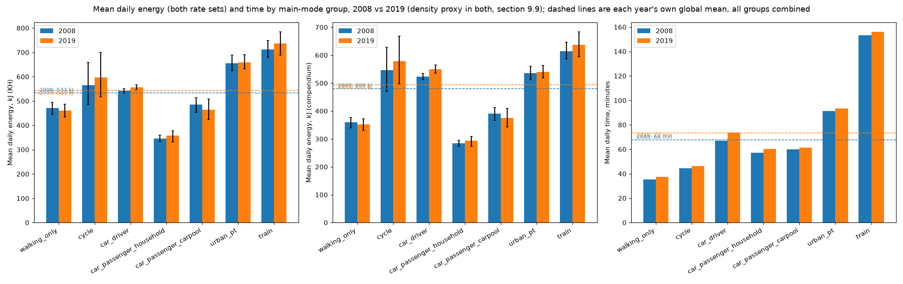

# Step 11 (`mobgrid/budget`): 2008-2019 comparison (section 9.9)

Generated by `python -m mobgrid.budget.emp --compare`. Same model parameters in both years (`config/energy.yaml`); EMP 2019 is run with both the INSEE density grid and section 9.9's urban-unit-status x residence-size proxy, ENTD 2008 with the proxy only (no density grid in ENTD 2008).

## Group table, 2008 vs 2019 (density proxy in both)

| Group | n (2008) | n (2019) | mean time (2008) | mean time (2019) | mean kh (2008) [CI] | mean kh (2019) [CI] | median kh (2008) | median kh (2019) | mean cp (2008) [CI] | mean cp (2019) [CI] | median cp (2008) | median cp (2019) |
|---|---|---|---|---|---|---|---|---|---|---|---|---|
| car_driver | 17239 | 6491 | 66.8 | 73.6 | 541.6 [531.7, 550.6] | 555.3 [543.9, 567.2] | 453.4 | 456.7 | 523.8 [512.7, 533.8] | 549.2 [535.2, 564.3] | 430.8 | 436.2 |
| walking_only | 4577 | 1628 | 35.3 | 37.4 | 471.2 [444.9, 494.7] | 461.3 [433.5, 487.3] | 355.2 | 355.2 | 359.7 [339.6, 377.6] | 352.2 [330.9, 371.9] | 271.1 | 271.1 |
| car_passenger_household | 3524 | 1167 | 57.1 | 60.5 | 345.8 [332.8, 359.3] | 357.2 [331.8, 376.6] | 282.0 | 285.8 | 283.8 [274.3, 294.8] | 293.6 [273.4, 309.3] | 235.6 | 233.7 |
| multimodal | 2863 | 864 | 107.1 | 116.1 | 686.5 [658.7, 712.9] | 719.6 [688.3, 752.6] | 647.0 | 676.3 | 604.7 [578.1, 628.7] | 632.8 [603.2, 662.2] | 554.8 | 591.4 |
| urban_pt | 2007 | 850 | 91.2 | 93.3 | 654.5 [624.8, 688.7] | 659.5 [632.1, 691.2] | 564.1 | 577.7 | 535.1 [512.7, 560.5] | 539.6 [518.4, 563.8] | 471.8 | 485.1 |
| car_passenger_carpool | 1372 | 540 | 59.9 | 61.5 | 485.3 [453.6, 513.7] | 464.0 [423.7, 509.1] | 388.0 | 383.8 | 390.9 [366.0, 413.0] | 375.2 [342.3, 409.6] | 313.0 | 306.8 |
| train | 784 | 219 | 153.2 | 156.1 | 712.5 [680.7, 748.7] | 736.0 [689.3, 784.5] | 661.1 | 701.2 | 614.0 [587.0, 646.3] | 637.1 [593.9, 684.0] | 578.1 | 593.8 |
| cycle | 565 | 184 | 44.6 | 46.1 | 564.3 [484.8, 658.4] | 595.9 [516.3, 698.7] | 402.8 | 472.8 | 546.3 [471.3, 627.9] | 578.6 [497.0, 667.9] | 381.8 | 473.7 |
| other | 81 | 31 | 72.8 | 98.8 | 291.8 [243.0, 352.0] | 457.1 [320.6, 584.8] | 222.0 | 330.4 | 222.7 [185.5, 268.7] | 348.9 [244.7, 446.4] | 169.5 | 252.2 |

## EMP 2019: density grid vs proxy, same groups

| Group | n (grid) | n (proxy) | mean time (grid) | mean time (proxy) | mean kh (grid) [CI] | mean kh (proxy) [CI] | median kh (grid) | median kh (proxy) | mean cp (grid) [CI] | mean cp (proxy) [CI] | median cp (grid) | median cp (proxy) |
|---|---|---|---|---|---|---|---|---|---|---|---|---|
| car_driver | 6491 | 6491 | 73.6 | 73.6 | 624.1 [612.0, 637.1] | 555.3 [543.9, 567.2] | 523.0 | 456.7 | 595.2 [581.8, 611.1] | 549.2 [535.2, 564.3] | 482.5 | 436.2 |
| walking_only | 1628 | 1628 | 37.4 | 37.4 | 461.3 [433.5, 487.3] | 461.3 [433.5, 487.3] | 355.2 | 355.2 | 352.2 [330.9, 371.9] | 352.2 [330.9, 371.9] | 271.1 | 271.1 |
| car_passenger_household | 1167 | 1167 | 60.5 | 60.5 | 416.2 [390.5, 439.6] | 357.2 [331.8, 376.6] | 337.7 | 285.8 | 337.6 [317.4, 356.1] | 293.6 [273.4, 309.3] | 267.8 | 233.7 |
| multimodal | 864 | 864 | 116.1 | 116.1 | 749.4 [718.3, 781.8] | 719.6 [688.3, 752.6] | 711.9 | 676.3 | 653.6 [625.5, 682.9] | 632.8 [603.2, 662.2] | 612.1 | 591.4 |
| urban_pt | 850 | 850 | 93.3 | 93.3 | 613.8 [589.5, 644.2] | 659.5 [632.1, 691.2] | 530.5 | 577.7 | 506.2 [487.0, 530.0] | 539.6 [518.4, 563.8] | 443.3 | 485.1 |
| car_passenger_carpool | 540 | 540 | 61.5 | 61.5 | 492.4 [447.4, 537.8] | 464.0 [423.7, 509.1] | 393.6 | 383.8 | 396.7 [361.1, 432.6] | 375.2 [342.3, 409.6] | 323.0 | 306.8 |
| train | 219 | 219 | 156.1 | 156.1 | 668.6 [622.4, 720.8] | 736.0 [689.3, 784.5] | 620.7 | 701.2 | 588.0 [545.2, 635.7] | 637.1 [593.9, 684.0] | 538.7 | 593.8 |
| cycle | 184 | 184 | 46.1 | 46.1 | 595.9 [516.3, 698.7] | 595.9 [516.3, 698.7] | 472.8 | 472.8 | 578.6 [497.0, 667.9] | 578.6 [497.0, 667.9] | 473.7 | 473.7 |
| other | 31 | 31 | 98.8 | 98.8 | 457.1 [320.6, 584.8] | 457.1 [320.6, 584.8] | 330.4 | 330.4 | 348.9 [244.7, 446.4] | 348.9 [244.7, 446.4] | 252.2 | 252.2 |

## Robustness (F8 base case, core and full scope, means)

| Scope | energy ratio (kh), 2008 | energy ratio (kh), 2019 | CV (kh), 2008 | CV (kh), 2019 | energy ratio (cp), 2008 | energy ratio (cp), 2019 |
|---|---|---|---|---|---|---|
| core | 1.51 | 1.60 | 0.16 | 0.17 | 1.71 | 1.81 |
| full | 2.06 | 2.06 | 0.21 | 0.22 | 2.16 | 2.17 |

## Declared vs modelled walk/wait minutes per trip, car driver, urban PT and train, both years

| Mode group | n, 2008 | n, 2019 | declared walk, 2008 | declared walk, 2019 | modelled walk, 2008 | modelled walk, 2019 | declared wait, 2008 | declared wait, 2019 | modelled wait, 2008 | modelled wait, 2019 |
|---|---|---|---|---|---|---|---|---|---|---|
| car_driver | 66480 | 23859 | 1.2 | 1.4 | 4.7 | 4.9 | 1.6 | 0.0 | - | - |
| urban_pt | 6029 | 2408 | 7.9 | 9.1 | 8.9 | 9.5 | 5.2 | 6.4 | 4.0 | 4.4 |
| train | 2215 | 631 | 11.7 | 14.6 | 9.9 | 10.2 | 9.7 | 13.8 | 4.9 | 4.8 |

## Weekday share of persons without trips, both years

- 2008: 15.8% unweighted, 15.0% by individual weight (n=2945 of 18,632 respondents)
- 2019: 3.3% unweighted, 2.6% by individual weight (n=455 of 13,825 respondents)

## 2008-calibrated v0 and P0 (for information only; the model uses the same parameters in both years, section 9.9)

- v0: 3.63 km/h, n=20348 (2019: 3.38 km/h, n=7707)
- P0: 34.0 W at an implied flat speed of 13.39 km/h, n=2146 (2019: 34.8 W, n=727)

## Overall (all groups combined), both years

- Mean daily energy: 2008 532.7 kJ (kh), 480.4 kJ (cp); 2019 543.4 kJ (kh), 494.7 kJ (cp).
- Mean daily time: 2008 67.8 min; 2019 73.3 min.

## Figure

