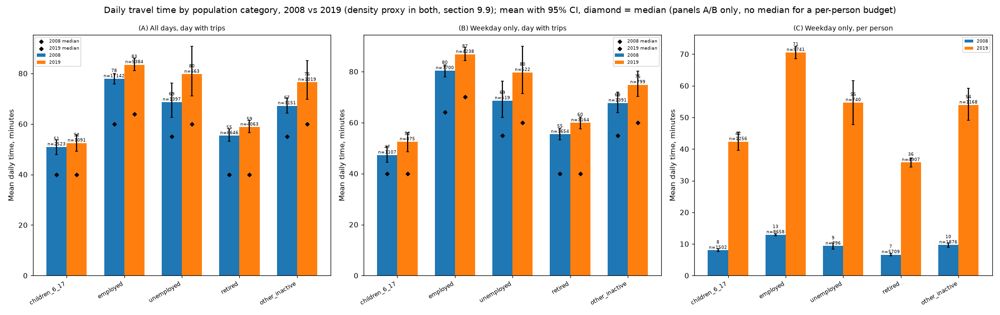
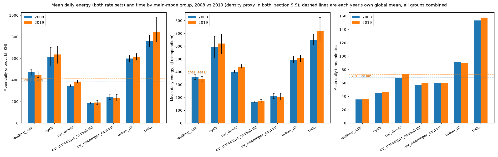

# Step 11 (`mobgrid/budget`): 2008-2019 comparison (section 9.9)

Generated by `python -m mobgrid.budget.emp --compare`. Same model parameters in both years (`config/energy.yaml`); EMP 2019 is run with both the INSEE density grid and section 9.9's urban-unit-status x residence-size proxy, ENTD 2008 with the proxy only (no density grid in ENTD 2008).

## Group table, 2008 vs 2019 (density proxy in both)

| Group | n (2008) | n (2019) | mean time (2008) | mean time (2019) | mean kh (2008) [CI] | mean kh (2019) [CI] | median kh (2008) | median kh (2019) | mean cp (2008) [CI] | mean cp (2019) [CI] | median cp (2008) | median cp (2019) |
|---|---|---|---|---|---|---|---|---|---|---|---|---|
| car_driver | 17239 | 6614 | 66.8 | 72.9 | 347.3 [338.8, 355.6] | 384.3 [373.3, 397.0] | 261.6 | 282.6 | 401.4 [392.4, 410.8] | 441.4 [429.5, 456.5] | 325.0 | 325.0 |
| walking_only | 4577 | 1659 | 35.3 | 36.4 | 471.2 [444.9, 494.7] | 447.5 [421.5, 475.7] | 355.2 | 355.2 | 359.7 [339.6, 377.6] | 341.6 [321.7, 363.1] | 271.1 | 271.1 |
| car_passenger_household | 3524 | 1215 | 57.1 | 59.8 | 183.9 [174.2, 194.9] | 190.9 [173.9, 207.9] | 107.5 | 114.3 | 164.3 [155.8, 172.4] | 170.8 [156.7, 185.4] | 105.1 | 113.8 |
| multimodal | 2863 | 880 | 107.1 | 114.1 | 458.5 [430.4, 490.2] | 512.2 [473.8, 549.8] | 345.0 | 402.8 | 447.1 [417.5, 476.8] | 487.2 [453.7, 517.3] | 354.8 | 406.3 |
| urban_pt | 2007 | 864 | 91.2 | 90.1 | 599.2 [565.9, 631.1] | 616.0 [583.3, 646.1] | 518.5 | 558.6 | 494.7 [468.9, 520.8] | 506.1 [480.1, 529.3] | 435.2 | 461.1 |
| car_passenger_carpool | 1372 | 556 | 59.9 | 60.1 | 241.3 [218.9, 268.2] | 234.6 [204.0, 265.7] | 139.1 | 156.2 | 209.6 [191.8, 230.7] | 204.7 [179.7, 231.3] | 139.8 | 151.2 |
| train | 784 | 228 | 153.2 | 157.7 | 759.3 [707.8, 814.8] | 848.3 [753.3, 978.8] | 676.6 | 703.3 | 649.7 [611.8, 694.2] | 721.1 [639.9, 823.4] | 588.4 | 594.5 |
| cycle | 565 | 185 | 44.6 | 46.2 | 610.7 [528.1, 702.9] | 636.9 [555.1, 714.7] | 450.7 | 540.7 | 592.3 [513.0, 676.7] | 620.0 [541.1, 694.8] | 421.2 | 541.5 |
| other | 81 | 30 | 72.8 | 96.0 | 291.8 [243.0, 352.0] | 411.7 [289.1, 546.2] | 222.0 | 330.4 | 222.7 [185.5, 268.7] | 314.3 [220.7, 416.9] | 169.5 | 252.2 |

## Time budget: by population category, 2008 vs 2019 (density proxy in both, section 9.9's 27 October 2026 decision)

| Group | n (2008) | n (2019) | mean time (2008) | mean time (2019) | mean kh (2008) [CI] | mean kh (2019) [CI] | median kh (2008) | median kh (2019) | mean cp (2008) [CI] | mean cp (2019) [CI] | median cp (2008) | median cp (2019) |
|---|---|---|---|---|---|---|---|---|---|---|---|---|
| employed | 17142 | 5384 | 77.9 | 83.5 | 416.7 [406.0, 428.6] | 454.1 [442.7, 466.8] | 315.0 | 353.0 | 439.2 [427.7, 452.2] | 475.5 [463.8, 489.2] | 352.1 | 379.2 |
| retired | 8646 | 4063 | 55.4 | 58.8 | 331.4 [321.9, 343.6] | 367.8 [349.8, 385.1] | 252.0 | 243.2 | 326.1 [317.7, 336.6] | 354.2 [338.3, 369.4] | 242.8 | 243.9 |
| children_6_17 | 2523 | 1091 | 50.9 | 52.4 | 301.1 [279.4, 324.8] | 291.9 [273.5, 310.4] | 205.1 | 203.6 | 255.8 [238.1, 272.9] | 248.3 [232.7, 263.3] | 184.3 | 169.5 |
| other_inactive | 3151 | 1019 | 67.2 | 76.5 | 435.5 [412.8, 457.9] | 444.3 [413.0, 480.4] | 311.0 | 337.5 | 401.5 [382.0, 423.7] | 407.3 [379.6, 437.7] | 314.5 | 325.0 |
| unemployed | 1397 | 663 | 68.6 | 79.7 | 454.0 [424.3, 493.2] | 511.6 [459.8, 573.3] | 312.9 | 355.2 | 421.6 [396.5, 454.2] | 487.0 [437.6, 551.3] | 325.0 | 341.3 |
| unknown | 153 | 11 | 50.9 | 60.7 | 213.6 [165.6, 257.6] | 290.7 [141.8, 631.7] | 168.0 | 69.9 | 198.6 [150.1, 242.5] | 266.6 [140.5, 544.0] | 152.5 | 74.8 |

### Constancy summary (density within category), both years

| Category | dense/very_sparse 2008 | dense/very_sparse 2019 | max/min 2008 | max/min 2019 | CV 2008 | CV 2019 |
|---|---|---|---|---|---|---|
| children_6_17 | 1.01 | 0.94 | 1.09 | 1.15 | 0.04 | 0.06 |
| employed | 1.11 | 1.05 | 1.11 | 1.17 | 0.05 | 0.06 |
| unemployed | 1.17 | 1.38 | 1.26 | 1.38 | 0.08 | 0.13 |
| retired | 1.11 | 1.14 | 1.28 | 1.23 | 0.09 | 0.08 |
| other_inactive | 0.96 | 1.17 | 1.14 | 1.30 | 0.05 | 0.11 |

### Within-survey equivalence: density proxy

| Category | Group | n 2008 | Ratio 2008 | 90% CI 2008 | ±15% 2008 | ±10% 2008 | n 2019 | Ratio 2019 | 90% CI 2019 | ±15% 2019 | ±10% 2019 |
|---|---|---|---|---|---|---|---|---|---|---|---|
| children_6_17 | dense | 278 | 1.050 | [0.911, 1.187] | no | no | 138 | 0.963 | [0.835, 1.112] | no | no |
| children_6_17 | intermediate | 1064 | 0.981 | [0.927, 1.028] | yes | yes | 541 | 1.040 | [0.983, 1.094] | yes | yes |
| children_6_17 | sparse | 350 | 0.961 | [0.881, 1.060] | yes | no | 164 | 0.903 | [0.794, 1.025] | no | no |
| children_6_17 | very_sparse | 831 | 1.038 | [0.947, 1.139] | yes | no | 248 | 1.026 | [0.922, 1.133] | yes | no |
| employed | dense | 2647 | 1.065 | [1.015, 1.128] | yes | no | 732 | 1.054 | [0.981, 1.148] | yes | no |
| employed | intermediate | 7189 | 1.023 | [1.001, 1.050] | yes | yes | 2465 | 1.017 | [0.985, 1.045] | yes | yes |
| employed | sparse | 2025 | 0.955 | [0.902, 1.011] | yes | yes | 802 | 0.902 | [0.854, 0.942] | yes | no |
| employed | very_sparse | 5281 | 0.955 | [0.918, 0.993] | yes | yes | 1385 | 1.006 | [0.959, 1.057] | yes | yes |
| other_inactive | dense | 753 | 0.999 | [0.940, 1.072] | yes | yes | 216 | 0.985 | [0.879, 1.102] | yes | no |
| other_inactive | intermediate | 1309 | 1.019 | [0.974, 1.071] | yes | yes | 513 | 1.099 | [1.024, 1.172] | no | no |
| other_inactive | sparse | 369 | 0.912 | [0.804, 1.004] | no | no | 147 | 0.857 | [0.728, 1.003] | no | no |
| other_inactive | very_sparse | 720 | 1.042 | [0.957, 1.141] | yes | no | 143 | 0.842 | [0.722, 0.967] | no | no |
| retired | dense | 1124 | 1.109 | [1.023, 1.202] | no | no | 476 | 1.101 | [1.016, 1.175] | no | no |
| retired | intermediate | 3575 | 1.028 | [0.994, 1.066] | yes | yes | 1821 | 1.043 | [1.012, 1.081] | yes | yes |
| retired | sparse | 1139 | 0.867 | [0.803, 0.924] | no | no | 750 | 0.895 | [0.843, 0.953] | no | no |
| retired | very_sparse | 2808 | 0.996 | [0.948, 1.035] | yes | yes | 1016 | 0.965 | [0.893, 1.031] | yes | no |
| unemployed | dense | 243 | 1.175 | [0.974, 1.425] | no | no | 134 | 1.212 | [1.014, 1.442] | no | no |
| unemployed | intermediate | 655 | 0.934 | [0.868, 1.006] | yes | no | 315 | 0.978 | [0.861, 1.086] | yes | no |
| unemployed | sparse | 143 | 1.065 | [0.872, 1.302] | no | no | 106 | 0.949 | [0.700, 1.255] | no | no |
| unemployed | very_sparse | 356 | 1.005 | [0.888, 1.131] | yes | no | 108 | 0.876 | [0.746, 0.997] | no | no |

### Within-survey equivalence: income quintile

| Category | Group | n 2008 | Ratio 2008 | 90% CI 2008 | ±15% 2008 | ±10% 2008 | n 2019 | Ratio 2019 | 90% CI 2019 | ±15% 2019 | ±10% 2019 |
|---|---|---|---|---|---|---|---|---|---|---|---|
| children_6_17 | q1 | 460 | 1.070 | [0.979, 1.194] | no | no | 299 | 1.011 | [0.935, 1.092] | yes | yes |
| children_6_17 | q2 | 592 | 0.964 | [0.891, 1.037] | yes | no | 248 | 0.967 | [0.862, 1.056] | yes | no |
| children_6_17 | q3 | 468 | 0.956 | [0.878, 1.036] | yes | no | 197 | 1.046 | [0.897, 1.215] | no | no |
| children_6_17 | q4 | 545 | 0.971 | [0.895, 1.052] | yes | no | 207 | 0.952 | [0.864, 1.054] | yes | no |
| children_6_17 | q5 | 458 | 1.044 | [0.928, 1.175] | no | no | 140 | 1.043 | [0.908, 1.191] | no | no |
| employed | q1 | 1323 | 0.893 | [0.841, 0.951] | no | no | 512 | 0.890 | [0.826, 0.963] | no | no |
| employed | q2 | 2432 | 0.915 | [0.867, 0.958] | yes | no | 850 | 0.941 | [0.892, 0.996] | yes | no |
| employed | q3 | 3465 | 0.989 | [0.942, 1.041] | yes | yes | 1141 | 1.023 | [0.967, 1.085] | yes | yes |
| employed | q4 | 4333 | 0.973 | [0.938, 1.012] | yes | yes | 1333 | 0.962 | [0.924, 1.007] | yes | yes |
| employed | q5 | 5589 | 1.140 | [1.098, 1.178] | no | no | 1548 | 1.098 | [1.058, 1.135] | yes | no |
| other_inactive | q1 | 1198 | 0.989 | [0.947, 1.037] | yes | yes | 472 | 1.032 | [0.922, 1.135] | yes | no |
| other_inactive | q2 | 634 | 0.958 | [0.887, 1.027] | yes | no | 234 | 0.826 | [0.720, 0.951] | no | no |
| other_inactive | q3 | 436 | 0.999 | [0.900, 1.084] | yes | yes | 140 | 1.113 | [0.949, 1.278] | no | no |
| other_inactive | q4 | 364 | 1.047 | [0.942, 1.162] | no | no | 87 | 1.165 | [0.983, 1.360] | no | no |
| other_inactive | q5 | 519 | 1.077 | [0.961, 1.217] | no | no | 86 | 0.956 | [0.795, 1.170] | no | no |
| retired | q1 | 1459 | 0.814 | [0.754, 0.874] | no | no | 482 | 0.886 | [0.821, 0.960] | no | no |
| retired | q2 | 1372 | 0.938 | [0.883, 0.996] | yes | no | 838 | 0.929 | [0.865, 0.998] | yes | no |
| retired | q3 | 1815 | 1.008 | [0.953, 1.070] | yes | yes | 859 | 0.975 | [0.914, 1.043] | yes | yes |
| retired | q4 | 1458 | 1.041 | [0.979, 1.120] | yes | no | 936 | 0.982 | [0.926, 1.036] | yes | yes |
| retired | q5 | 2542 | 1.135 | [1.076, 1.199] | no | no | 948 | 1.154 | [1.090, 1.217] | no | no |
| unemployed | q1 | 567 | 0.915 | [0.829, 0.984] | no | no | 372 | 0.890 | [0.771, 0.990] | no | no |
| unemployed | q2 | 273 | 1.048 | [0.908, 1.208] | no | no | 125 | 0.977 | [0.844, 1.136] | no | no |
| unemployed | q3 | 221 | 0.907 | [0.789, 1.033] | no | no | 77 | 1.499 | [1.073, 1.935] | no | no |
| unemployed | q4 | 165 | 1.232 | [1.004, 1.500] | no | no | 55 | 0.978 | [0.790, 1.210] | no | no |
| unemployed | q5 | 171 | 1.118 | [0.948, 1.352] | no | no | 34 | - | - | - | - |

## EMP 2019: density grid vs proxy, same groups

| Group | n (grid) | n (proxy) | mean time (grid) | mean time (proxy) | mean kh (grid) [CI] | mean kh (proxy) [CI] | median kh (grid) | median kh (proxy) | mean cp (grid) [CI] | mean cp (proxy) [CI] | median cp (grid) | median cp (proxy) |
|---|---|---|---|---|---|---|---|---|---|---|---|---|
| car_driver | 6614 | 6614 | 72.9 | 72.9 | 385.6 [374.4, 398.4] | 384.3 [373.3, 397.0] | 283.9 | 282.6 | 442.5 [430.6, 457.6] | 441.4 [429.5, 456.5] | 325.0 | 325.0 |
| walking_only | 1659 | 1659 | 36.4 | 36.4 | 447.5 [421.5, 475.7] | 447.5 [421.5, 475.7] | 355.2 | 355.2 | 341.6 [321.7, 363.1] | 341.6 [321.7, 363.1] | 271.1 | 271.1 |
| car_passenger_household | 1215 | 1215 | 59.8 | 59.8 | 191.1 [174.2, 208.1] | 190.9 [173.9, 207.9] | 115.8 | 114.3 | 171.1 [156.9, 185.7] | 170.8 [156.7, 185.4] | 113.8 | 113.8 |
| multimodal | 880 | 880 | 114.1 | 114.1 | 512.8 [474.3, 550.0] | 512.2 [473.8, 549.8] | 402.8 | 402.8 | 487.8 [454.2, 517.9] | 487.2 [453.7, 517.3] | 406.3 | 406.3 |
| urban_pt | 864 | 864 | 90.1 | 90.1 | 615.2 [582.4, 645.5] | 616.0 [583.3, 646.1] | 558.3 | 558.6 | 505.5 [479.7, 528.3] | 506.1 [480.1, 529.3] | 460.7 | 461.1 |
| car_passenger_carpool | 556 | 556 | 60.1 | 60.1 | 234.9 [204.4, 266.1] | 234.6 [204.0, 265.7] | 156.2 | 156.2 | 205.0 [180.1, 231.8] | 204.7 [179.7, 231.3] | 151.2 | 151.2 |
| train | 228 | 228 | 157.7 | 157.7 | 845.4 [752.3, 976.0] | 848.3 [753.3, 978.8] | 696.6 | 703.3 | 718.9 [639.2, 821.3] | 721.1 [639.9, 823.4] | 594.5 | 594.5 |
| cycle | 185 | 185 | 46.2 | 46.2 | 636.9 [555.1, 714.7] | 636.9 [555.1, 714.7] | 540.7 | 540.7 | 620.0 [541.1, 694.8] | 620.0 [541.1, 694.8] | 541.5 | 541.5 |
| other | 30 | 30 | 96.0 | 96.0 | 411.7 [289.1, 546.2] | 411.7 [289.1, 546.2] | 330.4 | 330.4 | 314.3 [220.7, 416.9] | 314.3 [220.7, 416.9] | 252.2 | 252.2 |

## Robustness (F8 base case, core and full scope, means)

| Scope | energy ratio (kh), 2008 | energy ratio (kh), 2019 | CV (kh), 2008 | CV (kh), 2019 | energy ratio (cp), 2008 | energy ratio (cp), 2019 |
|---|---|---|---|---|---|---|
| core | 2.19 | 2.21 | 0.28 | 0.31 | 1.81 | 2.11 |
| full | 4.13 | 4.44 | 0.43 | 0.45 | 3.95 | 4.22 |

## Declared vs modelled walk/wait minutes per trip, car driver, urban PT and train, both years

| Mode group | n, 2008 | n, 2019 | declared walk, 2008 | declared walk, 2019 | modelled walk, 2008 | modelled walk, 2019 | declared wait, 2008 | declared wait, 2019 | modelled wait, 2008 | modelled wait, 2019 |
|---|---|---|---|---|---|---|---|---|---|---|
| car_driver | 66480 | 23859 | 1.2 | 1.4 | 4.7 | 4.9 | 1.6 | 0.0 | - | - |
| urban_pt | 6029 | 2408 | 7.9 | 9.1 | 8.9 | 9.5 | 5.2 | 6.4 | 4.0 | 4.4 |
| train | 2215 | 631 | 11.7 | 14.6 | 9.9 | 10.2 | 9.7 | 13.8 | 4.9 | 4.8 |

## Weekday share of persons without trips, both years

- 2008: 15.8% unweighted, 15.0% by individual weight (n=2945 of 18,632 respondents)
- 2019: 3.3% unweighted, 2.6% by individual weight (n=455 of 13,825 respondents)

## 2008-calibrated v0 and P0 (for information only; the model uses the same parameters in both years, section 9.9)

- v0: 3.63 km/h, n=20348 (2019: 3.43 km/h, n=7636)
- P0: 26.7 W at an implied flat speed of 11.84 km/h, n=2146 (2019: 29.3 W, n=721)

## Overall (all groups combined), both years

- Mean daily energy: 2008 383.7 kJ (kh), 382.8 kJ (cp); 2019 410.7 kJ (kh), 406.2 kJ (cp).
- Mean daily time: 2008 67.8 min; 2019 72.2 min.

## Weekday-only comparison, 2008 vs 2019 (density proxy in both; section 9.9's per-person budget is only defined on the weekday in both surveys)

### Daily time, per day with trips

| Category | 2008 (min) | 2019 (min) | 2019 - 2008 | 95% CI |
|---|---|---|---|---|
| children_6_17 | 47.2 | 52.5 | +5.2 | [+1.0, +10.3] |
| employed | 80.4 | 86.8 | +6.4 | [+2.9, +10.1] |
| unemployed | 68.6 | 79.7 | +11.1 | [+0.6, +23.9] |
| retired | 55.4 | 59.9 | +4.5 | [+1.3, +8.0] |
| other_inactive | 67.6 | 74.8 | +7.2 | [+0.8, +13.5] |
| overall | 68.6 | 73.8 | +5.2 | [+2.7, +7.2] |

### Daily time, per person (days without trips included)

Direct producer-weighted local-trip total divided by the full respondent roster. The difference is between the two independent point estimates (each survey's household-bootstrap 95% CI appears in the adjacent columns).

| Category | 2008 (min) | 2008 95% CI | 2019 (min) | 2019 95% CI | 2019 - 2008 |
|---|---|---|---|---|---|
| children_6_17 | 8.0 | [7.5, 8.5] | 42.3 | [39.5, 45.3] | +34.4 |
| employed | 12.9 | [12.5, 13.2] | 70.5 | [68.5, 72.5] | +57.6 |
| unemployed | 9.3 | [8.4, 10.3] | 54.7 | [47.7, 61.6] | +45.3 |
| retired | 6.6 | [6.3, 7.0] | 35.8 | [34.3, 37.1] | +29.2 |
| other_inactive | 9.7 | [9.0, 10.4] | 53.9 | [49.1, 59.2] | +44.2 |
| overall | 10.1 | [9.9, 10.4] | 54.3 | [53.1, 55.9] | +44.2 |

## Temporal equivalence, 2008 to 2019

Ratios are 2019/2008; the 90% CI pairs replicate b from two independent 200-replicate household bootstraps. `yes` means the full interval is within the margin; `no` means equivalence was not established. Cells with fewer than 50 weekday respondents in either year are suppressed.

### Daily time, weekday days with trips (needs scope)

| Category | n 2008 | n 2019 | Ratio 2019/2008 | 90% CI | Equivalent at ±15% | Equivalent at ±10% |
|---|---|---|---|---|---|---|
| children_6_17 | 1107 | 875 | 1.111 | [1.027, 1.210] | no | no |
| employed | 7700 | 4238 | 1.079 | [1.040, 1.126] | yes | no |
| unemployed | 619 | 522 | 1.162 | [1.012, 1.319] | no | no |
| retired | 3654 | 3164 | 1.081 | [1.032, 1.146] | yes | no |
| other_inactive | 1391 | 799 | 1.106 | [1.021, 1.203] | no | no |
| overall | 14546 | 9608 | 1.076 | [1.049, 1.110] | yes | no |

### Daily time, weekday per-person budgets

| Category | n 2008 | n 2019 | Ratio 2019/2008 | 90% CI | Equivalent at ±15% | Equivalent at ±10% |
|---|---|---|---|---|---|---|
| children_6_17 | 1502 | 1256 | 1.060 | [0.978, 1.140] | yes | no |
| employed | 8658 | 5741 | 1.094 | [1.056, 1.132] | yes | no |
| unemployed | 796 | 740 | 1.171 | [1.032, 1.366] | no | no |
| retired | 5709 | 4907 | 1.084 | [1.025, 1.140] | yes | no |
| other_inactive | 1876 | 1168 | 1.113 | [0.997, 1.227] | no | no |
| overall | 18632 | 13825 | 1.076 | [1.043, 1.106] | yes | no |

### Daily time, weekday days with trips by category × density proxy

| Category | Group | n 2008 | n 2019 | Ratio 2019/2008 | 90% CI | Equivalent at ±15% | Equivalent at ±10% |
|---|---|---|---|---|---|---|---|
| children_6_17 | dense | 122 | 111 | 1.161 | [0.852, 1.496] | no | no |
| children_6_17 | intermediate | 475 | 436 | 1.127 | [1.004, 1.249] | no | no |
| children_6_17 | sparse | 161 | 127 | 0.980 | [0.806, 1.172] | no | no |
| children_6_17 | very_sparse | 349 | 201 | 1.130 | [0.931, 1.419] | no | no |
| employed | dense | 1120 | 574 | 1.053 | [0.946, 1.171] | no | no |
| employed | intermediate | 3110 | 1938 | 1.053 | [1.001, 1.117] | yes | no |
| employed | sparse | 951 | 621 | 1.033 | [0.951, 1.132] | yes | no |
| employed | very_sparse | 2519 | 1105 | 1.180 | [1.101, 1.284] | no | no |
| unemployed | dense | 97 | 105 | 1.268 | [0.834, 1.707] | no | no |
| unemployed | intermediate | 289 | 252 | 1.318 | [1.117, 1.572] | no | no |
| unemployed | sparse | 65 | 80 | 0.726 | [0.543, 1.088] | no | no |
| unemployed | very_sparse | 168 | 85 | 0.981 | [0.767, 1.222] | no | no |
| retired | dense | 456 | 377 | 1.140 | [1.018, 1.296] | no | no |
| retired | intermediate | 1485 | 1406 | 1.084 | [0.992, 1.181] | no | no |
| retired | sparse | 501 | 577 | 1.126 | [1.001, 1.264] | no | no |
| retired | very_sparse | 1212 | 804 | 1.027 | [0.947, 1.132] | yes | no |
| other_inactive | dense | 318 | 170 | 1.174 | [1.019, 1.343] | no | no |
| other_inactive | intermediate | 572 | 405 | 1.105 | [0.991, 1.233] | no | no |
| other_inactive | sparse | 176 | 111 | 1.205 | [0.938, 1.525] | no | no |
| other_inactive | very_sparse | 325 | 113 | 0.928 | [0.783, 1.155] | no | no |

## Figures

