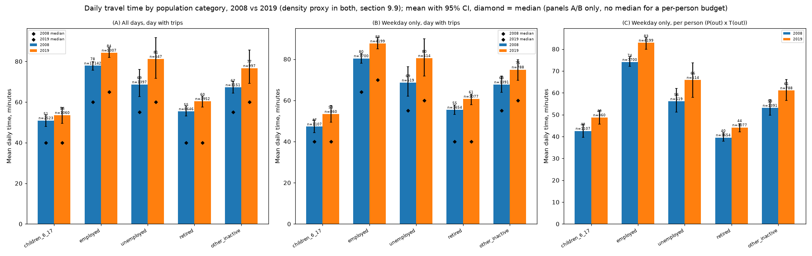

# Step 11 (`mobgrid/budget`): 2008-2019 comparison (section 9.9)

Generated by `python -m mobgrid.budget.emp --compare`. Same model parameters in both years (`config/energy.yaml`); EMP 2019 is run with both the INSEE density grid and section 9.9's urban-unit-status x residence-size proxy, ENTD 2008 with the proxy only (no density grid in ENTD 2008).

## Group table, 2008 vs 2019 (density proxy in both)

| Group | n (2008) | n (2019) | mean time (2008) | mean time (2019) | mean kh (2008) [CI] | mean kh (2019) [CI] | median kh (2008) | median kh (2019) | mean cp (2008) [CI] | mean cp (2019) [CI] | median cp (2008) | median cp (2019) |
|---|---|---|---|---|---|---|---|---|---|---|---|---|
| car_driver | 17239 | 6491 | 66.8 | 73.6 | 347.3 [338.8, 355.6] | 390.4 [378.9, 404.6] | 261.6 | 290.0 | 401.4 [392.4, 410.8] | 446.6 [433.6, 462.7] | 325.0 | 325.3 |
| walking_only | 4577 | 1628 | 35.3 | 37.4 | 471.2 [444.9, 494.7] | 461.3 [433.5, 487.3] | 355.2 | 355.2 | 359.7 [339.6, 377.6] | 352.2 [330.9, 371.9] | 271.1 | 271.1 |
| car_passenger_household | 3524 | 1167 | 57.1 | 60.5 | 183.9 [174.2, 194.9] | 198.5 [181.1, 215.8] | 107.5 | 115.5 | 164.3 [155.8, 172.4] | 176.6 [161.4, 190.0] | 105.1 | 113.8 |
| multimodal | 2863 | 864 | 107.1 | 116.1 | 458.5 [430.4, 490.2] | 535.9 [500.4, 571.7] | 345.0 | 440.2 | 447.1 [417.5, 476.8] | 505.8 [473.6, 540.6] | 354.8 | 428.1 |
| urban_pt | 2007 | 850 | 91.2 | 93.3 | 599.2 [565.9, 631.1] | 640.7 [610.8, 677.5] | 518.5 | 566.5 | 494.7 [468.9, 520.8] | 525.7 [502.8, 554.0] | 435.2 | 476.0 |
| car_passenger_carpool | 1372 | 540 | 59.9 | 61.5 | 241.3 [218.9, 268.2] | 245.8 [212.9, 283.1] | 139.1 | 160.7 | 209.6 [191.8, 230.7] | 213.7 [187.5, 243.4] | 139.8 | 152.8 |
| train | 784 | 219 | 153.2 | 156.1 | 759.3 [707.8, 814.8] | 860.7 [769.9, 965.3] | 676.6 | 718.0 | 649.7 [611.8, 694.2] | 730.1 [656.5, 819.3] | 588.4 | 632.7 |
| cycle | 565 | 184 | 44.6 | 46.1 | 610.7 [528.1, 702.9] | 634.9 [548.6, 741.4] | 450.7 | 540.7 | 592.3 [513.0, 676.7] | 617.0 [532.2, 712.7] | 421.2 | 521.6 |
| other | 81 | 31 | 72.8 | 98.8 | 291.8 [243.0, 352.0] | 457.1 [320.6, 584.8] | 222.0 | 330.4 | 222.7 [185.5, 268.7] | 348.9 [244.7, 446.4] | 169.5 | 252.2 |

## Time budget: by population category, 2008 vs 2019 (density proxy in both, section 9.9's 27 October 2026 decision)

| Group | n (2008) | n (2019) | mean time (2008) | mean time (2019) | mean kh (2008) [CI] | mean kh (2019) [CI] | median kh (2008) | median kh (2019) | mean cp (2008) [CI] | mean cp (2019) [CI] | median cp (2008) | median cp (2019) |
|---|---|---|---|---|---|---|---|---|---|---|---|---|
| employed | 17142 | 5307 | 77.9 | 84.2 | 416.7 [406.0, 428.6] | 463.5 [450.5, 475.5] | 315.0 | 357.0 | 439.2 [427.7, 452.2] | 483.2 [468.2, 497.5] | 352.1 | 379.3 |
| retired | 8646 | 3952 | 55.4 | 60.4 | 331.4 [321.9, 343.6] | 382.1 [360.8, 400.8] | 252.0 | 251.6 | 326.1 [317.7, 336.6] | 365.9 [346.3, 384.4] | 242.8 | 249.2 |
| children_6_17 | 2523 | 1060 | 50.9 | 53.5 | 301.1 [279.4, 324.8] | 304.9 [284.9, 330.7] | 205.1 | 217.2 | 255.8 [238.1, 272.9] | 258.9 [242.3, 281.6] | 184.3 | 177.2 |
| other_inactive | 3151 | 997 | 67.2 | 76.6 | 435.5 [412.8, 457.9] | 452.8 [419.4, 491.5] | 311.0 | 349.6 | 401.5 [382.0, 423.7] | 412.0 [383.8, 446.6] | 314.5 | 333.1 |
| unemployed | 1397 | 647 | 68.6 | 81.2 | 454.0 [424.3, 493.2] | 522.9 [467.3, 583.2] | 312.9 | 382.9 | 421.6 [396.5, 454.2] | 495.8 [444.9, 557.4] | 325.0 | 355.9 |
| unknown | 153 | 11 | 50.9 | 64.1 | 213.6 [165.6, 257.6] | 380.1 [268.0, 675.1] | 168.0 | 247.5 | 198.6 [150.1, 242.5] | 334.7 [239.4, 593.9] | 152.5 | 210.3 |

### Constancy summary (density within category), both years

| Category | dense/very_sparse 2008 | dense/very_sparse 2019 | max/min 2008 | max/min 2019 | CV 2008 | CV 2019 |
|---|---|---|---|---|---|---|
| children_6_17 | 1.01 | 1.00 | 1.09 | 1.10 | 0.04 | 0.03 |
| employed | 1.11 | 1.05 | 1.11 | 1.17 | 0.05 | 0.06 |
| unemployed | 1.17 | 1.41 | 1.26 | 1.41 | 0.08 | 0.13 |
| retired | 1.11 | 1.18 | 1.28 | 1.20 | 0.09 | 0.08 |
| other_inactive | 0.96 | 1.19 | 1.14 | 1.30 | 0.05 | 0.11 |

## EMP 2019: density grid vs proxy, same groups

| Group | n (grid) | n (proxy) | mean time (grid) | mean time (proxy) | mean kh (grid) [CI] | mean kh (proxy) [CI] | median kh (grid) | median kh (proxy) | mean cp (grid) [CI] | mean cp (proxy) [CI] | median cp (grid) | median cp (proxy) |
|---|---|---|---|---|---|---|---|---|---|---|---|---|
| car_driver | 6491 | 6491 | 73.6 | 73.6 | 391.8 [380.4, 406.2] | 390.4 [378.9, 404.6] | 292.7 | 290.0 | 447.6 [434.5, 463.8] | 446.6 [433.6, 462.7] | 330.4 | 325.3 |
| walking_only | 1628 | 1628 | 37.4 | 37.4 | 461.3 [433.5, 487.3] | 461.3 [433.5, 487.3] | 355.2 | 355.2 | 352.2 [330.9, 371.9] | 352.2 [330.9, 371.9] | 271.1 | 271.1 |
| car_passenger_household | 1167 | 1167 | 60.5 | 60.5 | 198.8 [181.3, 216.0] | 198.5 [181.1, 215.8] | 117.5 | 115.5 | 176.8 [161.6, 190.3] | 176.6 [161.4, 190.0] | 113.8 | 113.8 |
| multimodal | 864 | 864 | 116.1 | 116.1 | 536.6 [501.2, 572.5] | 535.9 [500.4, 571.7] | 439.5 | 440.2 | 506.4 [474.2, 541.5] | 505.8 [473.6, 540.6] | 428.1 | 428.1 |
| urban_pt | 850 | 850 | 93.3 | 93.3 | 640.0 [610.3, 676.9] | 640.7 [610.8, 677.5] | 566.5 | 566.5 | 525.2 [502.3, 553.3] | 525.7 [502.8, 554.0] | 476.0 | 476.0 |
| car_passenger_carpool | 540 | 540 | 61.5 | 61.5 | 246.1 [213.5, 283.4] | 245.8 [212.9, 283.1] | 160.7 | 160.7 | 214.0 [187.8, 243.8] | 213.7 [187.5, 243.4] | 152.8 | 152.8 |
| train | 219 | 219 | 156.1 | 156.1 | 857.6 [765.5, 957.6] | 860.7 [769.9, 965.3] | 713.6 | 718.0 | 727.8 [654.4, 813.6] | 730.1 [656.5, 819.3] | 632.7 | 632.7 |
| cycle | 184 | 184 | 46.1 | 46.1 | 634.9 [548.6, 741.4] | 634.9 [548.6, 741.4] | 540.7 | 540.7 | 617.0 [532.2, 712.7] | 617.0 [532.2, 712.7] | 521.6 | 521.6 |
| other | 31 | 31 | 98.8 | 98.8 | 457.1 [320.6, 584.8] | 457.1 [320.6, 584.8] | 330.4 | 330.4 | 348.9 [244.7, 446.4] | 348.9 [244.7, 446.4] | 252.2 | 252.2 |

## Robustness (F8 base case, core and full scope, means)

| Scope | energy ratio (kh), 2008 | energy ratio (kh), 2019 | CV (kh), 2008 | CV (kh), 2019 | energy ratio (cp), 2008 | energy ratio (cp), 2019 |
|---|---|---|---|---|---|---|
| core | 2.19 | 2.20 | 0.28 | 0.31 | 1.81 | 2.07 |
| full | 4.13 | 4.34 | 0.43 | 0.45 | 3.95 | 4.13 |

## Declared vs modelled walk/wait minutes per trip, car driver, urban PT and train, both years

| Mode group | n, 2008 | n, 2019 | declared walk, 2008 | declared walk, 2019 | modelled walk, 2008 | modelled walk, 2019 | declared wait, 2008 | declared wait, 2019 | modelled wait, 2008 | modelled wait, 2019 |
|---|---|---|---|---|---|---|---|---|---|---|
| car_driver | 66480 | 23859 | 1.2 | 1.4 | 4.7 | 4.9 | 1.6 | 0.0 | - | - |
| urban_pt | 6029 | 2408 | 7.9 | 9.1 | 8.9 | 9.5 | 5.2 | 6.4 | 4.0 | 4.4 |
| train | 2215 | 631 | 11.7 | 14.6 | 9.9 | 10.2 | 9.7 | 13.8 | 4.9 | 4.8 |

## Weekday share of persons without trips, both years

- 2008: 15.8% unweighted, 15.0% by individual weight (n=2945 of 18,632 respondents)
- 2019: 3.3% unweighted, 2.6% by individual weight (n=455 of 13,825 respondents)

## 2008-calibrated v0 and P0 (for information only; the model uses the same parameters in both years, section 9.9)

- v0: 3.63 km/h, n=20348 (2019: 3.38 km/h, n=7707)
- P0: 26.7 W at an implied flat speed of 11.84 km/h, n=2146 (2019: 28.4 W, n=727)

## Overall (all groups combined), both years

- Mean daily energy: 2008 383.7 kJ (kh), 382.8 kJ (cp); 2019 422.2 kJ (kh), 415.7 kJ (cp).
- Mean daily time: 2008 67.8 min; 2019 73.3 min.

## Weekday-only comparison, 2008 vs 2019 (density proxy in both; section 9.9's per-person budget is only defined on the weekday in both surveys)

### Daily time, per day with trips

| Category | 2008 (min) | 2019 (min) | 2019 - 2008 | 95% CI |
|---|---|---|---|---|
| children_6_17 | 47.2 | 53.4 | +6.1 | [+1.5, +11.4] |
| employed | 80.4 | 87.6 | +7.2 | [+4.1, +10.8] |
| unemployed | 68.6 | 80.5 | +11.9 | [+0.4, +22.4] |
| retired | 55.4 | 60.7 | +5.3 | [+2.2, +9.6] |
| other_inactive | 67.6 | 74.9 | +7.3 | [+1.0, +15.0] |
| overall | 68.6 | 74.7 | +6.1 | [+3.5, +8.2] |

### Daily time, per person (days without trips included)

P(out on the weekday) x T(weekday|out); the difference shown is between the two surveys' independent point budgets, without a joint bootstrap interval (each side's own 95% CI is shown instead, from its single-survey per-person budget table above).

| Category | 2008 (min) | 2008 95% CI | 2019 (min) | 2019 95% CI | 2019 - 2008 |
|---|---|---|---|---|---|
| children_6_17 | 42.5 | [39.7, 45.7] | 48.7 | [45.7, 51.8] | +6.1 |
| employed | 74.0 | [72.1, 76.5] | 82.9 | [79.9, 85.2] | +8.8 |
| unemployed | 56.1 | [51.2, 61.9] | 65.8 | [57.8, 73.7] | +9.8 |
| retired | 39.5 | [37.8, 41.7] | 44.1 | [42.0, 45.9] | +4.6 |
| other_inactive | 53.1 | [49.7, 56.9] | 61.0 | [56.5, 66.0] | +8.0 |
| overall | 58.3 | [57.1, 59.8] | 64.5 | [63.2, 66.3] | +6.2 |

## Figures

