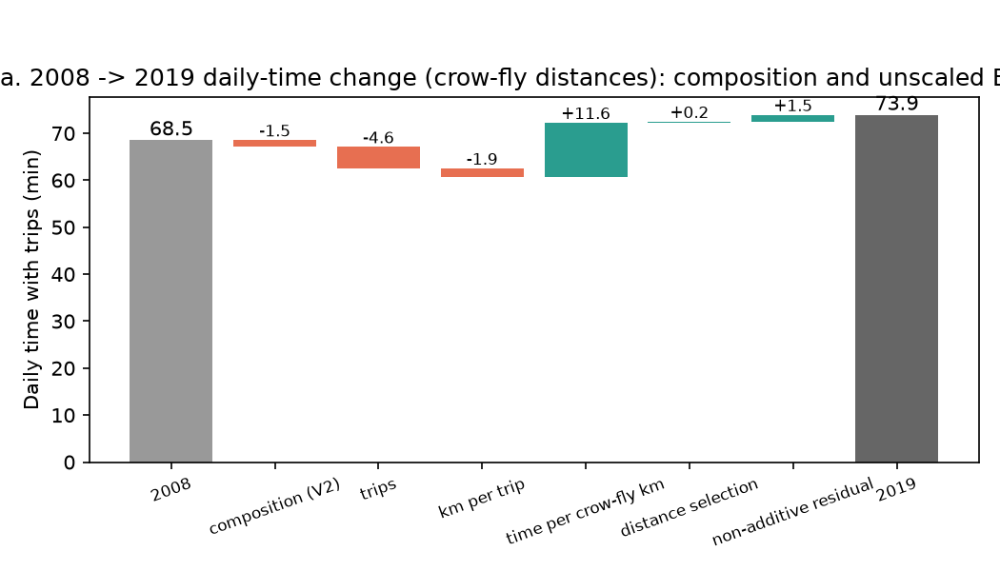
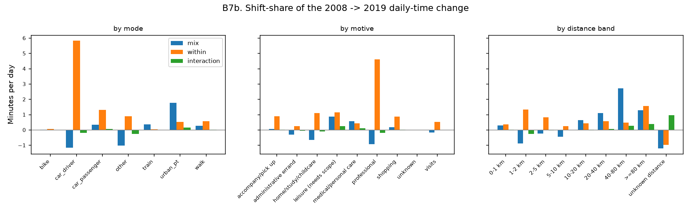
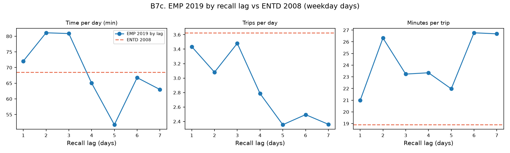

# Step 12: what explains the variation of daily travel time

Generated by `python -m mobgrid.budget.variation_report`. Unit of analysis: weekday person-days with at least one trip, needs scope, day weights (`POND_JOUR`/`POIDS_JOUR`), as in step 11. Bootstrap intervals resample households within each survey, independently (200 replicates). Cells of fewer than 50 respondents print their true n with `-` for the values.

Sample: ENTD 2008, 14958 weekday days with trips (52810 trips); EMP 2019, 9809 days (32193 trips).

## Choices made

- ENTD 2008's recall lag uses the second visit (`MDATENQ2V`, when trips are collected) minus the described reference weekday (`V2_DATESEMREF`); the first visit (`DATENQ`) precedes the described day.
- EMP 2019 days with a missing `MDATE_delai` (about 3% of respondents) are excluded from the lag-specific rows and regressions, kept everywhere else.
- Household cars are not in ENTD 2008's four public step-11 tables: B1's V3 variant falls back to V2 for the 2008 -> 2019 pair and is computed fully within EMP 2019 pairs (`JNBVEH`).
- The main 2008 -> 2019 comparison applies the raw return-home reassignment to both surveys; EMP 2019's `MOT_SEQ_COMPL` is retained as a C3 sensitivity check, with needs scope and groups using that selected motive in each table.
- Residence density uses the INSEE grid in both years (ENTD 2008's 2020-zoning SDES supplement, EMP 2019's published grid). The SDES tables contain no commune codes, so C2 crow-fly distances are not recomputed.
- The motive crosswalk reports raw code shares before the needs scope and before the return-trip motive reassignment, so both surveys' code inventories are visible.
- EMP 2019 declared distances have unit/coding errors and are excluded from the 2008 -> 2019 distance comparison.
- Distance bands use step 11's corrected distances (`trip_legs.distance_km`): the speed-plausibility correction replaces implausible declared distances, as in every step-11 table.
- Missing distances form a separate unknown-distance band. N and T include all trips; L and v use distance-known trips. Coverage is day-weighted at trip level, and the selection residual is explicit rather than attributed to speed.
- The waterfall figure shows B1 V2's composition effect, then the behavioural remainder split in proportion to B2's trips / km per trip / speed / selection terms (the decompositions are not nested). At zero total change, an explicit allocation residual closes the plot.

## A1. Recall lag (EMP 2019)

EMP 2019 describes a day drawn from the 7 days before the visit (`MDATE_delai`, days between the described day and the interview); ENTD 2008 describes the last weekday before the second visit (`MDATENQ2V` - `V2_DATESEMREF`: lag 1 except after a weekend, where the calendar lag is 3). Weekday described days with trips, needs scope, day weights.

| Lag (days) | n | Weighted share | Trips/day | Min/trip | Time/day (min) | Trips < 5 min | Trips < 1 km |
|---|---|---|---|---|---|---|---|
| 1 | 6665 | 72.4% | 3.43 | 21.0 | 72.1 | 5.2% | 19.4% |
| 2 | 563 | 5.1% | 3.08 | 26.3 | 81.1 | 4.8% | 18.0% |
| 3 | 1932 | 19.4% | 3.48 | 23.2 | 80.9 | 4.0% | 17.5% |
| 4 | 327 | 2.0% | 2.79 | 23.3 | 65.0 | 2.4% | 15.1% |
| 5 | 167 | 0.8% | 2.36 | 22.0 | 51.8 | 4.0% | 24.2% |
| 6 | 97 | 0.2% | 2.49 | 26.8 | 66.8 | 2.4% | 14.7% |
| 7 | 58 | 0.1% | 2.36 | 26.7 | 63.0 | 2.2% | 12.7% |
| all days | 9809 | - | 3.40 | 21.7 | 73.9 | 4.9% | 18.9% |

EMP 2019 at lag 1 next to ENTD 2008 (all weekday days):

| Survey | n | Trips/day | Min/trip | Time/day (min) | Trips < 5 min | Trips < 1 km |
|---|---|---|---|---|---|---|
| EMP 2019, lag 1 | 6665 | 3.43 | 21.0 | 72.1 | 5.2% | 19.4% |
| EMP 2019, all lags | 9809 | 3.40 | 21.7 | 73.9 | 4.9% | 18.9% |
| ENTD 2008 | 14958 | 3.63 | 18.9 | 68.5 | 7.5% | 17.6% |

Weighted regression on lag dummies (reference lag 1), with population-category x density-class controls and described-day weekday dummies (first observed weekday as reference; unknown weekdays excluded), household-bootstrap 95% CIs:

| Lag | Δ time/day (min) | 95% CI | Δ trips/day | 95% CI | n |
|---|---|---|---|---|---|
| 2 | 10.3 | [1.5, 23.0] | -0.37 | [-0.56, -0.19] | 563 |
| 3 | 0.2 | [-8.0, 8.3] | -0.04 | [-0.24, 0.15] | 1932 |
| 4 | -8.7 | [-19.5, 3.3] | -0.68 | [-0.90, -0.44] | 327 |
| 5 | -18.7 | [-29.3, -8.3] | -0.99 | [-1.27, -0.78] | 167 |
| 6 | 3.4 | [-14.5, 28.3] | -0.75 | [-1.15, -0.21] | 97 |
| 7 | -3.0 | [-20.3, 18.8] | -0.95 | [-1.27, -0.50] | 58 |

## A2. Motive crosswalk

Step 11's code-by-code conversion (`docs/data/entd2008.md`'s "Purposes" table), with each code's weighted share of weekday trips in its own survey. Shares are of raw trip codes before the needs scope; `return home` codes are re-assigned to the outward motive downstream, as in step 11.

### Destination motives

| ENTD 2008 code | share 2008 | EMP 2019 code | label | share 2019 | flag |
|---|---|---|---|---|---|
| 1.1 | 40.1% | 1.1 | return home | 40.1% |  |
| 1.2 | 0.3% | 1.2 | return to occasional residence | 0.6% |  |
| 1.3 | 0.8% | 1.3 | return to parents'/friends' home | 0.7% |  |
| 1.11 | 5.8% | 1.4 | study (school/university) | 5.1% |  |
| 1.12 | 0.4% | 1.5 | young-child childcare drop-off | 0.5% |  |
| 2.20 | 5.2% | 2.1 | shopping, mall/large store | 5.3% |  |
| 2.21 | 6.3% | 2.2 | shopping, local store | 6.2% |  |
| 3.31 | 2.0% | 3.1 | medical/personal care | 2.4% |  |
| 4.41 | 1.7% | 4.1 | administrative errand | 1.4% |  |
| 5.51 | 2.8% | 5.1 | visit family | 2.8% |  |
| 5.52 | 2.4% | 5.2 | visit friends | 2.2% |  |
| 6.61 | 0.2% | 6.1 | accompany to station/airport | 0.3% |  |
| 6.62 | 3.6% | 6.2 | accompany elsewhere | 3.6% |  |
| 6.63 | 0.2% | 6.3 | pick up from station/airport | 0.3% |  |
| 6.64 | 3.4% | 6.4 | pick up elsewhere | 3.2% |  |
| 7.71 | 1.1% | 7.1 | association/religious/meeting | 1.2% |  |
| 7.72 | 0.3% | 7.2 | leisure centre/amusement park/fair | 0.4% |  |
| 7.73 | 1.7% | 7.3 | eat/drink out | 2.1% |  |
| 7.74 | 0.1% | 7.4 | visit monument/historic site | 0.1% |  |
| 7.75 | 0.5% | 7.5 | cultural/sports show, conference | 0.6% |  |
| 7.76 | 1.6% | 7.6 | sport | 2.2% |  |
| 7.77 | 1.7% | 7.7 | stroll, no specific destination | 2.1% |  |
| 7.78 | 1.0% | 7.8 | go to a place for walking | 1.3% |  |
| 8.80 | 0.0% | 8.1 | holiday, away from second home | 0.0% |  |
| 8.81 | 0.1% | 8.2 | go to second home | 0.0% |  |
| 8.82 | 0.1% | 8.3 | go to occasional residence | 0.0% |  |
| 8.89 | 0.7% | 8.4 | other personal reason | 0.2% |  |
| 9.91 | 12.2% | 9.1 | work, fixed usual workplace | 11.3% |  |
| 9.92 | 2.5% | 9.2 | work, outside fixed workplace | 1.7% |  |
| 9.94 | 0.2% | 9.3 | training/conference/exhibition | 0.3% |  |
| 9.95 | 0.6% | 9.4 | professional rounds/patient visits | 0.8% |  |
| 9.96 | 0.6% | 9.5 | other professional reason | 0.7% |  |
| - | 0.0% | 4.12 | waste disposal site | 0.1% | 2019 only |
| - | 0.0% | 9999.0 | - | 0.0% | 2019 only |

### Origin motives

| ENTD 2008 code | share 2008 | EMP 2019 code | label | share 2019 | flag |
|---|---|---|---|---|---|
| 1.1 | 40.3% | 1.1 | return home | 40.3% |  |
| 1.2 | 0.2% | 1.2 | return to occasional residence | 0.3% |  |
| 1.3 | 0.5% | 1.3 | return to parents'/friends' home | 0.4% |  |
| 1.11 | 5.8% | 1.4 | study (school/university) | 5.1% |  |
| 1.12 | 0.4% | 1.5 | young-child childcare drop-off | 0.5% |  |
| 2.20 | 5.2% | 2.1 | shopping, mall/large store | 5.3% |  |
| 2.21 | 6.3% | 2.2 | shopping, local store | 6.2% |  |
| 3.31 | 2.0% | 3.1 | medical/personal care | 2.5% |  |
| 4.41 | 1.7% | 4.1 | administrative errand | 1.4% |  |
| 5.51 | 2.9% | 5.1 | visit family | 3.0% |  |
| 5.52 | 2.4% | 5.2 | visit friends | 2.2% |  |
| 6.61 | 0.2% | 6.1 | accompany to station/airport | 0.3% |  |
| 6.62 | 3.6% | 6.2 | accompany elsewhere | 3.5% |  |
| 6.63 | 0.2% | 6.3 | pick up from station/airport | 0.3% |  |
| 6.64 | 3.4% | 6.4 | pick up elsewhere | 3.2% |  |
| 7.71 | 1.1% | 7.1 | association/religious/meeting | 1.2% |  |
| 7.72 | 0.3% | 7.2 | leisure centre/amusement park/fair | 0.4% |  |
| 7.73 | 1.7% | 7.3 | eat/drink out | 2.1% |  |
| 7.74 | 0.1% | 7.4 | visit monument/historic site | 0.1% |  |
| 7.75 | 0.5% | 7.5 | cultural/sports show, conference | 0.6% |  |
| 7.76 | 1.6% | 7.6 | sport | 2.3% |  |
| 7.77 | 1.6% | 7.7 | stroll, no specific destination | 2.1% |  |
| 7.78 | 1.0% | 7.8 | go to a place for walking | 1.3% |  |
| 8.80 | 0.1% | 8.1 | holiday, away from second home | 0.2% |  |
| 8.81 | 0.1% | 8.2 | go to second home | 0.1% |  |
| 8.82 | 0.1% | 8.3 | go to occasional residence | 0.0% |  |
| 8.89 | 0.7% | 8.4 | other personal reason | 0.3% |  |
| 9.91 | 12.2% | 9.1 | work, fixed usual workplace | 11.3% |  |
| 9.92 | 2.5% | 9.2 | work, outside fixed workplace | 1.8% |  |
| 9.94 | 0.2% | 9.3 | training/conference/exhibition | 0.4% |  |
| 9.95 | 0.6% | 9.4 | professional rounds/patient visits | 0.8% |  |
| 9.96 | 0.6% | 9.5 | other professional reason | 0.8% |  |
| - | 0.0% | 4.12 | waste disposal site | 0.1% | 2019 only |
| - | 0.0% | 9999.0 | - | 0.0% | 2019 only |

### Needs scope

Weighted share of weekday trips and time removed by the needs scope (motives 7.6-7.8 and 8.x):

| Survey | Trips removed | Time removed |
|---|---|---|
| ENTD 2008 | 8.8% | 12.3% |
| EMP 2019 | 11.0% | 13.9% |

## A3. Distances

**How each survey's distance was produced.** ENTD 2008: `V2_MDISTTOT` is the respondent's declared distance; the producer's undocumented correction `distcor` (filled for 0.2% of weekday trips) replaces it where present (step 11's rule); `V2_DVO_LOC` is a computed crow-fly distance for local trips (100.0% filled). EMP 2019: `MDISTTOT_decl` is declared (99.9% filled), `MDISTTOT_fin` is the producer's consolidated distance (100% filled; producer-corrected against the declared value for 23.4% of trips, `indic_dist_corr`), `dVO_ORIDES` is a computed crow-fly distance and `dist_ign` an IGN route distance (49.3% filled). The measurement therefore changed between 2008 (declared, with a partial correction) and 2019 (declared, consolidated by the producer against geocoded route distances). Both surveys then receive step 11's speed-plausibility correction; the bands below use the corrected distances.

| Band | n 2008 | trips 2008 | time 2008 | n 2019 | trips 2019 | time 2019 |
|---|---|---|---|---|---|---|
| 0-1 km | 8639 | 17.6% | 6.5% | 5564 | 18.9% | 6.6% |
| 1-2 km | 7695 | 15.4% | 6.9% | 3872 | 12.4% | 6.3% |
| 2-5 km | 11215 | 22.6% | 15.6% | 7404 | 22.1% | 14.4% |
| 5-10 km | 10109 | 17.8% | 17.8% | 5831 | 17.1% | 15.2% |
| 10-20 km | 8077 | 14.0% | 18.5% | 4817 | 14.7% | 17.6% |
| 20-40 km | 4953 | 8.7% | 17.2% | 2958 | 9.5% | 17.3% |
| 40-80 km | 1350 | 2.4% | 7.4% | 1237 | 3.7% | 11.1% |
| >=80 km | 634 | 1.2% | 8.2% | 510 | 1.5% | 11.5% |
| unknown distance | 138 | 0.3% | 1.9% | 0 | - | - |

**80-km check.** Local-trip tables and the crow-fly distance from home: ENTD 2008 local weekday trips (`V2_DLOCAL` = 1) have 9 of 120882 trips with a crow-fly O-D distance above 80 km (max 96.0 km; max route distance 180.0 km). EMP 2019 local weekday trips (`mobloc` = 1) have 3 of 43818 with a crow-fly O-D distance above 80 km (max 103.9 km; max route distance 800.0 km). The 80-km rule is defined on the distance between home and the trip ends, not on the O-D crow-fly distance itself, so a small overshoot of the O-D distance is expected; both tables are consistent with an 80-km-from-home scope.

## A4. Survey-duration construction and rounding

**EMP 2019:** the loader uses the published `K_DEPLOC.DUREE` (minutes). **ENTD 2008:** it uses `v2_mduree` where numeric, otherwise `V2_DUREE` (minutes). Neither loader recomputes arrival minus departure time. The local dictionaries label `DUREE`/`V2_DUREE` as trip duration but do not establish whether the producer obtained it from an independent duration declaration or from declared arrival/departure times. Producer-side construction remains unverified; rounding here must not be interpreted as proof of independently declared durations.

Weighted share of published survey trip durations that are exact multiples of 5, 10, 15 and 30 minutes, by year and trip mode (weekday trips, needs scope).

| Mode | n 2008 | x5 | x10 | x15 | x30 | n 2019 | x5 | x10 | x15 | x30 |
|---|---|---|---|---|---|---|---|---|---|---|
| walk | 9936 | 79.8% | 35.2% | 19.5% | 4.3% | 6218 | 86.5% | 37.3% | 23.4% | 6.2% |
| bike | 1024 | 88.3% | 41.3% | 28.3% | 7.1% | 625 | 90.4% | 46.6% | 28.1% | 11.9% |
| car_driver | 30820 | 77.5% | 37.2% | 28.2% | 9.4% | 18292 | 92.0% | 46.3% | 38.0% | 15.4% |
| car_passenger | 5090 | 82.8% | 40.3% | 28.9% | 9.2% | 3867 | 93.2% | 46.6% | 39.8% | 15.6% |
| urban_pt | 3110 | 91.5% | 53.6% | 50.3% | 28.2% | 1925 | 95.5% | 60.9% | 53.5% | 34.2% |
| train | 1248 | 85.8% | 50.7% | 49.0% | 30.6% | 507 | 94.9% | 62.9% | 58.4% | 41.3% |
| other | 1582 | 87.1% | 45.4% | 37.5% | 15.6% | 759 | 92.0% | 52.4% | 42.4% | 22.5% |
| all modes | 52810 | 80.1% | 38.7% | 28.4% | 9.9% | 32193 | 91.3% | 45.9% | 36.5% | 15.4% |

## A5. Calendar of described days

Weighted month and weekday mix of the weekday described days with trips, by year, and the school-holiday share (`V2_VAC_SCOL` / `NEW_VAC_SCOL`).

| Month | Jan | Feb | Mar | Apr | May | Jun | Jul | Aug | Sep | Oct | Nov | Dec |
|---|---|---|---|---|---|---|---|---|---|---|---|---|
| 2008 | 8.5% | 8.2% | 7.4% | 9.1% | 9.1% | 7.7% | 9.5% | 5.8% | 8.4% | 9.0% | 10.7% | 6.5% |
| 2019 | 10.8% | 6.9% | 9.5% | 10.0% | 8.2% | 6.2% | 9.8% | 5.0% | 10.4% | 6.5% | 10.5% | 6.3% |

| Weekday | Mon | Tue | Wed | Thu | Fri |
|---|---|---|---|---|---|
| 2008 | 19.2% | 20.9% | 19.2% | 20.4% | 20.3% |
| 2019 | 18.5% | 20.6% | 20.2% | 19.7% | 20.9% |

School-holiday share of described days: 21.6% in 2008, 22.2% in 2019 (days with at least one trip flagged as school holiday). Days with an unknown described month: 0 in 2008, 0 in 2019.

## B1. Composition, 2008 -> 2019

Group 2008 re-weighted to group 2019's population structure, cell by cell. V1: age band x sex x category; V2: V1 x residence (density x Île-de-France vs other regions); V3: V2 x household cars (0/1/2+). Age bands with fewer than 30 respondents in either group are merged with the neighbouring band. Composition = counterfactual mean of A - mean of A; behaviour = mean of B - counterfactual. Household-bootstrap 95% CIs; the composition + behaviour identity holds exactly for each variant.

| Variant | Cells | Unmatched 2019 weight | Mean 2008 | Counterfactual 2008 | Mean 2019 | Composition (min) [CI] | Behaviour (min) [CI] | Note |
|---|---|---|---|---|---|---|---|---|
| V1 | 43 | 0.0% | 68.5 | 67.5 | 73.9 | -1.0 [-1.8, -0.2] | 6.4 [4.4, 8.6] |  |
| V2 | 141 | 0.0% | 68.5 | 67.1 | 73.9 | -1.5 [-2.3, -0.4] | 6.8 [4.7, 9.0] | INSEE density grid x Île-de-France |
| V3 | 141 | 0.0% | 68.5 | 67.1 | 73.9 | -1.5 [-2.3, -0.4] | 6.8 [4.7, 9.0] | falls back to V2: no household-car count in ENTD 2008's step-11 tables (see Choices made) |

## B2. Trips x distance x speed, 2008 -> 2019

N and T use all trips. L and v use distance-known trips only (km per trip and km per minute, ratios of weighted totals); coverage is their weighted share of all trips. T = N . L / v . R, where R = (T/N)/(L/v) is the all-trip/known-distance mean-duration ratio. Δln T = Δln N + Δln L - Δln v + Δln R, each term expressed in minutes as ΔT x (term / Δln T). Distances are raw crow-fly distances (`V2_DVO_LOC` for ENTD 2008; `dVO_ORIDES` for EMP 2019), with no speed correction. Household-bootstrap 95% CIs, surveys resampled independently. Daily-time ratios are 2019/2008 with 90% household-bootstrap CIs; equivalence requires the full interval inside the margin.

| Group | n 2008 | n 2019 | T 2008 | T 2019 | Δ (min) [CI] | trips (min) [CI] | km/trip (min) [CI] | speed (min) [CI] | selection R (min) [CI] | distance-known share 2008 | distance-known share 2019  | Time ratio 2019/2008 | 90% CI | Equivalent at ±15% | Equivalent at ±10% |
|---|---|---|---|---|---|---|---|---|---|---|---|---|---|---|---|
| overall | 14958 | 9809 | 68.5 | 73.9 | 5.4 [3.3, 7.7] | -4.6 [-6.0, -3.4] | -1.9 [-12.7, 6.8] | 11.6 [3.3, 21.0] | 0.2 [0.1, 0.4] | 100.0% | 99.9% | 1.078 | [1.049, 1.109] | equivalent | inconclusive |
| children_6_17 | 1284 | 917 | 49.4 | 53.3 | 3.9 [-0.7, 9.1] | -3.3 [-5.9, -0.9] | 3.9 [-16.6, 24.0] | 3.4 [-14.3, 20.4] | -0.1 [-0.4, 0.1] | 99.9% | 99.9% | 1.079 | [0.995, 1.171] | inconclusive | inconclusive |
| employed | 7868 | 4316 | 80.1 | 86.7 | 6.6 [2.6, 10.5] | -6.1 [-8.9, -3.5] | -2.4 [-17.8, 15.7] | 14.8 [0.5, 29.6] | 0.2 [0.1, 0.5] | 100.0% | 99.9% | 1.082 | [1.043, 1.119] | equivalent | inconclusive |
| unemployed | 625 | 527 | 68.0 | 79.6 | 11.6 [2.2, 23.7] | 0.9 [-6.5, 8.8] | 5.4 [-22.6, 32.1] | 5.3 [-13.1, 27.2] | 0.0 [-0.0, 0.0] | 100.0% | 100.0% | 1.171 | [1.036, 1.341] | inconclusive | inconclusive |
| retired | 3689 | 3219 | 55.3 | 59.8 | 4.6 [1.3, 8.6] | -1.3 [-3.3, 0.8] | -3.0 [-13.1, 7.6] | 8.5 [0.3, 16.7] | 0.3 [-0.0, 0.8] | 100.0% | 99.9% | 1.083 | [1.034, 1.143] | equivalent | inconclusive |
| other_inactive | 1415 | 820 | 67.7 | 74.7 | 7.0 [0.3, 13.9] | -6.3 [-11.7, -0.8] | 9.3 [-5.2, 25.3] | 3.4 [-8.9, 15.5] | 0.6 [-0.0, 1.8] | 100.0% | 100.0% | 1.103 | [1.012, 1.196] | inconclusive | inconclusive |

### B2 sensitivity: corrected distances

N and T use all trips. L and v use distance-known trips only (km per trip and km per minute, ratios of weighted totals); coverage is their weighted share of all trips. T = N . L / v . R, where R = (T/N)/(L/v) is the all-trip/known-distance mean-duration ratio. Δln T = Δln N + Δln L - Δln v + Δln R, each term expressed in minutes as ΔT x (term / Δln T). Distances are ENTD 2008's step-11 corrected/fallback distance (`distcor`, otherwise `V2_MDISTTOT`, with plausibility correction) and EMP 2019's step-11 corrected distance from `MDISTTOT_fin`. Household-bootstrap 95% CIs, surveys resampled independently. Daily-time ratios are 2019/2008 with 90% household-bootstrap CIs; equivalence requires the full interval inside the margin.

| Group | n 2008 | n 2019 | T 2008 | T 2019 | Δ (min) [CI] | trips (min) [CI] | km/trip (min) [CI] | speed (min) [CI] | selection R (min) [CI] | distance-known share 2008 | distance-known share 2019  | Time ratio 2019/2008 | 90% CI | Equivalent at ±15% | Equivalent at ±10% |
|---|---|---|---|---|---|---|---|---|---|---|---|---|---|---|---|
| overall | 14958 | 9809 | 68.5 | 73.9 | 5.4 [3.3, 7.7] | -4.6 [-6.0, -3.4] | 11.3 [6.9, 16.4] | -0.2 [-3.8, 2.8] | -1.1 [-1.5, -0.7] | 99.7% | 100.0% | 1.078 | [1.049, 1.109] | equivalent | inconclusive |
| children_6_17 | 1284 | 917 | 49.4 | 53.3 | 3.9 [-0.7, 9.1] | -3.3 [-5.9, -0.9] | 10.0 [-4.3, 24.3] | -2.1 [-13.1, 10.7] | -0.6 [-1.6, -0.0] | 99.8% | 100.0% | 1.079 | [0.995, 1.171] | inconclusive | inconclusive |
| employed | 7868 | 4316 | 80.1 | 86.7 | 6.6 [2.6, 10.5] | -6.1 [-8.9, -3.5] | 15.8 [8.2, 23.9] | -1.5 [-7.4, 3.2] | -1.6 [-2.6, -0.9] | 99.5% | 100.0% | 1.082 | [1.043, 1.119] | equivalent | inconclusive |
| unemployed | 625 | 527 | 68.0 | 79.6 | 11.6 [2.2, 23.7] | 0.9 [-6.5, 8.8] | 9.5 [-13.9, 32.7] | 1.5 [-14.3, 19.7] | -0.2 [-0.6, 0.0] | 100.0% | 100.0% | 1.171 | [1.036, 1.341] | inconclusive | inconclusive |
| retired | 3689 | 3219 | 55.3 | 59.8 | 4.6 [1.3, 8.6] | -1.3 [-3.3, 0.8] | 5.4 [-1.9, 13.6] | 1.3 [-4.0, 6.5] | -0.8 [-2.2, -0.2] | 99.8% | 100.0% | 1.083 | [1.034, 1.143] | equivalent | inconclusive |
| other_inactive | 1415 | 820 | 67.7 | 74.7 | 7.0 [0.3, 13.9] | -6.3 [-11.7, -0.8] | 11.0 [-1.2, 24.7] | 2.7 [-7.5, 10.6] | -0.5 [-1.1, -0.0] | 99.9% | 100.0% | 1.103 | [1.012, 1.196] | inconclusive | inconclusive |

## B3. Mode shift-share, 2008 -> 2019

ΔT = (N_B - N_A) . M_A + N_B . (M_B - M_A); the second term splits into mode mix Σ (s_B - s_A) . m_A, within Σ s_A . (m_B - m_A) and interaction Σ (s_B - s_A) . (m_B - m_A), all scaled by N_B into minutes per day. Household-bootstrap 95% CIs.
N, T and mean durations use all trips. Km/trip and speed use distance-known trips only; their weighted shares are shown. The within selection residual separates changes in the all-trip/known-distance mean-duration ratio from speed. A group with no usable distances has no km/speed split.

| Term | Minutes/day | 95% CI |
|---|---|---|
| ΔT | 5.4 | [3.3, 7.7] |
| trips volume | -4.3 | [-5.7, -3.2] |
| mode mix | 0.6 | [-0.3, 1.7] |
| within | 9.3 | [7.2, 11.4] |
| interaction | -0.2 | [-0.6, 0.1] |

Trips per day: 3.63 (2008) -> 3.40 (2019); minutes per trip: 18.9 -> 21.7.

| mode | n 2008 | n 2019 | share 2008 | share 2019 | min/trip 2008 | min/trip 2019 | mix (min) | within (min) | of which km/trip | of which speed | interaction (min) | distance-known share 2008 | distance-known share 2019 | within selection (min) |
|---|---|---|---|---|---|---|---|---|---|---|---|---|---|---|
| walk | 9936 | 6218 | 20.2% | 21.0% | 11.0 | 11.9 | 0.29 | 0.57 | -0.00 | 0.58 | 0.02 | 99.9% | 100.0% | -0.01 |
| bike | 1024 | 625 | 2.2% | 2.2% | 13.5 | 14.5 | 0.01 | 0.08 | 0.12 | -0.04 | 0.00 | 100.0% | 100.0% | 0.00 |
| car_driver | 30820 | 18292 | 55.0% | 53.1% | 18.3 | 21.4 | -1.16 | 5.84 | 5.24 | 0.64 | -0.20 | 99.9% | 100.0% | -0.04 |
| car_passenger | 5090 | 3867 | 11.6% | 12.1% | 18.2 | 21.5 | 0.33 | 1.30 | 1.09 | 0.24 | 0.06 | 99.7% | 100.0% | -0.02 |
| urban_pt | 3110 | 1925 | 5.3% | 6.9% | 34.3 | 37.2 | 1.78 | 0.52 | -0.70 | 1.23 | 0.15 | 100.0% | 100.0% | 0.00 |
| train | 1248 | 507 | 1.8% | 1.9% | 75.1 | 75.9 | 0.37 | 0.05 | 0.39 | 0.19 | 0.00 | 91.6% | 100.0% | -0.52 |
| other | 1582 | 759 | 3.9% | 2.8% | 26.8 | 33.5 | -1.03 | 0.90 | 3.69 | -2.59 | -0.26 | 98.2% | 100.0% | -0.21 |

## B4a. Motive shift-share, 2008 -> 2019

ΔT = (N_B - N_A) . M_A + N_B . (M_B - M_A); the second term splits into mode mix Σ (s_B - s_A) . m_A, within Σ s_A . (m_B - m_A) and interaction Σ (s_B - s_A) . (m_B - m_A), all scaled by N_B into minutes per day. Household-bootstrap 95% CIs.
N, T and mean durations use all trips. Km/trip and speed use distance-known trips only; their weighted shares are shown. The within selection residual separates changes in the all-trip/known-distance mean-duration ratio from speed. A group with no usable distances has no km/speed split.

| Term | Minutes/day | 95% CI |
|---|---|---|
| ΔT | 5.4 | [3.3, 7.7] |
| trips volume | -4.3 | [-5.7, -3.2] |
| motive mix | -0.3 | [-0.8, 0.2] |
| within | 9.9 | [7.9, 12.4] |
| interaction | 0.1 | [-0.2, 0.3] |

Trips per day: 3.63 (2008) -> 3.40 (2019); minutes per trip: 18.9 -> 21.7.

| motive | n 2008 | n 2019 | share 2008 | share 2019 | min/trip 2008 | min/trip 2019 | mix (min) | within (min) | of which km/trip | of which speed | interaction (min) | distance-known share 2008 | distance-known share 2019 | within selection (min) |
|---|---|---|---|---|---|---|---|---|---|---|---|---|---|---|
| home/study/childcare | 4218 | 2304 | 12.5% | 11.5% | 18.8 | 21.4 | -0.65 | 1.11 | 2.39 | -1.14 | -0.09 | 99.6% | 100.0% | -0.14 |
| shopping | 13024 | 8937 | 22.1% | 22.4% | 14.5 | 15.7 | 0.18 | 0.89 | -0.37 | 1.28 | 0.01 | 99.9% | 100.0% | -0.02 |
| medical/personal care | 2329 | 1965 | 3.7% | 4.6% | 19.1 | 22.7 | 0.59 | 0.44 | 0.72 | -0.19 | 0.11 | 99.7% | 100.0% | -0.09 |
| administrative errand | 1796 | 956 | 3.1% | 2.6% | 17.2 | 19.6 | -0.30 | 0.25 | -0.10 | 0.36 | -0.04 | 99.2% | 100.0% | -0.01 |
| visits | 5522 | 3523 | 9.9% | 9.7% | 21.7 | 23.3 | -0.15 | 0.52 | 0.02 | 0.61 | -0.01 | 99.8% | 100.0% | -0.10 |
| accompany/pick up | 6451 | 3744 | 13.5% | 13.6% | 12.8 | 14.7 | 0.06 | 0.90 | 1.24 | -0.33 | 0.01 | 100.0% | 100.0% | -0.00 |
| leisure (needs scope) | 3725 | 2599 | 6.5% | 7.9% | 18.2 | 23.4 | 0.89 | 1.15 | 1.60 | -0.39 | 0.25 | 99.7% | 100.0% | -0.05 |
| professional | 15745 | 8163 | 28.8% | 27.7% | 24.5 | 29.2 | -0.93 | 4.61 | 5.53 | -0.26 | -0.18 | 99.4% | 100.0% | -0.65 |
| unknown | 0 | 2 | - | - | - | - | - | - | - | - | - | - | - | - |

## B4b. Distance-band shift-share, 2008 -> 2019

Same shift-share by trip distance band (A3's bands). The within-band change can reflect both distance and speed, especially in the open-ended >=80 km band. Household-bootstrap 95% CIs.
N, T and mean durations use all trips. Km/trip and speed use distance-known trips only; their weighted shares are shown. The within selection residual separates changes in the all-trip/known-distance mean-duration ratio from speed. A group with no usable distances has no km/speed split.

| Term | Minutes/day | 95% CI |
|---|---|---|
| ΔT | 5.4 | [3.3, 7.7] |
| trips volume | -4.3 | [-5.7, -3.2] |
| band mix | 3.3 | [1.8, 5.2] |
| within bands | 4.9 | [3.3, 6.4] |
| interaction | 1.4 | [0.8, 2.0] |

Trips per day: 3.63 (2008) -> 3.40 (2019); minutes per trip: 18.9 -> 21.7.

| band | n 2008 | n 2019 | share 2008 | share 2019 | min/trip 2008 | min/trip 2019 | mix (min) | within (min) | of which km/trip | of which speed | interaction (min) | distance-known share 2008 | distance-known share 2019 | within selection (min) |
|---|---|---|---|---|---|---|---|---|---|---|---|---|---|---|
| 0-1 km | 8639 | 5564 | 17.6% | 18.9% | 7.0 | 7.6 | 0.31 | 0.37 | -0.44 | 0.80 | 0.03 | 100.0% | 100.0% | -0.00 |
| 1-2 km | 7695 | 3872 | 15.4% | 12.4% | 8.5 | 11.0 | -0.88 | 1.33 | -1.00 | 2.33 | -0.26 | 100.0% | 100.0% | -0.00 |
| 2-5 km | 11215 | 7404 | 22.6% | 22.1% | 13.0 | 14.1 | -0.24 | 0.83 | -1.18 | 2.01 | -0.02 | 100.0% | 100.0% | 0.00 |
| 5-10 km | 10109 | 5831 | 17.8% | 17.1% | 18.9 | 19.3 | -0.45 | 0.25 | -0.55 | 0.80 | -0.01 | 100.0% | 100.0% | -0.00 |
| 10-20 km | 8077 | 4817 | 14.0% | 14.7% | 25.0 | 26.0 | 0.65 | 0.44 | -0.47 | 0.90 | 0.02 | 100.0% | 100.0% | 0.00 |
| 20-40 km | 4953 | 2958 | 8.7% | 9.5% | 37.5 | 39.5 | 1.11 | 0.57 | -0.26 | 0.83 | 0.06 | 100.0% | 100.0% | -0.00 |
| 40-80 km | 1350 | 1237 | 2.4% | 3.7% | 58.9 | 65.0 | 2.73 | 0.48 | -0.11 | 0.60 | 0.28 | 100.0% | 100.0% | 0.00 |
| >=80 km | 634 | 510 | 1.2% | 1.5% | 127.9 | 165.7 | 1.29 | 1.56 | 1.39 | 0.17 | 0.38 | 100.0% | 100.0% | 0.00 |
| unknown distance | 138 | 0 | - | - | - | - | - | - | - | - | - | - | - | - |

### B4b. Trip-duration distributions

Day-weighted quantiles: first duration reaching 25%, 50% or 75% of cumulative trip weight; minutes. Unknown distances stay separate. Cells below 50 trips are suppressed.

| Band | n 2008 | median min/trip 2008 | n 2019 | median min/trip 2019 |
|---|---|---|---|---|
| 0-1 km | 8639 | 5.0 | 5564 | 5.0 |
| 1-2 km | 7695 | 5.0 | 3872 | 10.0 |
| 2-5 km | 11215 | 10.0 | 7404 | 10.0 |
| 5-10 km | 10109 | 15.0 | 5831 | 15.0 |
| 10-20 km | 8077 | 20.0 | 4817 | 20.0 |
| 20-40 km | 4953 | 30.0 | 2958 | 30.0 |
| 40-80 km | 1350 | 55.0 | 1237 | 60.0 |
| >=80 km | 634 | 105.0 | 510 | 120.0 |
| unknown distance | 138 | 60.0 | 0 | - |

Duration quartiles by mode, >=80 km band:

| Mode | n 2008 | Q1 2008 | Median 2008 | Q3 2008 | n 2019 | Q1 2019 | Median 2019 | Q3 2019 |
|---|---|---|---|---|---|---|---|---|
| walk | 0 | - | - | - | 0 | - | - | - |
| bike | 0 | - | - | - | 0 | - | - | - |
| car_driver | 395 | 75.0 | 90.0 | 120.0 | 300 | 90.0 | 120.0 | 184.0 |
| car_passenger | 122 | 75.0 | 120.0 | 145.0 | 97 | 75.0 | 120.0 | 150.0 |
| urban_pt | 26 | - | - | - | 13 | - | - | - |
| train | 74 | 102.0 | 135.0 | 190.0 | 64 | 105.0 | 150.0 | 240.0 |
| other | 17 | - | - | - | 36 | - | - | - |

## B5. Tails, 2008 -> 2019

Weighted statistics of daily time on days with trips: the median, means trimmed of the top 1% / 2.5% of daily-time weight, and the minutes per person-day held in days above 180 min and in trips above 20 and 40 km (step-11 corrected distances).

| Statistic | 2008 | 2019 | Δ (min) |
|---|---|---|---|
| Mean (min/day) | 68.5 | 73.9 | 5.4 |
| Median (min/day) | 55.0 | 60.0 | 5.0 |
| Trimmed mean, top 1% removed | 65.0 | 69.9 | 4.9 |
| Trimmed mean, top 2.5% removed | 62.2 | 66.7 | 4.6 |
| Minutes in days > 180 min | 12.0 | 14.8 | 2.8 |
| Minutes in trips > 20 km | 21.8 | 27.0 | 5.3 |
| Minutes in trips > 40 km | 10.4 | 15.5 | 5.1 |

## B6.1. Pair 1 variant: 2008 -> 2019 with EMP 2019 restricted to recall lag 1

N and T use all trips. L and v use distance-known trips only (km per trip and km per minute, ratios of weighted totals); coverage is their weighted share of all trips. T = N . L / v . R, where R = (T/N)/(L/v) is the all-trip/known-distance mean-duration ratio. Δln T = Δln N + Δln L - Δln v + Δln R, each term expressed in minutes as ΔT x (term / Δln T). Distances are raw crow-fly distances (`V2_DVO_LOC` for ENTD 2008; `dVO_ORIDES` for EMP 2019), with no speed correction. Household-bootstrap 95% CIs, surveys resampled independently. Daily-time ratios are 2019/2008 with 90% household-bootstrap CIs; equivalence requires the full interval inside the margin.

| Group | n 2008 | n 2019 (lag 1) | T 2008 | T 2019 (lag 1) | Δ (min) [CI] | trips (min) [CI] | km/trip (min) [CI] | speed (min) [CI] | selection R (min) [CI] | distance-known share 2008 | distance-known share 2019 (lag 1)  | Time ratio 2019 (lag 1)/2008 | 90% CI | Equivalent at ±15% | Equivalent at ±10% |
|---|---|---|---|---|---|---|---|---|---|---|---|---|---|---|---|
| overall | 14958 | 6665 | 68.5 | 72.1 | 3.5 [0.8, 5.9] | -3.8 [-5.4, -2.3] | -8.6 [-19.7, 0.0] | 15.8 [7.6, 27.4] | 0.1 [-0.0, 0.3] | 100.0% | 99.9% | 1.052 | [1.023, 1.081] | equivalent | equivalent |
| children_6_17 | 1284 | 660 | 49.4 | 51.8 | 2.4 [-1.8, 6.3] | -3.2 [-5.8, -0.5] | -8.6 [-24.9, 7.1] | 14.2 [0.6, 29.8] | -0.0 [-0.4, 0.2] | 99.9% | 99.9% | 1.048 | [0.977, 1.123] | equivalent | inconclusive |
| employed | 7868 | 3153 | 80.1 | 83.2 | 3.1 [0.0, 6.5] | -5.4 [-8.1, -2.9] | -9.9 [-27.3, 5.6] | 18.3 [4.0, 33.9] | 0.1 [-0.0, 0.2] | 100.0% | 99.9% | 1.038 | [1.006, 1.077] | equivalent | equivalent |
| unemployed | 625 | 353 | 68.0 | 80.8 | 12.8 [-0.5, 25.6] | 0.0 [-7.6, 7.6] | 4.8 [-24.2, 36.9] | 8.0 [-15.2, 30.2] | 0.0 [-0.0, 0.0] | 100.0% | 100.0% | 1.189 | [1.015, 1.336] | inconclusive | inconclusive |
| retired | 3689 | 1951 | 55.3 | 59.9 | 4.7 [1.4, 9.5] | -0.2 [-2.7, 1.9] | -7.6 [-18.9, 3.7] | 12.0 [2.6, 20.6] | 0.4 [-0.0, 1.2] | 100.0% | 99.9% | 1.084 | [1.029, 1.154] | inconclusive | inconclusive |
| other_inactive | 1415 | 539 | 67.7 | 71.8 | 4.1 [-1.8, 10.9] | -5.3 [-10.6, -0.2] | -1.8 [-16.2, 16.4] | 11.1 [-2.5, 21.2] | 0.0 [-0.0, 0.0] | 100.0% | 100.0% | 1.060 | [0.982, 1.159] | inconclusive | inconclusive |

## B6.2. EMP 2019, dense vs intermediate, within category

A = intermediate density, B = dense (INSEE density grid), so Δ = dense - intermediate, within each population category.

Decomposition (B2, minutes, household-bootstrap 95% CIs):

N and T use all trips. L and v use distance-known trips only (km per trip and km per minute, ratios of weighted totals); coverage is their weighted share of all trips. T = N . L / v . R, where R = (T/N)/(L/v) is the all-trip/known-distance mean-duration ratio. Δln T = Δln N + Δln L - Δln v + Δln R, each term expressed in minutes as ΔT x (term / Δln T). Distances are step 11's corrected distances. Household-bootstrap 95% CIs, surveys resampled independently.

| Group | n interm. | n dense | T interm. | T dense | Δ (min) [CI] | trips (min) [CI] | km/trip (min) [CI] | speed (min) [CI] | selection R (min) [CI] | distance-known share interm. | distance-known share dense |
|---|---|---|---|---|---|---|---|---|---|---|---|
| employed | 1112 | 1635 | 82.4 | 88.6 | 6.2 [-1.0, 14.4] | -1.7 [-6.2, 2.5] | -21.6 [-38.8, -2.7] | 29.6 [14.9, 41.5] | 0.0 [-0.0, 0.0] | 100.0% | 100.0% |
| retired | 955 | 1034 | 57.3 | 65.6 | 8.2 [1.9, 14.6] | -1.6 [-5.0, 2.4] | -20.3 [-38.2, -3.2] | 30.1 [17.7, 41.6] | -0.0 [-0.0, 0.0] | 100.0% | 100.0% |
| children_6_17 | 264 | 333 | 45.9 | 56.2 | 10.3 [2.0, 18.8] | -1.4 [-6.0, 3.5] | -2.0 [-20.3, 16.8] | 13.7 [-0.0, 27.3] | 0.0 [-0.0, 0.0] | 100.0% | 100.0% |

Mode shift-share aggregates (B3, minutes):

| Group | volume [CI] | mode mix [CI] | within modes [CI] | interaction [CI] |
|---|---|---|---|---|
| employed | -1.6 [-5.9, 2.4] | 23.7 [14.7, 35.8] | 1.4 [-6.4, 12.0] | -17.2 [-28.7, -9.8] |
| retired | -1.4 [-4.6, 2.2] | 8.1 [3.3, 15.6] | 7.9 [0.3, 14.6] | -6.3 [-13.1, -1.4] |
| children_6_17 | -1.2 [-5.1, 3.2] | 3.4 [-1.7, 7.7] | 17.3 [5.5, 29.7] | -9.2 [-19.0, -0.7] |

Composition (B1, minutes; residence uses the INSEE density grid in both surveys):

| Group | Variant | Cells | Composition [CI] | Behaviour [CI] |
|---|---|---|---|---|
| employed | V1 | 9 | 0.5 [-1.3, 2.4] | 5.8 [-2.1, 13.2] |
| retired | V1 | 6 | -1.0 [-2.4, 0.1] | 9.2 [3.5, 15.5] |
| children_6_17 | V1 | 6 | -1.7 [-4.3, 0.7] | 12.0 [4.0, 19.7] |

## B6.3. EMP 2019, income q1 vs q5, within category

A = income quintile q1, B = q5, so Δ = q5 - q1, within each population category (INSEE density grid for the composition variants).

Decomposition (B2, minutes, household-bootstrap 95% CIs):

N and T use all trips. L and v use distance-known trips only (km per trip and km per minute, ratios of weighted totals); coverage is their weighted share of all trips. T = N . L / v . R, where R = (T/N)/(L/v) is the all-trip/known-distance mean-duration ratio. Δln T = Δln N + Δln L - Δln v + Δln R, each term expressed in minutes as ΔT x (term / Δln T). Distances are step 11's corrected distances. Household-bootstrap 95% CIs, surveys resampled independently.

| Group | n q1 | n q5 | T q1 | T q5 | Δ (min) [CI] | trips (min) [CI] | km/trip (min) [CI] | speed (min) [CI] | selection R (min) [CI] | distance-known share q1 | distance-known share q5 |
|---|---|---|---|---|---|---|---|---|---|---|---|
| employed | 405 | 1255 | 77.0 | 93.6 | 16.7 [7.3, 24.0] | -1.0 [-7.2, 5.5] | 48.1 [31.1, 66.3] | -30.4 [-44.8, -17.8] | -0.0 [-0.0, 0.0] | 100.0% | 100.0% |
| retired | 372 | 743 | 52.7 | 69.9 | 17.3 [7.0, 25.2] | 14.6 [8.5, 19.1] | 14.4 [-5.4, 30.8] | -11.7 [-23.6, 2.1] | -0.0 [-0.0, 0.0] | 100.0% | 100.0% |

Mode shift-share aggregates (B3, minutes):

| Group | volume [CI] | mode mix [CI] | within modes [CI] | interaction [CI] |
|---|---|---|---|---|
| employed | -0.9 [-6.3, 5.2] | -0.2 [-4.0, 4.7] | 14.6 [5.2, 23.6] | 3.2 [-2.1, 7.1] |
| retired | 14.3 [8.2, 19.3] | -0.6 [-6.3, 4.0] | 2.9 [-8.0, 13.1] | 0.7 [-3.8, 5.9] |

Composition (B1, minutes; residence uses the INSEE density grid in both surveys):

| Group | Variant | Cells | Composition [CI] | Behaviour [CI] |
|---|---|---|---|---|
| employed | V1 | 8 | -0.7 [-3.5, 3.4] | 17.4 [8.7, 25.2] |
| employed | V2 | 13 | -2.3 [-5.2, 2.6] | 18.9 [8.8, 25.6] |
| employed | V3 | 31 | -0.3 [-5.6, 6.5] | 17.0 [6.4, 25.9] |
| retired | V1 | 4 | 1.7 [-0.5, 4.1] | 15.6 [5.0, 23.2] |
| retired | V2 | 14 | 2.4 [-0.8, 6.9] | 14.9 [3.2, 23.2] |
| retired | V3 | 27 | 0.2 [-9.1, 12.2] | 17.0 [2.2, 28.0] |

## B6.4. Density and income together

Time per day with trips (min) by density class x income quintile, and Île-de-France vs the other regions by income quintile (n, weighted mean, household-bootstrap 95% CI; cells under 50 respondents print n with `-`). The question is whether the income gradient survives within density classes, or is the density/Île-de-France gradient in disguise. Both years use the INSEE density grid.

### ENTD 2008, employed

| Density \ income | q1 | q2 | q3 | q4 | q5 |
|---|---|---|---|---|---|
| dense | n=235: 81.0 [72.1, 90.1] | n=385: 79.4 [72.8, 86.5] | n=592: 77.2 [72.0, 83.8] | n=822: 79.6 [73.4, 84.2] | n=1364: 98.4 [93.3, 103.7] |
| intermediate | n=133: 72.9 [62.1, 80.2] | n=235: 67.1 [56.0, 78.6] | n=324: 83.2 [66.9, 102.1] | n=393: 78.2 [67.4, 89.2] | n=502: 87.0 [80.1, 95.6] |
| sparse | n=220: 60.0 [50.9, 68.4] | n=445: 67.8 [61.6, 74.6] | n=580: 75.2 [66.8, 86.5] | n=696: 79.0 [69.6, 89.0] | n=578: 86.7 [76.8, 95.9] |
| very_sparse | n=53: 64.2 [52.6, 76.9] | n=82: 74.5 [48.8, 106.7] | n=90: 79.3 [68.1, 92.8] | n=72: 65.7 [53.4, 78.8] | n=67: 96.4 [74.3, 126.0] |

| Île-de-France \ income | q1 | q2 | q3 | q4 | q5 |
|---|---|---|---|---|---|
| Île-de-France | n=139: 92.3 [79.4, 104.1] | n=256: 85.5 [75.8, 93.5] | n=407: 88.3 [81.4, 96.5] | n=620: 94.5 [87.2, 102.3] | n=1158: 99.7 [94.4, 105.4] |
| other regions | n=502: 67.6 [62.1, 73.8] | n=891: 69.4 [63.7, 74.9] | n=1179: 76.2 [70.7, 84.2] | n=1363: 74.6 [69.0, 81.2] | n=1353: 89.2 [83.3, 94.9] |

### ENTD 2008, retired

| Density \ income | q1 | q2 | q3 | q4 | q5 |
|---|---|---|---|---|---|
| dense | n=189: 52.3 [44.0, 62.8] | n=193: 57.1 [50.6, 64.6] | n=267: 52.2 [44.7, 61.8] | n=259: 58.3 [48.5, 70.0] | n=538: 65.3 [56.8, 76.5] |
| intermediate | n=143: 45.6 [36.8, 55.8] | n=126: 49.4 [38.9, 58.6] | n=168: 58.2 [51.0, 66.4] | n=160: 57.8 [49.4, 66.2] | n=239: 55.9 [49.4, 62.7] |
| sparse | n=272: 40.5 [35.3, 46.1] | n=237: 49.9 [42.2, 59.1] | n=301: 50.6 [44.8, 58.2] | n=181: 52.6 [45.4, 60.1] | n=250: 66.3 [55.2, 77.2] |
| very_sparse | n=36: - | n=32: - | n=34: - | n=24: - | n=40: - |

| Île-de-France \ income | q1 | q2 | q3 | q4 | q5 |
|---|---|---|---|---|---|
| Île-de-France | n=121: 53.1 [43.7, 65.5] | n=132: 61.0 [52.3, 72.6] | n=170: 57.2 [50.6, 65.3] | n=177: 58.9 [50.2, 69.9] | n=415: 62.4 [57.2, 67.5] |
| other regions | n=519: 45.2 [41.0, 51.2] | n=456: 51.4 [46.8, 57.2] | n=600: 53.6 [48.8, 59.2] | n=447: 56.8 [51.2, 64.5] | n=652: 63.5 [56.4, 71.3] |

### EMP 2019, employed

| Density \ income | q1 | q2 | q3 | q4 | q5 |
|---|---|---|---|---|---|
| dense | n=194: 81.5 [68.5, 94.4] | n=222: 79.6 [70.4, 89.0] | n=297: 97.3 [82.6, 116.5] | n=361: 83.7 [77.3, 92.1] | n=561: 93.2 [87.5, 99.1] |
| intermediate | n=86: 71.1 [54.3, 91.9] | n=182: 71.2 [61.3, 85.2] | n=239: 89.0 [74.0, 106.5] | n=290: 81.6 [73.0, 92.4] | n=315: 89.3 [80.3, 97.7] |
| sparse | n=111: 73.4 [64.4, 84.0] | n=254: 86.7 [75.1, 102.8] | n=331: 86.3 [78.2, 94.5] | n=367: 87.0 [80.3, 94.7] | n=342: 97.7 [87.9, 108.9] |
| very_sparse | n=14: - | n=35: - | n=39: - | n=39: - | n=37: - |

| Île-de-France \ income | q1 | q2 | q3 | q4 | q5 |
|---|---|---|---|---|---|
| Île-de-France | n=68: 85.8 [65.1, 115.6] | n=84: 103.9 [85.3, 126.4] | n=114: 109.2 [96.8, 124.5] | n=158: 96.5 [84.5, 110.1] | n=331: 101.1 [94.1, 108.8] |
| other regions | n=337: 74.7 [68.1, 82.5] | n=609: 77.2 [71.5, 83.4] | n=792: 86.7 [79.1, 98.9] | n=899: 81.5 [77.3, 86.0] | n=924: 90.0 [84.6, 95.6] |

### EMP 2019, retired

| Density \ income | q1 | q2 | q3 | q4 | q5 |
|---|---|---|---|---|---|
| dense | n=127: 64.4 [53.8, 78.2] | n=181: 57.2 [46.6, 66.1] | n=195: 62.9 [53.7, 71.2] | n=229: 63.5 [56.6, 70.4] | n=302: 73.6 [65.2, 83.1] |
| intermediate | n=103: 44.3 [35.7, 51.9] | n=225: 58.7 [50.1, 72.8] | n=197: 60.4 [49.8, 69.2] | n=226: 53.0 [45.5, 59.7] | n=204: 65.1 [54.6, 78.4] |
| sparse | n=120: 48.7 [39.1, 58.9] | n=253: 49.7 [43.6, 56.6] | n=249: 53.7 [47.0, 61.1] | n=255: 61.1 [52.1, 71.8] | n=214: 66.4 [57.0, 76.5] |
| very_sparse | n=22: - | n=43: - | n=26: - | n=25: - | n=23: - |

| Île-de-France \ income | q1 | q2 | q3 | q4 | q5 |
|---|---|---|---|---|---|
| Île-de-France | n=52: 78.9 [60.6, 102.5] | n=44: - | n=67: 74.9 [51.4, 95.4] | n=97: 62.3 [52.5, 71.1] | n=172: 71.9 [57.1, 87.3] |
| other regions | n=320: 47.9 [42.1, 54.3] | n=658: 53.5 [47.9, 58.4] | n=600: 56.7 [52.4, 62.3] | n=638: 58.5 [54.5, 63.2] | n=571: 69.2 [62.9, 75.7] |

## B6.5. 2008 -> 2019 by INSEE density grid

Weekday person-days with needs-scope trips, by residence density grid class and population category. Measures are trips/day and minutes/day; n is the number of person-days. Differences use household-bootstrap 95% CIs; daily-time ratios use 90% CIs. Equivalence is established only when the full ratio interval is within the margin. Households are resampled independently. ENTD 2008 classes come from the SDES 2020-zoning supplement.

| Density grid class | Population category | Measure | n 2008 | 2008 [95% CI] | n 2019 | 2019 [95% CI] | Difference 2019 - 2008 [95% CI] | Time ratio 2019/2008 | 90% CI | Equivalent at ±15% | Equivalent at ±10% |
|---|---|---|---:|---|---:|---|---|---:|---|---|---|
| dense | all categories | trips/day | 6363 | 3.51 [3.42, 3.59] | 3656 | 3.34 [3.27, 3.40] | -0.17 [-0.27, -0.07] | - | - | - | - |
| dense | all categories | time/day (min) | 6363 | 72.12 [70.24, 74.47] | 3656 | 78.15 [75.51, 81.10] | 6.03 [2.75, 9.42] | 1.084 | [1.045, 1.124] | equivalent | inconclusive |
| dense | children_6_17 | trips/day | 461 | 3.09 [2.88, 3.27] | 333 | 2.92 [2.75, 3.11] | -0.18 [-0.45, 0.12] | - | - | - | - |
| dense | children_6_17 | time/day (min) | 461 | 48.48 [43.26, 53.75] | 333 | 56.19 [49.52, 63.18] | 7.70 [-0.97, 17.69] | 1.159 | [1.002, 1.361] | inconclusive | inconclusive |
| dense | employed | trips/day | 3398 | 3.73 [3.62, 3.83] | 1635 | 3.56 [3.45, 3.68] | -0.17 [-0.33, -0.01] | - | - | - | - |
| dense | employed | time/day (min) | 3398 | 85.15 [81.95, 88.05] | 1635 | 88.60 [83.29, 94.69] | 3.45 [-1.78, 9.81] | 1.041 | [0.986, 1.105] | equivalent | inconclusive |
| dense | unemployed | trips/day | 298 | 3.67 [3.35, 4.03] | 243 | 3.69 [3.33, 4.08] | 0.02 [-0.44, 0.47] | - | - | - | - |
| dense | unemployed | time/day (min) | 298 | 69.61 [60.75, 80.29] | 243 | 93.98 [80.35, 111.11] | 24.37 [5.26, 43.95] | 1.350 | [1.092, 1.576] | inconclusive | inconclusive |
| dense | retired | trips/day | 1446 | 3.11 [2.95, 3.32] | 1034 | 3.08 [2.97, 3.19] | -0.02 [-0.28, 0.18] | - | - | - | - |
| dense | retired | time/day (min) | 1446 | 58.36 [53.77, 63.05] | 1034 | 65.57 [61.34, 69.87] | 7.21 [0.92, 12.92] | 1.124 | [1.039, 1.214] | inconclusive | inconclusive |
| dense | other_inactive | trips/day | 732 | 3.76 [3.48, 4.08] | 404 | 3.27 [3.11, 3.53] | -0.49 [-0.86, -0.16] | - | - | - | - |
| dense | other_inactive | time/day (min) | 732 | 70.34 [65.26, 75.08] | 404 | 78.66 [72.65, 84.17] | 8.32 [1.26, 16.44] | 1.118 | [1.030, 1.238] | inconclusive | inconclusive |
| intermediate | all categories | trips/day | 3174 | 3.76 [3.65, 3.90] | 2709 | 3.42 [3.34, 3.54] | -0.33 [-0.48, -0.20] | - | - | - | - |
| intermediate | all categories | time/day (min) | 3174 | 66.07 [62.96, 70.07] | 2709 | 68.11 [65.24, 71.25] | 2.04 [-1.69, 6.40] | 1.031 | [0.984, 1.092] | equivalent | equivalent |
| intermediate | children_6_17 | trips/day | 301 | 3.17 [2.96, 3.44] | 264 | 3.00 [2.79, 3.17] | -0.17 [-0.45, 0.09] | - | - | - | - |
| intermediate | children_6_17 | time/day (min) | 301 | 49.23 [45.35, 54.33] | 264 | 45.87 [41.24, 51.31] | -3.36 [-9.77, 2.83] | 0.932 | [0.825, 1.046] | inconclusive | inconclusive |
| intermediate | employed | trips/day | 1587 | 4.16 [3.99, 4.36] | 1112 | 3.63 [3.49, 3.76] | -0.53 [-0.80, -0.32] | - | - | - | - |
| intermediate | employed | time/day (min) | 1587 | 78.74 [73.72, 85.23] | 1112 | 82.36 [77.38, 87.60] | 3.63 [-3.68, 11.03] | 1.046 | [0.968, 1.133] | equivalent | inconclusive |
| intermediate | unemployed | trips/day | 133 | 3.90 [3.39, 4.55] | 147 | 4.03 [3.43, 4.62] | 0.13 [-0.82, 1.02] | - | - | - | - |
| intermediate | unemployed | time/day (min) | 133 | 65.39 [55.40, 76.09] | 147 | 75.49 [57.27, 90.41] | 10.10 [-10.37, 28.58] | 1.154 | [0.895, 1.428] | inconclusive | inconclusive |
| intermediate | retired | trips/day | 836 | 3.31 [3.15, 3.53] | 955 | 3.16 [3.02, 3.32] | -0.15 [-0.46, 0.05] | - | - | - | - |
| intermediate | retired | time/day (min) | 836 | 53.66 [49.69, 57.45] | 955 | 57.35 [53.48, 61.96] | 3.69 [-1.40, 9.59] | 1.069 | [0.987, 1.176] | inconclusive | inconclusive |
| intermediate | other_inactive | trips/day | 298 | 3.80 [3.47, 4.28] | 230 | 3.61 [3.38, 3.92] | -0.19 [-0.73, 0.32] | - | - | - | - |
| intermediate | other_inactive | time/day (min) | 298 | 60.91 [53.00, 68.86] | 230 | 65.12 [55.66, 74.61] | 4.21 [-7.58, 14.87] | 1.069 | [0.921, 1.242] | inconclusive | inconclusive |
| sparse | all categories | trips/day | 4769 | 3.67 [3.58, 3.77] | 3077 | 3.45 [3.36, 3.53] | -0.22 [-0.37, -0.11] | - | - | - | - |
| sparse | all categories | time/day (min) | 4769 | 65.45 [62.67, 68.09] | 3077 | 73.34 [70.40, 76.33] | 7.89 [4.02, 11.71] | 1.121 | [1.066, 1.175] | inconclusive | inconclusive |
| sparse | children_6_17 | trips/day | 467 | 3.05 [2.90, 3.22] | 289 | 2.76 [2.62, 2.91] | -0.29 [-0.49, -0.06] | - | - | - | - |
| sparse | children_6_17 | time/day (min) | 467 | 49.53 [45.00, 55.26] | 289 | 55.42 [47.13, 63.25] | 5.90 [-2.83, 15.15] | 1.119 | [0.964, 1.300] | inconclusive | inconclusive |
| sparse | employed | trips/day | 2519 | 4.14 [4.01, 4.30] | 1405 | 3.88 [3.74, 4.03] | -0.26 [-0.46, -0.07] | - | - | - | - |
| sparse | employed | time/day (min) | 2519 | 75.36 [70.75, 80.69] | 1405 | 87.75 [83.44, 92.39] | 12.39 [6.96, 18.47] | 1.164 | [1.100, 1.245] | inconclusive | different |
| sparse | unemployed | trips/day | 169 | 3.54 [3.14, 4.01] | 123 | 3.37 [3.00, 3.84] | -0.17 [-0.84, 0.45] | - | - | - | - |
| sparse | unemployed | time/day (min) | 169 | 67.06 [54.59, 81.30] | 123 | 56.13 [46.15, 66.28] | -10.93 [-30.82, 4.60] | 0.837 | [0.649, 1.049] | inconclusive | inconclusive |
| sparse | retired | trips/day | 1241 | 3.03 [2.90, 3.16] | 1091 | 3.03 [2.92, 3.15] | -0.01 [-0.17, 0.18] | - | - | - | - |
| sparse | retired | time/day (min) | 1241 | 51.63 [47.98, 54.90] | 1091 | 56.31 [52.83, 60.85] | 4.68 [-0.77, 10.80] | 1.091 | [0.999, 1.189] | inconclusive | inconclusive |
| sparse | other_inactive | trips/day | 347 | 3.36 [3.09, 3.58] | 167 | 3.37 [2.95, 3.87] | 0.01 [-0.46, 0.56] | - | - | - | - |
| sparse | other_inactive | time/day (min) | 347 | 66.75 [58.16, 77.78] | 167 | 79.61 [64.69, 97.18] | 12.86 [-3.77, 31.56] | 1.193 | [0.975, 1.467] | inconclusive | inconclusive |
| very_sparse | all categories | trips/day | 652 | 3.54 [3.35, 3.79] | 367 | 3.52 [3.31, 3.79] | -0.02 [-0.32, 0.34] | - | - | - | - |
| very_sparse | all categories | time/day (min) | 652 | 72.11 [65.20, 78.98] | 367 | 76.39 [67.96, 83.76] | 4.28 [-7.67, 14.38] | 1.059 | [0.927, 1.197] | inconclusive | inconclusive |
| very_sparse | children_6_17 | trips/day | 55 | 2.36 [2.12, 2.60] | 31 | - | - | - | - | - | - |
| very_sparse | children_6_17 | time/day (min) | 55 | 59.85 [44.06, 84.83] | 31 | - | - | - | - | - | - |
| very_sparse | employed | trips/day | 364 | 3.94 [3.63, 4.34] | 164 | 4.05 [3.62, 4.42] | 0.11 [-0.47, 0.62] | - | - | - | - |
| very_sparse | employed | time/day (min) | 364 | 74.90 [66.74, 86.49] | 164 | 88.76 [77.28, 99.98] | 13.86 [-1.48, 28.28] | 1.185 | [1.018, 1.378] | inconclusive | inconclusive |
| very_sparse | unemployed | trips/day | 25 | - | 14 | - | - | - | - | - | - |
| very_sparse | unemployed | time/day (min) | 25 | - | 14 | - | - | - | - | - | - |
| very_sparse | retired | trips/day | 166 | 3.30 [2.93, 3.80] | 139 | 3.06 [2.66, 3.41] | -0.25 [-0.74, 0.32] | - | - | - | - |
| very_sparse | retired | time/day (min) | 166 | 65.94 [57.17, 75.03] | 139 | 57.73 [46.42, 66.55] | -8.21 [-20.96, 5.53] | 0.876 | [0.722, 1.075] | inconclusive | inconclusive |
| very_sparse | other_inactive | trips/day | 38 | - | 19 | - | - | - | - | - | - |
| very_sparse | other_inactive | time/day (min) | 38 | - | 19 | - | - | - | - | - | - |

## C. Measurement checks

Weekday person-days with needs-scope trips, day weights; the same denominator as B2. Section 9.9. Small-cell suppression is unchanged.

### C1. Rounding bounds

20 draws per variant; change = simulated minus observed ENTD 2008 minutes per day with trips. The mean and full simulation range are sensitivity bounds, not confidence intervals. Levels are 1, 5, 15 and 30 min, assigned by the largest multiple each duration is (zero is a multiple of 30). Nearest ties round upward. The minimum variant clips newly rounded values to 5 min; unchanged short trips are not floored.

Cells are mode x original duration class in each survey. The 2008 classes remain fixed after rounding. At each level, finest first, p = max(0, target share - current share) / eligible share, capped at 1. Only trips that can attain that level are eligible; no duration is made finer. Targets below existing shares do not undo rounding. Empty 2019 cells leave 2008 unchanged (no pooled fallback). Achieved shares can exceed targets or vary stochastically; they are shown below.

| Variant | Category | n 2008 | Mean change min/day | Range |
|---|---|---|---|---|
| nearest | overall | 14958 | 0.08 | [0.01, 0.14] |
| nearest | children_6_17 | 1284 | -0.04 | [-0.13, 0.08] |
| nearest | employed | 7868 | 0.15 | [0.01, 0.23] |
| nearest | unemployed | 625 | 0.03 | [-0.14, 0.27] |
| nearest | retired | 3689 | 0.08 | [0.02, 0.18] |
| nearest | other_inactive | 1415 | -0.02 | [-0.19, 0.11] |
| up | overall | 14958 | 2.25 | [2.18, 2.35] |
| up | children_6_17 | 1284 | 1.14 | [0.95, 1.31] |
| up | employed | 7868 | 2.94 | [2.79, 3.15] |
| up | unemployed | 625 | 1.62 | [1.30, 1.90] |
| up | retired | 3689 | 1.73 | [1.59, 1.92] |
| up | other_inactive | 1415 | 1.83 | [1.56, 2.09] |
| nearest_min5 | overall | 14958 | 0.10 | [0.04, 0.15] |
| nearest_min5 | children_6_17 | 1284 | -0.01 | [-0.12, 0.19] |
| nearest_min5 | employed | 7868 | 0.18 | [0.09, 0.24] |
| nearest_min5 | unemployed | 625 | 0.04 | [-0.10, 0.29] |
| nearest_min5 | retired | 3689 | 0.08 | [-0.00, 0.14] |
| nearest_min5 | other_inactive | 1415 | -0.01 | [-0.18, 0.12] |

Cumulative day-weighted trip shares at or above each level. Simulated shares are mean [min, max] across draws, within original 2008 cells; 2019 shares use original 2019 cells.

| Variant | Mode | Original duration class | Level (min) | n 2008 | Simulated 2008 share | n 2019 | 2019 share |
|---|---|---|---|---|---|---|---|
| nearest | walk | <5 min | 1 | 1122 | 100.0% [100.0%, 100.0%] | 581 | 100.0% |
| nearest | walk | <5 min | 5 | 1122 | 0.0% [0.0%, 0.0%] | 581 | 0.0% |
| nearest | walk | <5 min | 15 | 1122 | 0.0% [0.0%, 0.0%] | 581 | 0.0% |
| nearest | walk | <5 min | 30 | 1122 | 0.0% [0.0%, 0.0%] | 581 | 0.0% |
| nearest | walk | 5-9 min | 1 | 3236 | 100.0% [100.0%, 100.0%] | 1875 | 100.0% |
| nearest | walk | 5-9 min | 5 | 3236 | 92.6% [91.6%, 93.6%] | 1875 | 92.5% |
| nearest | walk | 5-9 min | 15 | 3236 | 0.0% [0.0%, 0.0%] | 1875 | 0.0% |
| nearest | walk | 5-9 min | 30 | 3236 | 0.0% [0.0%, 0.0%] | 1875 | 0.0% |
| nearest | walk | 10-14 min | 1 | 2567 | 100.0% [100.0%, 100.0%] | 1562 | 100.0% |
| nearest | walk | 10-14 min | 5 | 2567 | 97.5% [97.0%, 97.9%] | 1562 | 97.3% |
| nearest | walk | 10-14 min | 15 | 2567 | 1.2% [0.7%, 1.6%] | 1562 | 0.0% |
| nearest | walk | 10-14 min | 30 | 2567 | 0.0% [0.0%, 0.0%] | 1562 | 0.0% |
| nearest | walk | 15-29 min | 1 | 2249 | 100.0% [100.0%, 100.0%] | 1554 | 100.0% |
| nearest | walk | 15-29 min | 5 | 2249 | 98.4% [97.3%, 99.0%] | 1554 | 98.1% |
| nearest | walk | 15-29 min | 15 | 2249 | 68.4% [67.6%, 69.4%] | 1554 | 68.5% |
| nearest | walk | 15-29 min | 30 | 2249 | 0.9% [0.5%, 1.4%] | 1554 | 0.0% |
| nearest | walk | 30-59 min | 1 | 632 | 100.0% [100.0%, 100.0%] | 539 | 100.0% |
| nearest | walk | 30-59 min | 5 | 632 | 98.0% [97.0%, 99.0%] | 539 | 97.5% |
| nearest | walk | 30-59 min | 15 | 632 | 84.9% [83.5%, 86.5%] | 539 | 82.1% |
| nearest | walk | 30-59 min | 30 | 632 | 73.8% [71.9%, 76.0%] | 539 | 73.7% |
| nearest | walk | 60+ min | 1 | 130 | 100.0% [100.0%, 100.0%] | 107 | 100.0% |
| nearest | walk | 60+ min | 5 | 130 | 99.3% [97.4%, 100.0%] | 107 | 98.4% |
| nearest | walk | 60+ min | 15 | 130 | 81.1% [75.9%, 85.3%] | 107 | 80.9% |
| nearest | walk | 60+ min | 30 | 130 | 66.5% [64.2%, 70.8%] | 107 | 66.2% |
| nearest | bike | <5 min | 1 | 100 | 100.0% [100.0%, 100.0%] | 42 | - |
| nearest | bike | <5 min | 5 | 100 | 0.0% [0.0%, 0.0%] | 42 | - |
| nearest | bike | <5 min | 15 | 100 | 0.0% [0.0%, 0.0%] | 42 | - |
| nearest | bike | <5 min | 30 | 100 | 0.0% [0.0%, 0.0%] | 42 | - |
| nearest | bike | 5-9 min | 1 | 295 | 100.0% [100.0%, 100.0%] | 135 | 100.0% |
| nearest | bike | 5-9 min | 5 | 295 | 93.3% [92.8%, 94.0%] | 135 | 93.3% |
| nearest | bike | 5-9 min | 15 | 295 | 0.0% [0.0%, 0.0%] | 135 | 0.0% |
| nearest | bike | 5-9 min | 30 | 295 | 0.0% [0.0%, 0.0%] | 135 | 0.0% |
| nearest | bike | 10-14 min | 1 | 226 | 100.0% [100.0%, 100.0%] | 180 | 100.0% |
| nearest | bike | 10-14 min | 5 | 226 | 97.2% [97.2%, 97.2%] | 180 | 94.0% |
| nearest | bike | 10-14 min | 15 | 226 | 0.0% [0.0%, 0.0%] | 180 | 0.0% |
| nearest | bike | 10-14 min | 30 | 226 | 0.0% [0.0%, 0.0%] | 180 | 0.0% |
| nearest | bike | 15-29 min | 1 | 276 | 100.0% [100.0%, 100.0%] | 176 | 100.0% |
| nearest | bike | 15-29 min | 5 | 276 | 99.1% [98.2%, 99.6%] | 176 | 99.0% |
| nearest | bike | 15-29 min | 15 | 276 | 66.0% [65.3%, 66.4%] | 176 | 59.6% |
| nearest | bike | 15-29 min | 30 | 276 | 0.0% [0.0%, 0.1%] | 176 | 0.0% |
| nearest | bike | 30-59 min | 1 | 117 | 100.0% [100.0%, 100.0%] | 81 | 100.0% |
| nearest | bike | 30-59 min | 5 | 117 | 99.8% [98.4%, 100.0%] | 81 | 99.3% |
| nearest | bike | 30-59 min | 15 | 117 | 90.8% [85.3%, 95.4%] | 81 | 87.6% |
| nearest | bike | 30-59 min | 30 | 117 | 79.3% [74.4%, 86.0%] | 81 | 79.2% |
| nearest | bike | 60+ min | 1 | 10 | - | 11 | - |
| nearest | bike | 60+ min | 5 | 10 | - | 11 | - |
| nearest | bike | 60+ min | 15 | 10 | - | 11 | - |
| nearest | bike | 60+ min | 30 | 10 | - | 11 | - |
| nearest | car_driver | <5 min | 1 | 1984 | 100.0% [100.0%, 100.0%] | 684 | 100.0% |
| nearest | car_driver | <5 min | 5 | 1984 | 1.5% [1.0%, 2.5%] | 684 | 0.9% |
| nearest | car_driver | <5 min | 15 | 1984 | 1.0% [0.7%, 1.4%] | 684 | 0.9% |
| nearest | car_driver | <5 min | 30 | 1984 | 1.0% [0.7%, 1.4%] | 684 | 0.9% |
| nearest | car_driver | 5-9 min | 1 | 6488 | 100.0% [100.0%, 100.0%] | 3454 | 100.0% |
| nearest | car_driver | 5-9 min | 5 | 6488 | 91.6% [90.7%, 92.4%] | 3454 | 91.8% |
| nearest | car_driver | 5-9 min | 15 | 6488 | 0.0% [0.0%, 0.0%] | 3454 | 0.0% |
| nearest | car_driver | 5-9 min | 30 | 6488 | 0.0% [0.0%, 0.0%] | 3454 | 0.0% |
| nearest | car_driver | 10-14 min | 1 | 6482 | 100.0% [100.0%, 100.0%] | 3672 | 100.0% |
| nearest | car_driver | 10-14 min | 5 | 6482 | 96.4% [95.9%, 97.0%] | 3672 | 96.4% |
| nearest | car_driver | 10-14 min | 15 | 6482 | 7.0% [6.7%, 7.4%] | 3672 | 0.0% |
| nearest | car_driver | 10-14 min | 30 | 6482 | 0.0% [0.0%, 0.0%] | 3672 | 0.0% |
| nearest | car_driver | 15-29 min | 1 | 9816 | 100.0% [100.0%, 100.0%] | 6117 | 100.0% |
| nearest | car_driver | 15-29 min | 5 | 9816 | 97.8% [97.5%, 98.2%] | 6117 | 97.8% |
| nearest | car_driver | 15-29 min | 15 | 9816 | 58.2% [57.6%, 58.6%] | 6117 | 58.2% |
| nearest | car_driver | 15-29 min | 30 | 9816 | 2.1% [1.8%, 2.3%] | 6117 | 0.0% |
| nearest | car_driver | 30-59 min | 1 | 4776 | 100.0% [100.0%, 100.0%] | 3318 | 100.0% |
| nearest | car_driver | 30-59 min | 5 | 4776 | 98.2% [97.6%, 98.7%] | 3318 | 97.3% |
| nearest | car_driver | 30-59 min | 15 | 4776 | 76.7% [75.4%, 78.3%] | 3318 | 75.0% |
| nearest | car_driver | 30-59 min | 30 | 4776 | 59.4% [58.9%, 60.2%] | 3318 | 59.4% |
| nearest | car_driver | 60+ min | 1 | 1274 | 100.0% [100.0%, 100.0%] | 1047 | 100.0% |
| nearest | car_driver | 60+ min | 5 | 1274 | 97.9% [96.5%, 99.0%] | 1047 | 95.3% |
| nearest | car_driver | 60+ min | 15 | 1274 | 84.8% [83.2%, 86.5%] | 1047 | 77.5% |
| nearest | car_driver | 60+ min | 30 | 1274 | 66.8% [64.6%, 69.2%] | 1047 | 67.2% |
| nearest | car_passenger | <5 min | 1 | 270 | 100.0% [100.0%, 100.0%] | 97 | 100.0% |
| nearest | car_passenger | <5 min | 5 | 270 | 0.3% [0.0%, 0.8%] | 97 | 0.1% |
| nearest | car_passenger | <5 min | 15 | 270 | 0.2% [0.0%, 0.8%] | 97 | 0.1% |
| nearest | car_passenger | <5 min | 30 | 270 | 0.2% [0.0%, 0.8%] | 97 | 0.1% |
| nearest | car_passenger | 5-9 min | 1 | 1064 | 100.0% [100.0%, 100.0%] | 656 | 100.0% |
| nearest | car_passenger | 5-9 min | 5 | 1064 | 90.7% [88.2%, 92.5%] | 656 | 90.7% |
| nearest | car_passenger | 5-9 min | 15 | 1064 | 0.0% [0.0%, 0.0%] | 656 | 0.0% |
| nearest | car_passenger | 5-9 min | 30 | 1064 | 0.0% [0.0%, 0.0%] | 656 | 0.0% |
| nearest | car_passenger | 10-14 min | 1 | 1060 | 100.0% [100.0%, 100.0%] | 754 | 100.0% |
| nearest | car_passenger | 10-14 min | 5 | 1060 | 96.6% [95.2%, 97.5%] | 754 | 96.6% |
| nearest | car_passenger | 10-14 min | 15 | 1060 | 4.1% [3.3%, 4.7%] | 754 | 0.0% |
| nearest | car_passenger | 10-14 min | 30 | 1060 | 0.0% [0.0%, 0.0%] | 754 | 0.0% |
| nearest | car_passenger | 15-29 min | 1 | 1577 | 100.0% [100.0%, 100.0%] | 1316 | 100.0% |
| nearest | car_passenger | 15-29 min | 5 | 1577 | 98.7% [97.6%, 99.3%] | 1316 | 98.6% |
| nearest | car_passenger | 15-29 min | 15 | 1577 | 62.4% [61.5%, 63.7%] | 1316 | 62.1% |
| nearest | car_passenger | 15-29 min | 30 | 1577 | 1.7% [1.1%, 2.6%] | 1316 | 0.0% |
| nearest | car_passenger | 30-59 min | 1 | 829 | 100.0% [100.0%, 100.0%] | 758 | 100.0% |
| nearest | car_passenger | 30-59 min | 5 | 829 | 99.0% [97.9%, 99.7%] | 758 | 98.6% |
| nearest | car_passenger | 30-59 min | 15 | 829 | 80.7% [79.0%, 82.3%] | 758 | 80.0% |
| nearest | car_passenger | 30-59 min | 30 | 829 | 62.4% [61.6%, 64.0%] | 758 | 62.3% |
| nearest | car_passenger | 60+ min | 1 | 290 | 100.0% [100.0%, 100.0%] | 286 | 100.0% |
| nearest | car_passenger | 60+ min | 5 | 290 | 98.5% [95.3%, 100.0%] | 286 | 95.7% |
| nearest | car_passenger | 60+ min | 15 | 290 | 88.7% [84.7%, 92.7%] | 286 | 85.5% |
| nearest | car_passenger | 60+ min | 30 | 290 | 67.3% [64.5%, 72.0%] | 286 | 68.4% |
| nearest | urban_pt | <5 min | 1 | 3 | - | 3 | - |
| nearest | urban_pt | <5 min | 5 | 3 | - | 3 | - |
| nearest | urban_pt | <5 min | 15 | 3 | - | 3 | - |
| nearest | urban_pt | <5 min | 30 | 3 | - | 3 | - |
| nearest | urban_pt | 5-9 min | 1 | 26 | - | 22 | - |
| nearest | urban_pt | 5-9 min | 5 | 26 | - | 22 | - |
| nearest | urban_pt | 5-9 min | 15 | 26 | - | 22 | - |
| nearest | urban_pt | 5-9 min | 30 | 26 | - | 22 | - |
| nearest | urban_pt | 10-14 min | 1 | 152 | 100.0% [100.0%, 100.0%] | 85 | 100.0% |
| nearest | urban_pt | 10-14 min | 5 | 152 | 90.3% [84.5%, 97.8%] | 85 | 90.5% |
| nearest | urban_pt | 10-14 min | 15 | 152 | 10.1% [4.3%, 16.7%] | 85 | 0.0% |
| nearest | urban_pt | 10-14 min | 30 | 152 | 0.0% [0.0%, 0.0%] | 85 | 0.0% |
| nearest | urban_pt | 15-29 min | 1 | 973 | 100.0% [100.0%, 100.0%] | 520 | 100.0% |
| nearest | urban_pt | 15-29 min | 5 | 973 | 92.8% [91.1%, 94.1%] | 520 | 92.8% |
| nearest | urban_pt | 15-29 min | 15 | 973 | 34.9% [33.9%, 36.3%] | 520 | 30.7% |
| nearest | urban_pt | 15-29 min | 30 | 973 | 0.3% [0.1%, 0.6%] | 520 | 0.0% |
| nearest | urban_pt | 30-59 min | 1 | 1564 | 100.0% [100.0%, 100.0%] | 955 | 100.0% |
| nearest | urban_pt | 30-59 min | 5 | 1564 | 97.2% [95.9%, 98.2%] | 955 | 97.1% |
| nearest | urban_pt | 30-59 min | 15 | 1564 | 65.0% [64.6%, 65.6%] | 955 | 64.7% |
| nearest | urban_pt | 30-59 min | 30 | 1564 | 47.2% [46.9%, 48.3%] | 955 | 47.2% |
| nearest | urban_pt | 60+ min | 1 | 392 | 100.0% [100.0%, 100.0%] | 340 | 100.0% |
| nearest | urban_pt | 60+ min | 5 | 392 | 97.9% [96.6%, 99.5%] | 340 | 97.9% |
| nearest | urban_pt | 60+ min | 15 | 392 | 75.4% [73.7%, 77.8%] | 340 | 73.9% |
| nearest | urban_pt | 60+ min | 30 | 392 | 60.9% [59.6%, 62.8%] | 340 | 60.9% |
| nearest | train | <5 min | 1 | 3 | - | 1 | - |
| nearest | train | <5 min | 5 | 3 | - | 1 | - |
| nearest | train | <5 min | 15 | 3 | - | 1 | - |
| nearest | train | <5 min | 30 | 3 | - | 1 | - |
| nearest | train | 5-9 min | 1 | 2 | - | 1 | - |
| nearest | train | 5-9 min | 5 | 2 | - | 1 | - |
| nearest | train | 5-9 min | 15 | 2 | - | 1 | - |
| nearest | train | 5-9 min | 30 | 2 | - | 1 | - |
| nearest | train | 10-14 min | 1 | 13 | - | 3 | - |
| nearest | train | 10-14 min | 5 | 13 | - | 3 | - |
| nearest | train | 10-14 min | 15 | 13 | - | 3 | - |
| nearest | train | 10-14 min | 30 | 13 | - | 3 | - |
| nearest | train | 15-29 min | 1 | 82 | 100.0% [100.0%, 100.0%] | 12 | - |
| nearest | train | 15-29 min | 5 | 82 | 96.7% [90.0%, 100.0%] | 12 | - |
| nearest | train | 15-29 min | 15 | 82 | 27.0% [21.8%, 38.7%] | 12 | - |
| nearest | train | 15-29 min | 30 | 82 | 8.5% [3.6%, 20.0%] | 12 | - |
| nearest | train | 30-59 min | 1 | 472 | 100.0% [100.0%, 100.0%] | 142 | 100.0% |
| nearest | train | 30-59 min | 5 | 472 | 96.1% [94.3%, 98.2%] | 142 | 96.0% |
| nearest | train | 30-59 min | 15 | 472 | 45.0% [44.1%, 46.2%] | 142 | 41.9% |
| nearest | train | 30-59 min | 30 | 472 | 22.0% [21.3%, 22.5%] | 142 | 20.2% |
| nearest | train | 60+ min | 1 | 676 | 100.0% [100.0%, 100.0%] | 348 | 100.0% |
| nearest | train | 60+ min | 5 | 676 | 96.2% [93.4%, 98.4%] | 348 | 94.9% |
| nearest | train | 60+ min | 15 | 676 | 75.2% [70.5%, 79.2%] | 348 | 70.3% |
| nearest | train | 60+ min | 30 | 676 | 54.9% [51.6%, 57.6%] | 348 | 56.0% |
| nearest | other | <5 min | 1 | 41 | - | 19 | - |
| nearest | other | <5 min | 5 | 41 | - | 19 | - |
| nearest | other | <5 min | 15 | 41 | - | 19 | - |
| nearest | other | <5 min | 30 | 41 | - | 19 | - |
| nearest | other | 5-9 min | 1 | 166 | 100.0% [100.0%, 100.0%] | 73 | 100.0% |
| nearest | other | 5-9 min | 5 | 166 | 92.1% [86.0%, 96.4%] | 73 | 92.6% |
| nearest | other | 5-9 min | 15 | 166 | 0.0% [0.0%, 0.0%] | 73 | 0.0% |
| nearest | other | 5-9 min | 30 | 166 | 0.0% [0.0%, 0.0%] | 73 | 0.0% |
| nearest | other | 10-14 min | 1 | 224 | 100.0% [100.0%, 100.0%] | 82 | 100.0% |
| nearest | other | 10-14 min | 5 | 224 | 95.9% [93.6%, 97.4%] | 82 | 95.9% |
| nearest | other | 10-14 min | 15 | 224 | 2.9% [1.2%, 4.1%] | 82 | 0.0% |
| nearest | other | 10-14 min | 30 | 224 | 0.0% [0.0%, 0.0%] | 82 | 0.0% |
| nearest | other | 15-29 min | 1 | 594 | 100.0% [100.0%, 100.0%] | 241 | 100.0% |
| nearest | other | 15-29 min | 5 | 594 | 94.0% [93.0%, 94.8%] | 241 | 94.2% |
| nearest | other | 15-29 min | 15 | 594 | 46.6% [46.0%, 48.0%] | 241 | 42.7% |
| nearest | other | 15-29 min | 30 | 594 | 0.2% [0.0%, 0.7%] | 241 | 0.0% |
| nearest | other | 30-59 min | 1 | 427 | 100.0% [100.0%, 100.0%] | 245 | 100.0% |
| nearest | other | 30-59 min | 5 | 427 | 97.5% [96.1%, 98.6%] | 245 | 96.3% |
| nearest | other | 30-59 min | 15 | 427 | 68.4% [65.0%, 72.6%] | 245 | 66.0% |
| nearest | other | 30-59 min | 30 | 427 | 49.9% [48.1%, 53.1%] | 245 | 50.1% |
| nearest | other | 60+ min | 1 | 130 | 100.0% [100.0%, 100.0%] | 99 | 100.0% |
| nearest | other | 60+ min | 5 | 130 | 97.1% [97.1%, 97.1%] | 99 | 91.0% |
| nearest | other | 60+ min | 15 | 130 | 72.0% [72.0%, 72.0%] | 99 | 60.8% |
| nearest | other | 60+ min | 30 | 130 | 56.1% [56.1%, 56.1%] | 99 | 52.3% |
| up | walk | <5 min | 1 | 1122 | 100.0% [100.0%, 100.0%] | 581 | 100.0% |
| up | walk | <5 min | 5 | 1122 | 0.0% [0.0%, 0.0%] | 581 | 0.0% |
| up | walk | <5 min | 15 | 1122 | 0.0% [0.0%, 0.0%] | 581 | 0.0% |
| up | walk | <5 min | 30 | 1122 | 0.0% [0.0%, 0.0%] | 581 | 0.0% |
| up | walk | 5-9 min | 1 | 3236 | 100.0% [100.0%, 100.0%] | 1875 | 100.0% |
| up | walk | 5-9 min | 5 | 3236 | 92.4% [91.6%, 92.9%] | 1875 | 92.5% |
| up | walk | 5-9 min | 15 | 3236 | 0.0% [0.0%, 0.0%] | 1875 | 0.0% |
| up | walk | 5-9 min | 30 | 3236 | 0.0% [0.0%, 0.0%] | 1875 | 0.0% |
| up | walk | 10-14 min | 1 | 2567 | 100.0% [100.0%, 100.0%] | 1562 | 100.0% |
| up | walk | 10-14 min | 5 | 2567 | 97.2% [96.9%, 97.7%] | 1562 | 97.3% |
| up | walk | 10-14 min | 15 | 2567 | 1.4% [1.0%, 1.8%] | 1562 | 0.0% |
| up | walk | 10-14 min | 30 | 2567 | 0.0% [0.0%, 0.0%] | 1562 | 0.0% |
| up | walk | 15-29 min | 1 | 2249 | 100.0% [100.0%, 100.0%] | 1554 | 100.0% |
| up | walk | 15-29 min | 5 | 2249 | 98.3% [97.2%, 99.2%] | 1554 | 98.1% |
| up | walk | 15-29 min | 15 | 2249 | 68.6% [67.7%, 70.0%] | 1554 | 68.5% |
| up | walk | 15-29 min | 30 | 2249 | 4.1% [3.2%, 5.4%] | 1554 | 0.0% |
| up | walk | 30-59 min | 1 | 632 | 100.0% [100.0%, 100.0%] | 539 | 100.0% |
| up | walk | 30-59 min | 5 | 632 | 97.8% [96.6%, 99.0%] | 539 | 97.5% |
| up | walk | 30-59 min | 15 | 632 | 84.8% [83.5%, 86.7%] | 539 | 82.1% |
| up | walk | 30-59 min | 30 | 632 | 73.9% [71.4%, 76.5%] | 539 | 73.7% |
| up | walk | 60+ min | 1 | 130 | 100.0% [100.0%, 100.0%] | 107 | 100.0% |
| up | walk | 60+ min | 5 | 130 | 98.9% [97.8%, 100.0%] | 107 | 98.4% |
| up | walk | 60+ min | 15 | 130 | 82.8% [75.5%, 89.9%] | 107 | 80.9% |
| up | walk | 60+ min | 30 | 130 | 65.9% [62.5%, 74.8%] | 107 | 66.2% |
| up | bike | <5 min | 1 | 100 | 100.0% [100.0%, 100.0%] | 42 | - |
| up | bike | <5 min | 5 | 100 | 0.0% [0.0%, 0.0%] | 42 | - |
| up | bike | <5 min | 15 | 100 | 0.0% [0.0%, 0.0%] | 42 | - |
| up | bike | <5 min | 30 | 100 | 0.0% [0.0%, 0.0%] | 42 | - |
| up | bike | 5-9 min | 1 | 295 | 100.0% [100.0%, 100.0%] | 135 | 100.0% |
| up | bike | 5-9 min | 5 | 295 | 93.3% [92.8%, 94.6%] | 135 | 93.3% |
| up | bike | 5-9 min | 15 | 295 | 0.0% [0.0%, 0.0%] | 135 | 0.0% |
| up | bike | 5-9 min | 30 | 295 | 0.0% [0.0%, 0.0%] | 135 | 0.0% |
| up | bike | 10-14 min | 1 | 226 | 100.0% [100.0%, 100.0%] | 180 | 100.0% |
| up | bike | 10-14 min | 5 | 226 | 97.2% [97.2%, 97.2%] | 180 | 94.0% |
| up | bike | 10-14 min | 15 | 226 | 0.0% [0.0%, 0.0%] | 180 | 0.0% |
| up | bike | 10-14 min | 30 | 226 | 0.0% [0.0%, 0.0%] | 180 | 0.0% |
| up | bike | 15-29 min | 1 | 276 | 100.0% [100.0%, 100.0%] | 176 | 100.0% |
| up | bike | 15-29 min | 5 | 276 | 99.1% [98.3%, 99.8%] | 176 | 99.0% |
| up | bike | 15-29 min | 15 | 276 | 65.0% [64.9%, 65.1%] | 176 | 59.6% |
| up | bike | 15-29 min | 30 | 276 | 0.1% [0.1%, 0.2%] | 176 | 0.0% |
| up | bike | 30-59 min | 1 | 117 | 100.0% [100.0%, 100.0%] | 81 | 100.0% |
| up | bike | 30-59 min | 5 | 117 | 99.7% [98.4%, 100.0%] | 81 | 99.3% |
| up | bike | 30-59 min | 15 | 117 | 92.4% [86.0%, 98.8%] | 81 | 87.6% |
| up | bike | 30-59 min | 30 | 117 | 78.3% [72.8%, 84.5%] | 81 | 79.2% |
| up | bike | 60+ min | 1 | 10 | - | 11 | - |
| up | bike | 60+ min | 5 | 10 | - | 11 | - |
| up | bike | 60+ min | 15 | 10 | - | 11 | - |
| up | bike | 60+ min | 30 | 10 | - | 11 | - |
| up | car_driver | <5 min | 1 | 1984 | 100.0% [100.0%, 100.0%] | 684 | 100.0% |
| up | car_driver | <5 min | 5 | 1984 | 2.6% [1.6%, 3.9%] | 684 | 0.9% |
| up | car_driver | <5 min | 15 | 1984 | 1.7% [0.9%, 2.5%] | 684 | 0.9% |
| up | car_driver | <5 min | 30 | 1984 | 0.9% [0.5%, 1.5%] | 684 | 0.9% |
| up | car_driver | 5-9 min | 1 | 6488 | 100.0% [100.0%, 100.0%] | 3454 | 100.0% |
| up | car_driver | 5-9 min | 5 | 6488 | 91.8% [91.0%, 92.6%] | 3454 | 91.8% |
| up | car_driver | 5-9 min | 15 | 6488 | 0.0% [0.0%, 0.0%] | 3454 | 0.0% |
| up | car_driver | 5-9 min | 30 | 6488 | 0.0% [0.0%, 0.0%] | 3454 | 0.0% |
| up | car_driver | 10-14 min | 1 | 6482 | 100.0% [100.0%, 100.0%] | 3672 | 100.0% |
| up | car_driver | 10-14 min | 5 | 6482 | 96.5% [95.8%, 97.1%] | 3672 | 96.4% |
| up | car_driver | 10-14 min | 15 | 6482 | 13.9% [13.2%, 14.4%] | 3672 | 0.0% |
| up | car_driver | 10-14 min | 30 | 6482 | 0.0% [0.0%, 0.0%] | 3672 | 0.0% |
| up | car_driver | 15-29 min | 1 | 9816 | 100.0% [100.0%, 100.0%] | 6117 | 100.0% |
| up | car_driver | 15-29 min | 5 | 9816 | 98.0% [97.6%, 98.4%] | 6117 | 97.8% |
| up | car_driver | 15-29 min | 15 | 9816 | 58.3% [57.8%, 58.8%] | 6117 | 58.2% |
| up | car_driver | 15-29 min | 30 | 9816 | 6.2% [5.7%, 6.7%] | 6117 | 0.0% |
| up | car_driver | 30-59 min | 1 | 4776 | 100.0% [100.0%, 100.0%] | 3318 | 100.0% |
| up | car_driver | 30-59 min | 5 | 4776 | 98.4% [98.0%, 99.0%] | 3318 | 97.3% |
| up | car_driver | 30-59 min | 15 | 4776 | 78.1% [77.1%, 80.0%] | 3318 | 75.0% |
| up | car_driver | 30-59 min | 30 | 4776 | 59.5% [58.9%, 60.5%] | 3318 | 59.4% |
| up | car_driver | 60+ min | 1 | 1274 | 100.0% [100.0%, 100.0%] | 1047 | 100.0% |
| up | car_driver | 60+ min | 5 | 1274 | 97.8% [96.9%, 98.6%] | 1047 | 95.3% |
| up | car_driver | 60+ min | 15 | 1274 | 84.7% [82.9%, 86.2%] | 1047 | 77.5% |
| up | car_driver | 60+ min | 30 | 1274 | 66.9% [65.2%, 69.1%] | 1047 | 67.2% |
| up | car_passenger | <5 min | 1 | 270 | 100.0% [100.0%, 100.0%] | 97 | 100.0% |
| up | car_passenger | <5 min | 5 | 270 | 0.5% [0.0%, 2.1%] | 97 | 0.1% |
| up | car_passenger | <5 min | 15 | 270 | 0.3% [0.0%, 1.8%] | 97 | 0.1% |
| up | car_passenger | <5 min | 30 | 270 | 0.2% [0.0%, 0.9%] | 97 | 0.1% |
| up | car_passenger | 5-9 min | 1 | 1064 | 100.0% [100.0%, 100.0%] | 656 | 100.0% |
| up | car_passenger | 5-9 min | 5 | 1064 | 90.8% [89.7%, 92.5%] | 656 | 90.7% |
| up | car_passenger | 5-9 min | 15 | 1064 | 0.0% [0.0%, 0.0%] | 656 | 0.0% |
| up | car_passenger | 5-9 min | 30 | 1064 | 0.0% [0.0%, 0.0%] | 656 | 0.0% |
| up | car_passenger | 10-14 min | 1 | 1060 | 100.0% [100.0%, 100.0%] | 754 | 100.0% |
| up | car_passenger | 10-14 min | 5 | 1060 | 96.4% [95.1%, 98.1%] | 754 | 96.6% |
| up | car_passenger | 10-14 min | 15 | 1060 | 8.0% [6.7%, 9.7%] | 754 | 0.0% |
| up | car_passenger | 10-14 min | 30 | 1060 | 0.0% [0.0%, 0.0%] | 754 | 0.0% |
| up | car_passenger | 15-29 min | 1 | 1577 | 100.0% [100.0%, 100.0%] | 1316 | 100.0% |
| up | car_passenger | 15-29 min | 5 | 1577 | 98.5% [97.9%, 99.2%] | 1316 | 98.6% |
| up | car_passenger | 15-29 min | 15 | 1577 | 62.3% [61.1%, 63.8%] | 1316 | 62.1% |
| up | car_passenger | 15-29 min | 30 | 1577 | 5.1% [3.8%, 6.6%] | 1316 | 0.0% |
| up | car_passenger | 30-59 min | 1 | 829 | 100.0% [100.0%, 100.0%] | 758 | 100.0% |
| up | car_passenger | 30-59 min | 5 | 829 | 99.1% [98.0%, 99.8%] | 758 | 98.6% |
| up | car_passenger | 30-59 min | 15 | 829 | 81.2% [78.6%, 83.7%] | 758 | 80.0% |
| up | car_passenger | 30-59 min | 30 | 829 | 62.1% [61.4%, 63.1%] | 758 | 62.3% |
| up | car_passenger | 60+ min | 1 | 290 | 100.0% [100.0%, 100.0%] | 286 | 100.0% |
| up | car_passenger | 60+ min | 5 | 290 | 98.4% [96.1%, 99.8%] | 286 | 95.7% |
| up | car_passenger | 60+ min | 15 | 290 | 89.8% [83.1%, 95.4%] | 286 | 85.5% |
| up | car_passenger | 60+ min | 30 | 290 | 68.0% [63.3%, 73.4%] | 286 | 68.4% |
| up | urban_pt | <5 min | 1 | 3 | - | 3 | - |
| up | urban_pt | <5 min | 5 | 3 | - | 3 | - |
| up | urban_pt | <5 min | 15 | 3 | - | 3 | - |
| up | urban_pt | <5 min | 30 | 3 | - | 3 | - |
| up | urban_pt | 5-9 min | 1 | 26 | - | 22 | - |
| up | urban_pt | 5-9 min | 5 | 26 | - | 22 | - |
| up | urban_pt | 5-9 min | 15 | 26 | - | 22 | - |
| up | urban_pt | 5-9 min | 30 | 26 | - | 22 | - |
| up | urban_pt | 10-14 min | 1 | 152 | 100.0% [100.0%, 100.0%] | 85 | 100.0% |
| up | urban_pt | 10-14 min | 5 | 152 | 88.9% [84.1%, 94.7%] | 85 | 90.5% |
| up | urban_pt | 10-14 min | 15 | 152 | 10.2% [5.3%, 16.0%] | 85 | 0.0% |
| up | urban_pt | 10-14 min | 30 | 152 | 0.0% [0.0%, 0.0%] | 85 | 0.0% |
| up | urban_pt | 15-29 min | 1 | 973 | 100.0% [100.0%, 100.0%] | 520 | 100.0% |
| up | urban_pt | 15-29 min | 5 | 973 | 92.6% [91.6%, 94.2%] | 520 | 92.8% |
| up | urban_pt | 15-29 min | 15 | 973 | 34.1% [33.7%, 34.4%] | 520 | 30.7% |
| up | urban_pt | 15-29 min | 30 | 973 | 0.5% [0.1%, 0.8%] | 520 | 0.0% |
| up | urban_pt | 30-59 min | 1 | 1564 | 100.0% [100.0%, 100.0%] | 955 | 100.0% |
| up | urban_pt | 30-59 min | 5 | 1564 | 97.0% [96.2%, 97.8%] | 955 | 97.1% |
| up | urban_pt | 30-59 min | 15 | 1564 | 65.2% [64.6%, 65.7%] | 955 | 64.7% |
| up | urban_pt | 30-59 min | 30 | 1564 | 47.2% [46.7%, 47.6%] | 955 | 47.2% |
| up | urban_pt | 60+ min | 1 | 392 | 100.0% [100.0%, 100.0%] | 340 | 100.0% |
| up | urban_pt | 60+ min | 5 | 392 | 98.4% [96.5%, 99.7%] | 340 | 97.9% |
| up | urban_pt | 60+ min | 15 | 392 | 75.2% [73.8%, 76.4%] | 340 | 73.9% |
| up | urban_pt | 60+ min | 30 | 392 | 61.1% [59.8%, 63.5%] | 340 | 60.9% |
| up | train | <5 min | 1 | 3 | - | 1 | - |
| up | train | <5 min | 5 | 3 | - | 1 | - |
| up | train | <5 min | 15 | 3 | - | 1 | - |
| up | train | <5 min | 30 | 3 | - | 1 | - |
| up | train | 5-9 min | 1 | 2 | - | 1 | - |
| up | train | 5-9 min | 5 | 2 | - | 1 | - |
| up | train | 5-9 min | 15 | 2 | - | 1 | - |
| up | train | 5-9 min | 30 | 2 | - | 1 | - |
| up | train | 10-14 min | 1 | 13 | - | 3 | - |
| up | train | 10-14 min | 5 | 13 | - | 3 | - |
| up | train | 10-14 min | 15 | 13 | - | 3 | - |
| up | train | 10-14 min | 30 | 13 | - | 3 | - |
| up | train | 15-29 min | 1 | 82 | 100.0% [100.0%, 100.0%] | 12 | - |
| up | train | 15-29 min | 5 | 82 | 96.9% [92.9%, 99.3%] | 12 | - |
| up | train | 15-29 min | 15 | 82 | 26.9% [19.5%, 35.8%] | 12 | - |
| up | train | 15-29 min | 30 | 82 | 12.6% [5.2%, 21.5%] | 12 | - |
| up | train | 30-59 min | 1 | 472 | 100.0% [100.0%, 100.0%] | 142 | 100.0% |
| up | train | 30-59 min | 5 | 472 | 95.8% [93.9%, 97.1%] | 142 | 96.0% |
| up | train | 30-59 min | 15 | 472 | 44.9% [43.3%, 45.7%] | 142 | 41.9% |
| up | train | 30-59 min | 30 | 472 | 22.6% [21.7%, 23.4%] | 142 | 20.2% |
| up | train | 60+ min | 1 | 676 | 100.0% [100.0%, 100.0%] | 348 | 100.0% |
| up | train | 60+ min | 5 | 676 | 96.5% [93.1%, 98.3%] | 348 | 94.9% |
| up | train | 60+ min | 15 | 676 | 75.8% [72.5%, 81.4%] | 348 | 70.3% |
| up | train | 60+ min | 30 | 676 | 55.9% [52.9%, 60.6%] | 348 | 56.0% |
| up | other | <5 min | 1 | 41 | - | 19 | - |
| up | other | <5 min | 5 | 41 | - | 19 | - |
| up | other | <5 min | 15 | 41 | - | 19 | - |
| up | other | <5 min | 30 | 41 | - | 19 | - |
| up | other | 5-9 min | 1 | 166 | 100.0% [100.0%, 100.0%] | 73 | 100.0% |
| up | other | 5-9 min | 5 | 166 | 91.6% [86.8%, 97.9%] | 73 | 92.6% |
| up | other | 5-9 min | 15 | 166 | 0.0% [0.0%, 0.0%] | 73 | 0.0% |
| up | other | 5-9 min | 30 | 166 | 0.0% [0.0%, 0.0%] | 73 | 0.0% |
| up | other | 10-14 min | 1 | 224 | 100.0% [100.0%, 100.0%] | 82 | 100.0% |
| up | other | 10-14 min | 5 | 224 | 95.9% [93.5%, 98.5%] | 82 | 95.9% |
| up | other | 10-14 min | 15 | 224 | 4.8% [2.4%, 7.3%] | 82 | 0.0% |
| up | other | 10-14 min | 30 | 224 | 0.0% [0.0%, 0.0%] | 82 | 0.0% |
| up | other | 15-29 min | 1 | 594 | 100.0% [100.0%, 100.0%] | 241 | 100.0% |
| up | other | 15-29 min | 5 | 594 | 94.3% [93.3%, 96.5%] | 241 | 94.2% |
| up | other | 15-29 min | 15 | 594 | 46.3% [45.9%, 47.1%] | 241 | 42.7% |
| up | other | 15-29 min | 30 | 594 | 0.3% [0.0%, 1.2%] | 241 | 0.0% |
| up | other | 30-59 min | 1 | 427 | 100.0% [100.0%, 100.0%] | 245 | 100.0% |
| up | other | 30-59 min | 5 | 427 | 97.4% [95.7%, 98.7%] | 245 | 96.3% |
| up | other | 30-59 min | 15 | 427 | 69.8% [66.2%, 74.1%] | 245 | 66.0% |
| up | other | 30-59 min | 30 | 427 | 50.5% [47.0%, 53.7%] | 245 | 50.1% |
| up | other | 60+ min | 1 | 130 | 100.0% [100.0%, 100.0%] | 99 | 100.0% |
| up | other | 60+ min | 5 | 130 | 97.1% [97.1%, 97.1%] | 99 | 91.0% |
| up | other | 60+ min | 15 | 130 | 72.0% [72.0%, 72.0%] | 99 | 60.8% |
| up | other | 60+ min | 30 | 130 | 56.1% [56.1%, 56.1%] | 99 | 52.3% |
| nearest_min5 | walk | <5 min | 1 | 1122 | 100.0% [100.0%, 100.0%] | 581 | 100.0% |
| nearest_min5 | walk | <5 min | 5 | 1122 | 0.0% [0.0%, 0.0%] | 581 | 0.0% |
| nearest_min5 | walk | <5 min | 15 | 1122 | 0.0% [0.0%, 0.0%] | 581 | 0.0% |
| nearest_min5 | walk | <5 min | 30 | 1122 | 0.0% [0.0%, 0.0%] | 581 | 0.0% |
| nearest_min5 | walk | 5-9 min | 1 | 3236 | 100.0% [100.0%, 100.0%] | 1875 | 100.0% |
| nearest_min5 | walk | 5-9 min | 5 | 3236 | 92.5% [91.7%, 93.1%] | 1875 | 92.5% |
| nearest_min5 | walk | 5-9 min | 15 | 3236 | 0.0% [0.0%, 0.0%] | 1875 | 0.0% |
| nearest_min5 | walk | 5-9 min | 30 | 3236 | 0.0% [0.0%, 0.0%] | 1875 | 0.0% |
| nearest_min5 | walk | 10-14 min | 1 | 2567 | 100.0% [100.0%, 100.0%] | 1562 | 100.0% |
| nearest_min5 | walk | 10-14 min | 5 | 2567 | 97.4% [97.0%, 97.9%] | 1562 | 97.3% |
| nearest_min5 | walk | 10-14 min | 15 | 2567 | 1.2% [0.7%, 1.7%] | 1562 | 0.0% |
| nearest_min5 | walk | 10-14 min | 30 | 2567 | 0.0% [0.0%, 0.0%] | 1562 | 0.0% |
| nearest_min5 | walk | 15-29 min | 1 | 2249 | 100.0% [100.0%, 100.0%] | 1554 | 100.0% |
| nearest_min5 | walk | 15-29 min | 5 | 2249 | 98.4% [97.7%, 99.0%] | 1554 | 98.1% |
| nearest_min5 | walk | 15-29 min | 15 | 2249 | 68.4% [67.5%, 69.4%] | 1554 | 68.5% |
| nearest_min5 | walk | 15-29 min | 30 | 2249 | 0.9% [0.4%, 1.2%] | 1554 | 0.0% |
| nearest_min5 | walk | 30-59 min | 1 | 632 | 100.0% [100.0%, 100.0%] | 539 | 100.0% |
| nearest_min5 | walk | 30-59 min | 5 | 632 | 97.8% [96.6%, 98.8%] | 539 | 97.5% |
| nearest_min5 | walk | 30-59 min | 15 | 632 | 84.8% [83.7%, 86.8%] | 539 | 82.1% |
| nearest_min5 | walk | 30-59 min | 30 | 632 | 73.8% [72.2%, 75.7%] | 539 | 73.7% |
| nearest_min5 | walk | 60+ min | 1 | 130 | 100.0% [100.0%, 100.0%] | 107 | 100.0% |
| nearest_min5 | walk | 60+ min | 5 | 130 | 99.2% [98.1%, 100.0%] | 107 | 98.4% |
| nearest_min5 | walk | 60+ min | 15 | 130 | 81.6% [76.6%, 89.2%] | 107 | 80.9% |
| nearest_min5 | walk | 60+ min | 30 | 130 | 67.0% [62.3%, 74.0%] | 107 | 66.2% |
| nearest_min5 | bike | <5 min | 1 | 100 | 100.0% [100.0%, 100.0%] | 42 | - |
| nearest_min5 | bike | <5 min | 5 | 100 | 0.0% [0.0%, 0.0%] | 42 | - |
| nearest_min5 | bike | <5 min | 15 | 100 | 0.0% [0.0%, 0.0%] | 42 | - |
| nearest_min5 | bike | <5 min | 30 | 100 | 0.0% [0.0%, 0.0%] | 42 | - |
| nearest_min5 | bike | 5-9 min | 1 | 295 | 100.0% [100.0%, 100.0%] | 135 | 100.0% |
| nearest_min5 | bike | 5-9 min | 5 | 295 | 93.5% [92.8%, 94.5%] | 135 | 93.3% |
| nearest_min5 | bike | 5-9 min | 15 | 295 | 0.0% [0.0%, 0.0%] | 135 | 0.0% |
| nearest_min5 | bike | 5-9 min | 30 | 295 | 0.0% [0.0%, 0.0%] | 135 | 0.0% |
| nearest_min5 | bike | 10-14 min | 1 | 226 | 100.0% [100.0%, 100.0%] | 180 | 100.0% |
| nearest_min5 | bike | 10-14 min | 5 | 226 | 97.2% [97.2%, 97.2%] | 180 | 94.0% |
| nearest_min5 | bike | 10-14 min | 15 | 226 | 0.0% [0.0%, 0.0%] | 180 | 0.0% |
| nearest_min5 | bike | 10-14 min | 30 | 226 | 0.0% [0.0%, 0.0%] | 180 | 0.0% |
| nearest_min5 | bike | 15-29 min | 1 | 276 | 100.0% [100.0%, 100.0%] | 176 | 100.0% |
| nearest_min5 | bike | 15-29 min | 5 | 276 | 98.9% [98.2%, 99.8%] | 176 | 99.0% |
| nearest_min5 | bike | 15-29 min | 15 | 276 | 65.9% [65.2%, 66.6%] | 176 | 59.6% |
| nearest_min5 | bike | 15-29 min | 30 | 276 | 0.0% [0.0%, 0.1%] | 176 | 0.0% |
| nearest_min5 | bike | 30-59 min | 1 | 117 | 100.0% [100.0%, 100.0%] | 81 | 100.0% |
| nearest_min5 | bike | 30-59 min | 5 | 117 | 99.7% [98.4%, 100.0%] | 81 | 99.3% |
| nearest_min5 | bike | 30-59 min | 15 | 117 | 90.7% [85.5%, 96.0%] | 81 | 87.6% |
| nearest_min5 | bike | 30-59 min | 30 | 117 | 78.9% [74.7%, 84.3%] | 81 | 79.2% |
| nearest_min5 | bike | 60+ min | 1 | 10 | - | 11 | - |
| nearest_min5 | bike | 60+ min | 5 | 10 | - | 11 | - |
| nearest_min5 | bike | 60+ min | 15 | 10 | - | 11 | - |
| nearest_min5 | bike | 60+ min | 30 | 10 | - | 11 | - |
| nearest_min5 | car_driver | <5 min | 1 | 1984 | 100.0% [100.0%, 100.0%] | 684 | 100.0% |
| nearest_min5 | car_driver | <5 min | 5 | 1984 | 0.9% [0.4%, 1.5%] | 684 | 0.9% |
| nearest_min5 | car_driver | <5 min | 15 | 1984 | 0.0% [0.0%, 0.0%] | 684 | 0.9% |
| nearest_min5 | car_driver | <5 min | 30 | 1984 | 0.0% [0.0%, 0.0%] | 684 | 0.9% |
| nearest_min5 | car_driver | 5-9 min | 1 | 6488 | 100.0% [100.0%, 100.0%] | 3454 | 100.0% |
| nearest_min5 | car_driver | 5-9 min | 5 | 6488 | 91.7% [90.5%, 92.7%] | 3454 | 91.8% |
| nearest_min5 | car_driver | 5-9 min | 15 | 6488 | 0.0% [0.0%, 0.0%] | 3454 | 0.0% |
| nearest_min5 | car_driver | 5-9 min | 30 | 6488 | 0.0% [0.0%, 0.0%] | 3454 | 0.0% |
| nearest_min5 | car_driver | 10-14 min | 1 | 6482 | 100.0% [100.0%, 100.0%] | 3672 | 100.0% |
| nearest_min5 | car_driver | 10-14 min | 5 | 6482 | 96.4% [95.9%, 97.0%] | 3672 | 96.4% |
| nearest_min5 | car_driver | 10-14 min | 15 | 6482 | 7.0% [6.5%, 7.5%] | 3672 | 0.0% |
| nearest_min5 | car_driver | 10-14 min | 30 | 6482 | 0.0% [0.0%, 0.0%] | 3672 | 0.0% |
| nearest_min5 | car_driver | 15-29 min | 1 | 9816 | 100.0% [100.0%, 100.0%] | 6117 | 100.0% |
| nearest_min5 | car_driver | 15-29 min | 5 | 9816 | 98.0% [97.7%, 98.2%] | 6117 | 97.8% |
| nearest_min5 | car_driver | 15-29 min | 15 | 9816 | 58.2% [57.8%, 58.5%] | 6117 | 58.2% |
| nearest_min5 | car_driver | 15-29 min | 30 | 9816 | 2.1% [1.9%, 2.4%] | 6117 | 0.0% |
| nearest_min5 | car_driver | 30-59 min | 1 | 4776 | 100.0% [100.0%, 100.0%] | 3318 | 100.0% |
| nearest_min5 | car_driver | 30-59 min | 5 | 4776 | 98.2% [97.9%, 98.6%] | 3318 | 97.3% |
| nearest_min5 | car_driver | 30-59 min | 15 | 4776 | 76.5% [75.9%, 77.4%] | 3318 | 75.0% |
| nearest_min5 | car_driver | 30-59 min | 30 | 4776 | 59.3% [58.7%, 60.1%] | 3318 | 59.4% |
| nearest_min5 | car_driver | 60+ min | 1 | 1274 | 100.0% [100.0%, 100.0%] | 1047 | 100.0% |
| nearest_min5 | car_driver | 60+ min | 5 | 1274 | 97.6% [95.9%, 99.3%] | 1047 | 95.3% |
| nearest_min5 | car_driver | 60+ min | 15 | 1274 | 84.2% [82.9%, 85.6%] | 1047 | 77.5% |
| nearest_min5 | car_driver | 60+ min | 30 | 1274 | 66.8% [64.7%, 68.3%] | 1047 | 67.2% |
| nearest_min5 | car_passenger | <5 min | 1 | 270 | 100.0% [100.0%, 100.0%] | 97 | 100.0% |
| nearest_min5 | car_passenger | <5 min | 5 | 270 | 0.0% [0.0%, 0.8%] | 97 | 0.1% |
| nearest_min5 | car_passenger | <5 min | 15 | 270 | 0.0% [0.0%, 0.0%] | 97 | 0.1% |
| nearest_min5 | car_passenger | <5 min | 30 | 270 | 0.0% [0.0%, 0.0%] | 97 | 0.1% |
| nearest_min5 | car_passenger | 5-9 min | 1 | 1064 | 100.0% [100.0%, 100.0%] | 656 | 100.0% |
| nearest_min5 | car_passenger | 5-9 min | 5 | 1064 | 90.9% [88.8%, 92.5%] | 656 | 90.7% |
| nearest_min5 | car_passenger | 5-9 min | 15 | 1064 | 0.0% [0.0%, 0.0%] | 656 | 0.0% |
| nearest_min5 | car_passenger | 5-9 min | 30 | 1064 | 0.0% [0.0%, 0.0%] | 656 | 0.0% |
| nearest_min5 | car_passenger | 10-14 min | 1 | 1060 | 100.0% [100.0%, 100.0%] | 754 | 100.0% |
| nearest_min5 | car_passenger | 10-14 min | 5 | 1060 | 96.5% [95.3%, 97.7%] | 754 | 96.6% |
| nearest_min5 | car_passenger | 10-14 min | 15 | 1060 | 4.1% [3.1%, 5.0%] | 754 | 0.0% |
| nearest_min5 | car_passenger | 10-14 min | 30 | 1060 | 0.0% [0.0%, 0.0%] | 754 | 0.0% |
| nearest_min5 | car_passenger | 15-29 min | 1 | 1577 | 100.0% [100.0%, 100.0%] | 1316 | 100.0% |
| nearest_min5 | car_passenger | 15-29 min | 5 | 1577 | 98.7% [97.7%, 99.5%] | 1316 | 98.6% |
| nearest_min5 | car_passenger | 15-29 min | 15 | 1577 | 62.1% [61.2%, 63.4%] | 1316 | 62.1% |
| nearest_min5 | car_passenger | 15-29 min | 30 | 1577 | 1.7% [1.2%, 2.3%] | 1316 | 0.0% |
| nearest_min5 | car_passenger | 30-59 min | 1 | 829 | 100.0% [100.0%, 100.0%] | 758 | 100.0% |
| nearest_min5 | car_passenger | 30-59 min | 5 | 829 | 99.1% [98.3%, 99.6%] | 758 | 98.6% |
| nearest_min5 | car_passenger | 30-59 min | 15 | 829 | 80.4% [79.0%, 81.2%] | 758 | 80.0% |
| nearest_min5 | car_passenger | 30-59 min | 30 | 829 | 62.2% [61.5%, 63.1%] | 758 | 62.3% |
| nearest_min5 | car_passenger | 60+ min | 1 | 290 | 100.0% [100.0%, 100.0%] | 286 | 100.0% |
| nearest_min5 | car_passenger | 60+ min | 5 | 290 | 98.3% [95.0%, 99.9%] | 286 | 95.7% |
| nearest_min5 | car_passenger | 60+ min | 15 | 290 | 88.0% [81.9%, 91.8%] | 286 | 85.5% |
| nearest_min5 | car_passenger | 60+ min | 30 | 290 | 68.1% [64.0%, 75.3%] | 286 | 68.4% |
| nearest_min5 | urban_pt | <5 min | 1 | 3 | - | 3 | - |
| nearest_min5 | urban_pt | <5 min | 5 | 3 | - | 3 | - |
| nearest_min5 | urban_pt | <5 min | 15 | 3 | - | 3 | - |
| nearest_min5 | urban_pt | <5 min | 30 | 3 | - | 3 | - |
| nearest_min5 | urban_pt | 5-9 min | 1 | 26 | - | 22 | - |
| nearest_min5 | urban_pt | 5-9 min | 5 | 26 | - | 22 | - |
| nearest_min5 | urban_pt | 5-9 min | 15 | 26 | - | 22 | - |
| nearest_min5 | urban_pt | 5-9 min | 30 | 26 | - | 22 | - |
| nearest_min5 | urban_pt | 10-14 min | 1 | 152 | 100.0% [100.0%, 100.0%] | 85 | 100.0% |
| nearest_min5 | urban_pt | 10-14 min | 5 | 152 | 91.3% [85.7%, 97.3%] | 85 | 90.5% |
| nearest_min5 | urban_pt | 10-14 min | 15 | 152 | 11.1% [6.0%, 17.2%] | 85 | 0.0% |
| nearest_min5 | urban_pt | 10-14 min | 30 | 152 | 0.0% [0.0%, 0.0%] | 85 | 0.0% |
| nearest_min5 | urban_pt | 15-29 min | 1 | 973 | 100.0% [100.0%, 100.0%] | 520 | 100.0% |
| nearest_min5 | urban_pt | 15-29 min | 5 | 973 | 92.8% [91.8%, 94.8%] | 520 | 92.8% |
| nearest_min5 | urban_pt | 15-29 min | 15 | 973 | 34.9% [34.1%, 36.6%] | 520 | 30.7% |
| nearest_min5 | urban_pt | 15-29 min | 30 | 973 | 0.3% [0.0%, 0.6%] | 520 | 0.0% |
| nearest_min5 | urban_pt | 30-59 min | 1 | 1564 | 100.0% [100.0%, 100.0%] | 955 | 100.0% |
| nearest_min5 | urban_pt | 30-59 min | 5 | 1564 | 97.3% [96.7%, 98.9%] | 955 | 97.1% |
| nearest_min5 | urban_pt | 30-59 min | 15 | 1564 | 65.1% [64.8%, 65.9%] | 955 | 64.7% |
| nearest_min5 | urban_pt | 30-59 min | 30 | 1564 | 47.3% [46.9%, 48.6%] | 955 | 47.2% |
| nearest_min5 | urban_pt | 60+ min | 1 | 392 | 100.0% [100.0%, 100.0%] | 340 | 100.0% |
| nearest_min5 | urban_pt | 60+ min | 5 | 392 | 98.0% [96.0%, 99.9%] | 340 | 97.9% |
| nearest_min5 | urban_pt | 60+ min | 15 | 392 | 75.3% [74.0%, 78.6%] | 340 | 73.9% |
| nearest_min5 | urban_pt | 60+ min | 30 | 392 | 60.7% [59.5%, 63.8%] | 340 | 60.9% |
| nearest_min5 | train | <5 min | 1 | 3 | - | 1 | - |
| nearest_min5 | train | <5 min | 5 | 3 | - | 1 | - |
| nearest_min5 | train | <5 min | 15 | 3 | - | 1 | - |
| nearest_min5 | train | <5 min | 30 | 3 | - | 1 | - |
| nearest_min5 | train | 5-9 min | 1 | 2 | - | 1 | - |
| nearest_min5 | train | 5-9 min | 5 | 2 | - | 1 | - |
| nearest_min5 | train | 5-9 min | 15 | 2 | - | 1 | - |
| nearest_min5 | train | 5-9 min | 30 | 2 | - | 1 | - |
| nearest_min5 | train | 10-14 min | 1 | 13 | - | 3 | - |
| nearest_min5 | train | 10-14 min | 5 | 13 | - | 3 | - |
| nearest_min5 | train | 10-14 min | 15 | 13 | - | 3 | - |
| nearest_min5 | train | 10-14 min | 30 | 13 | - | 3 | - |
| nearest_min5 | train | 15-29 min | 1 | 82 | 100.0% [100.0%, 100.0%] | 12 | - |
| nearest_min5 | train | 15-29 min | 5 | 82 | 97.7% [94.0%, 100.0%] | 12 | - |
| nearest_min5 | train | 15-29 min | 15 | 82 | 27.2% [20.8%, 36.2%] | 12 | - |
| nearest_min5 | train | 15-29 min | 30 | 82 | 7.4% [2.8%, 17.6%] | 12 | - |
| nearest_min5 | train | 30-59 min | 1 | 472 | 100.0% [100.0%, 100.0%] | 142 | 100.0% |
| nearest_min5 | train | 30-59 min | 5 | 472 | 96.7% [94.9%, 98.5%] | 142 | 96.0% |
| nearest_min5 | train | 30-59 min | 15 | 472 | 45.0% [44.3%, 46.3%] | 142 | 41.9% |
| nearest_min5 | train | 30-59 min | 30 | 472 | 22.0% [21.3%, 22.4%] | 142 | 20.2% |
| nearest_min5 | train | 60+ min | 1 | 676 | 100.0% [100.0%, 100.0%] | 348 | 100.0% |
| nearest_min5 | train | 60+ min | 5 | 676 | 96.7% [95.2%, 98.2%] | 348 | 94.9% |
| nearest_min5 | train | 60+ min | 15 | 676 | 76.1% [73.2%, 79.5%] | 348 | 70.3% |
| nearest_min5 | train | 60+ min | 30 | 676 | 56.7% [52.7%, 61.0%] | 348 | 56.0% |
| nearest_min5 | other | <5 min | 1 | 41 | - | 19 | - |
| nearest_min5 | other | <5 min | 5 | 41 | - | 19 | - |
| nearest_min5 | other | <5 min | 15 | 41 | - | 19 | - |
| nearest_min5 | other | <5 min | 30 | 41 | - | 19 | - |
| nearest_min5 | other | 5-9 min | 1 | 166 | 100.0% [100.0%, 100.0%] | 73 | 100.0% |
| nearest_min5 | other | 5-9 min | 5 | 166 | 92.6% [85.9%, 97.1%] | 73 | 92.6% |
| nearest_min5 | other | 5-9 min | 15 | 166 | 0.0% [0.0%, 0.0%] | 73 | 0.0% |
| nearest_min5 | other | 5-9 min | 30 | 166 | 0.0% [0.0%, 0.0%] | 73 | 0.0% |
| nearest_min5 | other | 10-14 min | 1 | 224 | 100.0% [100.0%, 100.0%] | 82 | 100.0% |
| nearest_min5 | other | 10-14 min | 5 | 224 | 95.7% [94.2%, 97.9%] | 82 | 95.9% |
| nearest_min5 | other | 10-14 min | 15 | 224 | 2.8% [1.0%, 4.1%] | 82 | 0.0% |
| nearest_min5 | other | 10-14 min | 30 | 224 | 0.0% [0.0%, 0.0%] | 82 | 0.0% |
| nearest_min5 | other | 15-29 min | 1 | 594 | 100.0% [100.0%, 100.0%] | 241 | 100.0% |
| nearest_min5 | other | 15-29 min | 5 | 594 | 94.2% [93.0%, 95.7%] | 241 | 94.2% |
| nearest_min5 | other | 15-29 min | 15 | 594 | 46.7% [46.0%, 47.9%] | 241 | 42.7% |
| nearest_min5 | other | 15-29 min | 30 | 594 | 0.3% [0.0%, 0.7%] | 241 | 0.0% |
| nearest_min5 | other | 30-59 min | 1 | 427 | 100.0% [100.0%, 100.0%] | 245 | 100.0% |
| nearest_min5 | other | 30-59 min | 5 | 427 | 97.5% [95.7%, 99.8%] | 245 | 96.3% |
| nearest_min5 | other | 30-59 min | 15 | 427 | 68.2% [64.0%, 70.4%] | 245 | 66.0% |
| nearest_min5 | other | 30-59 min | 30 | 427 | 50.3% [48.2%, 52.5%] | 245 | 50.1% |
| nearest_min5 | other | 60+ min | 1 | 130 | 100.0% [100.0%, 100.0%] | 99 | 100.0% |
| nearest_min5 | other | 60+ min | 5 | 130 | 97.1% [97.1%, 97.1%] | 99 | 91.0% |
| nearest_min5 | other | 60+ min | 15 | 130 | 72.0% [72.0%, 72.0%] | 99 | 60.8% |
| nearest_min5 | other | 60+ min | 30 | 130 | 56.1% [56.1%, 56.1%] | 99 | 52.3% |

### C2. Common distance measures

No speed correction in either year. Crow-fly uses `V2_DVO_LOC` and `dVO_ORIDES`; neither falls back to another measure. Missing, non-finite or negative distances remain unknown. N and T retain all trips/days. Km/person-day sums known km over all days with trips (a lower bound when distances are missing); B2 coverage and the unknown-distance band expose this limitation. CIs resample households independently in the two surveys.

#### crow-fly: B2

N and T use all trips. L and v use distance-known trips only (km per trip and km per minute, ratios of weighted totals); coverage is their weighted share of all trips. T = N . L / v . R, where R = (T/N)/(L/v) is the all-trip/known-distance mean-duration ratio. Δln T = Δln N + Δln L - Δln v + Δln R, each term expressed in minutes as ΔT x (term / Δln T). Distances are raw crow-fly distances, no speed correction. Household-bootstrap 95% CIs, surveys resampled independently.

| Group | n 2008 | n 2019 | T 2008 | T 2019 | Δ (min) [CI] | trips (min) [CI] | km/trip (min) [CI] | speed (min) [CI] | selection R (min) [CI] | distance-known share 2008 | distance-known share 2019 |
|---|---|---|---|---|---|---|---|---|---|---|---|
| overall | 14958 | 9809 | 68.5 | 73.9 | 5.4 [3.3, 7.7] | -4.6 [-6.0, -3.4] | -1.9 [-12.7, 6.8] | 11.6 [3.3, 21.0] | 0.2 [0.1, 0.4] | 100.0% | 99.9% |
| children_6_17 | 1284 | 917 | 49.4 | 53.3 | 3.9 [-0.7, 9.1] | -3.3 [-5.9, -0.9] | 3.9 [-16.6, 24.0] | 3.4 [-14.3, 20.4] | -0.1 [-0.4, 0.1] | 99.9% | 99.9% |
| employed | 7868 | 4316 | 80.1 | 86.7 | 6.6 [2.6, 10.5] | -6.1 [-8.9, -3.5] | -2.4 [-17.8, 15.7] | 14.8 [0.5, 29.6] | 0.2 [0.1, 0.5] | 100.0% | 99.9% |
| unemployed | 625 | 527 | 68.0 | 79.6 | 11.6 [2.2, 23.7] | 0.9 [-6.5, 8.8] | 5.4 [-22.6, 32.1] | 5.3 [-13.1, 27.2] | 0.0 [-0.0, 0.0] | 100.0% | 100.0% |
| retired | 3689 | 3219 | 55.3 | 59.8 | 4.6 [1.3, 8.6] | -1.3 [-3.3, 0.8] | -3.0 [-13.1, 7.6] | 8.5 [0.3, 16.7] | 0.3 [-0.0, 0.8] | 100.0% | 99.9% |
| other_inactive | 1415 | 820 | 67.7 | 74.7 | 7.0 [0.3, 13.9] | -6.3 [-11.7, -0.8] | 9.3 [-5.2, 25.3] | 3.4 [-8.9, 15.5] | 0.6 [-0.0, 1.8] | 100.0% | 100.0% |

| Category | Measure (km/day with trips) | n 2008 | 2008 [95% CI] | n 2019 | 2019 [95% CI] | Difference 2019 - 2008 [95% CI] |
|---|---|---|---|---|---|---|
| overall | km per person-day | 14958 | 28.71 [26.12, 32.75] | 9809 | 26.22 [24.56, 28.16] | -2.50 [-6.79, 0.69] |
| children_6_17 | km per person-day | 1284 | 13.10 [9.71, 17.39] | 917 | 13.25 [10.85, 16.22] | 0.15 [-4.86, 4.93] |
| employed | km per person-day | 7868 | 39.96 [34.66, 47.56] | 4316 | 36.05 [32.91, 40.32] | -3.92 [-11.88, 3.06] |
| unemployed | km per person-day | 625 | 21.17 [17.25, 26.59] | 527 | 23.07 [17.64, 29.11] | 1.90 [-5.57, 9.01] |
| retired | km per person-day | 3689 | 19.70 [17.27, 22.37] | 3219 | 18.28 [16.44, 20.35] | -1.41 [-4.73, 1.94] |
| other_inactive | km per person-day | 1415 | 17.87 [15.41, 20.42] | 820 | 18.63 [16.31, 21.46] | 0.76 [-2.83, 4.72] |

#### crow-fly: B4b distance-band shift-share

Raw crow-fly bands; no speed correction. Household-bootstrap 95% CIs.
N, T and mean durations use all trips. Km/trip and speed use distance-known trips only; their weighted shares are shown. The within selection residual separates changes in the all-trip/known-distance mean-duration ratio from speed. A group with no usable distances has no km/speed split.

| Term | Minutes/day | 95% CI |
|---|---|---|
| ΔT | 5.4 | [3.3, 7.7] |
| trips volume | -4.3 | [-5.7, -3.2] |
| band mix | 0.3 | [-1.4, 1.8] |
| within bands | 9.3 | [7.8, 10.9] |
| interaction | 0.1 | [-0.5, 0.5] |

Trips per day: 3.63 (2008) -> 3.40 (2019); minutes per trip: 18.9 -> 21.7.

| band | n 2008 | n 2019 | share 2008 | share 2019 | min/trip 2008 | min/trip 2019 | mix (min) | within (min) | of which km/trip | of which speed | interaction (min) | distance-known share 2008 | distance-known share 2019 | within selection (min) |
|---|---|---|---|---|---|---|---|---|---|---|---|---|---|---|
| 0-1 km | 24387 | 15723 | 49.9% | 49.7% | 10.8 | 12.0 | -0.07 | 2.09 | - | - | -0.01 | 100.0% | 100.0% | - |
| 1-2 km | 545 | 680 | 1.1% | 2.1% | 11.6 | 14.7 | 0.41 | 0.11 | 0.24 | -0.12 | 0.11 | 100.0% | 100.0% | 0.00 |
| 2-5 km | 7254 | 4375 | 14.1% | 13.1% | 15.1 | 18.4 | -0.55 | 1.57 | 1.07 | 0.50 | -0.12 | 100.0% | 100.0% | 0.00 |
| 5-10 km | 9571 | 5059 | 15.8% | 15.3% | 20.0 | 21.9 | -0.29 | 1.03 | 0.79 | 0.24 | -0.03 | 100.0% | 100.0% | -0.00 |
| 10-20 km | 6697 | 3497 | 11.4% | 11.1% | 28.7 | 32.4 | -0.32 | 1.46 | 0.64 | 0.83 | -0.04 | 100.0% | 100.0% | 0.00 |
| 20-40 km | 2929 | 1859 | 5.0% | 5.8% | 43.8 | 48.8 | 1.20 | 0.86 | 0.18 | 0.68 | 0.14 | 100.0% | 100.0% | 0.00 |
| 40-80 km | 860 | 659 | 1.6% | 1.9% | 66.3 | 77.5 | 0.62 | 0.61 | -0.05 | 0.66 | 0.10 | 100.0% | 100.0% | -0.00 |
| >=80 km | 564 | 308 | 1.1% | 0.9% | 144.0 | 185.2 | -0.81 | 1.51 | -0.94 | 2.45 | -0.23 | 100.0% | 100.0% | 0.00 |
| unknown distance | 3 | 33 | - | - | - | - | - | - | - | - | - | - | - | - |

#### crow-fly: B4b trip-duration distributions

Day-weighted quantiles: first duration reaching 25%, 50% or 75% of cumulative trip weight; minutes. Unknown distances stay separate. Cells below 50 trips are suppressed.

| Band | n 2008 | median min/trip 2008 | n 2019 | median min/trip 2019 |
|---|---|---|---|---|
| 0-1 km | 24387 | 10.0 | 15723 | 10.0 |
| 1-2 km | 545 | 10.0 | 680 | 10.0 |
| 2-5 km | 7254 | 10.0 | 4375 | 15.0 |
| 5-10 km | 9571 | 15.0 | 5059 | 15.0 |
| 10-20 km | 6697 | 25.0 | 3497 | 30.0 |
| 20-40 km | 2929 | 39.0 | 1859 | 45.0 |
| 40-80 km | 860 | 60.0 | 659 | 65.0 |
| >=80 km | 564 | 115.0 | 308 | 140.0 |
| unknown distance | 3 | - | 33 | - |

Duration quartiles by mode, >=80 km band:

| Mode | n 2008 | Q1 2008 | Median 2008 | Q3 2008 | n 2019 | Q1 2019 | Median 2019 | Q3 2019 |
|---|---|---|---|---|---|---|---|---|
| walk | 0 | - | - | - | 0 | - | - | - |
| bike | 1 | - | - | - | 0 | - | - | - |
| car_driver | 312 | 86.0 | 105.0 | 140.0 | 160 | 95.0 | 150.0 | 270.0 |
| car_passenger | 101 | 75.0 | 125.0 | 170.0 | 68 | 90.0 | 120.0 | 150.0 |
| urban_pt | 20 | - | - | - | 12 | - | - | - |
| train | 93 | 105.0 | 135.0 | 225.0 | 42 | - | - | - |
| other | 37 | - | - | - | 26 | - | - | - |

### C3. Trips by motive: harmonised return-home rule

EMP 2019's raw destination motive is replaced by its raw origin motive for returns to home or a residence (codes 1.1-1.3), matching ENTD 2008's rule. This reassigned motive drives both needs scope and motive groups. Each category denominator includes days with zero trips for that motive. n counts all category person-days, not just motive users. Short-trip rows use strict < thresholds; missing crow-fly distances are not short trips. Thus short-distance rates are lower bounds if crow-fly distances are missing. Household-bootstrap 95% CIs for each year and the difference, with independent survey resamples.
Unemployed and other-inactive respondents' “professional” and “home/study” changes reflect motive coding, not behaviour.

| Category | Measure (trips/day with trips) | n 2008 | 2008 [95% CI] | n 2019 | 2019 [95% CI] | Difference 2019 - 2008 [95% CI] |
|---|---|---|---|---|---|---|
| overall | home/study/childcare | 14958 | 0.45 [0.43, 0.49] | 9809 | 0.39 [0.37, 0.42] | -0.06 [-0.11, -0.02] |
| overall | shopping | 14958 | 0.80 [0.77, 0.83] | 9809 | 0.76 [0.73, 0.79] | -0.04 [-0.07, 0.01] |
| overall | medical/personal care | 14958 | 0.13 [0.12, 0.15] | 9809 | 0.16 [0.14, 0.17] | 0.02 [0.00, 0.04] |
| overall | administrative errand | 14958 | 0.11 [0.10, 0.12] | 9809 | 0.09 [0.08, 0.09] | -0.02 [-0.04, -0.01] |
| overall | visits | 14958 | 0.36 [0.34, 0.39] | 9809 | 0.33 [0.31, 0.35] | -0.03 [-0.06, 0.00] |
| overall | accompany/pick up | 14958 | 0.49 [0.46, 0.53] | 9809 | 0.46 [0.43, 0.49] | -0.03 [-0.08, 0.02] |
| overall | leisure (needs scope) | 14958 | 0.23 [0.22, 0.26] | 9809 | 0.27 [0.25, 0.29] | 0.03 [0.01, 0.06] |
| overall | holidays/second home | 14958 | 0.00 [0.00, 0.00] | 9809 | 0.00 [0.00, 0.00] | 0.00 [0.00, 0.00] |
| overall | professional | 14958 | 1.04 [1.01, 1.08] | 9809 | 0.94 [0.90, 0.98] | -0.10 [-0.16, -0.04] |
| overall | unknown motive | 14958 | 0.00 [0.00, 0.00] | 9809 | 0.00 [0.00, 0.00] | 0.00 [0.00, 0.00] |
| overall | trips under 5 min | 14958 | 0.27 [0.25, 0.30] | 9809 | 0.17 [0.15, 0.18] | -0.11 [-0.14, -0.08] |
| overall | trips under 1 km (crow-fly) | 14958 | 1.81 [1.76, 1.86] | 9809 | 1.69 [1.64, 1.74] | -0.12 [-0.19, -0.05] |
| overall | intra-commune trips (crow-fly = 0) | 14958 | 1.81 [1.76, 1.86] | 9809 | 1.68 [1.63, 1.73] | -0.13 [-0.21, -0.06] |
| children_6_17 | home/study/childcare | 1284 | 1.89 [1.76, 1.98] | 917 | 1.74 [1.63, 1.84] | -0.14 [-0.29, -0.01] |
| children_6_17 | shopping | 1284 | 0.29 [0.23, 0.35] | 917 | 0.24 [0.19, 0.31] | -0.05 [-0.13, 0.04] |
| children_6_17 | medical/personal care | 1284 | 0.07 [0.05, 0.10] | 917 | 0.08 [0.05, 0.11] | 0.01 [-0.03, 0.05] |
| children_6_17 | administrative errand | 1284 | 0.04 [0.02, 0.06] | 917 | 0.02 [0.01, 0.03] | -0.02 [-0.05, 0.01] |
| children_6_17 | visits | 1284 | 0.34 [0.27, 0.41] | 917 | 0.26 [0.21, 0.31] | -0.08 [-0.17, -0.00] |
| children_6_17 | accompany/pick up | 1284 | 0.17 [0.12, 0.22] | 917 | 0.23 [0.18, 0.30] | 0.07 [-0.00, 0.15] |
| children_6_17 | leisure (needs scope) | 1284 | 0.27 [0.19, 0.36] | 917 | 0.27 [0.22, 0.33] | 0.00 [-0.11, 0.09] |
| children_6_17 | holidays/second home | 1284 | 0.00 [0.00, 0.00] | 917 | 0.00 [0.00, 0.00] | 0.00 [0.00, 0.00] |
| children_6_17 | professional | 1284 | 0.01 [0.00, 0.02] | 917 | 0.04 [0.02, 0.06] | 0.03 [0.00, 0.05] |
| children_6_17 | unknown motive | 1284 | 0.00 [0.00, 0.00] | 917 | 0.00 [0.00, 0.00] | 0.00 [0.00, 0.00] |
| children_6_17 | trips under 5 min | 1284 | 0.25 [0.19, 0.31] | 917 | 0.16 [0.12, 0.20] | -0.09 [-0.16, -0.03] |
| children_6_17 | trips under 1 km (crow-fly) | 1284 | 2.02 [1.89, 2.15] | 917 | 1.86 [1.74, 1.99] | -0.16 [-0.34, 0.04] |
| children_6_17 | intra-commune trips (crow-fly = 0) | 1284 | 2.02 [1.89, 2.15] | 917 | 1.85 [1.74, 1.99] | -0.17 [-0.34, 0.03] |
| employed | home/study/childcare | 7868 | 0.05 [0.04, 0.06] | 4316 | 0.07 [0.06, 0.08] | 0.02 [0.00, 0.03] |
| employed | shopping | 7868 | 0.65 [0.61, 0.70] | 4316 | 0.58 [0.54, 0.61] | -0.08 [-0.13, -0.01] |
| employed | medical/personal care | 7868 | 0.10 [0.09, 0.11] | 4316 | 0.11 [0.09, 0.12] | 0.01 [-0.01, 0.03] |
| employed | administrative errand | 7868 | 0.09 [0.08, 0.11] | 4316 | 0.07 [0.06, 0.08] | -0.02 [-0.05, -0.01] |
| employed | visits | 7868 | 0.26 [0.23, 0.29] | 4316 | 0.24 [0.21, 0.27] | -0.02 [-0.06, 0.02] |
| employed | accompany/pick up | 7868 | 0.59 [0.54, 0.64] | 4316 | 0.55 [0.50, 0.60] | -0.04 [-0.12, 0.03] |
| employed | leisure (needs scope) | 7868 | 0.19 [0.17, 0.21] | 4316 | 0.23 [0.21, 0.25] | 0.04 [0.01, 0.07] |
| employed | holidays/second home | 7868 | 0.00 [0.00, 0.00] | 4316 | 0.00 [0.00, 0.00] | 0.00 [0.00, 0.00] |
| employed | professional | 7868 | 2.04 [1.98, 2.10] | 4316 | 1.85 [1.80, 1.90] | -0.19 [-0.27, -0.11] |
| employed | unknown motive | 7868 | 0.00 [0.00, 0.00] | 4316 | 0.00 [0.00, 0.00] | 0.00 [0.00, 0.00] |
| employed | trips under 5 min | 7868 | 0.32 [0.29, 0.36] | 4316 | 0.21 [0.17, 0.23] | -0.12 [-0.16, -0.07] |
| employed | trips under 1 km (crow-fly) | 7868 | 1.67 [1.60, 1.75] | 4316 | 1.54 [1.45, 1.61] | -0.13 [-0.24, -0.04] |
| employed | intra-commune trips (crow-fly = 0) | 7868 | 1.67 [1.60, 1.75] | 4316 | 1.52 [1.43, 1.59] | -0.15 [-0.26, -0.06] |
| unemployed | home/study/childcare | 625 | 0.27 [0.17, 0.39] | 527 | 0.05 [0.02, 0.09] | -0.22 [-0.35, -0.11] |
| unemployed | shopping | 625 | 1.17 [1.06, 1.31] | 527 | 1.08 [0.95, 1.20] | -0.09 [-0.29, 0.06] |
| unemployed | medical/personal care | 625 | 0.18 [0.12, 0.23] | 527 | 0.22 [0.15, 0.29] | 0.04 [-0.05, 0.13] |
| unemployed | administrative errand | 625 | 0.37 [0.28, 0.45] | 527 | 0.33 [0.26, 0.42] | -0.04 [-0.13, 0.09] |
| unemployed | visits | 625 | 0.52 [0.40, 0.65] | 527 | 0.59 [0.50, 0.70] | 0.07 [-0.08, 0.20] |
| unemployed | accompany/pick up | 625 | 0.93 [0.69, 1.22] | 527 | 0.87 [0.66, 1.08] | -0.05 [-0.41, 0.31] |
| unemployed | leisure (needs scope) | 625 | 0.23 [0.16, 0.35] | 527 | 0.27 [0.20, 0.36] | 0.04 [-0.09, 0.15] |
| unemployed | holidays/second home | 625 | 0.00 [0.00, 0.00] | 527 | 0.00 [0.00, 0.00] | 0.00 [0.00, 0.00] |
| unemployed | professional | 625 | 0.01 [0.00, 0.03] | 527 | 0.31 [0.21, 0.45] | 0.30 [0.19, 0.45] |
| unemployed | unknown motive | 625 | 0.00 [0.00, 0.00] | 527 | 0.00 [0.00, 0.00] | 0.00 [0.00, 0.00] |
| unemployed | trips under 5 min | 625 | 0.24 [0.16, 0.33] | 527 | 0.17 [0.11, 0.24] | -0.07 [-0.19, 0.03] |
| unemployed | trips under 1 km (crow-fly) | 625 | 2.12 [1.88, 2.42] | 527 | 2.19 [2.00, 2.44] | 0.07 [-0.29, 0.47] |
| unemployed | intra-commune trips (crow-fly = 0) | 625 | 2.12 [1.88, 2.42] | 527 | 2.18 [1.99, 2.43] | 0.06 [-0.32, 0.45] |
| retired | home/study/childcare | 3689 | 0.06 [0.05, 0.08] | 3219 | 0.02 [0.02, 0.03] | -0.04 [-0.06, -0.02] |
| retired | shopping | 3689 | 1.49 [1.43, 1.58] | 3219 | 1.47 [1.42, 1.53] | -0.02 [-0.13, 0.06] |
| retired | medical/personal care | 3689 | 0.27 [0.24, 0.31] | 3219 | 0.28 [0.25, 0.30] | 0.01 [-0.05, 0.05] |
| retired | administrative errand | 3689 | 0.15 [0.12, 0.17] | 3219 | 0.11 [0.09, 0.13] | -0.03 [-0.06, -0.00] |
| retired | visits | 3689 | 0.54 [0.49, 0.60] | 3219 | 0.51 [0.47, 0.55] | -0.04 [-0.11, 0.04] |
| retired | accompany/pick up | 3689 | 0.30 [0.24, 0.37] | 3219 | 0.28 [0.24, 0.33] | -0.02 [-0.08, 0.06] |
| retired | leisure (needs scope) | 3689 | 0.33 [0.28, 0.38] | 3219 | 0.37 [0.33, 0.40] | 0.04 [-0.01, 0.10] |
| retired | holidays/second home | 3689 | 0.00 [0.00, 0.00] | 3219 | 0.00 [0.00, 0.00] | 0.00 [0.00, 0.00] |
| retired | professional | 3689 | 0.01 [0.00, 0.02] | 3219 | 0.05 [0.03, 0.06] | 0.03 [0.02, 0.05] |
| retired | unknown motive | 3689 | 0.00 [0.00, 0.00] | 3219 | 0.00 [0.00, 0.00] | 0.00 [0.00, 0.00] |
| retired | trips under 5 min | 3689 | 0.16 [0.14, 0.19] | 3219 | 0.11 [0.09, 0.13] | -0.05 [-0.09, -0.02] |
| retired | trips under 1 km (crow-fly) | 3689 | 1.72 [1.63, 1.81] | 3219 | 1.72 [1.65, 1.81] | 0.00 [-0.13, 0.13] |
| retired | intra-commune trips (crow-fly = 0) | 3689 | 1.72 [1.63, 1.81] | 3219 | 1.70 [1.64, 1.79] | -0.01 [-0.15, 0.11] |
| other_inactive | home/study/childcare | 1415 | 0.84 [0.74, 0.96] | 820 | 0.65 [0.54, 0.77] | -0.19 [-0.35, -0.02] |
| other_inactive | shopping | 1415 | 1.01 [0.92, 1.12] | 820 | 0.86 [0.77, 0.96] | -0.15 [-0.29, -0.00] |
| other_inactive | medical/personal care | 1415 | 0.14 [0.10, 0.18] | 820 | 0.23 [0.17, 0.31] | 0.08 [0.01, 0.17] |
| other_inactive | administrative errand | 1415 | 0.17 [0.12, 0.21] | 820 | 0.11 [0.07, 0.14] | -0.05 [-0.11, 0.01] |
| other_inactive | visits | 1415 | 0.49 [0.42, 0.58] | 820 | 0.38 [0.33, 0.44] | -0.11 [-0.21, 0.00] |
| other_inactive | accompany/pick up | 1415 | 0.70 [0.58, 0.84] | 820 | 0.62 [0.49, 0.75] | -0.08 [-0.29, 0.12] |
| other_inactive | leisure (needs scope) | 1415 | 0.25 [0.20, 0.30] | 820 | 0.24 [0.19, 0.31] | -0.00 [-0.08, 0.09] |
| other_inactive | holidays/second home | 1415 | 0.00 [0.00, 0.00] | 820 | 0.00 [0.00, 0.00] | 0.00 [0.00, 0.00] |
| other_inactive | professional | 1415 | 0.08 [0.03, 0.14] | 820 | 0.28 [0.19, 0.37] | 0.20 [0.09, 0.31] |
| other_inactive | unknown motive | 1415 | 0.00 [0.00, 0.00] | 820 | 0.00 [0.00, 0.00] | 0.00 [0.00, 0.00] |
| other_inactive | trips under 5 min | 1415 | 0.27 [0.20, 0.39] | 820 | 0.11 [0.07, 0.14] | -0.17 [-0.28, -0.07] |
| other_inactive | trips under 1 km (crow-fly) | 1415 | 2.22 [2.03, 2.47] | 820 | 1.84 [1.66, 2.00] | -0.39 [-0.63, -0.16] |
| other_inactive | intra-commune trips (crow-fly = 0) | 1415 | 2.22 [2.03, 2.47] | 820 | 1.84 [1.66, 2.00] | -0.39 [-0.63, -0.16] |

### C3 sensitivity: EMP 2019 producer sequence motive

Same C3 measures and ENTD 2008 rule as above; EMP 2019 uses `MOT_SEQ_COMPL` for both its needs scope and motive groups.

| Category | Measure (trips/day with trips) | n 2008 | 2008 [95% CI] | n 2019 | 2019 [95% CI] | Difference 2019 - 2008 [95% CI] |
|---|---|---|---|---|---|---|
| overall | home/study/childcare | 14958 | 0.45 [0.43, 0.49] | 9645 | 0.41 [0.38, 0.44] | -0.04 [-0.09, -0.01] |
| overall | shopping | 14958 | 0.80 [0.77, 0.83] | 9645 | 0.67 [0.64, 0.70] | -0.13 [-0.18, -0.09] |
| overall | medical/personal care | 14958 | 0.13 [0.12, 0.15] | 9645 | 0.17 [0.15, 0.18] | 0.03 [0.02, 0.06] |
| overall | administrative errand | 14958 | 0.11 [0.10, 0.12] | 9645 | 0.08 [0.06, 0.09] | -0.04 [-0.05, -0.02] |
| overall | visits | 14958 | 0.36 [0.34, 0.39] | 9645 | 0.35 [0.32, 0.37] | -0.01 [-0.05, 0.02] |
| overall | accompany/pick up | 14958 | 0.49 [0.46, 0.53] | 9645 | 0.32 [0.30, 0.35] | -0.17 [-0.22, -0.12] |
| overall | leisure (needs scope) | 14958 | 0.23 [0.22, 0.26] | 9645 | 0.30 [0.28, 0.32] | 0.06 [0.03, 0.09] |
| overall | holidays/second home | 14958 | 0.00 [0.00, 0.00] | 9645 | 0.00 [0.00, 0.00] | 0.00 [0.00, 0.00] |
| overall | professional | 14958 | 1.04 [1.01, 1.08] | 9645 | 1.14 [1.10, 1.19] | 0.10 [0.04, 0.16] |
| overall | unknown motive | 14958 | 0.00 [0.00, 0.00] | 9645 | 0.00 [0.00, 0.00] | 0.00 [0.00, 0.00] |
| overall | trips under 5 min | 14958 | 0.27 [0.25, 0.30] | 9645 | 0.17 [0.15, 0.19] | -0.10 [-0.13, -0.08] |
| overall | trips under 1 km (crow-fly) | 14958 | 1.81 [1.76, 1.86] | 9645 | 1.71 [1.66, 1.75] | -0.10 [-0.16, -0.04] |
| overall | intra-commune trips (crow-fly = 0) | 14958 | 1.81 [1.76, 1.86] | 9645 | 1.69 [1.65, 1.74] | -0.12 [-0.18, -0.05] |
| children_6_17 | home/study/childcare | 1284 | 1.89 [1.76, 1.98] | 901 | 1.93 [1.82, 2.03] | 0.05 [-0.10, 0.21] |
| children_6_17 | shopping | 1284 | 0.29 [0.23, 0.35] | 901 | 0.22 [0.16, 0.29] | -0.08 [-0.17, 0.02] |
| children_6_17 | medical/personal care | 1284 | 0.07 [0.05, 0.10] | 901 | 0.07 [0.04, 0.10] | -0.00 [-0.03, 0.04] |
| children_6_17 | administrative errand | 1284 | 0.04 [0.02, 0.06] | 901 | 0.01 [0.00, 0.02] | -0.03 [-0.05, -0.00] |
| children_6_17 | visits | 1284 | 0.34 [0.27, 0.41] | 901 | 0.26 [0.21, 0.31] | -0.08 [-0.17, 0.01] |
| children_6_17 | accompany/pick up | 1284 | 0.17 [0.12, 0.22] | 901 | 0.15 [0.09, 0.20] | -0.02 [-0.10, 0.05] |
| children_6_17 | leisure (needs scope) | 1284 | 0.27 [0.19, 0.36] | 901 | 0.28 [0.21, 0.34] | 0.01 [-0.09, 0.11] |
| children_6_17 | holidays/second home | 1284 | 0.00 [0.00, 0.00] | 901 | 0.00 [0.00, 0.00] | 0.00 [0.00, 0.00] |
| children_6_17 | professional | 1284 | 0.01 [0.00, 0.02] | 901 | 0.04 [0.02, 0.06] | 0.02 [0.00, 0.04] |
| children_6_17 | unknown motive | 1284 | 0.00 [0.00, 0.00] | 901 | 0.00 [0.00, 0.00] | 0.00 [0.00, 0.00] |
| children_6_17 | trips under 5 min | 1284 | 0.25 [0.19, 0.31] | 901 | 0.17 [0.13, 0.21] | -0.08 [-0.15, -0.00] |
| children_6_17 | trips under 1 km (crow-fly) | 1284 | 2.02 [1.89, 2.15] | 901 | 1.92 [1.77, 2.06] | -0.10 [-0.31, 0.10] |
| children_6_17 | intra-commune trips (crow-fly = 0) | 1284 | 2.02 [1.89, 2.15] | 901 | 1.91 [1.77, 2.06] | -0.11 [-0.31, 0.10] |
| employed | home/study/childcare | 7868 | 0.05 [0.04, 0.06] | 4276 | 0.04 [0.03, 0.05] | -0.01 [-0.03, 0.00] |
| employed | shopping | 7868 | 0.65 [0.61, 0.70] | 4276 | 0.45 [0.42, 0.50] | -0.20 [-0.25, -0.14] |
| employed | medical/personal care | 7868 | 0.10 [0.09, 0.11] | 4276 | 0.11 [0.09, 0.13] | 0.01 [-0.01, 0.04] |
| employed | administrative errand | 7868 | 0.09 [0.08, 0.11] | 4276 | 0.06 [0.04, 0.07] | -0.04 [-0.06, -0.02] |
| employed | visits | 7868 | 0.26 [0.23, 0.29] | 4276 | 0.24 [0.20, 0.26] | -0.02 [-0.06, 0.03] |
| employed | accompany/pick up | 7868 | 0.59 [0.54, 0.64] | 4276 | 0.34 [0.30, 0.38] | -0.25 [-0.32, -0.18] |
| employed | leisure (needs scope) | 7868 | 0.19 [0.17, 0.21] | 4276 | 0.25 [0.22, 0.27] | 0.06 [0.02, 0.09] |
| employed | holidays/second home | 7868 | 0.00 [0.00, 0.00] | 4276 | 0.00 [0.00, 0.00] | 0.00 [0.00, 0.00] |
| employed | professional | 7868 | 2.04 [1.98, 2.10] | 4276 | 2.24 [2.16, 2.30] | 0.20 [0.11, 0.31] |
| employed | unknown motive | 7868 | 0.00 [0.00, 0.00] | 4276 | 0.00 [0.00, 0.00] | 0.00 [0.00, 0.00] |
| employed | trips under 5 min | 7868 | 0.32 [0.29, 0.36] | 4276 | 0.21 [0.18, 0.24] | -0.12 [-0.16, -0.08] |
| employed | trips under 1 km (crow-fly) | 7868 | 1.67 [1.60, 1.75] | 4276 | 1.54 [1.45, 1.62] | -0.13 [-0.25, -0.02] |
| employed | intra-commune trips (crow-fly = 0) | 7868 | 1.67 [1.60, 1.75] | 4276 | 1.52 [1.44, 1.60] | -0.15 [-0.27, -0.05] |
| unemployed | home/study/childcare | 625 | 0.27 [0.17, 0.39] | 519 | 0.05 [0.02, 0.09] | -0.23 [-0.35, -0.11] |
| unemployed | shopping | 625 | 1.17 [1.06, 1.31] | 519 | 1.14 [0.94, 1.29] | -0.03 [-0.28, 0.16] |
| unemployed | medical/personal care | 625 | 0.18 [0.12, 0.23] | 519 | 0.23 [0.16, 0.33] | 0.06 [-0.03, 0.17] |
| unemployed | administrative errand | 625 | 0.37 [0.28, 0.45] | 519 | 0.26 [0.18, 0.35] | -0.11 [-0.20, 0.02] |
| unemployed | visits | 625 | 0.52 [0.40, 0.65] | 519 | 0.67 [0.54, 0.84] | 0.15 [-0.01, 0.36] |
| unemployed | accompany/pick up | 625 | 0.93 [0.69, 1.22] | 519 | 0.71 [0.54, 0.89] | -0.22 [-0.54, 0.12] |
| unemployed | leisure (needs scope) | 625 | 0.23 [0.16, 0.35] | 519 | 0.32 [0.23, 0.42] | 0.09 [-0.07, 0.21] |
| unemployed | holidays/second home | 625 | 0.00 [0.00, 0.00] | 519 | 0.00 [0.00, 0.00] | 0.00 [0.00, 0.00] |
| unemployed | professional | 625 | 0.01 [0.00, 0.03] | 519 | 0.34 [0.24, 0.48] | 0.32 [0.22, 0.46] |
| unemployed | unknown motive | 625 | 0.00 [0.00, 0.00] | 519 | 0.00 [0.00, 0.00] | 0.00 [0.00, 0.00] |
| unemployed | trips under 5 min | 625 | 0.24 [0.16, 0.33] | 519 | 0.16 [0.11, 0.22] | -0.08 [-0.19, 0.04] |
| unemployed | trips under 1 km (crow-fly) | 625 | 2.12 [1.88, 2.42] | 519 | 2.21 [1.99, 2.42] | 0.09 [-0.27, 0.44] |
| unemployed | intra-commune trips (crow-fly = 0) | 625 | 2.12 [1.88, 2.42] | 519 | 2.19 [1.96, 2.40] | 0.07 [-0.30, 0.43] |
| retired | home/study/childcare | 3689 | 0.06 [0.05, 0.08] | 3131 | 0.01 [0.00, 0.01] | -0.05 [-0.08, -0.04] |
| retired | shopping | 3689 | 1.49 [1.43, 1.58] | 3131 | 1.38 [1.32, 1.44] | -0.12 [-0.22, -0.03] |
| retired | medical/personal care | 3689 | 0.27 [0.24, 0.31] | 3131 | 0.33 [0.30, 0.36] | 0.06 [0.01, 0.11] |
| retired | administrative errand | 3689 | 0.15 [0.12, 0.17] | 3131 | 0.11 [0.09, 0.14] | -0.03 [-0.07, 0.00] |
| retired | visits | 3689 | 0.54 [0.49, 0.60] | 3131 | 0.57 [0.51, 0.62] | 0.02 [-0.06, 0.10] |
| retired | accompany/pick up | 3689 | 0.30 [0.24, 0.37] | 3131 | 0.22 [0.19, 0.26] | -0.08 [-0.14, -0.01] |
| retired | leisure (needs scope) | 3689 | 0.33 [0.28, 0.38] | 3131 | 0.44 [0.39, 0.49] | 0.11 [0.05, 0.19] |
| retired | holidays/second home | 3689 | 0.00 [0.00, 0.00] | 3131 | 0.00 [0.00, 0.00] | 0.00 [0.00, 0.00] |
| retired | professional | 3689 | 0.01 [0.00, 0.02] | 3131 | 0.05 [0.03, 0.07] | 0.04 [0.02, 0.06] |
| retired | unknown motive | 3689 | 0.00 [0.00, 0.00] | 3131 | 0.00 [0.00, 0.00] | 0.00 [0.00, 0.00] |
| retired | trips under 5 min | 3689 | 0.16 [0.14, 0.19] | 3131 | 0.11 [0.09, 0.13] | -0.05 [-0.08, -0.02] |
| retired | trips under 1 km (crow-fly) | 3689 | 1.72 [1.63, 1.81] | 3131 | 1.75 [1.67, 1.83] | 0.03 [-0.11, 0.14] |
| retired | intra-commune trips (crow-fly = 0) | 3689 | 1.72 [1.63, 1.81] | 3131 | 1.73 [1.65, 1.81] | 0.01 [-0.13, 0.12] |
| other_inactive | home/study/childcare | 1415 | 0.84 [0.74, 0.96] | 808 | 0.72 [0.63, 0.83] | -0.12 [-0.30, 0.04] |
| other_inactive | shopping | 1415 | 1.01 [0.92, 1.12] | 808 | 0.77 [0.68, 0.86] | -0.24 [-0.39, -0.10] |
| other_inactive | medical/personal care | 1415 | 0.14 [0.10, 0.18] | 808 | 0.25 [0.18, 0.34] | 0.10 [0.02, 0.21] |
| other_inactive | administrative errand | 1415 | 0.17 [0.12, 0.21] | 808 | 0.10 [0.07, 0.14] | -0.06 [-0.12, 0.00] |
| other_inactive | visits | 1415 | 0.49 [0.42, 0.58] | 808 | 0.40 [0.34, 0.48] | -0.09 [-0.19, 0.02] |
| other_inactive | accompany/pick up | 1415 | 0.70 [0.58, 0.84] | 808 | 0.58 [0.44, 0.71] | -0.12 [-0.32, 0.08] |
| other_inactive | leisure (needs scope) | 1415 | 0.25 [0.20, 0.30] | 808 | 0.25 [0.18, 0.32] | 0.01 [-0.08, 0.08] |
| other_inactive | holidays/second home | 1415 | 0.00 [0.00, 0.00] | 808 | 0.00 [0.00, 0.00] | 0.00 [0.00, 0.00] |
| other_inactive | professional | 1415 | 0.08 [0.03, 0.14] | 808 | 0.33 [0.21, 0.47] | 0.25 [0.12, 0.40] |
| other_inactive | unknown motive | 1415 | 0.00 [0.00, 0.00] | 808 | 0.00 [0.00, 0.00] | 0.00 [0.00, 0.00] |
| other_inactive | trips under 5 min | 1415 | 0.27 [0.20, 0.39] | 808 | 0.11 [0.07, 0.15] | -0.16 [-0.29, -0.07] |
| other_inactive | trips under 1 km (crow-fly) | 1415 | 2.22 [2.03, 2.47] | 808 | 1.86 [1.68, 2.02] | -0.36 [-0.66, -0.13] |
| other_inactive | intra-commune trips (crow-fly = 0) | 1415 | 2.22 [2.03, 2.47] | 808 | 1.86 [1.68, 2.02] | -0.36 [-0.66, -0.13] |

### C4. Measurement ledger

Weekday person-days with needs-scope trips, day weights (section 9.9). T = minutes/day, N = trips/day, M = weighted total minutes/trips (not an average of person-day ratios). Brackets below are ordered T; N; M. Unavailable estimates print `-`.

| Difference | Effect on time change (min/day) | Effect on trips/day change | Effect on min/trip change | Interval or bounds (T; N; M) | Source section |
|---|---:|---:|---:|---|---|
| a. Duration rounding | [0.013, 2.352] | 0.000 | [0.004, 0.649] | [0.013, 2.352]; [0.000, 0.000]; [0.004, 0.649] | C1 |
| b. Recall lag | -0.397 | -0.025 | 0.042 | [-0.623, -0.089]; [-0.031, -0.019]; [-0.031, 0.134] | A1 |
| c. Motive processing | 0.787 | 0.036 | 0.000 | [-2.776, 4.093]; [-0.054, 0.129]; [-1.078, 0.955] | C3 sensitivity |
| d. Distance measurement | 0.000 | 0.000 | 0.000 | [0.000, 0.000]; [0.000, 0.000]; [0.000, 0.000] | B2 sensitivity / B2 |
| e. Short trips missing in 2019 | -0.281 | -0.105 | 0.573 | [-0.373, -0.217]; [-0.137, -0.081]; [0.439, 0.759] | C3 / C4 |
| f. Calendar | -0.662 | 0.003 | -0.215 | [-1.312, 0.031]; [-0.011, 0.018]; [-0.398, -0.038] | A5 / C4 |
| g. Composition (not a measurement effect) | -1.451 | -0.051 | -0.134 | [-2.346, -0.378]; [-0.084, -0.023]; [-0.352, 0.098] | B1 V2 |

A positive effect means the difference raises the measured 2019 value (and hence the 2008 -> 2019 change). Row e reports measurement bias, not the opposite-signed restoration. Row f likewise reports observed minus calendar-reweighted EMP, not the correction.

- a: Nearest and round-up draw extrema; minutes/trip divides by 2008 trips/day. Bounds, not a confidence interval.
- b: EMP all days minus lag 1-3 days; missing lag stays in all days. Paired household-bootstrap 95% CIs.
- c: Producer MOT_SEQ_COMPL minus harmonised change (2008 cancels). Envelope of marginal 95% CIs, not a CI for the contrast.
- d: Changes the decomposition only, not the totals. Corrected minus crow-fly km/trip term: 13.12 [0.10, 29.17] min/day (marginal-CI envelope, not a contrast CI).
- e: Bias = observed minus restored EMP; restoration adds the 2008-minus-2019 rate of trips under 5 min at their 2008 mean duration. Household-bootstrap 95% CIs. Restoration (adjusted minus observed): +0.281 min/day, +0.105 trips/day, -0.573 min/trip.
- f: Observed minus EMP reweighted to the ENTD weekday x month mix. Missing weekday/month components remain explicit cells. Unmatched target weight: 0.0%. Valid calendar replicates: 200/200. Household-bootstrap 95% CIs.
- g: 2008 reweighted to 2019 structure using the existing V2 cells and household draws. Household-bootstrap 95% CIs; excluded from the residual.

- trips under 5 min: 2019 - 2008 = -0.105 [-0.137, -0.081] trips/day; share of total trip change = 46.7% [32.8%, 62.8%] (95% CIs).
- intra-commune trips (crow-fly = 0): 2019 - 2008 = -0.134 [-0.210, -0.065] trips/day; share of total trip change = 59.3% [34.9%, 88.4%] (95% CIs).
- Forgotten trips lower measured time and raise mean duration when the missing trips are shorter. The table reports the opposite signs (measurement bias).
- Intra-commune is the zero-crow-fly convention, not a commune-code join; missing/negative crow-fly distances do not count as zero. The short-duration and intra-commune diagnostics overlap and are not added together.

#### Residual change

| Quantity | Time (min/day) | Trips/day | Minutes/trip |
|---|---:|---:|---:|
| Observed change | 5.372 | -0.225 | 2.833 |
| Residual range | [-0.798, 10.443] | [-0.272, 0.007] | [0.374, 3.897] |

Residual bounds = observed change minus the highest/lowest combinations of bounds for a, b, c, e and f; equivalently add the short-trip restoration while removing a, b, c and f. These are sensitivity ranges, not a confidence interval: CIs are not added across rows, and overlapping checks are not an identified causal decomposition. Distance and composition are excluded. Missing required effects make the residual unavailable.

### C5. Official-scope replication

Residents aged 6+, Monday-Friday local trips, all motives, per person with non-travellers counted as zero. EMP 2019 uses the weekday going-out share from `IMMODEP_A`-`G` times the weighted value on days out; ENTD 2008 uses its reference-weekday `V2_MOBILREF` indicator. Household-bootstrap 95% CIs.

| Indicator | Unit | n 2008 | 2008 [95% CI] | SDES 2008 | Gap 2008 | n 2019 | 2019 [95% CI] | SDES 2019 | Gap 2019 |
|---|---|---:|---|---:|---:|---:|---|---:|---:|
| trips_per_person | trips/person | 18542 | 3.2 [3.2, 3.3] | 3.15 | 2.7% | 13805 | 3.1 [3.1, 3.2] | 3.04 | 3.4% |
| minutes_per_trip | min/trip | 18542 | 18.0 [17.7, 18.3] | 17.9 | 0.5% | 13805 | 20.4 [20.0, 20.7] | 20 | 1.8% |
| minutes_per_person | min/person | 18542 | 58.2 [57.0, 59.4] | 56 | 3.9% | 13805 | 64.1 [62.9, 65.5] | 62 | 3.3% |

## Figures

B7a allocates the behavioural remainder proportionally to B2's terms; it is not a sequential composition-adjusted decomposition. The distance-selection term keeps all-trip time separate from distance-known-trip time. At zero net change, proportional allocation is undefined: B2 terms are retained and an explicit allocation residual closes the composition offset.

