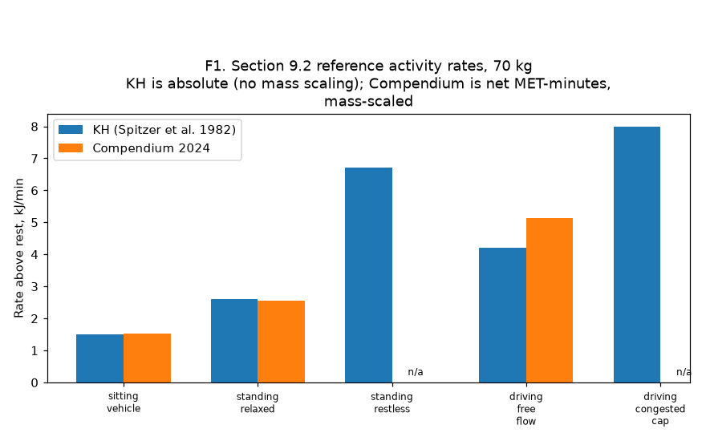
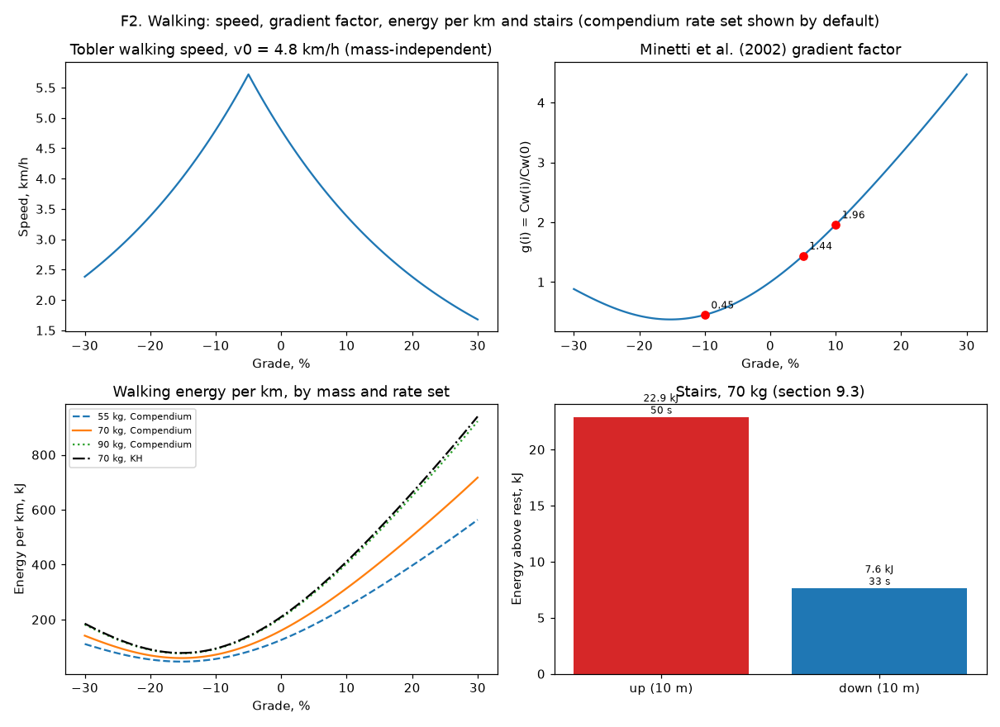
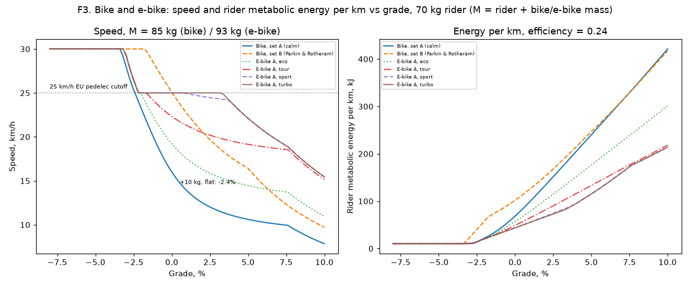
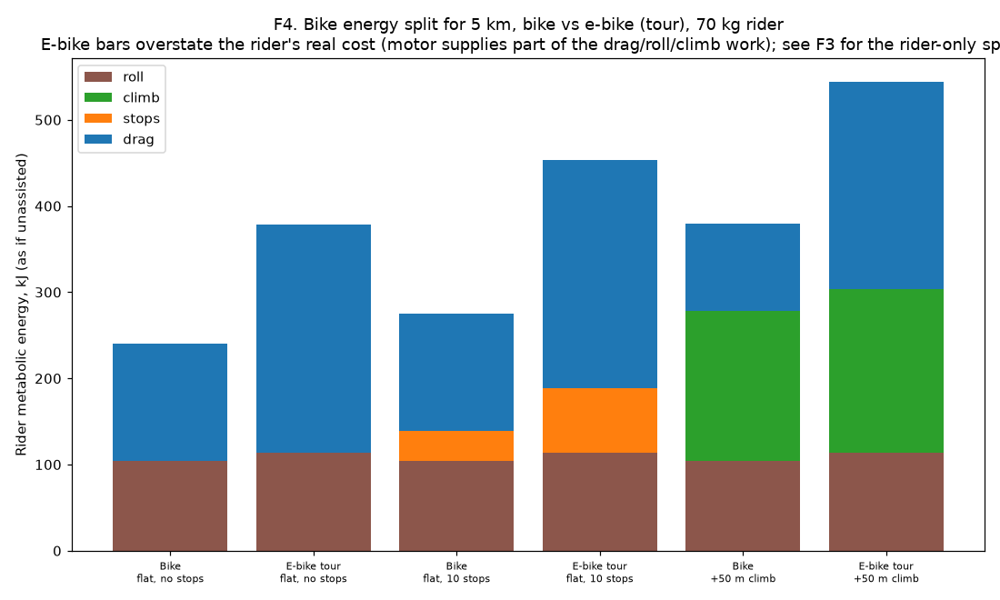
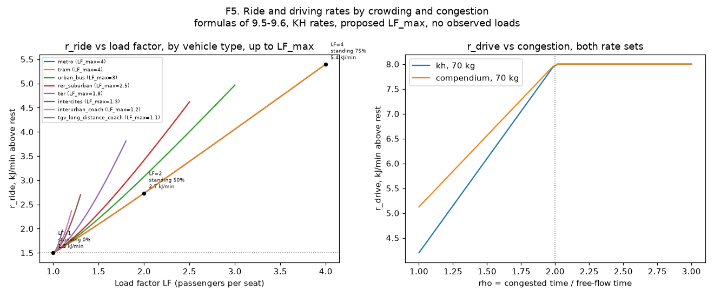
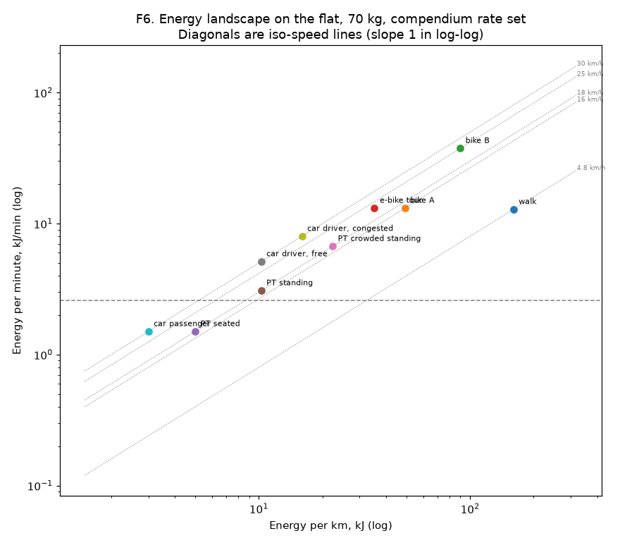
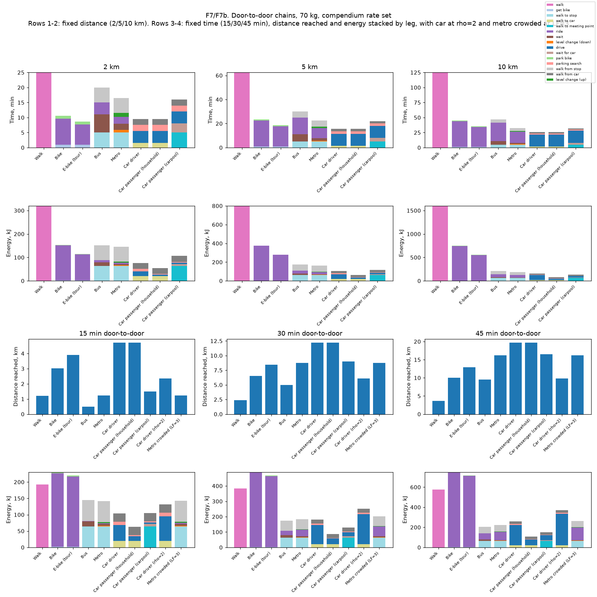
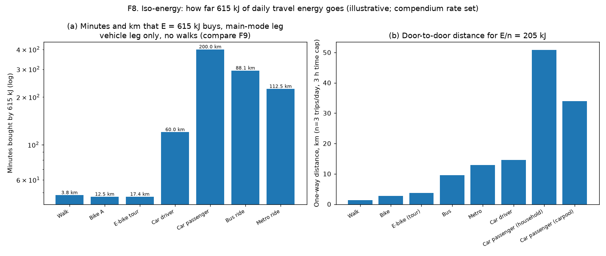
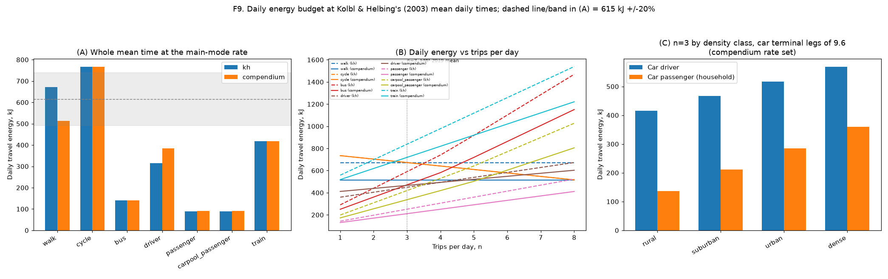
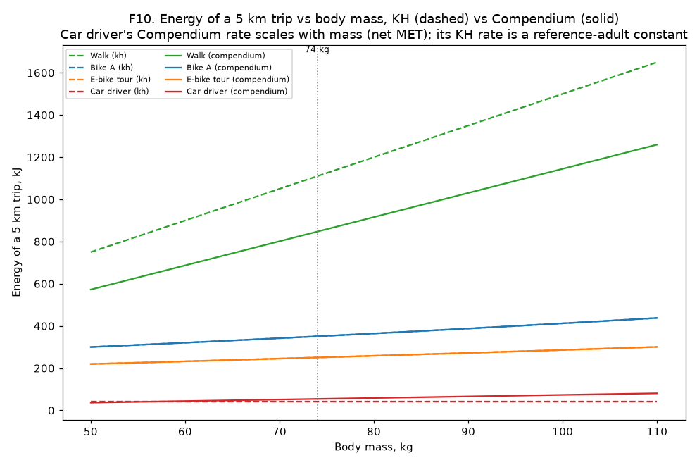

# Step 7 (`mobgrid/energy`): leg formula checks (section 9)

Generated by `python -m mobgrid.energy.checks`. No external data; mass = 70 kg (section 9.1 convention) unless a figure states otherwise; `config/energy.yaml` rate set = `compendium`.

**Check summary: 27 PASS, 0 FAIL, 10 COMPARE.**

## Check table

| Quantity | Expected (spec section) | Computed | Tolerance | Status |
|---|---|---|---|---|
| 9.2 rate, sitting_vehicle (KH) | 1.5 (9.2) | 1.500 kJ/min | +/-0.01 kJ/min | PASS |
| 9.2 rate, sitting_vehicle (Compendium) | 1.5 (9.2) | 1.537 kJ/min | +/-3% | PASS |
| 9.2 rate, standing_relaxed (KH) | 2.6 (9.2) | 2.600 kJ/min | +/-0.01 kJ/min | PASS |
| 9.2 rate, standing_relaxed (Compendium) | 2.6 (9.2) | 2.562 kJ/min | +/-3% | PASS |
| 9.2 rate, standing_restless (KH) | 6.7 (9.2) | 6.700 kJ/min | +/-0.01 kJ/min | PASS |
| 9.2 rate, driving_free_flow (KH) | 4.2 (9.2) | 4.200 kJ/min | +/-0.01 kJ/min | PASS |
| 9.2 rate, driving_free_flow (Compendium) | 5.1 (9.2) | 5.124 kJ/min | +/-3% | PASS |
| 9.2 rate, driving_congested_cap (KH) | 8.0 (9.2) | 8.000 kJ/min | +/-0.01 kJ/min | PASS |
| gradient factor g(+5%) | 1.44 (9.3) | 1.440 | +/-0.01 | PASS |
| gradient factor g(+10%) | 1.96 (9.3) | 1.960 | +/-0.01 | PASS |
| gradient factor g(-10%) | 0.45 (9.3) | 0.451 | +/-0.01 | PASS |
| 1 km flat walk, 70 kg (Compendium) | 160 kJ (9.3) | 160.300 kJ | +/-2% | PASS |
| 1 km flat walk, 70 kg (KH) | 211 kJ (9.3) | 210.000 kJ | +/-1% | PASS |
| stairs up, 10 m, 70 kg | ~22.9 kJ (9.3) | 22.890 kJ | +/-3% | PASS |
| bike speed change, +10 kg, flat, set A | -2.4% (9.7) | -2.384% | +/-0.3% | PASS |
| bike speed change, +10 kg, 5% climb, 100 W | -9.8% (9.7) | -9.828% | +/-0.5% | PASS |
| mechanical power, 16 km/h flat, M=85 kg | ~52.5 W (9.7) | 52.466 W | +/-2% | PASS |
| metabolic rate, 16 km/h flat, M=85 kg (work + unloaded) | ~18.2 kJ/min (9.7) | 18.241 kJ/min | +/-2% | PASS |
| one-stop energy, 16 km/h, M=85 kg | ~3.50 kJ (9.7) | 3.498 kJ | +/-2% | PASS |
| e-bike rider rate vs Compendium light support (tour) | 25.6 kJ/min (light, 6.0 MET) / 29.7 kJ/min (unassisted, 6.8 MET), 9.7 | 13.1 kJ/min (ebike_effort_factor=1.0, A7) | - | COMPARE |
| e-bike rider rate vs Compendium high support (sport) | 15.4 kJ/min (high, 4.0 MET) / 29.7 kJ/min (unassisted, 6.8 MET), 9.7 | 13.1 kJ/min (ebike_effort_factor=1.0, A7) | - | COMPARE |
| set B flat speed vs Parkin & Rotheram (2010) | ~22 km/h (85th percentile commuter) | 25.1 km/h | - | COMPARE |
| r_stand at LF=1 | 2.6 kJ/min (9.5) | 2.600 kJ/min | +/-0.01 kJ/min | PASS |
| r_stand at LF=LF_max (metro) | 6.7 kJ/min (9.5) | 6.700 kJ/min | +/-0.01 kJ/min | PASS |
| r_drive at rho >= rho_max | 8.0 kJ/min (9.6) | 8.000 kJ/min | +/-0.01 kJ/min | PASS |
| wait, h=10 min, CV=0.45 | 6.0 min (9.4) | 6.013 min | +/-0.05 min | PASS |
| 615 kJ in net MET-minutes, 70 kg | ~120 net MET-min (9.9) | 120.023 net MET-min | +/-3% | PASS |
| F9-A walking day (Compendium) | ~510 kJ (9.9) | 512.960 kJ | +/-5% | PASS |
| F9-A driving only (Compendium) | ~385 kJ (9.9) | 384.300 kJ | +/-5% | PASS |
| F9-A car passenger sitting only (Compendium) | ~90 kJ (9.9) | 90.695 kJ | +/-5% | PASS |
| F9-B total, walk (n=3, compendium) | ~615 kJ (9.9) | 513 kJ | - | COMPARE |
| F9-B total, cycle (n=3, compendium) | ~615 kJ (9.9) | 672 kJ | - | COMPARE |
| F9-B total, bus (n=3, compendium) | ~615 kJ (9.9) | 471 kJ | - | COMPARE |
| F9-B total, driver (n=3, compendium) | ~615 kJ (9.9) | 466 kJ | - | COMPARE |
| F9-B total, passenger (n=3, compendium) | ~615 kJ (9.9) | 211 kJ | - | COMPARE |
| F9-B total, carpool_passenger (n=3, compendium) | ~615 kJ (9.9) | 337 kJ | - | COMPARE |
| F9-B total, train (n=3, compendium) | ~615 kJ (9.9) | 719 kJ | - | COMPARE |

## Figures

## Provisional values used only in these figures

`config/energy.yaml` keeps every `null`/`TODO(confirm)` placeholder unchanged; the scenario numbers below (`checks.build_provisional`) are used only to draw these figures.

- Bike set A ("calm", 9.7 consistency check): P0 = 52.5 W, k = 37, Pmax = 200 W
- Bike set B (Parkin & Rotheram 2010 commuter): P0 = 150 W, k = 13.33, Pmax = 250 W
- Both sets: v_max,desc = 30 km/h
- Urban terminal legs: s_house=0.3, t_house=0.5 min, t_apartment=2 min, parking search=2 min, walk from car=2 min, get/park bike=1 min each, 2 bike stops/km
- PT access/egress walk (illustrative, not in the task's list): 400 m each way
- Bus: h=10 min, CV=0.45, ride=18 km/h
- Metro: h=4 min, CV=0.15, ride=30 km/h, station depth=15 m (escalator, >10 m)
- Car: 30 km/h urban; rho in [1.0, 1.5]
- Trips per day: n=3 (F9-B sweeps n=1..8)
- Carpool passenger (section 9.6, A5; `config.car.carpool_passenger`, TODO(confirm)): walk to a meeting point 5 min, wait standing 3 min
- Bike stop time (section 9.7, A3; `config.bike.stops`, TODO(confirm)): deceleration 1.5 m/s^2, acceleration 1 m/s^2, signal cycle 90 s, red time 40 s
- E-bike effort factor by level (section 9.7, A7; `config.bike.ebike.effort_factor_by_level`, TODO(confirm)): all 1.0 (no rider-effort reduction with more assistance yet)

## Modelling notes and simplifications

- F3/F4/F6/F7/F8/F9/F10's e-bike rider metabolic energy uses bike set A's rider power profile (scaled by the configured, still-1.0 `ebike_effort_factor`, A7) plus the configured pedelec assist factor and motor cap (section 9.7): rider effort does not yet fall with more assistance (F3's COMPARE rows against the Compendium's light/high-support MET values make this gap explicit).
- F4's e-bike roll/climb/stops/drag split is the unassisted-equivalent total, at efficiency only, split by s_r = P_r/(P_r+P_m) into a solid rider share and a hatched motor share (section 9.7, A2); F3/F7-F10 compute the rider's own metabolic cost directly from P_r and the achieved time instead.
- F7/F8/F9's PT legs use an illustrative access/egress walk (400 m each way), not given by the task, and an implied load factor (`1/(1-standing_share)`) from section 9.5's first-phase standing shares (A6), so the crowding-aware PT ride formula is used everywhere a PT rate is needed, not a seated-only rate.
- F9's "train" mode reuses the metro chain's terminal legs (access walk, escalator, wait) as a stand-in, with its own first-phase-standing-share main-mode rate, since section 9 gives no separate rail access/wait model (per the task's "Train: metro terminal legs"); its daily time is Kolbl & Helbing's own (153 min), but "carpool_passenger" is not one of their six modes, so its daily time is assumed equal to the household passenger's (59 min).
- Bike stops now cost time as well as energy (section 9.7, A3: deceleration + expected wait R^2/(2C) + acceleration), using `config.bike.stops`' not-yet-calibrated placeholders.
- F8(b) and the chains solve for distance/time exactly from each chain's two-point affine fit (`_affine_fit`), since every chain built by `build_chain` is exactly linear in distance.
- F9-C uses section 9.6's own per-density-class car terminal legs (`config.car.walk_to_car.apartment_min_by_density`, `parking_search_min_by_density`, `walk_from_car_min_by_density`), not the flat illustrative `provisional` scenario used elsewhere.
